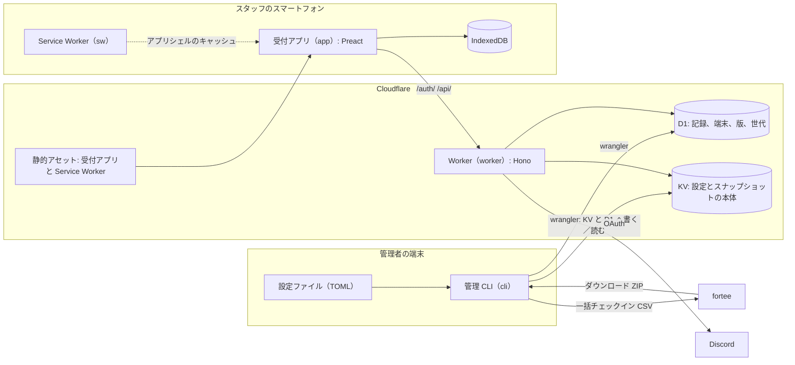
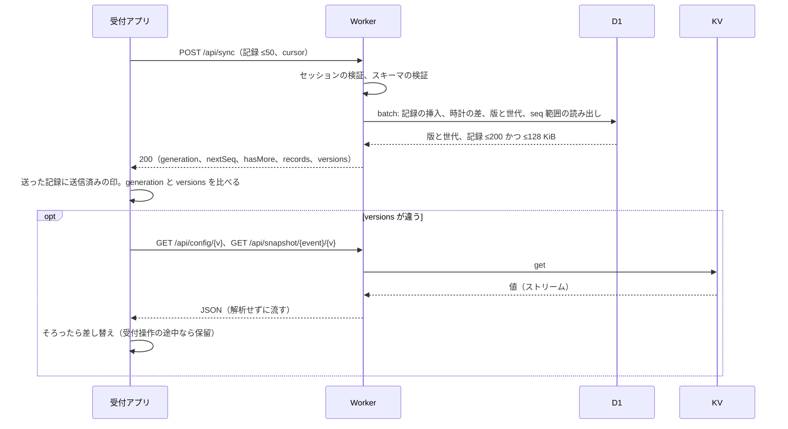

# Design Doc: fortee 連携チェックインシステム

## 1. はじめに

本書は、[PRD](prd.md) と[画面設計書](screen-design.md)が定める要件と画面を実現するアプリケーションの設計を定める。対象は、システム全体の構成要素とその境界、コードの層の分け方と依存の方向、受付アプリ・サーバ・管理 CLI それぞれの内部構成、層のあいだで共有するデータの形（設定、スナップショット、記録、同期の要求と応答、参考情報テンプレートの文脈）、そして PRD 12 章の未決事項と、[バックエンド](research/backend.md)の選定では決めなかった同期の設計の事項の決定である。

ホスティングと DB（バックエンド）、CSS・描画・ビルドの道具・記憶域・QR のデコード（[フロントエンド](research/frontend.md)）は選定済みで、選んだ理由、比べた候補、実測の値は research/ の各文書にある。本書は選んだ結果を前提に、何をどう作るかを書く。表と SQL、CSS の書き方、Service Worker の方式、テストの方針のように作りに属する事柄は本書が持ち、選定の文書には置かない。端末の挙動は[端末の挙動](research/device-behavior.md)の検証結果を事実として参照する。これらの文書と本書が食い違う場合は本書に従う。要件と画面は PRD と画面設計書が正であり、本書は変えない。本書が前提にした扱いのうち PRD と画面設計書に書かれていないものは、本書に挙げず、それぞれの文書に書く。開発に要る道具の導入、ローカルでの起動、環境の作成とデプロイ、保持期間の後の削除のコマンドは[開発・環境構築手順書](dev-setup.md)に置き、本書はその前提になる環境の構成（3.6）と版の扱い（9.5〜9.7）を定める。

### 1.1 本書で決めること、決めないこと

| 決めること | 決めないこと |
| --- | --- |
| 構成要素とデータの所在、信頼の境界（2 章） | 色、余白、フォントの値、動きの細部、フォーカスの見せ方（画面設計書）。6.12 は、それらを CSS に書く書き方だけを定める |
| コードの層、依存の方向とその強制、抽象化の置き方、リポジトリの構成、カンファレンスごとの環境（3 章） | 画面の要素と文言（画面設計書） |
| 層のあいだで共有する契約: 設定、スナップショット、記録、同期、テンプレートの文脈、時刻（4 章） | 関数名や引数名などコードの細部。本書に書く型は形を示すための略記で、実装がこの名前に従う必要はない |
| core、受付アプリ、サーバ、管理 CLI の内部構成と主要な流れ。受付アプリの非同期処理の反映順序（6.13）と、管理操作の重なりの扱い（8.8）を含む（5〜8 章） | テストケースの一覧（11 章は層ごとの方針にとどめる） |
| 識別子、時刻、セキュリティ、版と互換性など横断的な事項（9 章） | 選定に由来する構築時の確認の手順（バックエンド 8 章、フロントエンド 7 章、端末の挙動 12 章）。本書の設計から加わるものだけを 12 章に挙げる |
| PRD 12 章の未決事項と、選定では決めなかった同期の設計の事項（10 章） | 本番の ZIP でしか確かめられないこと（12 章に設計上の備えだけを書く） |

### 1.2 設計の方針

本書の判断は、次の 3 つの方針から導く。

- 規則と入出力を分ける。判定、受付の選択、チェックイン状態の集約、検索、テンプレートの描画といった規則は、DOM にも Workers にも Node.js にも依存しない純粋な関数として 1 か所（core）に置き、受付アプリ、サーバ、管理 CLI はその関数を呼ぶ薄い層にする。同じ規則を 3 つの実行環境で使う（FR-6, 9, 12〜16, 45, 46、PRD 7.2）ので、実装を 1 つにしないと 3 か所の食い違いが受付の結果の食い違いになるためである
- 境界で検証し、内側では型を信じる。設定ファイル、fortee の CSV、同期の要求と応答、端末の記憶域から読んだ値は、層の境界でスキーマに照らして検証し、通ったものだけを型の付いた値として内側に渡す。内側の関数は引数の形を疑わない。検証を境界に集めれば、どこで壊れた値が入ったかが境界の数だけで済むためである
- 抽象化は、差し替えの計画が実際にある箇所に限る。選定の文書が替え先を残している箇所（D1 から Turso、jsQR から barcode-detector、カメラを止めない予備案、ログインのワンタイムコードの予備案）には、差し替えが局所で済む継ぎ目を置く。それ以外には、将来に備えた間接層を置かない。3 つの実行環境のどれも実装は 1 つずつで、差し替えの計画がない間接層は、読む人が辿る段を増やすだけだからである（3.3）

## 2. 全体像

### 2.1 構成要素

PRD 5 章の要素を、次のコードのまとまりと実行環境に対応させる。



| PRD の要素 | コードのまとまり | 実行環境 | 担うこと |
| --- | --- | --- | --- |
| 受付アプリ | app、sw | iOS Safari と Android Chrome の PWA | 読み取り、判定、記録、検索、履歴、取り消し、受付の切り替え、同期、配布物の取得。判定と集約は core を呼ぶ |
| サーバ | worker | Cloudflare Workers（Hono） | Discord ログインとセッション、記録の受け取りと配布、設定とスナップショットの配布。規則を解釈せず、記録と配布物の中身を見ない |
| 管理操作 | cli | 管理者の端末の Node.js | 設定検証、取り込み、公開、書き出し、テンプレートのプレビュー、DB を戻した後の復旧。ほかに、マイグレーションとデプロイ（8.1）。集約と描画は core を呼ぶ |
| 設定ファイル | config/ | リポジトリ | カンファレンス、イベント、受付、検索と表示の列、テンプレート。CLI が検証して JSON に変換し、公開する |
| （共通） | core | 上記のすべて | 規則とスキーマ。実行環境の API を使わない |

Worker に判定を持たせず、記録と配布物の中身も解釈させないのは、受付が端末内で完結し（NFR-2）、Worker の CPU 時間が要求 1 件あたり 10 ms に限られる（バックエンド 5 章）ためである。Worker の仕事は、認証と、端末と DB のあいだでデータを受け渡すことにとどめる。

### 2.2 データの所在と正

| データ | 正の所在 | 複製 | 生成と更新 |
| --- | --- | --- | --- |
| 設定 | リポジトリの TOML | 公開した JSON（KV）、端末の IndexedDB | 管理者が編集し、CLI が検証して公開する。Worker は中身を見ない |
| スナップショット | KV（イベントと版ごと） | 端末の IndexedDB | CLI が ZIP から作って公開する。版はイベントごとの取り込み日時（FR-44） |
| 記録 | D1 の `records`（合流後） | 各端末の IndexedDB。端末は自分の記録と、受け取った他端末の記録を持つ | 端末が追記し、同期でサーバに集まる。削除も更新もしない（PRD 7.2）。DB を戻した後の復旧で、サーバの受信時刻をダンプの値に戻すのだけが例外である（8.6） |
| チケットのチェックイン状態 | （持たない） | 端末と CLI がそれぞれ記録から集約して求める | core の集約（5.3） |
| セッション | 署名付き Cookie（サーバに状態を持たない） | — | ログインで発行し、同期のたびに期限を延ばす。同期しないまま期限を過ぎると失効する（7.2） |
| 端末の設定、受付の手動の上書き、受信位置 | 端末の IndexedDB | — | 端末だけが持つ。同期しない |
| 端末の時計の差と受付アプリのリリース、スナップショットと設定の版、世代、環境名 | D1 | — | 同期、公開、復旧、マイグレーション（環境名。8.1）で更新する |

チェックイン状態をどこにも保存せず、毎回記録から求めるのは、PRD 7.2 が状態を記録からの導出として定めており、保存すると記録と状態の二重管理になるためである。端末の記録は数千件（バックエンド 3 章）なので、起動時に全件をメモリに読み、記録が増えるたびに集約し直しても表示は遅れない。

### 2.3 信頼の境界

| 境界 | 外側 | 内側 | 通すもの |
| --- | --- | --- | --- |
| fortee と本システム | fortee | 管理者の端末 | ダウンロード ZIP と一括チェックイン CSV のファイルだけ。本システムは fortee と通信せず、fortee の認証情報を持たない（NFR-7） |
| スタッフの認証 | インターネット | `/api/` 以下、スナップショット、設定 | 指定ロールを持つ Discord ユーザのセッション Cookie（7.2）。スナップショットはチケットトークンを含むので、認証の内側にだけ置く（PRD 7.1） |
| 管理者の認証 | スタッフ | D1 と KV の直接の読み書き | Cloudflare の API トークン（バックエンド 4 章）。Worker に管理用の API は作らない |
| 端末が送る値 | 端末 | D1 の記録 | 記録の端末 ID、操作者 ID と表示名は、端末が送った値をそのまま保存し、セッションの値と照合しない（9.1） |

端末が送った操作者を照合しないのは、DB を以前の時点に戻した後に、端末が持つ他端末の記録も送り直して回収する（バックエンド 7.2）ためである。照合すると、他端末の記録が送り直せない。記録を送れるのはセッションを持つスタッフの端末に限られるので、なりすましの範囲はスタッフの内側にとどまり、これを受け入れる。

## 3. コードの層と依存の方向

### 3.1 層

コードを次の 5 つの層に分ける。規則を受付アプリ、Worker、管理 CLI で共有するため、実行環境に依存しない core を置く（1.2）。Service Worker を独立した層にするのは、実行環境（WebWorker）と型の設定が受付アプリと異なり、依存をビルドで埋め込む一覧だけに限りたいためである。

| 層 | 中身 | 実行環境と型の設定（`lib`、`types`） | 依存してよい層とライブラリ |
| --- | --- | --- | --- |
| core | スキーマと型（4 章）、判定、受付の選択と提案、集約、検索、テンプレートの描画、時刻の整形、同期の状態の優先順（5 章） | どれにも依存しない（`lib: ["ES2023"]` のみ。DOM、Workers、Node.js の型を含めない） | zod と mustache.js（4.6） |
| app | 画面、状態、操作、カメラ、音、同期、IndexedDB（6 章） | ブラウザ（`lib: ["DOM"]`） | core、Preact、@preact/signals、idb、jsQR |
| sw | Service Worker（6.11） | WebWorker（`lib: ["WebWorker"]`） | なし。キャッシュするファイルの一覧はビルドで埋め込む |
| worker | ルート、セッション、同期、配布（7 章） | Cloudflare Workers（`@cloudflare/workers-types`） | core、Hono |
| cli | コマンド、ZIP と CSV と QR 画像の処理、wrangler の呼び出し（8 章） | Node.js（`@types/node`） | core、smol-toml、fflate、csv-parse、pngjs、jsQR |

### 3.2 依存の方向の強制

依存の方向は、レビューではなく型検査と lint で守る。

- TypeScript の project references で層ごとに `tsconfig` を分け、`references` に依存してよい層だけを書く。core の `tsconfig` は `lib` を ES2023 に限るので、core から `document` や `D1Database` を参照すると型検査が失敗する。app から worker を参照すると、`references` にないので解決できない
- ESLint の `no-restricted-imports` で、`src/core/` の中から `src/core/` の外への import と、app・worker・cli のあいだの import を禁じる。相対パスでほかの層を読む import は型検査でも止まる（下記）が、lint は、層ごとに依存してよいライブラリ（3.1）と、app の中の層の向き（6.1）も、同じ規則で止める
- core のテストは Node.js で動かし、DOM のモックを入れない。モックが要る関数が core にあれば、それは層の誤りである
- 層ごとの `tsconfig` には `composite` を付ける。`composite` があると、`include` にも `references` にもないファイルの import が誤りになり、相対パスでほかの層を読む import も型検査で止まる。誤りがあるときは宣言ファイルを出さない（`noEmitOnError`）。出すと、層をまたぐ import の誤りがあるビルドが、出力先ではなく `src/` の中に宣言ファイルを書く（12.1）
- 相対パスの import には拡張子（`.ts`、`.tsx`）を付け、型を消すだけで動く構文に限る（`erasableSyntaxOnly`。`enum` などを使わない）。こうすると、Node.js が CLI の TypeScript をそのまま実行でき（8.1）、Vite が設定ファイルとそこから読むファイルを、変換せずに読み込める。Vite 8.3.5 は、設定ファイルから辿る import に拡張子がないと、将来の既定の読み込み方では動かないと警告する
- 動的な `import()` は、`src/` では使わず、lint で止める（`no-restricted-syntax`）。`no-restricted-imports` が見るのは、静的な import と `export ... from` だけである。動的な import は、同じ層の `tsconfig` の中のファイルなら型検査も通るので、app の中の層の向き（6.1）と、依存してよいライブラリの検査をすり抜ける（12.1）
- core が現在時刻と乱数を自分で読むこと（`Date.now()`、引数のない `new Date()`、`Math.random()`）も、lint で止める。core の関数は引数だけから結果を決める（5 章）が、これらは `lib` を ES2023 に限っても型検査を通る
- lint の規則が違反を検出することは、違反の例を ESLint に通すテストで確かめる（11 章）。規則の正規表現を変えたときに、強制が外れたことに気付けるようにするためである

### 3.3 抽象化のバランス

1.2 の 3 つ目の方針を、継ぎ目を置く箇所と置かない箇所に分けて示す。継ぎ目とは、差し替えるときに書き換える範囲を 1 つのモジュールか 1 つの型に閉じ込めることをいい、インターフェイスと複数の実装を最初から用意することではない。

継ぎ目を置く箇所:

| 箇所 | 差し替えの計画 | 継ぎ目の形 |
| --- | --- | --- |
| Worker の DB アクセス（7.5） | D1 の位置が問題になれば Turso に替える（バックエンド 9 章） | SQL 文と、文を実行する関数を 1 つのモジュールに置く。Turso も同じ SQLite の SQL なので、替えるのは実行する関数だけになる |
| QR のデコード（6.8） | 読み取りが遅ければ barcode-detector に替える（フロントエンド 6 章） | 「画像を受け取り文字列か null を返す」関数の型 1 つ。呼び出し側はこの型だけを知る |
| カメラ（6.8） | 再開のたびに許可を求められる端末があれば、結果の間も止めない予備案に替える（画面設計書 6.2） | 開始・停止・一時停止をカメラのサービスの内側に閉じ、画面の状態はサービスに「読み取り中か」だけを伝える |
| ログインのルート（7.2） | 既定のブラウザに着く経路が見つかれば、ワンタイムコードの手順を加える（端末の挙動 3.4） | 認可の開始とコールバックを独立したルートにし、開始記録の表を足せば済む形にする |
| 設定ファイルの形式（4.2） | — | TOML を読むのは CLI の 1 モジュールだけにし、ほかは検証済みの JSON を扱う。形式を変えても CLI のその部分だけが変わる |
| 端末の記憶域（6.3） | リハーサルモード（FR-50）では、記録だけをメモリに置く | idb の呼び出しを 1 モジュールに閉じ、テストでは fake-indexeddb に差し替える。操作（commands）は、書き込みの関数をまとめた 1 つの型（`Store`）を通して使う。実装は、IndexedDB のものと、その記録の関数だけをメモリに替えたものの 2 つである |

置かないもの:

| 置かないもの | 置いた場合に本件で増えるもの |
| --- | --- |
| DI コンテナ | 注入先は実行環境ごとに 1 つずつしかなく、テストは引数で渡せば足りる。登録と解決のコードと、どこで実体が決まるかを追う手間が増える |
| 端末と Worker に共通の Repository インターフェイス | 端末の記憶域（全件をメモリに読む）と Worker の D1（連番の範囲を読む）は読み書きの形が違い、共通のインターフェイスを切っても実装は 1 つずつになる。端末の記憶域の型（上の表）は、端末の中で実装が 2 つあるので置く。行数と CPU 時間の条件（バックエンド 5 章）を抽象の下に隠すと、条件を守れているかが文から読めなくなる |
| UseCase や Interactor のクラス | 操作は、読み取りからの判定、検索からのチェックイン、取り消し、受付の切り替え、同期、ログアウトの 6 つほどで、それぞれ 1 つの関数で書ける（6.1） |
| ORM、クエリビルダ | 文は 7.3 の 4 文と、公開・書き出し・復旧の数文に限られ、CPU 時間の条件のために文を手で書く |
| 画面のルータ | 画面は URL ではなく状態で切り替える（6.9）。Android の戻る操作を受け取るために History API のエントリを 1 つ使うだけで、URL と画面の対応表を持たない（6.9） |
| 状態管理ライブラリ（Redux など） | 多くの画面が読む状態は Signals で共有できる（フロントエンド 4 章）。操作ごとの reducer と action の型が増える |
| イベントソーシングの汎用の基盤 | 記録からの集約は PRD 7.2 の 1 つの規則で、1 つの関数になる（5.3） |
| Node.js で動く道具ごとのディレクトリ（`src/cli/admin/` など）、役割の名前の層（`src/admin/` など） | Node.js で動く道具は管理 CLI の 1 つだけで、機能はサブコマンドとして足せる（8.1）。別の実行ファイルが要るようになったら、`src/cli/` の下を道具ごとに分け、共有するものを直下に残す。層は増やさない。共有するものの切り分けは 2 つ目の道具の中身で決まるので、先に分けても、そのときに組み替え直すことになる |
| 多言語対応、テーマの切り替え | NFR-5、画面設計書 1.2 |

### 3.4 リポジトリの構成

パッケージの根は、リポジトリの `fortee-reception/` である。リポジトリには、fortee に関わるほかの道具も置くので、パッケージをリポジトリの直下には置かない。本書と手順書のパスとコマンドは、このディレクトリを基準にする。リポジトリをほかの道具と分け合うことで決まる、リリースのタグの名前と `deploy` の検査の範囲は、8.1 にある。

1 つの npm パッケージに 5 つの層を置く。層ごとにパッケージを分けないのは、公開するライブラリがなく、依存の方向は 3.2 の仕組みで守れるためである。

```text
package.json          1 つのパッケージ。scripts に dev、test、test:e2e、typecheck、lint、admin を置く。admin は管理 CLI（8 章）を実行する。ビルドとデプロイは admin の deploy（8.1）
tsconfig.json         project references の親
tsconfig.base.json    全層に共通の設定
tsconfig.core.json    層ごとの設定（app、sw、worker、cli も同様）。ほかに、ビルドの道具（build）とテスト（test、test-worker）の設定
vite.config.ts        受付アプリ、Service Worker、Worker のビルド（3.5）
vitest.config.ts      層ごとのテストのプロジェクト（11 章）
playwright.config.ts  画面のテスト（11 章）
eslint.config.js      依存の方向（3.2）と CSS のクラス（6.12）の lint
index.html            受付アプリの殻の HTML
wrangler.jsonc        Worker、静的アセット、D1 と KV のバインディング。最上位はローカルの開発用、env はカンファレンスの環境ごと（3.6）
migrations/           D1 のマイグレーション
config/               設定ファイル（TOML）。`<環境名>.toml` がその環境の設定（3.6）
build/                ビルド時の埋め込みを行う Vite のプラグイン（6.11）
src/core/             3.1 の層
src/app/
src/sw/
src/worker/
src/cli/
test/                 層ごとのテストと、フィクスチャ。fortee の ZIP は、調査（research/fortee/）の記述から合成したものをテストのコードで作る（11 章）
docs/                 文書
.dev.vars             ローカルの開発で Worker に渡す秘密。コミットしない（3.6）。名前の一覧は .dev.vars.example に置いてコミットする
.work/<環境名>/        CLI が取り込みの出力などを置く作業ディレクトリ。環境ごとに分ける。コミットしない
```

npm のスクリプトの名前は、使う人から見た役割で付ける。層の名前（3.1）とは揃えないので、管理 CLI は `src/cli/` にあり、`npm run admin` で実行する。

リポジトリは create-cloudflare などの雛形から始めてよい。雛形から取り込むのは、`wrangler.jsonc`、Workers 向けの tsconfig、Vite プラグインの配線といった設定の部分で、残す形は本節の構成に合わせる。雛形の構成（React、`src/index.ts` に置いた Worker、`public/` など）は持ち込まず、生成された依存の版は 14 章と突き合わせる。雛形が生成するのは設定の組み合わせであって本節の構成ではないので、精査して削るより、設定を本節の形に移す作業になる。

### 3.5 ビルドと配信

言語は TypeScript で、型の検査は tsc で全層をまとめて行う。ビルドは Vite に Cloudflare の Vite プラグインを組み合わせ、受付アプリ、Service Worker、Worker を 1 つのプロジェクトでビルドする（選定の理由はフロントエンド 5.1）。`vite build` が受付アプリを静的アセットとして出力し、出力する wrangler の設定に静的アセットのディレクトリを書き込む。デプロイは、その後に `wrangler deploy` を実行する。どのカンファレンスの環境に向けてビルドするかは、ビルドのときに環境名で選ぶ（3.6）。ビルドとデプロイは CLI の `deploy` が 1 つのコマンドで行い（8.1）、手で `vite build` と `wrangler deploy` を分けて実行しない。開発中も同じオリジンから静的アセットと `/auth/`、`/api/` を返せるので、Discord のコールバックと Cookie の扱いを本番と同じ形で試せる。`/auth/` と `/api/` 以下を静的アセットより先に Worker で処理する設定は 7.1 にある。

フロントエンド 7 章の確認でプラグインが構成に合わないと分かった場合は、Vite で受付アプリだけをビルドして wrangler の静的アセットのディレクトリに書き出し、Worker は wrangler でビルドする。

### 3.6 カンファレンスごとの環境

1 つのデプロイは 1 つのカンファレンスを扱う（PRD 3.1）。本書では、1 つのカンファレンスのために作る Worker、D1、KV、秘密、設定ファイル、作業ディレクトリの組を、そのカンファレンスの環境と呼ぶ。開発用と検証用の環境を常に設けることはしないが、開発と実機の確認のために、確認用の環境を別に作ってもよい（後述）。

環境は、そのカンファレンスのためだけに作り、次の順に進んで、保持期間（PRD 7.4）の後に削除する。環境を次のカンファレンスに使い回さない。次のカンファレンスでは、新しい環境を作り、そのときのコードをデプロイする。前のカンファレンスの Worker、D1、KV、オリジンを引き継ぐものがないので、カンファレンスをまたぐ互換性は保たない（9.6）。

| 段階 | 行うこと | 節 |
| --- | --- | --- |
| 作る | Worker、D1、KV、秘密、設定ファイルを用意し、デプロイする | [本番環境構築手順書](production-setup.md) |
| 運用の開始 | 本番の設定と本番の ZIP を公開し、本番のチケットの受付を始める。来場者の受付の前に、スタッフ自身のチケットで受付の手順を通す。以後、記録を消さない | 後述、PRD 9 章 |
| 受付 | 来場者を受け付ける | PRD 9 章 |
| 最終の書き出し | 記録を書き出し、fortee に反映する | 8.5、PRD 9 章 |
| 削除 | 保持期間の後に、Worker、D1、KV、秘密と、管理者の端末のファイルを消す | 8.9 |

環境には、そのカンファレンスの fortee のスラッグを名前として付ける（以下、環境名。例 `yapc-tokyo-2026`）。環境名から、次の対応が決まる。

| 対象 | 環境ごとの値 | 置き場所 |
| --- | --- | --- |
| Cloudflare のアカウント | 環境ごとに指定する。複数の環境で同じアカウントを使ってもよい（後述） | `wrangler.jsonc` の `env.<環境名>.account_id` |
| Worker | `checkin-<環境名>` | `env.<環境名>.name` |
| オリジン | `https://checkin-<環境名>.<アカウントのサブドメイン>.workers.dev`。スタッフの端末を準備する前に決め、以後は変えない（バックエンド 2.2） | Worker の名前とアカウントから決まる |
| D1 | 環境ごとに 1 つのデータベース。名前は `checkin-<環境名>` | `env.<環境名>.d1_databases` |
| KV | 環境ごとに 1 つの名前空間 | `env.<環境名>.kv_namespaces` |
| 設定ファイル | `config/<環境名>.toml`。`conference.environment` に環境名を書く（4.2） | リポジトリ |
| Discord の OAuth のコールバック | すべての環境とローカルの開発で、同じ Discord のアプリケーションとギルドを使う。各環境の `<オリジン>/auth/discord/callback` を、そのアプリケーションのリダイレクト URI に登録する | Discord の開発者画面 |
| 秘密 | `DISCORD_CLIENT_ID`、`DISCORD_CLIENT_SECRET`、`DISCORD_GUILD_ID`、`DISCORD_ROLE_IDS`（カンマ区切り）、`SESSION_SECRET`。ギルド ID とロール ID は設定ファイルに書かない（FR-5）。`SESSION_SECRET` は、暗号論的疑似乱数で生成した 32 バイトの値にする | その環境の Worker の secret |
| 管理 CLI の実行対象 | `--env <環境名>` で指定する。既定値を持たない | CLI の引数 |
| 作業ディレクトリ | `.work/<環境名>/` | 管理者の端末 |
| 配っている版 | その環境に最後にデプロイしたリリース（9.5） | デプロイの記録（`wrangler deploy --message`） |

`wrangler.jsonc` の最上位はローカルの開発だけに使い、D1 と KV の ID には実在しない仮の値を置く。カンファレンスの環境の値は、すべて `env.<環境名>` に書く。こうすると、`--env` を付け忘れた wrangler のコマンドは、どのカンファレンスの D1 と KV にも届かずに失敗する。バックエンド 8.2 が注意する「`--env` を付けないコマンドは最上位の設定で動く」性質を、取り違えの防止に使う形である。

```jsonc
{
  // 最上位: ローカルの開発用。リモートの資源を指さない
  "name": "checkin-local",
  "d1_databases": [{ "binding": "DB", "database_name": "checkin-local", "database_id": "local" }],
  "kv_namespaces": [{ "binding": "KV", "id": "local" }],
  // main、compatibility_date、assets など、環境で変わらない項目もここに書く
  "env": {
    "yapc-tokyo-2026": {
      "name": "checkin-yapc-tokyo-2026",
      "account_id": "<アカウント ID>",
      "d1_databases": [{ "binding": "DB", "database_name": "checkin-yapc-tokyo-2026", "database_id": "<D1 の ID>" }],
      "kv_namespaces": [{ "binding": "KV", "id": "<KV の名前空間の ID>" }]
    }
  }
}
```

複数の環境で同じ Cloudflare のアカウントを使うかは、環境を作るときに決める。同じアカウントに置くと、Worker の要求数と D1・KV の日次の上限を環境のあいだで分け合い（バックエンド 7.1）、API トークンもアカウントの全 D1 と全 KV を操作できる（バックエンド 4 章）。受付の期間が重なる環境を同じアカウントに置くときは、3 章の見積もりを環境の数だけ足して上限と比べる。

#### 取り違えと混入を防ぐ仕組み

カンファレンスを取り違えた公開と、別のカンファレンスの作業データの混入は、次の照合で止める。どれも、1 つの値を指定すれば残りが決まる形にしたうえで、食い違いを見つけたら書く前に止めるものである。

| 照合 | 防ぐこと |
| --- | --- |
| CLI のすべてのコマンドとデプロイ（8.1）は `--env` を必須にし、wrangler の env、作業ディレクトリ、既定の設定ファイルをそこから決める | 対象の指定が複数の場所に分かれ、一部だけを取り違えること |
| 設定ファイルの `conference.environment` が `--env` と一致しなければ止める | 別のカンファレンスの設定を公開し、それを埋め込んでビルドすること |
| D1 の `meta.environment` と、KV のキー `environment` に環境名（環境の印）を置き、`--env` と一致しなければ止める。印は `migrate` が、ないほうに書く。ほかのコマンドは、印がなければ止まる（8.1） | `wrangler.jsonc` の env に別の環境の D1 か KV の ID を写し間違えること。KV を取り違えたまま公開すると、公開の後の掃除（8.4）が別の環境の配布物を消す |
| 取り込みで、`Ticket url` と go-profile の URL のスラッグが `conference.slug` と一致しなければ止める（8.3） | 別のカンファレンスの ZIP を取り込むこと |
| 作業ディレクトリを環境ごとに分け、公開は設定のイベント ID のスナップショットだけを読む（8.4） | 別の環境のために取り込んだスナップショットを公開すること |

#### 運用の開始と、消さない記録

環境の記録の扱いは、運用の開始を境に変わる。運用の開始とは、その環境に本番の設定と本番の ZIP を公開し、本番のチケットの受付を始める時点をいう。この時点から保持期間の後の削除（8.9）まで、記録を消さない。本番のチケットの記録は、どれも書き出しと fortee への反映に含めるためである。来場者の受付の前には、スタッフ自身のチケットを受付と同じ手順で受け付けて、端末の準備から fortee への一括チェックインまでを通しておく（PRD 9 章の 2）。

| 時期 | 扱い |
| --- | --- |
| 運用の開始より前 | 記録を引き継がない。D1 と KV を作り直してよい。同期プロトコルの版、形式の版、IndexedDB の形、マイグレーションのファイルを変える変更もデプロイできる（9.6） |
| 運用の開始から、保持期間の後の削除まで | 記録を消さない。記録を消す操作は、DB を戻す復旧（8.6）だけである。D1 を作り直さない。デプロイは 9.6 と 9.7 の条件に従う |

カンファレンスの環境に、Sandbox や合成のデータを公開して確認に使った場合は、運用の開始の前に D1 と KV を作り直し、そのオリジンで受付アプリを使った端末はログアウトする。D1 には試験の記録と端末の表が、KV には試験で公開した配布物が残っているためである。端末のログアウトが要るのは、端末にも試験の記録が残っているためである。DB の世代（9.5）は初期のマイグレーションが乱数で作るので、作り直した D1 は世代が変わる。端末は、世代の変化を知ると、持っている記録をすべて送り直す（4.5、6.13）。ログアウトしていない端末が同期すると、試験の記録が、作り直した D1 に入る。ログアウトは端末のデータを消す（FR-37）。

開発と実機の確認には、Sandbox のカンファレンス用に、確認用の環境を別に作って使ってもよい。カンファレンスの環境に試験のデータを載せなければ、作り直しとログアウトの漏れで試験の記録が受付の記録に混ざることがないためである。確認用の環境も、使い終えたら 8.9 と同じ手順で削除する。受付をする環境と同じアカウントに残すと、要求数と D1・KV の日次の上限を分け合う（バックエンド 8.1）ためである。D1 に試験の記録を書く確認と、DB を戻す試験（12 章、バックエンド 8.1）は、運用を始める前の環境か、確認用の環境で行う。

運用の開始後は、試しのチェックインも本番の記録として残り、書き出しと fortee への反映に含まれる。試しの記録を見分ける印や、記録を消して運用を始め直す操作は置かない。誤ったチェックインは、取り消しの記録で打ち消す（FR-29）。

受付の練習には、受付アプリのリハーサルモード（FR-50、6.3）を使う。リハーサルモードの間の操作は、メモリの記憶域にだけ置き、記録として IndexedDB にも D1 にも入らないので、上の決定を変えない。試しの記録を見分ける印も、記録を消す操作も、置いていない。本番の記録は、リハーサルモードの出入りで変わらない。

#### ローカルの開発との関係

ローカルの開発は、どのカンファレンスの環境とも接続しない。`vite dev` は `wrangler.jsonc` の最上位の設定で動き、D1 と KV はローカルの模擬環境（Miniflare）の、`.wrangler/state` 以下のデータを使う。リモートの資源を開発サーバから使う設定（リモートのバインディング）は使わない。CLI の `--env local` は、wrangler を `--local` で呼び、同じローカルのデータを読み書きする。秘密は `.dev.vars` から渡す。Discord は本番と同じアプリケーションとギルドを使い、`http://localhost:<ポート>/auth/discord/callback` をリダイレクト URI に加える。`.dev.vars` には本番と同じクライアントシークレットが入るが、開発者が手元の秘密を善良に管理する（コミットせず、ほかの場所に写さない）ことを前提とし、そのための仕組みは置かない。

スマートフォンでの確認は、ローカルではなく、デプロイした環境（カンファレンスの環境か、確認用の環境）で行う。カメラは安全なコンテキストでしか使えず、LAN の IP アドレスへの `http://` の接続はそれに当たらない（端末の挙動 10 章）ためである。運用を始めた後の環境で試しにチェックインすると、その記録も本番の記録として残る（上記）。Sandbox の設定と ZIP は、運用を始めた後の環境には公開しない。Sandbox のチケットの記録も消せずに残り、書き出しのたびに、スナップショットにない参加者の記録の警告（8.5）に出るためである。

## 4. 共有する契約

層のあいだを渡るデータは、core にスキーマとして定義し、そこから TypeScript の型を導く。スキーマと型を別々に書かないのは、両者がずれると検証を通った値の形と関数が仮定する形が食い違うためである。

### 4.1 スキーマの書き方

スキーマは zod（`zod/mini`）で書く。zod を選ぶのは、利用者と文書が多く（フロントエンド 2.1 の選定の条件と同じ）、スキーマから型を導く書き方が標準的で、`zod/mini` なら受付アプリに同梱する大きさを抑えられるためである。Worker では同期の要求（記録 50 件まで）を検証するだけなので、CPU 時間の条件（バックエンド 5 章）に収まる見込みである。収まらなければ valibot に替える（12 章）。`zod/mini` は検証の文言を持たず、設定しなければ、どの誤りも `Invalid input` になる（12.1）。誤りを人が読む管理 CLI とビルドは、入口で日本語の文言を設定する。受付アプリと Worker は、検証の成否と誤りの場所だけを使うので、設定しない。設定する関数は、受付アプリが読まない core のモジュールに置き、殻の大きさを増やさない。

スキーマを使う境界は次のとおりである。内側の関数は、これらの境界を通った型の値だけを受け取る。

| 境界 | 検証するもの | 失敗したときの扱い |
| --- | --- | --- |
| CLI が設定ファイルを読むとき | TOML を解析した値（4.2） | 設定検証の誤りとして、見つかった誤りをすべて列挙して止める（FR-4） |
| CLI が CSV を読むとき | ヘッダと各行の値（FR-43、8.3 の表） | 取り込みを止める |
| 受付アプリが記録を作るとき | 作った記録（4.4） | 記録を保存せず、想定外のエラーとして S99 に移る。自由記述の長さは画面が入力で止める（画面設計書 S08-M1）ので、通らないのは実装の誤りである。上限を超える記録を保存すると、その記録を含む同期が 400 で拒まれ続け、未送信の記録は作った順に送る（6.6）ので、後に作った記録も送れなくなる |
| Worker が同期の要求を受けたとき | 要求の全体（4.5） | 400 を返す。記録を 1 件も保存しない（7.3） |
| 受付アプリがサーバの応答と配布物を受けたとき | 応答、設定、スナップショット。配布物は形式の版（`format`。9.5）が読める版かも見る | 同期の失敗として扱い、端末のデータを変えない |
| 受付アプリが IndexedDB から読むとき | 保存してある設定、スナップショット、記録 | スキーマに合わなければ、想定外のエラーとして S99 に移る（6.3） |

### 4.2 設定ファイルと公開する設定

設定ファイルは TOML で書く。候補のうち JSON はコメントと複数行の文字列を書けず、YAML はインデントの誤りが値の構造の誤りになる。TOML は、受付のような表の配列を `[[receptions]]` で、テンプレートを複数行の文字列で、期間の日時をローカル日時型でそのまま書ける。解析には smol-toml を使う。

TOML を読むのは CLI だけである。CLI は検証して JSON に変換し、公開する（8.4）。受付アプリはこの JSON だけを読み、Worker は中身を解釈せずに配る。この分担にするのは、受付アプリに TOML の解析を同梱せずに済み、設定とスナップショットを 1 回の公開でそろえられるためである（9.4）。TOML と JSON のキーは同じ名前（camelCase）にし、変換表を持たない。

PRD 11 章の YAPC::Tokyo 2026 の例を TOML で書くと次の形になる。時刻は例である。

```toml
[conference]
slug = "yapc-tokyo-2026"
name = "YAPC::Tokyo 2026"
timezone = "Asia/Tokyo"
environment = "yapc-tokyo-2026"   # 公開先の環境名（3.6）

[[events]]
id = "8b2e79c9-9301-4dca-ac12-7b686a1ec85e"
name = "本編"
key = "main"                 # テンプレートと設定の中でイベントを指す短い名前（FR-1）。省略すると id で指す

[[events]]
id = "87e485da-0d45-432b-9943-4a5a3728bb2b"
name = "前夜祭"
key = "eve"

[[events]]
id = "78db606a-1e93-41b9-a531-7791dd68eee0"
name = "懇親会"
key = "party"

[[events]]
id = "64478c06-1fb2-4286-a7ab-32d0b2c9f350"
name = "託児所"
key = "nursery"              # どの受付も受け付けない。設定に入れて取り込んでおくと、託児所の QR を「対象外のチケット」と案内できる（下記）

[[receptions]]
id = "eve"                   # 記録に残す識別子（9.1）。表示名を変えても記録は壊れない
name = "前夜祭受付"
periods = [{ start = 2026-11-27T17:30:00, end = 2026-11-27T21:00:00 }]
accept = ["eve", "main"]
require = ["eve"]
checkin = ["eve", "main"]
rejectMessage = "前夜祭チケットがありません。本編の受付は明日からです"

[[receptions]]
id = "main"
name = "本編受付"
# 期間は日中だけにする。夜間まで含めると定期の同期（6.6）が続き、バックエンド 3 章の要求数の見積もり（1 日 12 時間）を超える。
# 懇親会の後に来た人は、提案（FR-9）から本編受付に切り替えて受け付ける。
# 期間は開始を含み、終了を含まない。11/28 の 17:30 の終了と、懇親会受付の 17:30 の開始は重ならない
periods = [
  { start = 2026-11-28T09:30:00, end = 2026-11-28T17:30:00 },
  { start = 2026-11-29T09:30:00, end = 2026-11-29T18:00:00 },
]
accept = ["main"]
require = ["main"]
checkin = ["main"]
rejectMessage = "本編チケットがありません"

[[receptions]]
id = "party"
name = "懇親会受付"
periods = [{ start = 2026-11-28T17:30:00, end = 2026-11-28T20:30:00 }]
accept = ["party"]
require = ["party"]
checkin = ["party"]
rejectMessage = "懇親会チケットがありません"

[search]
# columns の既定は ["ticketNo", "userName", "name"]（FR-1）。書けば置き換える
[[search.answers]]
event = "main"
field = "スピーカー名札に記載するお名前"   # fortee のフォーム項目名そのもの（CSV の列名）

[[display.answers]]
event = "main"
field = "Tシャツのサイズ"
key = "tshirt"               # テンプレートから参照する名前。省略すると field で参照する。「.」と空白は使えない（4.6）

[[display.ticketTypes]]
event = "main"
types = [                    # fortee のチケット種別名そのもの（スナップショットの ticketType）。1 つの key に複数の種別をまとめられる
  "【カンファレンス本編】一般チケット",
  "【カンファレンス本編】一般チケット（特別請求）",
]
key = "general"              # テンプレートから {{#typeIs.general}} で参照する名前（4.6）

[[display.ticketTypes]]
event = "main"
types = ["【カンファレンス本編】スタッフチケット"]
key = "staff"

[template]
reference = """
<h3>{{user.userName}} さん</h3>
{{#byEvent.main}}
<p>本編 {{ticketNo}} {{ticketType}}{{#done}}（済 {{doneAt}}）{{/done}}</p>
<ul>
{{#typeIs.general}}
<li>ネームカード: 一般。Tシャツあり</li>
{{/typeIs.general}}
{{#typeIs.staff}}
<li>ネームカード: スタッフ。Tシャツはスタッフ控室で</li>
{{/typeIs.staff}}
{{#answers.tshirt}}
<li>Tシャツ: <b>{{answers.tshirt}}</b></li>
{{/answers.tshirt}}
</ul>
{{/byEvent.main}}
{{^byEvent.main}}
<p>本編チケットなし</p>
{{/byEvent.main}}
"""
```

託児所は、どの受付の `accept` にも入れていない。それでも `events` に入れて取り込むのは、入れないと託児所のチケットがスナップショットになく、その QR が「見つからない」（FR-17）と案内されるためである。入れておけば、「対象外のチケット」（FR-10）と案内される。

設定検証（FR-4）で確かめることは次のとおりである。CSV の列の存在は取り込み時に確かめ（FR-43）、種別名がスナップショットにあるかは公開時に警告する（9.4）。

| 検証 | 由来 |
| --- | --- |
| イベントの `id` と `key`、受付の `id` が重複しない | 9.1 |
| イベントの `key` と受付の `id` が、英数字、`-`、`_` の 1〜32 文字である。受付の `id` は記録に残り、Worker も同じ上限で検証する（7.3） | 9.1 |
| イベントの `id` が、英数字、`-`、`_` の 1〜64 文字である。KV のキーと配布の URL に入る（7.1、7.5）ので、区切りになる文字を許さない。Worker も、同じ形で照合する。fortee のイベント ID は UUID で、この形に収まる | 7.1 |
| `search.columns` の値が、`ticketNo`、`userName`、`name` のいずれかである。スナップショットの参加者の項目のうち、検索対象にできるのはこの 3 つで、アンケートの項目は `search.answers` で指す | FR-1 |
| `conference.environment` が、CLI の `--env` と一致する | 3.6 |
| 受付の `accept`、`require`、`checkin`、`search.answers`、`display.answers`、`display.ticketTypes` の `event` が、`events` の `key` か `id` を指す | FR-4 |
| `checkin` ⊆ `accept` | FR-2 |
| 受付の `accept`、`require`、`checkin` のそれぞれが、同じイベントを 2 回指さない。`key` と `id` で書き分けた場合も、解決した `id` で比べる。同じイベントが並ぶと、判定の「残るイベント」（5.4）と案内に同じイベントが 2 回出る | 5.4 |
| 受付の `periods` が 1 つ以上ある | FR-2 |
| すべての受付のすべての期間が、互いに重複せず、`start < end` である。期間は開始を含み、終了を含まない（`start <= 時刻 < end`）。ある期間の終了と別の期間の開始が同じ時刻でも、重複ではない | FR-3 |
| `timezone` が IANA のタイムゾーン名として解釈できる | FR-1 |
| `template.reference` が mustache.js で解析でき、部分集合の検証（持たないタグがない）と名前の検証を通る（4.6） | FR-4 |
| `display.answers` と `search.answers` の `key`（省略時は `field`）が、同じイベントの中で重複しない | 4.6 |
| `display.ticketTypes` の `key` が、同じイベントの中で重複しない。同じ種別が複数のエントリに現れることは許す | 4.6 |
| `display.ticketTypes` の `types` が空でなく、同じエントリの中で種別が重複しない | 4.6 |
| `display.answers` と `display.ticketTypes` の `key`（省略時は `field`）に、`.` と空白を含まない。`.` は名前の区切りになり、空白を含む名前は Mustache の仕様の外になるためである | 4.6 |

公開する JSON は、TOML の構造を保ったまま、次の変換を加えたものである。

- イベントの参照（`accept` など）は、`key` で書かれていても `id` に解決する。テンプレートの中の参照は変換せず、受付アプリが `key`（なければ `id`）で引く（4.6）
- 期間の `start` と `end` は、`timezone` で解釈してエポックミリ秒にする。受付アプリは数値の比較だけを行い、タイムゾーンの解釈を持たない（4.7）
- `search.columns` の既定値など、省略された項目を埋める
- 公開の版 `version`（公開した時刻のエポックミリ秒）と、形式の版 `format`（9.5）を加える

### 4.3 スナップショット

スナップショットは、イベントごとに 1 つの JSON である（バックエンド 1.1）。

```jsonc
{
  "format": 0,                     // 形式の版（9.5）
  "eventId": "8b2e79c9-9301-4dca-ac12-7b686a1ec85e",
  "version": 1764200000000,        // 取り込み日時のエポックミリ秒（FR-44）
  "columns": ["Tシャツのサイズ", "スピーカー名札に記載するお名前"],   // answers に取り込んだ列の名前。参加者が 0 人でも設定との整合を確かめられるようにする（9.4）
  "attendees": [
    {
      "ticketToken": "aRZAnjQt1sepvZ2OTJLNQZ1MsAI93cAw",
      "ticketNo": "A-12",
      "ticketType": "【カンファレンス本編】一般チケット",
      "userName": "karupanerura",
      "name": "",
      "profileUrlToken": "...",
      "forteeCheckedIn": false,
      "answers": { "Tシャツのサイズ": "L", "スピーカー名札に記載するお名前": "" }   // そのイベントについて設定で参照する列だけ（FR-1, 43）
    }
  ]
}
```

参加者の値は、CSV の値をそのまま持つ（8.3）。前後の空白、改行、全角と半角、大文字と小文字を変えない。検索のための正規化（5.5）は索引を作るときにだけ行い、スナップショットの値には加えない。ユーザ名はユーザの同一性の判定（5.1）に、チケット番号とユーザ名は記録の写し（4.4）に使うので、正規化した値を持つと、fortee の上で別のユーザや別のチケットを 1 つにまとめうるためである。

Name はチケットごとの値である（CSV の 1 行ごと。PRD 7.1）。ユーザに 1 つの Name を出すところ（`UserView` の `name`、テンプレートの `user.name`、S05 の候補）には、そのユーザの有効なチケットの Name のうち空でないものを、チケットの並び順（設定のイベントの順、同じイベントの中はチケット番号の順）で、文字列の完全一致で重複を除いて「、」でつないだ値を使う。この値は core の 1 つの関数で作る。

`answers` のキーは fortee の項目名（CSV の列名）であり、設定の `key` には変換しない。スナップショットを設定の `key` から独立させ、`key` を変えただけで再取り込みが要らないようにするためである。項目名から `key` への対応は、受付アプリがテンプレートの文脈を作るときに設定から引く（4.6）。

### 4.4 記録

記録は FR-39 の項目を持つ。端末が作る記録と、サーバが連番と受信時刻を付けた記録を区別する。

```jsonc
// 端末が作る記録
{
  "recordId": "9f1c...-...",          // UUID v4。端末が生成する
  "opId": "3a7e...-...",              // 1 回の操作で作られた記録に共通。UUID v4
  "op": "checkin",                    // "checkin" | "cancel"
  "ticketToken": "aRZAnjQt1sepvZ2OTJLNQZ1MsAI93cAw",
  "userName": "karupanerura",         // チケットの fortee ユーザ名（100 文字まで）。チェックインでは対象のチケットから、取り消しでは取り消す記録から写す
  "ticketNo": "A-12",                 // チケット番号（100 文字まで）。写し方は userName と同じ
  "reception": "eve",                 // 受付の id。受付なしのときに行った取り消しでは null
  "route": "qr",                      // checkin のとき "qr" | "search"。cancel では null
  "reasonKind": null,                 // cancel のとき "mistake" | "wrong_person" | "other"。checkin では null
  "reasonText": null,                 // reasonKind が "other" のときの自由記述（1〜2,000 文字。空は通さない。FR-29）。それ以外は null
  "targetRecordIds": null,            // cancel のとき、打ち消すチェックインの記録 ID の配列（1〜50 件）。checkin では null（5.3）
  "deviceTime": 1764300000000,        // 端末の時刻
  "deviceId": "c2d4...-...",          // 端末 ID（9.1）
  "operatorId": "123456789012345678", // Discord のユーザ ID
  "operatorName": "karupanerura"      // Discord の表示名
}
// サーバが返す記録は、これに seq（連番）と receivedAt（受信時刻）を加えたもの
```

本書では、この記録の型を `CheckinRecord` と書く。TypeScript の組み込みの `Record<K, V>` と区別するためである。

ユーザ名とチケット番号は、スナップショットから引かずに記録に写す。操作者名と同じく、記録した時点の値を残す非正規化である。参加者が fortee でキャンセルされ、再取り込みでスナップショットから消えた後も、履歴（FR-28、画面設計書 S07、S08）と書き出し（8.5）がその記録のユーザ名とチケットを出せるようにするためであり、新しく準備した端末には以前のスナップショットもない。チケットの現在の状態は、この値ではなく記録の集約（5.3）から求める。受付アプリの履歴（S07、S08、S08-M1）はこの値をそのまま出し、Name とチケットのイベント・種別だけを索引（5.1）から引く。索引にないチケットの記録も落とさず、画面設計書 S08 の「データにないチケット」として、番号と、集約から求めた状態を出す。集約は記録だけから求めるので、スナップショットにないチケットの状態も得られる。写す値は 100 文字の上限（7.3）に収まる。上限を超えるユーザ名とチケット番号は、取り込みで止める（8.3）ためである。

`reasonKind` の値は、画面設計書 S08-M1 の区分「誤操作」「別人だった」「その他」に対応する。記録には表示名ではなく識別子を残し、表示名は画面と CSV に出すときに引く。

取り消しの記録は、打ち消すチェックインの記録を `targetRecordIds` で名指しする。取り消しが何を打ち消すかを、記録の時刻の前後ではなく、取り消した端末がそのとき持っていた記録で決めるためである（5.3）。入れるのは、取り消しを確定した時点で端末にある、そのチケットの打ち消されていないチェックインの記録の ID すべてである（6.2）。ID は重複させない。1 件の記録に入れるのは 50 件までとし、超えるときは、同じチケットの取り消しの記録を、同じ操作 ID で複数に分けて作る。打ち消されていないチェックインの記録が増えるのは、同じチケットを別々の端末がチェックインしたときだけで（1 台の端末は、済みのチケットをもう一度チェックインしない）、端末の台数（NFR-4 は 20 台）を超えることはまずない。それでも分ける決まりを置くのは、上限を超える記録は同期で拒まれ続ける（7.3）ので、端末がそういう記録を作らないようにするためである。

スキーマが確かめるのは形だけである。`op` が `cancel` なら 1〜50 件の重複のない UUID の配列、`checkin` なら null でなければならない。ID の指す先が何であるかは、端末も Worker も確かめない（5.3）。`reception`、`route`、`reasonKind`、`reasonText` が null かどうかも、上の例の注記のとおりに `op` と `reasonKind` から決まり、スキーマが確かめる。`reception` が null でよいのは `cancel` だけである。チェックインは、受付なしでは行えない（FR-7）。`reasonText` は、対になっていないサロゲートを含まないものに限る。D1 に保存して読み戻すと、1 つが 3 つの U+FFFD になり（ローカルの D1 で確かめた）、読み戻した値が 2,000 文字を超えると、その記録を受け取る全端末の同期と、書き出しが止まるためである。受付アプリは、自由記述の入力からこの文字を除く。上限で切った端がサロゲートの対を割ったときに残る片方が、これに当たる。UUID は、`crypto.randomUUID()` が返す小文字の表記に限る。大文字と小文字だけが違う記録 ID は、D1 の一意の索引（7.5）では別の記録になり、再送の重複排除から漏れるためである。

### 4.5 同期の要求と応答

同期は `POST /api/sync` の 1 本で行い、記録の送信、他端末の記録の受け取り、版と世代の確認、時計の差の測定をまとめる（バックエンド 3 章）。

```jsonc
// 要求
{
  "v": 0,                                   // プロトコルの版（9.5）。Worker の版と違えば 400
  "deviceId": "c2d4...-...",
  "deviceTime": 1764300000000,              // 端末の現在時刻。時計の差の測定に使う
  "appVersion": "v0.3.0",                   // 受付アプリのリリース（ビルド時に埋め込む。64 文字まで）。端末の表に残す（7.3）
  "cursor": { "generation": "k7Qm...", "seq": 1234 },   // 受信位置。初回は null
  "limit": 200,                             // 受け取る記録の件数の上限（1〜200）。省略すると 200。失敗の応答の後に端末が減らす（下記）
  "records": [ /* 端末が作る記録（4.4）。未送信のものを 50 件、かつ UTF-8 で 200 KiB まで（6.6） */ ]
}

// 応答（200）
{
  "generation": "k7Qm...",                  // DB の世代（7.3）
  "nextSeq": 1300,                          // 次の受信位置。実際に返した最後の記録の seq
  "hasMore": false,                         // 続きがあれば true。端末は続けて要求する
  "records": [ /* サーバが返す記録。要求の limit 件まで、かつ 128 KiB まで（7.3） */ ],
  "versions": {                             // 7.5 の meta.versions の値そのまま。まだ公開していなければ null
    "config": 1764100000000,
    "events": { "8b2e79c9-...": 1764200000000, "87e485da-...": 1764210000000 }
  }
}
```

要求と応答の意味は次のとおりである。

- 200 が返れば、要求に含めた記録はすべて保存されたか、既に保存済みである。保存は 1 つのトランザクション（`batch()`）で行い、同じ記録 ID は `ON CONFLICT DO NOTHING` で 1 件だけ保存する（7.3）ので、受理した記録の一覧を応答に含める必要がない。応答が失われたら端末は同じ記録を再送し、サーバは 2 回目も 200 を返す
- 端末は、200 を受けた時点で、送った記録に送信済みの印（`sent`。6.3）を付ける。未同期の表示（画面設計書 2.3、S07）と、次の同期で送る記録の集合は、この印だけで決める。応答の `records` に自分の記録が含まれていれば、その `seq` と `receivedAt` も書き込むが、これは表示と再送の判断には使わない。受け取り直しの途中では、サーバに保存済みの記録がまだ `seq` を持たないことがあるためである
- `cursor.generation` が応答の `generation` と違えば、端末は DB が戻されたと判断し、初期化だけを行う。すべての記録の `sent` を偽に戻し、受信位置を `{ generation, seq: 0 }` にする。その応答の `records` と `nextSeq` は使わず、送った記録にも `sent` を付けない。続けて新しい受信位置で要求し、送り直しと受け取り直しを始める（手順は 6.13）。サーバは、要求の `generation` が現在の世代と違うときも要求の記録を保存し、記録は返さない（`records` は空、`nextSeq` は 0、`hasMore` は false）。保存した記録は端末がもう一度送るが、記録 ID で 1 件になる
- `versions` が端末の持つ版と違えば、端末は違う分の配布物を取得する（6.7）。要求には端末の版を含めない。応答の `versions` は小さく、比較は端末で済むためである
- `hasMore` が true のとき、端末は `nextSeq` を受信位置にして続けて要求する。`hasMore` が false でも、未送信の記録が残っていれば続けて要求する（6.6）。`hasMore` はサーバにある記録の続きの有無であり、端末の未送信の有無とは独立だからである。要求が複数になるのは、受け取り直しのときと、未送信が 50 件か 200 KiB を超えて溜まったときで、定常の同期は 1 要求で済む。返す記録が 0 件のとき、`nextSeq` は要求の `seq` と同じ値になる（世代が違うときを除く。上の `cursor.generation` の項）
- 400 は、要求が 4.5 のスキーマに合わないときに返す。端末と Worker は同じ core のスキーマで検証するので、400 は実装の誤りか、受付アプリと Worker の版の食い違いでしか起きない。Worker が受け付ける `v` は、自分の版の 1 つだけである（9.6）。端末は 400 を受けても記録を消さず、同期の状態を「同期の失敗」にして間隔を延ばす。古い受付アプリは、新しい Service Worker が有効になったときに停止中で再読み込みされる（6.11）
- 413 は、本文が 256 KiB を超えたときに返す（7.3）。端末は送る記録を件数とバイト数の両方で区切る（6.6）ので通常は起きないが、受けたら送る件数を半分にして送り直す。半分にして送り直している間は「同期の失敗」にしない。1 件だけで超える記録は、1 件あたりの上限（7.3）から作られないはずだが、あれば飛ばさずに「同期の失敗」とする。飛ばすと、その記録が送られないまま残るためである
- 401 は、セッションがないか期限切れのときに返す。端末は「再ログインが必要」にする（画面設計書 2.3）
- 上のどれでもない失敗の応答（Worker の CPU 時間の超過による応答を含む。バックエンド 5 章）を受けたら、端末は「同期の失敗」にして間隔を延ばし（6.6）、次の要求では、送る記録の件数と `limit` をそれぞれ半分にする（下限は 1 件）。200 を受けるたびに倍にして、50 件と 200 件まで戻す。大きな記録が並んだ要求か応答を Worker が処理しきれないときに、同じ未送信の記録と同じ受信位置で同じ量をやり直し続けて、同期が進まなくなるのを防ぐためである。応答が届かない失敗（タイムアウト、通信の失敗）と 429 では減らさない。回線の不調と日次の上限（バックエンド 7.1）は、量を減らしても直らないためである。減らした件数は起動の間だけ持つ
- 200 の応答は、セッションの残りの期間が短いとき、発行し直したセッションの Cookie を伴う（7.2）。Cookie はブラウザが置き換えるので、受付アプリは何もしない

### 4.6 参考情報テンプレートの文脈と文法

テンプレートの形式は、Mustache のうち変数（`{{.}}` を含む）、セクション、反転セクション、コメントだけを持つ部分集合とし、描画には mustache.js 4.2.0 を使う。部分テンプレート、区切り文字の変更、エスケープしない変数（`{{{name}}}`、`{{&name}}`）、継承は持たない。部分集合に収めるのは、使わない記法を誤って書いたときに黙って結果が変わる（部分テンプレートは空になる）のを設定検証（FR-4）で気付けるようにするためと、名前の検証の対象を小さく保つためである。core の template モジュールは、`Mustache.parse` のトークンを辿って持たないタグ（`{{{`、`{{&`、`{{>`、`{{=`）を拒否する部分集合の検証と、名前の検証（下記）を行い、描画は `Mustache.render` を呼ぶ 1 つの関数に閉じる。継承の記法（`{{<name}}`、`{{$name}}`）は、mustache.js が `<name`、`$name` という名前の変数として解析するので、部分集合の検証には掛からない。そういう名前は文脈にないので、名前の検証が止める。解析の誤りになるのは、閉じるタグ（`{{/name}}`）を付けたときである。描画結果は HTML として表示する（FR-20、画面設計書 S04-M1）。テンプレートに書いた HTML はそのまま出し、変数の値は mustache.js の既定のエスケープ（`&`、`<`、`>`、`"`、`'`、`/`、`` ` ``、`=` を文字参照にする）を通す。エスケープしない変数は部分集合にないので、参加者が入力した値（Name やアンケート回答）がタグとして解釈されることはない。エスケープはこの関数の中で済むので、呼び出し側（受付アプリの S04-M1 と CLI の `preview`）は、結果をそのまま HTML として扱う。受付アプリは、結果を要素の中身にそのまま入れる（Preact の `dangerouslySetInnerHTML`）。テンプレートに書ける HTML は制限せず、表示の前の無害化も行わない。テンプレートを書くのは、受付アプリそのものをデプロイできる管理者であり、制限しても信頼の境界が変わらないためである。エスケープが守るのは、要素の中身と、引用符で囲んだ属性値に置いた変数だけである。URL として解釈される属性（`href="{{…}}"` は `javascript:` の値を通す）、引用符で囲まない属性値、`<script>` と `<style>` の中には、変数を置かない。これは検証では止めず、テンプレートを書くときの決まりとする。空白と改行の扱いも HTML のとおりで、テンプレートの改行と字下げは表示に出ない。行を分けるには、ブロックの要素（`<p>`、`<ul>`、見出しなど）か `<br>` を書く。行で組んだテンプレートを改行のまま出す作りにしないのは、タグを 1 行ずつ書いたテンプレートで、タグのあいだの改行がすべて空きになるためである。見出し、リスト、強調などの見た目は、受付アプリの CSS（`.reference`）が定める。エスケープは日時の `/` も文字参照にする（`doneAt` の `11/27` は `11&#x2F;27` になる）が、HTML として表示すれば元の文字に戻る。`Mustache.parse` は誤りを例外で知らせるので、この関数が受けて成功か失敗かの値に直す（6.10）。ロジックを持たない形式なので、テンプレートの誤りで描画が止まることが少ない。PRD 11 章の「種別に応じた案内」は、設定で種別に付けた別名（4.2 の `display.ticketTypes`）を `typeIs` のセクションで引いて書く（4.2 の例）。

意味は mustache.js 4.2.0 の挙動に従う。要点は次のとおりである。

| 記法 | 意味 |
| --- | --- |
| `{{name}}`、`{{.}}` | 値を文字列にして出す。`{{.}}` はいまの文脈の値そのもの。真偽値は `true`／`false`、見つからない値と null は空文字 |
| `{{#name}}…{{/name}}` | 値が配列なら要素ごとに繰り返し、要素を文脈に積む。false、null、見つからない値、空文字、0、空の配列なら出さない。オブジェクト、空でない文字列、0 でない数は 1 回出し、その値を文脈に積む。true は 1 回出すが、文脈は変えない |
| `{{^name}}…{{/name}}` | 上の「出さない」場合に 1 回出す。文脈は変えない |
| `{{! comment }}` | 出さない |

名前は `.` で区切る。最初の区切りだけを文脈の積み重ねの上から順に探し、以降の区切りは直前に解決した値の中だけを辿る（Mustache の仕様）。mustache.js の挙動が仕様と違う点は 2 つある。1 つは、true のセクションが文脈を変えないことである（上の表）。仕様は、偽でない値をどれも文脈に積むので、true のセクションの中の `{{.}}` は `true` を出す。mustache.js では、外側の文脈の値を出す。名前の検証（下記）が真偽値のセクションの中の `{{.}}` を止めるので、この違いは描画に現れない。もう 1 つは、名前の探し直しである。mustache.js は、途中まで解決して最後の名前だけが欠けたとき（`answers.tshirt` で、`answers` はあるが `tshirt` がない）に、外側の文脈で同じ名前を探し直す（仕様のテスト "Dotted Names - Context Precedence" に通らない）。チケットのセクションを入れ子にしたとき（`{{#byEvent.main}}{{#byEvent.eve}}…{{/byEvent.eve}}{{/byEvent.main}}`）に、内側のチケットにない値を外側のチケットから引き、別のチケットの情報を出しうる。対策として、文脈を作る関数は、全イベントの `display.answers` の key と `display.ticketTypes` の key の和集合を、すべてのチケットの `answers`（値は空文字）と `typeIs`（値は false）に置く。これで、文脈の点付きの名前のうち途中まで解決して欠けうるのは `byEvent.{event}` だけになり、`byEvent` は最も外側の文脈にしかないので、探し直す先がない。mustache.js は、名前の中の空白を、両端を除いて名前の一部として扱う（`{{a b}}` は `a b` という 1 つの名前になる）。Mustache の仕様は名前に空白を許さないので、本書はこの挙動に頼らない。文脈のキーになる設定の `key` に空白を含めないことを設定検証で確かめ（4.2）、空白を含む項目名は `key` を付けて参照させる。空白を含む名前を書いたテンプレートは、その名前が文脈にないので、名前の検証で止まる。タグだけの行（前後が空白だけの行）は、セクション、反転セクション、コメントに限り、Mustache の standalone の規則で行ごと取り除く。変数だけの行は取り除かない。セクションの開始と終了が対応しないテンプレートは解析の誤りとし、設定検証（FR-4）で止める。ラムダは、文脈に関数を渡さないので成立しない。

名前の検証は、テンプレートの各タグの名前が、設定から決まる文脈の形で解決できることを確かめる。形は、最も外側（`user`、`reception`、`tickets`、`byEvent`）、`user`、`reception`、チケット（`TemplateTicket`）の 4 つで、`byEvent` と `reception.checkin` の鍵はイベントの `key`（なければ `id`）、`reception.is` の鍵は受付の `id`、`answers` と `typeIs` の鍵は設定の key の和集合である。形の積み方は、描画（上の表）と同じにする。セクションは、配列を指せば要素の形を、オブジェクトを指せばその形を、文字列を指せば文字列を積んで、中を確かめる。真偽値を指すセクションと反転セクションは、何も積まずに中を確かめる。名前の解決は描画と同じく積み重ねを上から見る。文字列は名前を持たないので、文字列のセクションの中の名前は、その外側の形で解決する。変数のタグは文字列か真偽値を、セクションと反転セクションは配列、オブジェクト、真偽値、文字列を指さなければならない。`{{.}}` は変数のタグと同じく、積み重ねのいちばん上が文字列か真偽値のときだけ通す。この文脈では真偽値が積まれることはないので、通るのは文字列のセクションの中（`{{#answers.tshirt}}{{.}}{{/answers.tshirt}}`）である。真偽値のセクションと反転セクションの中の `{{.}}`（`{{#done}}{{.}}{{/done}}`、`{{^typeIs.staff}}{{.}}{{/typeIs.staff}}`）は、外側のチケットのオブジェクトを指して "[object Object]" を出すので止まる。ほかに、`{{user}}`（オブジェクトを文字列にして "[object Object]" が出る）、`{{answers.tshrit}}`（打ち間違い。描画では空文字で静かに通る）、`{{constructor}}`（mustache.js は `in` で引くので prototype の名前も解決する）、継承の記法（`{{<name}}`、`{{$name}}`）、空白を含む名前（`{{a b}}`）も公開の前に止まる。この検証は CLI の `validate` と `publish`（8.4）だけで行い、受付アプリでは行わない。更新前の受付アプリが、新しいリリースで文脈に足した項目を使うテンプレートを受け取ったときに、名前の検証で配布物ごと止めると、参加者のデータが古いまま残って新しい購入者が「見つからない」になり、同期の失敗も出続ける。知らない名前は mustache.js が空文字で描くので、止めるより害が小さい（9.6）。受付アプリは部分集合の検証だけを行い、通らなければテンプレートを描画できないものとして扱う（6.7）。

テンプレートに渡す文脈は次のとおりである。受付アプリの S04-M1 と、CLI のプレビュー（FR-46）は、同じ関数で同じ文脈を作る。この関数は、ユーザ、受付、チケットの一覧とその状態、設定を引数に受け取り、チケットの状態を自分では求めない。すべてのチケットの `answers` と `typeIs` には、全イベントの設定の key の和集合を置く（上記）。S04-M1 では、判定の結果の `UserView`（5.4）にある判定した時点のチケットと状態に、`newlyDone`（今回済みにしたチケット）を重ねて作り、computed のチケットの状態（5.3）は読まない。`newlyDone` のチケットは、`done` を真、`doneAt` を今回作った記録（6.2 の結果の `records`）の端末時刻、`doneReception` を判定した受付の表示名にする。判定は記録を作らないので、`UserView` の状態は記録を作る前の集約を写したものであり、重ねなければ今回済みにしたチケットが未のまま渡るためである。判定の後に他端末の記録が届いても、S04 の一覧と参考情報の `done`、`doneAt`、`doneReception` が食い違わないようにするためである（画面設計書 S04-M1、6.2）。参加者の情報と回答は、受付操作の途中なのでスナップショットの差し替えが保留され（6.7）、受付は切り替えれば S04-M2 で判定し直すので、どちらも判定した時点の値のままになる。CLI のプレビューは、`--done` で指定した状態から作る（8.7）。

```ts
type TemplateContext = {
  user: { userName: string; name: string };     // name はチケットの Name をまとめた値（4.3）
  reception?: {                                 // 受付なしのときは持たない（FR-20）
    id: string; name: string;
    is: Record<string, boolean>;                // 設定の受付の id のすべて。現在の受付の id だけが true
    checkin: Record<string, boolean>;           // 設定のイベントの key（なければ id）のすべて。現在の受付がチェックインするイベント（FR-2）が true
  };
  tickets: TemplateTicket[];                    // そのユーザの有効なチケットすべて。設定のイベントの順、同じイベントの中はチケット番号の順
  byEvent: Record<string, TemplateTicket[]>;    // イベントの key（なければ id）ごと。チケットを持たないイベントのキーは持たない
};
type TemplateTicket = {
  eventKey: string; eventName: string;
  ticketNo: string; ticketType: string;
  name: string;                                 // このチケットの Name（CSV のその行の値）
  typeIs: Record<string, boolean>;              // 設定の display.ticketTypes の key のすべて（全イベントの和集合）。この券の種別を types に含む key が true、ほかは false
  done: boolean;                                // 本システムの記録で済みか（PRD 7.2）
  doneAt: string;                               // 済みなら画面設計書 2.9 の書式の時刻、未なら空文字
  doneReception: string;                        // 済みにした受付の表示名。未なら空文字
  forteeCheckedIn: boolean;
  answers: Record<string, string>;              // 設定の display.answers の key（省略時は field）のすべて（全イベントの和集合）→ 回答。空、項目なし、ほかのイベントの key はどれも空文字（PRD 7.1）
};
```

`reception.is` と `reception.checkin` は、案内を受付ごとに出し分けるための真偽値である。この形式には値を比べる手段がなく、`reception.id` だけでは「本編受付のときだけ出す」が書けないためである。`{{#reception.is.party}}…{{/reception.is.party}}` は、現在の受付が `party` のときだけ出す。`{{#reception.checkin.main}}…{{/reception.checkin.main}}` は、現在の受付が本編をチェックインするときに出す。前夜祭受付のように複数のイベントをチェックインする受付（4.2 の例）で、受付の id を並べずに、イベントごとの案内を書ける。どちらも、設定にある受付の id、イベントの key のすべてを鍵に持ち、当てはまらないものは false である。`typeIs` と同じく、名前の検証が通す名前を必ず文脈に持たせるためである。受付なしのときは `reception` ごと持たないので、どれも偽になる。

`user.name` のほかにチケットごとの `name` を渡すのは、同じユーザのチケットで Name が違うとき（4.3）に、イベントごとの Name をテンプレートで出し分けられるようにするためである。`doneAt` を整形済みの文字列で渡すのは、この形式に日時を整形する手段がないためである。`byEvent` に、チケットを持たないイベントのキーを置かないのは、`{{^byEvent.main}}` で「本編チケットなし」を出せるようにするためである。`typeIs` は設定の key をすべて持ち、この券の種別を `types` に含む key だけが true なので、`{{#typeIs.general}}` はその群の種別のときだけ出る。種別の名前をそのまま文脈のキーにしないのは、種別の名前が `.` や空白を含みうるためである。`.` は名前の区切りになり、空白を含む名前は Mustache の仕様の外になる（上記）。key にそれらを含めないことは設定検証で確かめる（4.2）。

### 4.7 時刻の表し方

内部の時刻はすべて UTC のエポックミリ秒の整数で持ち、タイムゾーンは表示と設定の解釈のときにだけ使う。

| 場面 | 扱い |
| --- | --- |
| 設定の期間 | TOML のローカル日時を、CLI が `timezone` で解釈してエポックミリ秒にする（4.2） |
| 受付の判定（FR-6） | 端末の現在時刻（エポックミリ秒）と期間の数値を比べる。端末のタイムゾーン設定は使わない |
| 記録の時刻 | 端末の時刻（`deviceTime`）とサーバの受信時刻（`receivedAt`） |
| 画面の表示 | core の整形関数が、設定の `timezone` を `Intl.DateTimeFormat` に渡し、当日は「08:30」、前日以前は「11/28 08:30」にする（画面設計書 2.9） |
| 一括チェックイン CSV | 設定の `timezone` のオフセット付き ISO 8601（PRD 7.3） |

端末の時計のずれは補正しない。同期のたびにサーバがずれを記録し、書き出しの警告で見つける（FR-40, 45）。補正しないのは、受付の判定と記録の時刻の両方を端末の時刻にそろえ、記録の時刻がどの時計の値かを一通りに保つためである。

## 5. core の構成

core は、4 章のスキーマと次のモジュールから成る。どの関数も引数だけから結果を決め、乱数、現在時刻、入出力を持たない。現在時刻と識別子は呼び出し側が引数で渡す。

| モジュール | 関数 | 由来 |
| --- | --- | --- |
| config | スキーマ、設定検証（4.2 の表）、イベントの参照の解決 | FR-1〜4 |
| snapshot | イベントごとのスナップショットから索引を作る（5.1）、ユーザの Name をまとめる（4.3） | FR-12, 17、PRD 7.1 |
| records | 記録の順序、チケットごとの状態の集約、済みの根拠（5.3） | PRD 7.2 |
| reception | 現在時刻で受付を選ぶ、次の期間の境界を求める、切り替えを提案する（5.2） | FR-6〜9 |
| judge | QR の文字列の検証、判定（5.4） | FR-11〜17、画面設計書 2.4 |
| search | 正規化、一致、並び順（5.5） | FR-24、画面設計書 S05 |
| template | 部分集合と名前の検証、描画（mustache.js を包む 1 つの関数）、文脈の組み立て（4.6） | FR-20, 46 |
| time | 時刻の整形（4.7） | 画面設計書 2.9 |
| sync | 要求と応答のスキーマ（4.5）、同期の状態の優先順（画面設計書 2.3） | FR-40 |

### 5.1 スナップショットの索引

受付アプリと CLI は、全イベントのスナップショットから次の索引を作って使う。

```ts
type Ticket = Attendee & { eventId: string };
type SnapshotIndex = {
  byToken: Map<string, Ticket>;          // チケットトークン → チケット
  byUser: Map<string, Ticket[]>;         // fortee ユーザ名 → そのユーザの有効なチケット
  versions: Record<string, number>;      // イベント ID → 版
};
```

ユーザの同一性は fortee ユーザ名の一致で判定する（FR-12）。一致は文字列の完全一致で見て、正規化しない（4.3）。fortee のユーザ名が一意であることは確かめておらず、同名の別人がいれば同じユーザとして扱う（12 章）。スナップショットに含まれるチケットだけが有効であり、含まれないチケットは「見つからない」になる（FR-17）。

### 5.2 受付の選択と提案

| 関数 | 入力 | 出力 |
| --- | --- | --- |
| 自動の選択 | 設定、現在時刻 | 現在時刻を期間に含む受付（`start <= 現在時刻 < end`。期間は開始を含み、終了を含まない。4.2）。なければ null（受付なし）。期間は重複しない（FR-3）ので高々 1 つである |
| 次の境界 | 設定、時刻 | その時刻より後の、すべての期間の開始と終了のうち最も早いもの。手動の上書きの持続の終わり（FR-8）と、保留の判定（6.2）に使う |
| 受付の状態 | 設定、現在時刻、受付 | 「期間中」（現在時刻がどれかの期間に含まれる）、「これから」（これから始まる期間がある）、「終了」（どちらでもない）。S02-M1 の一覧（画面設計書 S02-M1）に出す。切り替えの提案の「終了していない候補」は、この状態が終了でない受付である |
| 切り替えの提案 | 設定、現在の受付、現在時刻、チケットのイベント | チケットのイベントを `accept` に含む、現在以外の受付のうち、FR-9 の順で 1 つ。終了していない候補（期間中か、これから始まる期間を持つ）があれば、現在時刻との隔たりが最も小さいもの、隔たりが同じならこれから始まるほう、なければ最も最近に終了したもの。隔たりは、その受付の期間のうち現在時刻に最も近いものまでの時間である（期間中なら 0、終わった期間なら終了からの時間、これからの期間なら開始までの時間）。終了していない候補は、終わった期間とこれからの期間の両方を持つことがある（日ごとの期間を持つ受付の、日のあいだ）。これからの期間だけで測ると、10 分前にその日の期間を終えた受付より 2 時間後に始まる受付が先になり、FR-9 の「隔たりが同じなら、これから始まるほう」も起こりえない条件になる。期間外かどうかも返す |

### 5.3 記録の集約

記録の順序は、端末の時刻、サーバの受信時刻、記録 ID の順で決める。PRD 7.2 の規則（端末時刻、同時刻は受信時刻）に、記録 ID を加えて全順序にしたものである。端末にある未送信の記録は受信時刻を持たないので、同じ端末時刻の中では受信時刻のある記録の後ろに置く。

チケットの状態は、そのチケットの記録から次のとおり求める（PRD 7.2）。

1. チェックインの記録は、同じチケットの取り消しの記録のどれかが、その記録 ID を `targetRecordIds`（4.4）に持てば、打ち消されたものとする
2. 打ち消されていないチェックインの記録があれば済みで、そのうち上の順で最も早いものが根拠の記録である。なければ未である

```ts
type TicketState =
  | { done: true; basis: CheckinRecord; uncancelled: CheckinRecord[]; lastCancel?: CheckinRecord }   // 済み。uncancelled は打ち消されていないチェックインの記録（上の順）。basis はその先頭で、根拠の記録（画面設計書 2.4）
  | { done: false; lastCancel?: CheckinRecord };                                                     // 未
// lastCancel は、そのチケットの取り消しの記録のうち、上の順で最も遅いもの。取り消しの記録がなければ持たない
function aggregate(records: Iterable<CheckinRecord>): Map<string /* ticketToken */, TicketState>;
```

この関数は、受付アプリでは端末にある全記録（自分の記録と受け取った他端末の記録）に、CLI の書き出しでは D1 の全記録に適用する。入力が違うだけで規則は同じである。FR-41 の「同じチケットが複数端末でチェックインされた場合、時刻の早い記録を採用する」は、この規則の「最も早いもの」として実現される。

チェックインの記録が打ち消されているかも、この結果から決まる。済みのチケットでは `uncancelled` にない記録が、未のチケットではすべてのチェックインの記録が、打ち消されている。S08 の注記（その記録が打ち消されているか、打ち消されていないが根拠でもないか。画面設計書 S08）と、S08-M1 の確定（6.2）は、これを読む。

取り消しの端末時刻は、打ち消しの判断に使わない。使うのは、履歴の並び（S07）と `lastCancel` を決めるときだけである。「取り消しは、それより前のチェックインをすべて打ち消す」という時刻の前後による規則にしないのは、その規則では次の 2 つが起きるためである。

- 取り消した端末がまだ受信していない再チェックインを、古い記録からの取り消しが打ち消す。端末 A と B がチェックイン C1 を持ち、B が C1 を取り消して再チェックイン（C2）した後に、B の記録をまだ受信していない A が C1 を取り消したとする。A の取り消しは C2 より後の時刻なので、記録が合流すると C2 まで打ち消し、入場した参加者が未になる。時計が正確でも起きる
- 時計の遅れた端末が他端末のチェックインを取り消すと、取り消しの端末時刻がチェックインより前になり、取り消しが状態を変えない

記録 ID で指せば、A の取り消しが打ち消すのは C1 だけで、C2 は残る。時計の遅れた端末の取り消しも、指した記録を打ち消す。

`targetRecordIds` の指す先は検証しない。ID が、ほかのチケットの記録、取り消しの記録、端末やサーバにまだ届いていない記録のどれを指していても、スキーマの検証（4.4）は通し、集約は 1 の規則に当たらない ID として無視する。まだ届いていないチェックインの記録は、届いた時点で打ち消される。集約の結果は記録の届く順によらないので、DB を戻した後の送り直し（8.6）で取り消しの記録が先に届いても、結果は変わらない。指す先を確かめて拒む作りにすると、届く順が入れ替わっただけの記録を拒むことになり、受け取る側では、その記録を含む応答の全体が検証で落ちて同期が進まなくなる（4.1）。

取り消した端末が受信していなかった別端末のチェックイン（FR-41 の重複）は、指されないので打ち消されない。記録が合流すると、そのチェックインを根拠として、チケットは済みに戻る。これは受け入れる。取り消した端末は、持っていない記録を取り消す判断をしていないためである。済みに戻ったチケットは、根拠になった記録から、あらためて取り消せる（FR-29）。端末では、済みに戻ったことを知らせない。書き出しは、済みで、かつ取り消しの記録を持つチケットを一覧にして、fortee に反映する前に管理者が確かめられるようにする（8.5 の `done-with-cancel.csv`）。

### 5.4 判定

判定は、QR の読み取りと検索からのチェックインの両方で同じ関数を使い、入力の種類で分岐する。引数は、入力、現在の受付、索引（5.1）、集約したチケットの状態（5.3）である。結果の `UserView` には、そのユーザのチケットと判定した時点の状態を写す。結果（S04）の帯とチケットの一覧はこの値を描き、判定の後に届いた記録では変わらない（6.2）。受付が「受付なし」のときは呼ばない。QR の読み取りは S02 で止まり、検索では S06 がチェックインの操作を出さない（画面設計書）ので、受付の引数は null を許さない型にする。

```ts
type JudgeInput =
  | { kind: "qr"; ticket: Ticket }                    // QR の形式の検証と索引の引き当ては呼び出し側で済ませる
  | { kind: "search"; tickets: Ticket[] };            // S06 でイベントごとに選んだチケット
type UserView = {
  userName: string; name: string;                     // name はチケットの Name をまとめた値（4.3）
  tickets: (Ticket & { state: TicketState })[];       // そのユーザの有効なチケットと、判定した時点の状態（5.3）。設定のイベントの順
};
type Judgement =
  | { kind: "suggestSwitch"; user: UserView; reception: Reception; outOfPeriod: boolean }
  | { kind: "outOfScope"; user: UserView }
  | { kind: "rejected"; user: UserView; message: string }
  | { kind: "noTicketToCheckIn"; user: UserView; checkInEvents: string[] }   // チケットなし（FR-16、画面設計書 2.4）。記録を作らない。checkInEvents は受付の checkin のイベント ID で、帯の 1 行のイベント名に使う
  | { kind: "continue"; user: UserView; newlyDone: Ticket[]; remainingEvents: string[] }
  | { kind: "success"; user: UserView; newlyDone: Ticket[] }
  | { kind: "alreadyDone"; user: UserView; basis: CheckinRecord };
```

判定の手順は、画面設計書 2.4 の順に従う。

1. QR の読み取りでは、呼び出し側が文字列を `/^fortee:[A-Za-z0-9]{32}$/` で検証し（FR-11、[constraints.md](research/fortee/constraints.md) 2 章）、通らなければ判定に進まずバナーを出す。通ったトークンを索引で引き、なければ判定を呼ばず、受付アプリが「見つからない」（6.2 の home の `notFound`）を出す（FR-17）
2. QR の読み取りでは、チケットのイベントが現在の受付の `accept` になければ、5.2 の提案を求め、あれば「切替提案」、なければ「対象外」とする（FR-9, 10）。検索からはこの手順を省く（FR-26）
3. チケットのユーザの有効なチケットの集合を索引から取り、現在の受付の `require` のすべてのイベントについて、そのイベントのチケットを 1 枚以上持つかを見る。持たないイベントがあれば「拒否」とし、受付の `rejectMessage` を返す（FR-12, 14）
4. ユーザが現在の受付の `checkin` のどのイベントのチケットも持たなければ、「チケットなし」とする（FR-16、画面設計書 2.4）。所持が必須の条件は満たしているので拒否ではないが、この受付でチェックインするイベントの参加者ではないので、済みとして通すのも誤りだからである。結果には `checkin` のイベント ID を含め、受付アプリが帯の 1 行のイベント名に引く。検索からは、S06 が `checkin` のイベントのチケットを持つユーザにだけチェックインの操作を出すので、この結果は出ない
5. 現在の受付の `checkin` の各イベントについて、ユーザのそのイベントのチケットを見て、済みにするチケットを 1 枚決める。読み取った（検索で選んだ）チケットがそのイベントのものなら、それを済みにする。そうでなく、いずれか 1 枚が既に済みなら、そのイベントは済みとして扱い何もしない。そうでなくチケットが 1 枚だけなら、それを済みにする。そうでなく複数あれば、そのイベントを「残るイベント」に加える（FR-13, 15）。済みにすると決めたチケットのうち、まだ済みでないものを `newlyDone` とする
6. 残るイベントがあれば「続けて読み取り」、`newlyDone` があれば「成功」、どちらもなければ「済み」とする。済みの根拠は、`checkin` のイベントにあるユーザの済みのチケットの根拠の記録のうち最も新しいもの（画面設計書 2.4）である。この根拠は常に存在する。4 でチケットを持つことを確かめており、5 でチケットを持つイベントが残るイベントにも `newlyDone` にもならないのは、そのイベントに済みのチケットがあるときだけだからである

判定は記録を作らない。`newlyDone` から記録を作るのは受付アプリの操作（6.1）であり、「成功」と「続けて読み取り」以外の結果では記録を作らない。切替提案からの切り替え（S04-M2）では、新しい受付を引数にして同じ入力で判定し直す（FR-9）。

### 5.5 検索

検索は、ライブラリを使わず、正規化した文字列の部分一致で行う。

| 段階 | 規則 |
| --- | --- |
| 正規化 | NFKC 正規化、小文字化、カタカナをひらがなに変換、空白と `-`、`_`、`ー`、`・`、`.` の除去を、検索語と検索対象の列の両方に行う |
| 検索対象 | 候補はユーザ単位（FR-25）。ユーザの検索対象の文字列は、設定の `search.columns`（既定はチケット番号、fortee ユーザ名、Name）と `search.answers` の列を、そのユーザのすべてのチケットについて集めたもの |
| 一致 | 正規化した検索語が、検索対象の文字列のどれかに部分一致する。検索語が空なら候補を出さない |
| 並び順 | どれかの文字列に完全一致した候補、次に前方一致した候補、最後にそれ以外（画面設計書 S05）。同じ順位の中は fortee ユーザ名の昇順。20 件で切る |

編集距離のような字の入れ替わりを許す一致は採らない。1,500 枚に対して 20 件で切る一覧では、余分な候補が増えると本人が一覧から落ちやすくなるためである。正規化した文字列は、スナップショットを読み込んだときに索引として作り、入力のたびには計算しない。

## 6. 受付アプリ（app）の構成

### 6.1 内部の層

app は次の 5 つに分ける。上の層は下の層を呼び、下の層は上の層を知らない。

| 層 | 中身 | 依存 |
| --- | --- | --- |
| ui | Preact のコンポーネント。画面設計書の画面、シート、ダイアログと、その要素。状態を読み、操作を呼ぶ | state、commands |
| state | Signals で持つ状態（6.2）と、そこから導く値（現在の受付、チケットの状態、同期の表示） | core |
| commands | 操作。読み取りからの判定、検索からのチェックイン、取り消し、受付の切り替えとその解除、同期の要求、ログイン、ログアウト。core を呼んで結果を得て、記憶域に書き、状態を更新する | state、services、storage、core |
| services | 外の世界との接点。カメラと QR のデコード、音と振動、画面のスリープ、ネットワーク（同期と配布物の取得）、History、可視性 | core |
| storage | IndexedDB の読み書き（6.3） | idb、core のスキーマ |

ui が core を直接呼ばないのは、画面が規則を知らずに済むようにするためである。たとえば結果（S04）は、判定の結果の種類と値を表示するだけで、判定の手順を持たない。

### 6.2 状態モデル

状態は、起動のたびに IndexedDB から読み戻す永続の状態と、起動の間だけ持つ揮発の状態に分かれる。

| 区分 | 状態 | 置き場所 |
| --- | --- | --- |
| 永続 | 端末 ID、操作者（Discord の ID と表示名）、音と振動の設定、高速受付の設定、リハーサルモードか、受信位置、受付の手動の上書き、最終同期の時刻、ログインの番号（6.4） | IndexedDB の `meta` |
| 永続 | 設定、イベントごとのスナップショット、記録 | IndexedDB の各ストア |
| 揮発 | 画面、シートとダイアログ、カメラの状態、同期の進行、現在時刻（1 秒ごとに更新） | Signals |
| 導出 | 索引（5.1）、チケットの状態（5.3）、端末の版（6.7）、現在時刻での自動の受付、今日の日付、確定している受付の現在の期間、確定している受付、受付操作の途中か、同期の表示 | Signals の computed |

画面の描画は、現在時刻を直接読まない。時刻の表示（当日は時分だけ。画面設計書 2.9）は、設定のタイムゾーンでの今日の日付を、受付のカードの期間は、確定している受付の現在の期間を読む。どちらも現在時刻からの導出で、日付が変わるときと、期間の境界を跨ぐときにしか値が変わらない。現在時刻を読むと、時刻を出している行（直近の記録、履歴の全行）が、表示が変わらないのに 1 秒ごとに描き直される。記録 3,000 件の履歴（S07）を開いたままにすると、その描き直しだけで処理が続く（計測は開発環境の構築 4.4 の `test/perf/run.ts`）。

画面は、1 つの判別可能な直和型で表す。ホームの 3 つの状態（S02〜S04）は 1 つの画面の中の状態である（画面設計書 S02〜S04）。

```ts
type Screen =
  | { id: "boot" }                                         // 起動の最初の判定（ロックの照会と meta の読み出し。6.4）が終わるまで。何も出さない
  | { id: "S00"; reason: "safariTab" | "otherInstance" }   // 開き方の案内。iOS の Safari のタブか、別の画面で開いているか（画面設計書 S00）。後者は、ロックが取れないとき（6.4）と、IndexedDB を開く要求が待たされたとき（6.3）
  | { id: "S01"; phase: "idle" | "loggingIn" | "noRole" | "fetching" | "fetchFailed" | "needsLogin"; loginFailed?: boolean; failed?: { data: boolean; app: boolean }; canGoBack?: boolean }   // failed は取得失敗の内訳（配布物か、Service Worker の殻か。6.4）。文言を分ける（画面設計書 S01）。canGoBack は再ログインのとき（端末にデータがあるとき）で、左上に「戻る」を出す
  | { id: "home"; mode:
      | { kind: "idle" }
      | { kind: "scanning"; camera: "requesting" | "streaming" | "denied" }
      | { kind: "confirming"; ticket: Ticket }           // 通常受付の確認（S03-D1。FR-49）。読み取ったチケットを持つ。カメラは止めてある（6.5）
      | { kind: "notFound"; token: string }              // 見つからない（FR-17）。判定を呼ばずに移る（5.4、6.5）。token は 6.5 の 4 の照合に使う
      | { kind: "result"; input: JudgeInput; judgement: Judgement; records: CheckinRecord[]; reception: Reception } }   // reception は判定した受付。参考情報（S04-M1）の「済みにした受付」に使う
  | { id: "S05"; query: string }
  | { id: "S06"; userName: string; selected: Record<string, string>; query: string }   // selected はイベント ID → 選んだチケットトークン。query は S05 の入力で、戻るときに残す（画面設計書 S06）
  | { id: "S07"; filter: string }
  | { id: "S08"; opId: string; from: "home" | "S07"; filter?: string }   // filter は from が S07 のときの S07 の検索欄の値で、戻るときに残す（画面設計書 S08）
  | { id: "S09" }
  | { id: "S99"; error: string };
type Overlay =
  | null
  | { id: "S02-M1"; step: { kind: "list" } | { kind: "confirm"; change: { kind: "switch"; receptionId: string } | { kind: "reset" } } }
  | { id: "S04-D1" }   // 「リハーサルモードです」
  | { id: "S04-M1" } | { id: "S04-M2" } | { id: "S06-M1" }
  | { id: "S08-M1" }   // 選んだチケットと理由は、シートの中の入力として画面が持ち、確定のときに操作に渡す
  | { id: "S09-D1" }
  | { id: "S09-D2"; change: "rehearsalOn" | "rehearsalOff" | "fastCheckinOn" };
```

通常受付の確認（S03-D1）は、画面設計書ではダイアログだが、状態はシートとダイアログ（`Overlay`）ではなく、ホームの状態（`confirming`）で持つ。確認を出している間は読み取り中ではない、ということを、状態の形で表すためである。読み取り中だけに働く処理（デコードの結果の受理、「終了」、2 分の経過、バックグラウンドへの移行）は、条件を足さなくても、確認の間は働かない。画面は、読み取り中の見た目にダイアログを重ねて描く。

リハーサルモード（FR-50、画面設計書 2.12）は、状態の形を変えずに、記憶域を差し替えて作る（6.3）。記録（`records`）は 1 つで、通常モードでは端末の記録、リハーサルモードではその間に作った記録が入る。判定、履歴、未送信の有無は、どちらのモードでも同じ記録から導く。リハーサルモードかどうかは `meta` に保存する Signal である。記録の置き場のために読むのは、記憶域を選ぶところ（6.3）だけで、ほかに読むのは、同期を止めるところ（6.6。同期の入口と、切り替えの前に始まった同期の応答を捨てる照合）と、表示（帯、S04-D1、同期の状態、S09-D1 の警告）である。

現在の受付は、次の 2 段で持つ。

- 自動の受付は、現在時刻から 5.2 で求める computed である
- 確定している受付は、自動の受付と手動の上書きから求めた値を保持する Signal で、受付操作の途中でないときだけ更新する。受付操作の途中（読み取りを受理してから結果を出すまで（6.13）と、結果（見つからないを含む）、通常受付の確認、S06、S08、シートかダイアログが開いている間。画面設計書 2.7）は更新を止め、途中が終わった時点で計算し直す。計算し直した値が変わっていれば、ヘッダのすぐ下に「{受付名}になりました」を出す。スタッフが自分で受付を切り替えたとき（S02-M1 の手動の切り替えとその解除、S04-M2 の提案からの切り替え）は、確定した時点で、確定している受付もその値に更新する。シートを閉じた後の計算し直しでは値が変わらないので、知らせは出ない。知らせが出るのは、期間の境界での自動の切り替えと、設定の差し替えで受付が変わったときに限られる（画面設計書 2.7）

手動の上書きは `{ receptionId, until }` で持ち、`until` は上書きした時刻の次の境界（5.2）である。現在時刻が `until` に達すると上書きは終わる。上書きが指す受付が、配布物の差し替えで設定から消えたときも上書きは終わる（6.7）。受付が設定に残るときは、差し替えの時点で `until` を新しい設定の次の境界に付け直す。古い設定の境界のままにすると、期間を変えた公開の後に、上書きが新しい境界を跨いでも続いたり、新しい境界の前に切れたりするためである（FR-8）。この先に境界がないとき（最後の期間の後）は `until` を null とし、解除するか、受付が設定から消えるまで続く。受付操作の途中に上書きかその解除を確定したときは、保留していた自動の切り替えを捨て、`until` を確定した時刻の次の境界にする（FR-8、画面設計書 2.7）。

新しい配布物（設定とスナップショット）の差し替えも、同じ「受付操作の途中」の判定で保留する（6.7）。設定の差し替えは受付のルールを変えるので、スナップショットと同じく、判定の途中で変わらないようにするためである。

他端末の記録の合流（6.6）は、受付操作の途中でも保留しない。保留すると、S06 からの検索チェックインが古い記録で判定し、二重チェックインを招くためである。その代わり、S08-M1 の確定は、確定した時点の集約（5.3）で行う。選ばれたチケットのうち、この記録がまだ根拠になっているものごとに取り消しの記録を作り、その `targetRecordIds`（4.4）に、そのチケットの打ち消されていないチェックインの記録（`uncancelled`）の ID をすべて入れる。根拠の記録と、受け取っている重複のチェックイン（FR-41）がこれにあたる。根拠でなくなったチケットには取り消しの記録を作らず、すべてが根拠でなくなっていれば記録を作らない（FR-29）。この記録が根拠かを確定した時点で確かめ直すのは、確認を開いた後に、他端末の「同じチケットを取り消して再チェックイン」が届いていることがあるためである。確かめ直さないと、確定した時点で打ち消されていない再チェックインを、指す先に含めてしまう。S06-M1 の確定でも、判定（5.4）は確定した時点の記録で行う。取り消さなかったチケットの知らせと注記の更新は、画面設計書 S08 が定める。

結果（S04）の帯とチケットの一覧は、判定の結果の `UserView`（5.4）にある判定した時点のチケットの状態と、`newlyDone`（今回済みにしたチケット。一覧では「今回」）から描き、computed のチケットの状態（5.3）は読まない。届いた他端末の記録で一覧だけが描き直されると、帯と一覧が食い違うためである。たとえば他端末の先の記録（FR-41）が届くと、帯は成功のまま一覧だけが済みになる（画面設計書 2.7）。届いた記録は次の判定から使い、S04-M2 で判定し直すときは、その時点の記録で `UserView` を作り直す。S06 と S08 は computed を読み、届いた記録ですぐに描き直す。

### 6.3 端末内の記憶域

IndexedDB に次のストアを置く。idb の呼び出しは storage の 1 モジュールに閉じる（3.3）。

| ストア | キー | 値 |
| --- | --- | --- |
| meta | 項目名 | 6.2 の永続の状態の各項目 |
| config | 固定の 1 件 | 公開された設定（4.2） |
| snapshots | イベント ID | イベントごとのスナップショット（4.3）。1 件を 1 つの値として置く |
| records | 記録 ID | 記録（4.4）に、送信済みの印 `sent` と、サーバから受け取ったときの `seq` と `receivedAt`（受け取るまでは null）を加えたもの。未送信の記録とは `sent` が偽の記録をいう（4.5） |

起動時に `meta` を読み、ログイン済みならロックを取ってから（6.4）ほかのストアを読む。以後はメモリ上の状態を正として、変更のたびに書く。ストアに索引は置かない。記録は数千件、スナップショットは 1 MB 前後（バックエンド 3 章）で、メモリに置ける大きさだからである。

IndexedDB にはデータベースの版を付ける（9.5）。前の版のデータベースから保存する形を移す処理は持たない。保存する形を変える変更は、運用の開始から最終の書き出しまでデプロイせず、どうしても変えるときは、全端末を同期させてログアウトし、端末のデータを消してから配る（9.6）ので、移す元のデータが端末に残らないためである。データを残したまま、保存する形の違う受付アプリに更新された端末は、読み出した値がスキーマ（4.1）に合わず、S99 に移る。

データベースの名前を `checkin` にする前の版は、`checkin-dev` を使っていた。その版を開いた開発の端末には `checkin-dev` が残るので、開くときに、読まずに消す。残すと、そのスナップショットと記録が、ログアウト（FR-37）でも消えないためである。

IndexedDB の接続を持ち続けるのは、ロック（6.4）を持つ画面だけにする。ロックを持たないまま起動を終えた画面（S01 の「未ログイン」と「ロールなし」、S00）は、起動時の読み書き（`meta` の読み出しと、初回の端末 ID の保存）を終えたら接続を閉じ、ログアウトした画面も、消去の後に閉じる。S99 に移った画面も、ロックの有無によらず閉じる。S99 では何も書かないためである。データベースの版を上げる要求は、ほかの画面の接続が残っている間、待たされる。開いたまま忘れられたタブが接続を持っていると、更新した受付アプリが起動できないためである。

版を上げる要求と、ほかの画面の接続が重なったときは、次のとおりに扱う。受付に使っている画面を、後から開いた画面の都合で止めないことを優先する。

| 画面 | 扱い |
| --- | --- |
| 接続を持つ画面が、`versionchange`（idb の `blocking`）を受けた | その場では接続を閉じない。受付操作の途中（6.2）でなく、反映の列（6.13）が空になった時点で、接続を閉じて再読み込みする。途中なら、途中が終わるまで動き続ける。`versionchange` が届くのは、より新しい版の受付アプリがほかの画面で開かれたときなので、再読み込みすれば、この画面も新しい版になる。再読み込みの扱いは、Service Worker の更新のとき（6.11、6.13）と同じである |
| 開こうとした画面が、`blocked` を受けたか、版を上げる処理（`upgrade`）が始まらないまま 10 秒（6.13 の表）たった | 待たされている要求を捨てて、S00 の「別の画面で開いている」（画面設計書 S00）に止まる。開く要求は取り消せないので、ページを読み込み直して要求を捨て、読み込み直したページは IndexedDB を開かずに S00 を出す（6.4 の 2）。以後は自動では進まず、「再読み込み」で起動をやり直す |

接続を持つ画面がその場で閉じないのは、閉じると、後から開いた画面の起動が先へ進み、先の画面が再読み込みでロックを手放した隙に、後の画面がロックを取りうるためである。そうなると、受付に使っていた画面のほうが S00 で止まる。その場で閉じなければ、後の画面は `blocked` を受けて S00 に止まり、ロックを取りに行かない。先の画面は、再読み込みの後に、版を上げる処理を自分で行ってロックを取り直す。後の画面が要求を捨てるのは、要求を残すと、先の画面が接続を閉じた時点で、後の画面が版を上げる処理を始めることになるためである。後の画面が背景で凍結されていると、その処理が進まず、再読み込みした先の画面まで待たされる。時間でも止めるのは、背景で凍結された画面が `versionchange` を処理せず、`blocked` も届かない場合に備えるためである。版を上げる処理が始まった後は、ほかの画面に待たされてはいないので、時間を数えない。1 つの画面だけで使っている端末（NFR-9）では、更新の再読み込みで前のページの接続が閉じられるので、待たされない見込みである（12 章で確かめる）。接続がブラウザに切られたとき（idb の `terminated`）は、S99 に移る。

後の画面が要求を捨てる前に、先の画面が接続を閉じることもある。IndexedDB の仕様は、`blocked` を送った後、ほかの接続が閉じれば版を上げる処理へ進むと定めており、後の画面が要求を捨て終えるのを待たない。後の画面が `blocked` を処理する前に背景で凍結されると、要求が残ったまま先の画面が接続を閉じ、上の表の扱いでは防げない。そこで、起動のときに、ロック（6.4）をほかの画面が持っていれば、IndexedDB を開かない（6.4 の 2）。接続を持ち続けるのはロックを持つ画面だけなので、受付に使っている画面がある間は、後から開いた画面が版を上げる要求を出すことがなく、待たされる要求そのものが作られない。このとき、先の画面に `versionchange` は届かない。先の画面は、Service Worker の更新（6.11）で新しい版になり、再読み込みの後に自分で版を上げる。上の表の扱いは、ロックを調べてから開くまでの間に別の画面がロックを取った場合の備えとして残す。この場合の相手は起動の途中の画面で、受付操作の途中ではない。

操作（commands）は、書き込みの関数をまとめた 1 つの型（`Store`）を通して、記憶域を使う。反映の列（6.13）が、処理に記憶域を渡す。記憶域は 2 つある。

| 記憶域 | 記録 | 受付の手動の上書き | 設定、スナップショット、ほかの `meta` |
| --- | --- | --- | --- |
| IndexedDB の記憶域（通常モード） | IndexedDB の `records` | IndexedDB の `meta` | IndexedDB |
| リハーサルモードの記憶域（FR-50） | メモリ。空から始まり、記憶域を捨てると消える | メモリ。IndexedDB の値から始まり、記憶域を捨てると消える | IndexedDB（上の記憶域の関数をそのまま使う） |

上書きもメモリに置くのは、練習のための受付の切り替えが、通常モードに戻した後の受付を変えないようにするためである。受付の期間の外で練習するには手動の切り替えが要る（FR-7）ので、リハーサルモードでは切り替えがふつうに起きる。

どちらを使うかは、リハーサルモードかどうか（`meta`）で、1 か所で選ぶ。操作は、どちらの記憶域を使っているかを知らない。起動のときは `meta` を読んでから選び、リハーサルモードの切り替えでは、記憶域を差し替えて、記録と上書きをその記憶域から読み直す。入るときは、先に同期を止めてから差し替え、戻るときは、記録を端末の記録に戻してから、同期できるようにする（6.6）。通常モードに戻すと、端末の記録が読み直され、リハーサルの記録は記憶域ごと消える。記録の形、IndexedDB の形、同期プロトコルは変えないので、9.6 の条件に触れない。リハーサルモードの間は同期しない（6.6）ので、同期の結果を書く関数は、リハーサルモードの記憶域では例外を投げる。本番の記録とリハーサルの記録が混ざる前に止めるためである。接続を開いていない間は、どの関数も例外を投げる記憶域を置く。列は、接続のない間は処理を実行しない（6.13）。

次の書き込みは、それぞれ 1 つのトランザクションで一体に行う。途中で終了したときに、半分だけ書かれた状態を残さないためである。

| 書き込み | 一体にするもの |
| --- | --- |
| 記録の新規作成（6.5、S08-M1） | 1 回の操作で作った記録のすべて。判定の結果を表示する前に書き、失敗したら結果を表示せずに S99 に移る。表示した結果の記録が端末に残っていない状態を作らないためである |
| 同期の 1 要求の結果（6.6） | 送った記録への `sent` の印、受け取った記録の合流、受信位置の更新。受信位置だけが先に残ると、その `seq` までの記録をこの端末は二度と受け取れない |
| 世代の変化（4.5） | 全記録の `sent` を偽に戻すことと、受信位置の初期化。その応答の記録の合流と `sent` の印は含めない（6.13） |
| 配布物の差し替え（6.7） | `config` と `snapshots` の全部 |

ログアウト（FR-37）では、`meta` の端末 ID、音・振動の設定、高速受付の設定、ログインの番号（6.4）を除いて、すべてのストアを消す。リハーサルモードかどうかも消えるので、通常モードに戻る。端末 ID を残すのは、同じ端末の記録が、ログアウトの前後で同じ端末名（9.1）で履歴に出るようにするためである。ログインの番号を残すのは、消去の前に始まった処理の書き戻しを防ぐ照合（6.4）に使うためである。

端末のデータを、記憶域の逼迫による立ち退きから守るために、記憶域の永続化を要求する。ロックを取った起動のたび（6.4 の 4）に `navigator.storage.persist()` を呼び、結果を待たずに起動を進める。iOS の Safari と Android の Chrome は、確認を出さず、使われ方から可否を決める（MDN）ので、要求は操作を妨げない。認められなかった端末でも、次の起動でまた要求する。インストールの形や使われ方が変われば、認められることがあるためである。端末の挙動 9 章の検証では、iOS のシミュレータのホーム画面アプリと Android の WebAPK で認められ、Android のショートカットでは認められなかった。可否は `navigator.storage.persisted()` で読め、認められていないときに、画面設計書 S09 がそのことを表示する。認められない端末も止めず、受付に使ってよいとする。逼迫による立ち退きが起きるのは端末の空きが足りなくなったときで、同期を続けていれば、失われうるのは未同期の記録に限られるためである。端末の準備（PRD 9 章の 4）で認められていなかった端末は、次のとおりに扱う。Android では、Google アカウントにログインした Chrome からインストールし直す。端末の挙動 9 章と 10 章の検証では、Google アカウントのない Chrome からはショートカットとして入り、ログインした後は WebAPK として入って、WebAPK の場合だけ認められた。ブラウザのタブのままでは使わない。入れ直しても認められない Android の端末と、認められない iOS の端末は、端末の空き容量に余裕があることを確かめたうえで、そのまま使う。

永続化が防ぐのは、記憶域の逼迫による立ち退きだけである。Safari には、利用者の操作がないサイトのデータを、Safari を使った日数で数えて 7 日で消す仕組みもある（MDN）。ホーム画面に追加した Web アプリは、これに当たらない。Safari とは別に利用日数を数え、そのアプリを実際に使うたびに数え直すので、WebKit は、アプリ自身のデータが消されることを想定しておらず、消えれば重大なバグとして扱うとしている（WebKit の 2020 年の記事）。iOS では受付アプリをホーム画面のアプリとしてだけ使う（NFR-8）ので、この仕組みには備えない。立ち退きはオリジンの単位で起き、IndexedDB と Service Worker のキャッシュが同時に消える（MDN）。未同期の記録も一緒に失われるので、守る対象は、アプリの殻よりも記録である。立ち退きの後の端末は、端末 ID も操作者も持たない新しい端末として起動し、S01 の「未ログイン」から始まる。失われた未同期の記録は戻らない。

### 6.4 起動とログインの流れ

1. iOS で、ホーム画面アプリとしてではなく Safari のタブで開いていれば（`navigator.standalone` が偽）、S00 の「Safari のタブ」の状態を出して進まない（NFR-8）。Android のブラウザのタブ（`display-mode: browser`）では、S01 にバナーを出す
2. sessionStorage に、更新の待機で止めた印があれば、IndexedDB を開かずに、S00 の「別の画面で開いている」を出して進まない。印がなければ、`navigator.locks.query()` で 4 のロックを調べ、ほかの画面が持っていれば、同じく IndexedDB を開かずに S00 の「別の画面で開いている」を出して進まない。ロックを持つ画面はログイン済みで動いているので、IndexedDB を開いて `meta` を読んでも、4 でロックを取れずに同じ S00 に止まる。開く前に止めるのは、データベースの版を上げる要求を、受付に使っている画面の接続の後ろに残さないためである（6.3）。どの画面もロックを持っていなければ IndexedDB を開き、`meta` を読む。開く要求がほかの画面の接続に待たされたときは、印を sessionStorage に置いて、ページを読み込み直す（6.3）。印を IndexedDB の外に置くのは、読み込み直したページが IndexedDB を開かずに止まるためで、sessionStorage はタブごとなので、ほかの画面の起動には影響しない。この S00 の「再読み込み」は、印を消してから読み込み直す。URL のクエリに `login=` があれば、その値で S01 の状態を決める。`ok` なら「ログイン中」として `GET /api/me`（7.1）を呼び、取得した操作者はメモリに置く。`meta` には、4 でロックを取ってから保存する。`GET /api/me` が失敗したとき（タイムアウトを含む。6.13）は、`failed` と同じく「未ログイン」にログインの失敗を添える。`no-role` なら「ロールなし」、`failed` なら「未ログイン」にログインの失敗を添える。クエリは `history.replaceState` で消す
3. `meta` にも、2 で取得したメモリにも操作者がなければ、S01 の「未ログイン」を出す。この画面はロックを持たないので、IndexedDB の接続を閉じる（6.3）。「Discord でログイン」は同じ画面のまま `GET /auth/discord/start` に移動する（端末の挙動 3 章）
4. `meta` か、2 で取得してメモリに持つ操作者があれば、`navigator.locks.request` で、このオリジンに 1 つのロックを `ifAvailable` で取る。取れなければ、別のタブかウィンドウが既にログイン済みで動いているので、後の画面は先に進めない（NFR-9）。メモリの操作者は保存せず、IndexedDB の接続を閉じて（6.3）、S00 の「別の画面で開いている」の状態（画面設計書 S00）に止める。Android とデスクトップでは、ブラウザのタブとインストールしたアプリが同じ記憶域を共有する（端末の挙動 9 章）ので、2 つ目の実体がメモリ上の古い状態で動くと、ログアウトで消した後に記録を書き戻し、FR-37 の消去を保証できないためである。iOS はホーム画面アプリと Safari が記憶域を共有しない（NFR-8）。ロックが取れたら `meta` を読み直し、2 で読んだ値をこの値に置き換える。ロックを持っていた実体が、2 の後にログアウトで消していることがあるためである。読み直した `meta` にも、2 で取得したメモリにも操作者がなければ、ロックを外して 3 の「未ログイン」に戻る。この分岐がないと、2 で `meta` の操作者を読んだ直後に別の画面がログアウトしたとき、この実体はロックを取れて、操作者のないまま先へ進む。ログアウトの `POST /auth/logout` が失敗して Cookie が残っていれば同期も通り、操作者のないまま S02 に着く。メモリに操作者があれば反映の列（6.13）で `meta` に保存し、残りのストア（`config`、`snapshots`、`records`）を読む。記憶域の永続化も、ここで要求する（6.3）。配布物（設定とスナップショット）がそろっていないか、有効な Service Worker（登録の `active`）がなければ、「データ取得中」とし、ないほうをそろえる（下記）。配布物は、同期（4.5）を 1 回行って版を得て取得する（6.7）。Service Worker は、有効になるのを待つ。どちらかに失敗したら「取得失敗」にし、「再試行」でそろっていないほうをやり直す。応答の `versions` が null（まだ公開していない）のときも取得失敗とする。公開は端末の準備より前に済ませる（PRD 9 章）。同期か取得が 401 を返したときは、「取得失敗」ではなく「再ログインが必要」にする。セッションが切れている（期限切れか `SESSION_SECRET` の差し替え。7.2）ので、「再試行」を繰り返しても取得できないためである。この状態の「Discord でログイン」は、再ログイン（下記）と同じく端末のデータを消さずにログインし、戻ったら 2 の手順で操作者を取得し直し、この 4 の手順でロックを取ってから保存する
5. 配布物がそろい、有効な Service Worker があれば、ホームの停止中（S02）に移り、同期を予約する（6.6）

「データ取得中」は、配布物がそろい、かつ `navigator.serviceWorker.ready` が解決した（有効な Service Worker がある）時点で終える。Service Worker は `install` で殻のファイルを事前にキャッシュし、失敗すれば有効にならない（6.11）ので、有効な Worker があることが、オフラインで起動できる殻がそろっていることを意味する。配布物だけで S02 に進むと、取得には成功したが事前のキャッシュに失敗した端末が、会場でオフラインで起動できない。`ready` は失敗しても拒否されずに保留のままになるので、タイムアウト（60 秒。6.13 の表）を置き、`registration.installing` が `redundant` になって有効な Worker もないときは待たずに失敗とする。どちらに失敗したかは状態に持ち（6.2 の `failed`）、画面設計書 S01 が文言を分ける。「再試行」では、配布物は取得し直し、Service Worker は `navigator.serviceWorker.register()` からやり直す。インストールに失敗した登録は捨てられるので、呼び直さなければ再インストールが始まらないためである。

有効な Service Worker があるかは、初回に限らず、起動のたびに確かめる。配布物は、Service Worker を待たずに、そろった時点で保存される（6.7）ので、配布物のない初回だけ確かめる作りでは、事前のキャッシュだけが失敗した端末を「再試行」ではなく再読み込みすると、配布物がそろっているとして S02 に進み、確認を飛ばせるためである。起動時に有効な Service Worker（`navigator.serviceWorker.getRegistration()` の `active`）がなければ、配布物がそろっていても「データ取得中」で `ready` を待つ。このとき配布物の取得は行わず、タイムアウトと失敗の扱いは初回と同じにする。有効な Worker があれば `ready` はすぐに解決するので、ふだんの起動は待たない。オフラインで起動できた端末は、殻を有効な Worker から受け取っているので、ここで止まらない。Worker が有効でキャッシュだけが消えた端末も止めず、6.11 の取り直しに任せる。止まるのは、ネットワークから読み込まれ、有効な Worker のない端末である。会場で回線が不安定だと、この端末は Service Worker が有効になるまで S01 から進めない（1 回の待ちは最大 60 秒で、超えれば「取得失敗」になり、「再試行」でやり直す）。これは受け入れる。この端末は次にオフラインで開けないので、端末の準備（PRD 9 章の 4）の時点で確実に止めることを優先する。

ロックは、起動時ではなくログイン済みの時点で取る。Android の準備の手順は、Chrome のタブで開いてホーム画面に追加し、タブを開いたままアプリを開くものなので、起動時に取ると、ログインしていないタブがロックを持ったままになり、初めてアプリを開いたときに止める画面が出てしまうためである。ログインしていない実体は、端末 ID の保存とデータベースの作成（6.3）のほかには何も書かない（2 で取得した操作者も、4 でロックを取ってから保存する）ので、ロックなしで動いてよい。止める画面は、ロックが外れても自動では進まず、「再読み込み」で起動をやり直す（画面設計書 S00）。ロックを待つ作りにすると、忘れられたタブがアプリを閉じた隙にロックを取り、次にアプリを開いたときに止めてしまう。ロックの奪取（`steal`）も使わない。奪う側は新しく読み込まれた実体なので、6.11 の再読み込みや、ブラウザが破棄したタブの復元で、使っている最中のアプリから奪いうる。止める画面の文言は、その実体がホーム画面のアプリかブラウザのタブか（1 の判定）で変わる（画面設計書 S00）。ロックが防ぐのは端末内のデータへの書き込みまでで、Cookie は防げない。忘れられたタブで別のアカウントでログインすると、セッションの Cookie は上書きされ、ロックを持つ実体の次の同期は新しいアカウントのセッションで通る。記録の操作者はメモリの値のままで、サーバは操作者とセッションを照合しない（2.3）。この組み合わせは、1 つの画面だけで使う運用（NFR-9、PRD 9 章）に任せる。

再ログイン（画面設計書 2.8）は、ヘッダの「再ログインが必要」から S01 に移り、Discord から戻ったら 2 の手順で操作者を取得し直し、4 でロックを取ってから保存して S02 に戻る。Discord への移動でページが破棄された時点でロックは外れるので、戻った実体が取り直す。端末のデータは消さない。ログアウト（S09-D1）は、まず定期の同期の予約を止め、進行中の同期と配布物の取得の `fetch` を `AbortController` で中断し、`meta` のログインの番号（ログアウトのたびに 1 増える整数）を上げる。ほかの処理との順序は 6.13 にある。そのうえで端末のデータを 6.3 のとおり消し、IndexedDB の接続を閉じ、ロックを外して、`POST /auth/logout` を送る。ログインしていない実体はロックも接続も持たない、という決め（6.3）に合わせるためである。同期と取得は、保存の直前に、処理を始めたときのログインの番号と現在の番号を照合し、違えば保存しない。中断だけでは、応答を受け取った直後の処理との競合が残るので、この照合を正の対策とする。消去の後に古い応答が記録やスナップショットを書き戻すと、FR-37 の消去を保証できないためである。送信は失敗してもよい。HttpOnly の Cookie は受付アプリから消せず、オフラインでもログアウトできる必要がある（FR-37）ので、端末のデータの消去を正の処理とし、Cookie は期限切れか次のログインの上書きに任せる。

### 6.5 読み取りと判定の流れ

1. 停止中（S02）の「QR コード読み取り」で、音を鳴らせる状態にし（端末の挙動 11.3）、画面のスリープを止め、カメラを開始して読み取り中（S03）にする
2. カメラのサービスは、150 ms ごとに、上の領域に見えている範囲を映像から切り出し（端末の挙動 11.2。範囲の計算は core と同じく DOM から切り離した関数にする）、長辺 640 px 以下に縮めてデコーダに渡す
3. 文字列が得られたら、操作（commands）が FR-11 の形式を検証する。形式外なら、同じ内容を写し続けている間は 1 回だけ、2 秒のバナーを出す。2 分の計時は続け、起点を更新しない（数え直さない。画面設計書 2.6）
4. 形式に合えば、直前の結果から戻って 3 秒以内に同じトークンを読んだ場合は無視する（画面設計書 2.6）。そうでなければ、受付をいまの時刻で確かめ直してから、読み取りを受理してデコードを止め（6.13）、索引で引く。確定している受付を更新するのは 1 秒ごとの処理なので、確かめ直さないと、期間の境界を跨いだ直後の読み取りが、終わった受付のルールで判定されるためである（FR-6）。読み取り中は受付操作の途中ではない（画面設計書 2.7）ので、この切り替えは保留に当たらない。確かめ直して受付なしになったときは、受理せずに停止中（S02）に戻る（FR-7）。なければ判定を呼ばず、見つからない（6.2 の `notFound`）に移る。あれば判定（5.4）を呼ぶ
5. 判定の `newlyDone` から、共通の操作 ID を持つチェックインの記録を作り（ユーザ名とチケット番号はチケットから写す。4.4）、IndexedDB に書いてから、カメラを止めて結果（S04）にし、音と振動で知らせる。判定から記録の書き込みまでは、反映の列の 1 つの処理として行う（6.13）
6. 結果の主ボタンで、再び 1 に戻る。カメラの使用が拒否されている端末では S05 に移る（画面設計書 S04）

4 で索引にあったチケットは、記録を作らずに判定し、次に行うことを core の関数（`checkinStep`）で決める。通常受付（高速受付がオフ。FR-49）で、新たに済みにするチケットがあれば、確認する。高速受付と、記録を作らない判定は、そのまま 5 に進む。確認するときは、カメラを止め、ホームを確認の状態（6.2 の `confirming`）にして、通常受付の確認（S03-D1）を出す。確認の「続ける」は、確定した時点の記録で判定し直して、5 を行う。S06-M1 と同じく、確認を出している間に他端末の記録が届いていることがあるためである。「やめる」は、記録を作らずに読み取り中（S03）に戻り、カメラを始め直して、2 分の計時の起点を更新する。直後の 3 秒間は、4 と同じ照合で、そのチケットを無視する。確認の状態は読み取り中ではないので、デコードの結果、「終了」、2 分の経過、バックグラウンドへの移行は、どれも働かない（画面設計書 2.6）。確認の状態は、受付操作の途中である（6.2）。

リハーサルモードでは、5 の記録は、メモリの記憶域に入る（6.3）。操作の手順は変わらない。結果を出した後に、S04-D1 を重ねる。

検索からのチェックイン（S06-M1 の確定）は、選んだチケットを `kind: "search"` の入力にして 4 以降と同じ手順を通る。経路は `search` になる。通常受付の確認は挟まない。S06-M1 が確認を兼ねるためである。

### 6.6 同期サービス

リハーサルモード（FR-50）の間は、同期しない。同期の入口で、どの契機の同期も始めない。本番の未送信の記録の送信も、他端末の記録と配布物の受信も、通常モードに戻すまで待つ。リハーサルモードに入るときに進行中の同期は中断し、入った後に届いた応答は反映しない。切り替えの前に取得を終えて、受付操作の途中のために保留していた配布物（6.7）は、リハーサルモードに入った後でも差し替える。切り替えの確認（S09-D2）を出している間に取得したものが、これに当たる。配布物は両方のモードで共有し、記録には触れないので、止めない。通常モードに戻したときに、同期を 1 回始める。同期を続けたままリハーサルの記録だけを送らない作りにしないのは、記録の置き場を 2 つに分けて、どちらを見るかを各所で選ぶことになるためである（6.3 の記憶域の差し替えで済ませる）。ヘッダの同期の状態は「同期を停止中」にする（画面設計書 2.3）。

同期は、次の契機で始める。バックエンド 3 章と 5 章の前提（30 秒ごと、受付の期間の中、受付の手動の上書きが有効な間、未送信の記録が残る間だけ、定常では 1 回の同期が 1 要求）に合わせる。

| 契機 | 条件 |
| --- | --- |
| 起動、`online` イベント、手動（ヘッダのアイコン、S09 の「今すぐ同期」） | `navigator.onLine` が真で、同期中でないとき |
| 30 秒ごとの定期 | `navigator.onLine` が真で、同期中でなく、画面が表示されていて、現在時刻がどれかの受付の期間に含まれるか、受付の手動の上書き（6.2）が有効か、未送信の記録（6.3）があるとき |
| 失敗の後の再試行 | 定期と同じ条件で、間隔だけを延ばす（下記）。直前の同期が 401 と 400 以外の失敗で終わっていれば、期間の外で未送信の記録がなくても再試行する |

定期の同期の条件に未送信の記録を含めるのは、記録を作ることを同期の契機にしない（下記）ので、期間の中で最後の定期の同期の後に作った記録と、期間の外で行った取り消し（FR-7）が、オンラインのままでも送られずに残るためである。未送信の記録がある間は、同期の失敗が起きていなくても、期間の外でも 30 秒ごとに送る。送り終えれば、手動の上書きが有効でない限り、期間の外の定期の同期は止まる。

手動の上書きが有効な間を条件に含めるのは、期間の外で受付を手動で切り替えて受け付ける端末（FR-8）が、ほかの端末の記録を受け取れるようにするためである。条件が期間と未送信の記録だけだと、この端末は自分が記録を作った直後にしか同期せず、ほかの端末が済みにした来場者を「成功」と判定して、重複の記録を作る。受付の期間より前に行う、スタッフのチケットの受付（PRD 9 章の 2）が、これに当たる。上書きは、解除するか次の期間の境界を跨ぐまで続く（FR-8）が、定期の同期は画面が表示されている間に限るので、使っていない端末は要求を出さない。

失敗の後の再試行は、期間の外で未送信の記録がなくても行う。1 回の同期は複数の要求にまたがることがあり（下記）、未送信を送り終えた後の要求や配布物の取得（6.7）が失敗すると、受信と配布物は途中のまま、未送信だけがなくなるためである。再試行の条件を定期と同じにすると、この端末は、`online` イベントか手動の同期か起動まで、続きを受け取らない。受付の開始より前に準備した端末では、配布物が古いまま開始の時刻を迎える。401 と 400 で終わった同期は、この対象にしない。再ログインか受付アプリの更新までは成功せず（下記）、どちらの後にも起動の同期が走るためである。未送信の記録を持つ端末の 401 と 400 は、これまでどおり間隔を延ばして再試行する。

1 回の同期は、4.5 の要求を、応答の `hasMore` が真か、未送信の記録（6.3）が残っている間、続けて送る。`hasMore` はサーバにある記録の続きの有無であり、端末の未送信の有無とは独立だからである。1 回の要求に載せる記録は、未送信のものを作った順に、50 件（失敗の応答の後は、減らした件数。4.5）、かつ JSON の UTF-8 で 200 KiB までで区切る。本文の上限（256 KiB。7.3）を件数だけでは守れないためである。2,000 文字の自由記述を持つ取り消しが 50 件あれば、本文は 300 KB を超える。要求が複数になるのは、受け取り直しのときと、未送信がこの区切りを超えて溜まったときに限られ、定常では 1 要求で済む。受付の終了後に未送信を多く持ったままオンラインに戻った端末も、1 回の同期の中で続けて要求して、全部を送り切る（PRD 9 章）。1 回の要求の結果（送った記録への `sent` の印、受け取った記録の合流、受信位置の更新）は、1 つのトランザクションで書く（6.3）。世代が変わったときの、全記録の `sent` の初期化と受信位置の初期化も同じである。保存の直前にはログインの番号（6.4）を照合し、ログアウトの後なら保存しない。応答をどの順に反映するか、タイムアウトと中断をどう扱うかは 6.13 にある。

記録を作るたびには送らない。バックエンド 3 章の要求数の見積もりが 30 秒ごとの同期を前提にしており、即時性は求められていない（FR-40）ためである。

同期に失敗したときは、次の間隔を 30 秒から倍々に延ばし（上限 10 分）、端末ごとの乱数で散らす。成功したら 30 秒に戻す。全端末が同じ瞬間に再試行して Worker の要求数と D1 の操作数を消費しないためである（バックエンド 5 章、7.1）。Worker が失敗の応答を返したときは、次の要求の量も減らす（4.5）。この再試行が、サーバに届かない状態からの回復を知る手段でもある。`navigator.onLine` は端末がネットワークにつながっているかを表すだけで、サーバに届くかは表さない（端末の挙動 8 章）ので、Wi-Fi につながったままサーバにだけ届かない状態では、復旧しても `online` イベントは来ない。401（再ログインが必要）と 400 も、この延ばす対象の失敗に含める。どちらも、再ログインか受付アプリの更新までは何度送っても成功しないので、未送信の記録を持つ端末が期間の外でも 30 秒ごとに要求を使い続けないようにするためである。期間の外の要求は、手動の上書きが有効な端末の定期の同期を除けば、未送信を送り終えるまでの数回か、失敗した同期が成功するまでの再試行（失敗が続く間は 10 分に 1 回）にとどまり、バックエンド 3 章の見積もりには影響しない。手動の上書きが有効な端末の定期の同期は、バックエンド 3 章が受付時間に含めて数えている。手動の同期は、直近の失敗を理由に止めない。

同期の状態は `{ paused, inFlight, online, needsLogin, lastFailed, hasUnsynced }` で持ち（`paused` はリハーサルモードの間）、ヘッダの表示は core の優先順の関数（画面設計書 2.3）で決め、S09-D1 の警告（オフライン、同期の失敗）も同じ関数が返す 1 つの状態で選ぶ（画面設計書 S09-D1）。`online` は `navigator.onLine` だけで決め、要求が届かなかったことは `lastFailed` に反映する。画面設計書 2.3 は「オフライン」と「同期の失敗」を別の状態にしており、サーバに届かないことを「オフライン」に含めると、`navigator.onLine` が真のまま届かない端末（端末の挙動 8 章）で、「同期の失敗」として見せるべき状態が「オフライン」になり、タップで再試行することもできなくなるためである。

### 6.7 配布物の取得と差し替え

同期の応答の `versions` が端末の版と違うとき、端末は違う分を取得する。端末の版は、保存した設定の `version` と `snapshots` の各 `version` から、応答と同じ `{ config, events }` の形に導く（6.2 の導出の状態）。版を別に保存しないのは、保存すると 6.3 の差し替えのトランザクションの外に版の写しができ、途中で終了したときに配布物と版が食い違うためである。

1. 設定の版が違えば `GET /api/config/{version}`、イベントの版が違えば `GET /api/snapshot/{eventId}/{version}` を順に取得し、メモリに一時的に置く。応答の `versions` にないイベントは、差し替えのときに消す。差し替えた設定に手動の上書きが指す受付がなければ、上書きを消して自動の選択に戻す。これで受付が変われば、確定している受付の計算し直し（6.2）が「{受付名}になりました」を出す
2. その応答の `versions` の全部がそろったら、受付操作の途中でなく、ログインの番号（6.4）が取得を始めたときと同じなら、IndexedDB の `config` と `snapshots` を 1 つのトランザクションで差し替え、索引を作り直し、ヘッダのすぐ下に「データを更新しました」を出す。差し替えで受付も変わったときは、受付の知らせを上にして 2 行で同時に出す（画面設計書 2.7）。途中なら、そろった配布物を保留し、途中が終わった時点で差し替える（画面設計書 2.7）
3. 取得に失敗したら、一時的に置いたものを捨て、次の同期で再試行する。取得の途中で次の同期がさらに新しい版を返したら、取得をやり直す。保留している間にさらに新しい版を知ったときも、保留したものを捨てて取得し直す
4. 応答の形式の版（9.5）を読めないときは、取得の失敗と同じに扱う。設定のテンプレートが部分集合の検証（4.6）を通らなくても配布物は差し替え、テンプレートを描画できないものとして扱う。S04-M1 は「表示できません」を出す（画面設計書 S04-M1）。名前の検証は受付アプリでは行わない（4.6）。公開（8.4）は検証を通った設定しか出さないので、どちらも通常は起きない

1 回の応答の `versions` をひとまとまりとして差し替えるのは、公開（8.4）が設定と全イベントのスナップショットを一緒に出すためであり、設定だけが新しくスナップショットが古い状態を端末に作らないためである。差し替えの前後で、端末の記録は変わらない。

### 6.8 カメラ、音、振動、画面のスリープ

| 対象 | 設計 |
| --- | --- |
| カメラ | `getUserMedia({ video: { facingMode: "environment" } })` で背面カメラを開始し、読み取り中の間だけ動かす（画面設計書 2.6）。拒否は `NotAllowedError` で判定する。iOS の Permissions API は拒否を `prompt` と返すためである（端末の挙動 10 章）。開始・停止・一時停止はカメラのサービスの内側に閉じ、画面設計書 6.2 の予備案（結果の間も止めない）に切り替えるときはサービスの中だけを変える |
| QR のデコード | 「`ImageData` を受け取り、文字列か null を返す」関数の型を定め、jsQR（`inversionAttempts: "dontInvert"`）で実装する。barcode-detector に替えるときは、この型の別の実装を差し込む（フロントエンド 6 章） ブラウザの `BarcodeDetector` が QR に対応している環境（Android の Chrome など）では、デコーダの代わりに、映像のコマをそのまま検出器に渡す。jsQR は読み取り中の処理時間の 8 割強を占めるためである（開発環境の構築 4.4 の計測）。検出器は映像の全体を調べるので、見つかった QR のうち、四隅が見えている範囲に収まっているものだけを使い、複数あれば中央に最も近いものを選ぶ。前のコマの結果が届くまで次のコマは渡さず、デコードを止めた後に届いた結果は捨てる。検出器が QR に対応していると答えても、読めるとは限らない。Android の Chrome は、対応する形式の一覧を固定で返し、検出器が端末にまだ入っていないあいだは、検出が失敗せずに空の結果を返す（QR が写っていないコマと区別できない）。そこで、使い始める前に、内容の分かっている QR の画像を 1 回読ませ、読めた検出器だけを使う。読めなかった端末は、ページを読み込み直すまで検出器を使わない。検出器がない環境（iOS の Safari）、QR に対応していない環境、確認用の画像を読めない環境（検出器が端末に入っていない Android）、検出器が失敗した後は、キャンバスとデコーダで読み取る。オフラインでの初回の読み取りは、この経路で成り立つ |
| 音 | Web Audio API で、成功・注意・拒否の 3 種類の波形を初回に `AudioBuffer` に作って使い回す。音を鳴らしうる画面へ進むタップのたびに、`AudioContext` の `resume()` と無音の再生で鳴らせる状態にする（端末の挙動 11.3）。iOS では、起動時に `navigator.audioSession.type` を `transient` にする（この API は Android の Chrome にはないので、あるときだけ行う）。判定の音は通知の類の短い音で、Audio Session の仕様は、この種類を、ほかの再生の上に重ねて鳴らす音としている。`playback` は音楽や動画のための種類で、ほかのアプリの再生を止める。消音モードで鳴るかは仕様が定めておらず、画面設計書 2.4 は鳴らなくてよいとしている。この指定は実機で確かめるまでの決めで、鳴らないときの替え先は 12 章にある 音を鳴らす予定がなくなったら（結果を出した、読み取り中を終えた、鳴らさずに操作を終えた）、最も長い音が鳴り終わる時間に余裕を足した 1 秒の後に、`AudioContext` を `suspend()` で休ませる。動いている `AudioContext` は、音を出していなくても音の出力を動かし続けるためである。次のタップの `resume()` で戻す。タップで鳴らせる状態にしてから、予定がなくなるまで（読み取り中）は、休ませない。結果の音はタップの外で鳴らすので、その間に休むと、戻せない端末では音が欠ける。鳴らせる状態にした操作は、鳴らさずに終わるときも、予定がなくなったことを必ず知らせる。戻すのが間に合わずに音が欠けることより、電池の消耗を抑えることを優先する。休ませた後に実機で音が鳴ることは、12.3 の「音声セッションの種類」と合わせて確かめる |
| 振動 | `navigator.vibrate` があるときだけ使い、成功は短く 1 回、注意は短く 2 回、拒否は長く 1 回（画面設計書 2.4）。iOS では使わない |
| 画面のスリープ | 読み取り中、結果、S06 と、それらのシートの間は Screen Wake Lock を取得し、ほかでは解放する。ページが表示に戻ったときは取り直す（端末の挙動 7 章） |
| バックグラウンド | `visibilitychange` で隠れたときにカメラを止め、読み取り中だったら表示に戻ったときに停止中（S02）にする（画面設計書 2.6） |
| 画面の向き | 縦向きを基準に作る（画面設計書 1.2）。インストールした Android のアプリは、`manifest.webmanifest` の `orientation` を `portrait` にして固定する。iOS の Safari は、manifest の `orientation` にも `screen.orientation.lock()` にも対応していない（MDN の互換性データ）ので、iOS と、Android のブラウザのタブでは固定できない。これらで横向きになっても、画面は隠さず、読み取りも止めない。向きの検出もしない。端末を水平に持つと横向きと判定されることがあり、検出して読み取りを止める作りでは、誤った判定で QR を読み取れなくなるためである。横向き用のレイアウトは作らず、縦向きのレイアウトのまま、要素が重ならず、内容をスクロールで見られるようにする（6.12） |

### 6.9 Android の戻る操作

Android の端末の戻る操作は、画面設計書 2.1 のとおり、その場で押せる「戻る」「終了」「閉じる」「やめる」と同じに扱う。実装は次のとおりにする。

- 画面の切り替えは状態で行い、URL は変えない。iOS のホーム画面アプリにはブラウザの戻る操作がなく、画面ごとの戻り先は画面設計書が決めているためである。History API は、戻る操作を受け取るためだけに使う。起動時に `history.replaceState` で基点のエントリを置き、戻る操作に割り当てのある画面（読み取り中、結果、S05〜S09、「戻る」を出している S01）にいる間は、同じ URL のエントリを 1 つだけ積んでおく（番人のエントリ）。`popstate` が来たら、画面設計書 2.1 の表の処理を行い、移った先にも割り当てがあれば番人のエントリを積み直す。S00、停止中（S02）、S99、「戻る」を出していない S01 では番人を積まないので、戻る操作で Android の通常の挙動のとおりアプリが閉じる
- 結果（S04。見つからないを含む）では、`popstate` を受けても画面を変えず、番人のエントリを積み直す（FR-22）
- 通常受付の確認（S03-D1）は、ホームの状態（6.2）なので、番人のエントリを積んでおく。戻る操作と `cancel` は「やめる」と同じに扱い、読み取り中（S03）に戻って、カメラを始め直す（6.5）
- シートとダイアログは `<dialog>` 要素を `showModal()` で開く。背後の要素は操作を受け付けなくなり、フォーカスも中に閉じ込められるので、その処理を自分で書かずに済む。開いたときのフォーカスは、中のボタンではなくダイアログ自身に置く。`<dialog>` 要素に `autofocus` と `tabindex="-1"` を付け、`showModal()` の直後に `dialog.focus()` を呼ぶ。HTML の仕様の dialog focusing steps では、`autofocus` を付けたダイアログ自身がフォーカスの対象になる。しかし、Playwright の Chromium（1248）は、`autofocus` だけでは中の最初のボタンにフォーカスを置いた（WebKit はダイアログ自身に置いた）。`tabindex="-1"` でダイアログ自身をフォーカスできる要素にし、`focus()` で置き直すと、どちらのブラウザでもダイアログ自身に置かれる（11 章の画面のテストで確かめている）。ブラウザは、開いたばかりのダイアログの中で自動でフォーカスされた要素に、フォーカスの輪郭を出すことがある（Selectors Level 4 が挙げる目安）。中のボタンにフォーカスが置かれると、タップで開いたシートに輪郭が出て、画面設計書 2.11 の「タップで操作したときには出さない」と食い違うためである。ダイアログ自身には輪郭を出さない（6.12）。キーボードで操作するときは、Tab で中の要素に移る。閉じ方をブラウザに任せる `closedby` 属性は Safari にないので使わず、下に引いて閉じる操作はポインタイベントで書く。Android Chrome は、モーダルのダイアログが開いている間の戻る操作を `cancel` イベントとしてダイアログに届け、番人のエントリには触れない（12 章で確かめる）。`cancel` は止めず、閉じたら「閉じる」「やめる」と同じ処理を行い、下の画面は変えない
- S02-M1 の確認の段階では、`cancel` を取り消して（`preventDefault`）シートを閉じず、一覧に切り替える。確認に入るには一覧の行のタップが要るので、1 回目の `cancel` は取り消せる。タップを挟まずに 2 回目の戻る操作が来ると取り消せずにシートが閉じる（14 章の HTML の仕様）が、一覧での戻る操作は「閉じる」なので、画面設計書 2.1 の結果と変わらない。確認を別の `<dialog>` として一覧の上に重ねる作りは採らない。開いたダイアログが 2 つになり、フォーカスの閉じ込めと重なり順を 2 段で扱うことになるためである

### 6.10 エラーの扱い

| 層 | 方針 |
| --- | --- |
| core | 例外を投げない。失敗しうる関数（テンプレートの解析と描画、スキーマの検証）は成功か失敗かを値で返す |
| storage | IndexedDB の読み書きの失敗は、想定外のエラーとして S99 に移る（画面設計書 S99）。記録は追記型で書き込み済みなので、再読み込みで失われない |
| services（ネットワーク） | 失敗は同期の状態に反映し、画面を移らない。401 は「再ログインが必要」、それ以外は「同期の失敗」。記録を消さない（FR-36, 37） |
| ui | 描画中の例外は Preact のエラー境界で受けて S99 に移る |

### 6.11 Service Worker とビルド時の埋め込み

Service Worker は端末の挙動 11.1 の処理を TypeScript で書き、`/api/` と `/auth/` 以下と別のオリジンへの要求は扱わない。要点は、事前にキャッシュするときに HTTP キャッシュを通さないこと（`cache: 'reload'`）、キャッシュを `caches.open()` ではなく `caches.match(req, { cacheName })` で引くこと、クエリを無視して照合すること、ネットワークに届かないページ遷移にはキャッシュした `/` を返すことである。2 つ目は、古い版の Service Worker が、消したキャッシュを空で作り直すのを防ぐためである（端末の挙動 10 章）。Workbox の部品には置き換えない。置き換えると、この 4 点と、次に述べる `Vary` の扱いが守られているかを確かめ直すことになる（フロントエンド 5.2）。

照合では、クエリに加えて、応答の `Vary` も無視する（`ignoreVary`）。端末の挙動 11.1 のコードには、この指定がない。Vite が `index.html` に出す script と link には `crossorigin` 属性が付く。`vite preview` で配った本番のビルドでは、応答に `Vary: Origin` が付いており、`ignoreVary` がないと、オフラインで殻の HTML だけが返り、JavaScript と CSS の要求にはキャッシュが当たらなかった（12.1）。事前にキャッシュしたときの要求と、`crossorigin` 属性の付いた要素の要求とで、`Origin` の有無が違うためと見ている。殻のファイルは URL だけで決まるので、`Vary` を見る理由がない。デプロイ先の応答に `Vary` が付くかは確かめていないが、付いても付かなくても、この指定で同じ結果になる。

キャッシュするファイルの一覧と版は、受付アプリの出力を列挙する小さな Vite のプラグインを書いて埋め込む。手で書くと、上げ忘れたときに端末に古い版が残る（端末の挙動 10 章）ためである。殻の HTML は、出力の `index.html` を `/` として列挙する（端末の挙動 11.1 のコードと同じ）。ページ遷移で開くのも、ネットワークに届かないときに返すのも `/` で、Cloudflare の静的アセットは、既定の設定で `index.html` へのパスを転送するためである。vite-plugin-pwa を使わない理由はフロントエンド 5.2 にある。スナップショットと記録は Service Worker のキャッシュではなく IndexedDB に置く（6.3）。アプリの殻のキャッシュと分けておけば、ログアウト（FR-37）で消す対象がはっきりする。

一覧に入れるのは、受付アプリの出力のうち、配信されるファイルである。Service Worker 自身と、名前が `.` で始まるファイルは入れない。Cloudflare の Vite プラグインは、受付アプリの出力に `.assetsignore` を加えるが、このファイルは配信されない。配信されないファイルが 1 つでも一覧にあると、事前のキャッシュが 404 で失敗し、Service Worker が有効にならない。プラグインが出力に加えるファイル（`manifest.webmanifest`）は、出力の生成（`generateBundle`）より前に加える。生成の中で加えたファイルは、一覧に現れなかった（12.1）。版は、一覧の各ファイルの中身のハッシュから作る。`index.html` のように、名前にハッシュのないファイルが変わっても、版が変わるようにするためである。このビルドのキャッシュ名（後述）は、受付アプリの JavaScript ではなく、`index.html` の meta 要素に埋め込む。版は JavaScript の中身から作るので、JavaScript に埋め込むと、版がその JavaScript 自身の中身に依ることになる。開発サーバ（`vite dev`）は Service Worker を配らず、meta 要素のキャッシュ名を空にする。受付アプリは、キャッシュ名が空なら Service Worker を登録しない。

一覧には、ファイルごとに、配信される中身の SHA-256 を添える。Service Worker は、殻のファイルをすべて取得し、どれもハッシュが一致することを確かめてから、キャッシュに入れる。1 つでも取得できないか、一致しなければ、何もキャッシュに入れずに、インストールを失敗させる。端末の挙動 11.1 のコードは `cache.addAll()` を使い、取得の成功だけを見ている。取得の成功だけで有効にすると、取得の途中で配信が別の版に切り替わったときに、この版の JavaScript と、別の版の HTML がキャッシュにそろう。キャッシュした HTML は、キャッシュにない JavaScript を指すので、オフラインで開くと画面が空になる（12.1）。`index.html` のハッシュは、キャッシュ名を埋め込んだ後の中身から求める。版は、埋め込む前の中身から求める（上記）ので、この 2 つは別の値である。

受付アプリは起動のたびに `navigator.serviceWorker.register()` を呼ぶ。登録がなければ（初回と、インストールに失敗して登録が捨てられた後。6.4）、インストールが始まる。登録があり、スクリプトの URL が同じなら、`register()` は何もしない（Service Worker の仕様）。更新の確認は、ページを読み込んだときにブラウザが行うものと、`registration.update()`（下記）で起きる。

受付アプリの更新は、次の手順で有効にする。Service Worker の `install` では `skipWaiting()` を呼ばず、新しい版は待機にとどめる。ページは `registration.waiting` で待機中の版を見つけたら「更新待ち」の状態を持ち、次の表のどれかに当たるときに、待機中の Service Worker へ `SKIP_WAITING` のメッセージを送る。Service Worker はこれを受けて `skipWaiting()` を呼び、`activate` で古いキャッシュを消して `clients.claim()` を行う。ページは `controllerchange` で再読み込みする。ただし、受付操作の途中（読み取りの受理の後を含む）であれば、途中が終わるまで再読み込みを延ばす。端末の状態はすべて IndexedDB にあるので、再読み込みで失われない。`controller` が null から非 null に変わった `controllerchange`（初回のインストールの `activate` での `clients.claim()`）では再読み込みしない。初めて開いた端末で、S01 のログイン中やデータ取得中（6.4）を読み込み直さないためである（12 章で確かめる）。

| 画面 | 有効にする条件 |
| --- | --- |
| 停止中（S02） | シートもダイアログも開いておらず、反映の列（6.13）が空で、同期と配布物の取得が進行中でない |
| S01 の「取得失敗」と「再ログインが必要」 | 反映の列が空で、通信が進行中でない |
| S99 | この画面がロック（6.4）を持っているか、`ifAvailable` で取れる。反映の列が空になるのは待たない |

S01 と S99 でも有効にするのは、そこから S02 に着けない端末が、新しい版でしか回復できないことがあるためである。たとえば、古い受付アプリは新しい形式の配布物を読めず（6.7）、初回の取得に失敗し続けて S01 にとどまる。起動の処理の誤りで S99 に移る端末も、直した版が要る。どちらの画面にも受付操作の途中はない。S99 で列を待たないのは、書き込みの失敗で S99 に移ったときに列が進まないことがあるためで、確定していないトランザクションは破棄され、送った記録は `sent` が付かないまま残る（6.13）。S01 と S99 に入ったときは `registration.update()` を呼び（登録がなければ `register()`。6.4）、1 時間ごとの確認（下記）を待たずに新しい版を探す。S99 の「再読み込み」は、待機中の版があって表の条件を満たせば有効にしてから、そうでなければそのまま読み込み直す。待機中の版は、ふつうの再読み込みでは有効にならないことがあるためである。

どの画面でも、ロックを持つ画面だけが有効にする（S99 では、取れるときも含む）。有効にすると、同じオリジンのほかの画面も新しい Service Worker の下に移り、受付操作の途中の画面は、途中が終わるまで古いページのまま新しい Service Worker の下で動く。ロックを持つ画面はログイン済みの唯一の画面である（6.4）ので、ほかに受付操作の途中の画面はない。S02 と、表の S01 の 2 つの状態は、ログイン済みでロックを持つ。

`install` で即時に有効化しないのは、有効化と再読み込みを同時にするためである。即時に有効化すると、停止中になるまでの間、古いページと新しい Service Worker の組み合わせで動き、古いキャッシュにしかない資産をオフラインで取得できない。同時なら、古い版の Service Worker が消したキャッシュを作り直す問題（端末の挙動 10 章）も起きにくい。この点は、端末の挙動 11.1 の検証済みのコード（`install` で `skipWaiting()`）から意図して変える。一日中開いたままの端末にも、その日のうちに新しい版が届くよう、ページは 1 時間ごとに `registration.update()` を呼ぶ。ブラウザは、ページの読み込みがないと更新を確かめに行かないためである。

同じプラグインで、ビルド時に設定ファイルを読み、カンファレンスの表示名を受付アプリと `manifest.webmanifest` に埋め込む。マニフェストの `orientation` は `portrait` にする（6.8）。リリース名（`git describe` の出力）も受付アプリに埋め込み、同期の要求の `appVersion`（4.5）として送る。S01 の「未ログイン」はログインの前、つまり公開された設定を取得する前にカンファレンス名を出す（画面設計書 S01）ためであり、マニフェストの名前とアイコンは静的アセットだからである。ビルドが読む設定ファイルは、CLI の `deploy`（8.1）が環境名から決めて環境変数で渡す。ビルド時の表示名と公開した設定の表示名は、再デプロイせずに設定の表示名だけを変えると食い違うが、表示だけの差なので受け入れる。

S09 の「アプリ」の行（画面設計書 S09）には、埋め込んだリリース名と、オフラインで起動できるかを出す。起動できるとするのは、`navigator.serviceWorker.controller` があり、かつ、このビルドのキャッシュ名（Service Worker と同じプラグインで受付アプリにも埋め込む）で `caches.match('/', { cacheName })` が当たるときである。有効な Worker があるだけで足りないのは、登録が残ったままキャッシュだけが失われると、Worker が有効でもオフラインで殻を返せないためである。記憶域の逼迫による立ち退きは、これに当たらない。立ち退きはオリジンの単位で、IndexedDB もキャッシュも同時に消える（6.3）。キャッシュだけが失われる経路として文書で確かめられたのは、WebKit が、数週間開かれなかったキャッシュと、使われなかった Service Worker の登録を、それぞれ消すとしていることである（WebKit の 2018 年の記事。いまの Safari でも続いているかは確かめていない）。運用の開始から来場者の受付まで数週間あくと、この条件に当たりうるので、キャッシュの有無も見る。ページからも `caches.open()` は使わない（消されたキャッシュを空で作り直す。上記）。更新待ちの間は、ページも有効な Worker も 1 つ前の版で、キャッシュ名は一致する。判定は、起動時と、S09 を開いたときに行う。起動時の判定は取り直しを始めるためのもので、行の表示には S09 を開いたときの判定を使う。起動時にネットワークがあり、`controller` があるのに判定が偽なら、ページは `controller` に `PRECACHE` のメッセージを送り、Service Worker は `install` と同じ手順で自分のキャッシュに殻を取り直し、終わったらページにメッセージで知らせる。`register()` は、登録が残っていてスクリプトも変わっていなければ何もしないので、消されたキャッシュはこの経路でしか戻らない。Worker は、待機中の版に置き換えられて有効な Worker でなくなっていれば、この要求を無視する。消したキャッシュを古い版が作り直す問題（端末の挙動 10 章）を、この経路でも起こさないためである。登録ごと失われていれば、起動のたびに呼ぶ `register()` が再インストールし、起動は S01 の「データ取得中」でその完了を待つ（6.4）。したがって「オフラインでは起動できません」には、ネットワークのある場所で開き直す案内を添える。どちらの場合も、開き直せば取り直しが始まるためである。S09 を開いている間に取り直しが終われば、判定し直して行の表示を更新する。契機は 2 つである。起動時の `register()` で始まった再インストールが有効になり、`controller` が付いたとき（`controllerchange`。null から非 null への変化なので、上記のとおり再読み込みはしない）と、`PRECACHE` の完了の知らせを Service Worker から受けたときである。文言は画面設計書 S09 が定める。

### 6.12 CSS の書き方

CSS は Tailwind CSS v4 で書く（選定の理由と候補はフロントエンド 3 章、仕様の出典はフロントエンド 8 章）。色、フォント、文字サイズ、角丸、影、余白の値は画面設計書 2.10 が、動きとフォーカスの見せ方は画面設計書 2.11 が定める。本節が定めるのは、それらを CSS に書く書き方である。既定のテーマを消し、画面設計書が定める値だけをトークンとして定める。テーマの名前で引くクラス（`text-lg`、`rounded-xl`、`shadow-md`、`bg-red-500` など）は生成されなくなるので、色、文字サイズ、角丸、影の値の大半を、生成されるクラスの範囲で閉じられる。既定のテーマを消しても残る書き方（任意の値と、テーマに依らないクラス）は、lint で禁じる（下記）。

- CSS の入口のファイルで `@import "tailwindcss";` の後に `@theme static` を置き、最初に `--*: initial;` で既定のテーマを消してから、本件のトークンだけを定める。`@theme` のトークンは CSS 変数としても出力されるが、既定では使われたものだけが出力される。`static` を付けてすべてを出力させ、後述の `@layer components` の CSS からも、トークンを `var()` で確実に参照できるようにする
- クラスを探す範囲は、受付アプリのソース（`src/app/`）に限る。`@import "tailwindcss" source(none);` で自動の走査を止め、`@source` で範囲を指定する。限らないと、Tailwind CSS はプロジェクトの全体を走査し、文書や lint の設定に例として書いたクラスまで CSS に出力する。本書に書いた `rounded-full` と `bg-(--color-ok)` が、本番の CSS に出力された（12.1）
- 色は、すべてトークンとして定めてから使う。画面設計書 2.10 の表の色と、表にない色を実装で決めたとき（画面設計書 2.10）の、どちらもである。任意の値を禁じている（下記）ので、トークンにない色は書けない。トークンの名前は、色の名前（緑、赤）ではなく、使い道の名前にする（`--color-ok` を定めれば `bg-ok`、`text-ok`、`border-ok` が使える）。画面設計書 2.10 の表で 1 つの色が複数の役割（画面設計書 2.2）に使われているときは、役割ごとに別のトークンを定めて、同じ値を置く。拒否、注意を要する操作、確定はどれも赤だが、別のトークンにしておけば、値を分けることになってもクラスを変えずに済む
- 文字サイズと角丸は、画面設計書 2.10 が定める段と種類の数だけ、トークンを定める。影のトークンは定めない。定めなければ影のクラスは生成されず、画面の中のまとまりを影で区切る見た目（画面設計書 2.10 が使わないとしている。フロントエンド 2.2）を書けない。画面に重なるシート、ダイアログ、ヘッダのすぐ下の知らせの影は、`@layer components` の素の CSS に書く。状態のマークのような丸は、角丸のトークンにしない（画面設計書 2.10 は、角丸ではなく形として扱う）。アイコンの SVG で描くか、`@layer components` に書く。`rounded-full` は、押せる要素の角にも使えてしまうので、lint で禁じたままにする（下記）。枠を押せる要素に限る決まり（画面設計書 2.9）は、クラスの範囲では閉じられない。枠はボタンなど押せる要素のコンポーネントの中にだけ書き、レビューで確かめる
- 余白は、`--spacing` に定めた基準の値（画面設計書 2.10）の倍数で書く（`p-4` は基準の 4 倍）。倍数は制限されないので、使う倍数の範囲と、タップできる要素が最小の大きさ（画面設計書 1.3）を下回っていないことは、レビューで確かめる
- 横向き用のレイアウトは作らない（画面設計書 1.2）。iOS と Android のブラウザのタブでは向きを固定できない（6.8）ので、縦向きのレイアウトのまま、高さが足りなくなっても、要素が重なって押せなくなったり、はみ出して見えなくなったりしないようにする。画面は、上部固定、本文、下部固定を縦に並べた列として組み、固定の要素は高さを保って、本文の領域だけを縮めてスクロールさせる。固定の要素を本文の上に重ねて置く作り（`position: fixed`）にはしない。リハーサルモードの帯（画面設計書 2.12）だけは、`position: fixed` でヘッダに重ねる。どの画面にも同じ位置に出し、画面の配置を変えないためである。帯は押す操作を受け取らず、帯に下げる札だけが本文の右上の角に重なる。ヘッダには `position: sticky` を付ける。枠はスクロールしないので配置は変わらないが、iOS 27 がホーム画面のアプリの上端に重ねるぼかしを避けられる。シートとダイアログも、高さが画面に収まらないときは、中をスクロールできるようにする
- ホーム（S02〜S04）は、表示領域の高さが足りないときに、配置の決めを崩す。崩す条件（高さの値）と、崩したときの状態ごとの見え方は、画面設計書 1.2 と S02〜S04 が定める。本書が定めるのは書き方である。条件は高さのメディアクエリで書き、`@custom-variant` で名前を付けて使う
- 長さは px で定める。画面設計書は、幅 360〜390px と、OS の文字サイズに追従しないことを前提にレイアウトを決めており（画面設計書 1.2）、rem を介す理由がない（フロントエンド 3 章）
- `--font-sans` に、画面設計書 2.10 が定めるフォントの並びを置き、`--default-font-family` も同じ値にする。並びの先頭は、日本語のフォント名でなければならない（フロントエンド 2.1）。Preflight が根要素に当てるのは `--default-font-family` である。既定のテーマでは、これが `--font-sans` を指しているが、`--*: initial` はこの指定も消す。消えたままだと、根要素のフォントは Preflight の予備の値（`-apple-system` から始まる）になり、iOS で日本語が豆腐になった指定（端末の挙動 10 章）そのものになる
- `--*: initial` は、ほかの `--default-` で始まる値と、`--animate-` で始まる値も消す。使うものは定め直す。`transition` のユーティリティの既定の時間と緩急（`--default-transition-duration`、`--default-transition-timing-function`）は、消えたままだと時間が 0 秒になって動きが出ないので、トークンに定める。回転するアイコンに使う `--animate-spin` と `@keyframes spin` も定める。時間と緩急の値は、画面設計書 2.11 が定める
- 状態は `data-*` と `aria-*` の属性で表し、属性の変種で見た目を当てる。Tailwind にある変種（`disabled:`、`aria-checked:` など）はそのまま使い、`data-*` の値による条件はすべて `@custom-variant` で名前を付けて（`tone-ok:` など）使う。角括弧で属性を書く変種（`data-[tone=ok]:`）は使わない。`aria-*` で表せる状態を見た目の条件にも使えば、画面設計書 2.9 のアクセシブルな名前と状態が、見た目とずれない
- ユーティリティで書きにくい部品は、同じファイルの `@layer components` に素の CSS で書き、値はトークンの CSS 変数で参照する。対象は、高さを画面の高さに対する割合で決める結果の帯、シートの出入りと下に引いて閉じる動き、状態のマークの列をそろえるチケットの一覧（subgrid。画面設計書 2.9）、画面に重なるものの影と丸い形（上記）、安全領域（`env(safe-area-inset-*)`）、リハーサルモードの帯の縞である
- 任意の値と任意の変種は使わない。角括弧の書き方（`text-[15px]`、`data-[tone=ok]:`）と、丸括弧で CSS 変数を渡す書き方（`bg-(--color-ok)`）である。要る値はトークンか `@utility` で名前を付けたユーティリティに、要る条件は `@custom-variant` にする。テーマに依らないクラスのうち、体系の外の値を持ち込むもの（2 つ目の角丸になる `rounded-full` など）も使わない。`rounded-none`、`text-current`、`bg-transparent` のように新しい値を持ち込まないものは使ってよい。これらの書き方は、既定のテーマを消しても生成される。検査は、ESLint に入れる eslint-plugin-better-tailwindcss の 2 つの規則で行う。`no-unknown-classes`（登録していないクラスの検出）は、既定のテーマを消した状態で既定のクラス（`text-lg` など）を書いた誤りを見つける。CSS が生成されないだけで、画面の上では気付きにくいためである。`no-restricted-classes`（禁じるクラスを正規表現で指定する）は、`[` か `(` を含むクラスと、使わないと決めたテーマに依らないクラスを禁じる。任意の値は Tailwind CSS の正しいクラスなので、`no-unknown-classes` では見つからない。括弧を一律に禁じるのは、規則を 1 つの正規表現で済ませ、推奨する書き方が検査に引っかかることをなくすためである。禁じるクラスは、ビルドした CSS に体系の外の値が出ていないかを見て足す（12 章）
- 動きを付ける対象、動きの速さ、端末で動きを減らす設定をしたときの扱い、フォーカスの輪郭は、画面設計書 2.11 が定める。動きを減らす設定は `prefers-reduced-motion: reduce` のメディアクエリで書く。フォーカスの輪郭は、要素ごとのクラスでは書かず、入口の CSS に `:focus-visible` の規則を 1 つ書いて、すべての要素に当てる。ただし、`<dialog>` 自身には出さない（6.9）。`:focus-visible` がいつ当たるかはブラウザに任されており、Selectors Level 4 は目安を挙げているだけである。目安では、キーボードで操作したときと、入力欄にフォーカスしたとき（タップで入力を始めた場合を含む）に当たり、ボタンなど、入力欄でない要素をタップしたときには当たらない。この振る舞いが、画面設計書 2.11 の決め（タップで操作したときには出さない。入力欄には、タップで入力を始めたときにも出す）と合うので、入力欄のための規則は足さない。対象のブラウザが目安のとおりに振る舞うことは、画面の試験で確かめる（11 章、12 章）
- トークンの組み合わせ（画面設計書 2.10 の表の、色と、その上に載せる文字とマーク）は、画面設計書 1.3 のコントラスト比（文字は 4.5:1、ボタンの輪郭と意味を表すマークは 3:1）を満たすことを確かめる。画面のテストで axe-core を画面ごとに走らせ、コントラストとアクセシブルな名前の抜けを検出する（11 章）

トークンの定義は次の形になる。値は画面設計書 2.10 と 2.11 が定めるので、ここには書かない。

```css
@import "tailwindcss" source(none);
@source "./";

@theme static {
  --*: initial;

  /* 色。使い道の名前で定める */
  --color-ok: <値>;           /* 成功の帯 */
  --color-on-ok: <値>;        /* その上に載せる文字とマーク */
  /* ほかの色も同じ形で並べる */

  /* 文字サイズ。段ごとに定める */
  --text-1: <値>;
  /* ほかの段も同じ形で並べる */

  /* 押せる要素の角丸と、余白の基準 */
  --radius-pressable: <値>;
  --spacing: <値>;

  /* フォント。Preflight が根要素に当てるのは --default-font-family */
  --font-sans: <日本語のフォント名を先頭に置いた並び>;
  --default-font-family: var(--font-sans);

  /* transition のユーティリティの既定の時間と緩急 */
  --default-transition-duration: <値>;
  --default-transition-timing-function: <値>;

  /* 回転するアイコン */
  --animate-spin: spin <時間> linear infinite;
  @keyframes spin {
    to { transform: rotate(360deg); }
  }
}
```

フロントエンド 7 章の確認で Preflight の重複を避けられず、重複を取り除く後処理も入れたくない場合は、素の CSS とトークンに切り替える。`@theme` で定めたトークンは CSS のカスタムプロパティとしても出力されるので、トークンはそのまま使え、書き直すのはクラスの部分である。

### 6.13 非同期処理の反映順序と中断

受付アプリでは、スタッフの操作と並んで、カメラのデコード、同期、配布物の取得、ログイン後の操作者の取得、Service Worker の更新が進む。6.3 のトランザクション、6.4 のログインの番号、6.4 のロック（2 つ目の実体を止める）を前提に、これらが重なったときの順序を次の 1 つの方針で決める。通信の待ちは互いに独立して進め、メモリ上の状態と IndexedDB への反映だけを 1 列に並べて 1 つずつ行う。この列を反映の列と呼ぶ。

#### 反映の列

IndexedDB に書く処理は、すべて反映の列に入れる。記録の作成（読み取りからの判定、S03-D1 の確定、S04-M2 の判定し直し、S06-M1 と S08-M1 の確定）、同期の 1 要求の結果、世代の変化、配布物の差し替え、受付の手動の上書きとその終了、操作者の保存（6.4 の 4 でロックを取った後に入れる）、音と振動の設定、高速受付の設定、リハーサルモードの切り替え、ログアウトの消去である。列は、処理に記憶域（6.3）を渡す。リハーサルモードの切り替えは、記憶域の差し替えと記録の読み直しを、列の 1 つの処理として行う。前後の処理は、どちらか一方の記憶域だけを使う。

列の 1 つの処理は、次の順に進み、途中で通信を待たない。通信の結果は、列に入れる前にそろえておく。

1. 前提の照合: ログインの番号（6.4）と、その処理が前提にした状態（同期なら要求に使った受信位置、配布物の差し替えなら取得した版）が、いまも同じかを見る。違えば何も書かずに終える
2. 計算: core の関数を呼ぶ
3. 書き込み: 6.3 の 1 つのトランザクションで書く。失敗したら S99 に移る（6.10）
4. メモリの更新: 書き込みが確定してから Signals を更新する。画面に出した状態が IndexedDB にない、という食い違いを作らないためである

列は Promise をつなぐだけで作り、ライブラリは使わない（3.3）。

#### QR の読み取りと記録の作成

読み取り中に、形式に合い、3 秒の無視（6.5 の 4）に当たらないトークンを得た時点で、その読み取りを受理する。受理したらデコードを止め、結果（S04）を出すまで次の読み取りを受理しない。デコードは 150 ms ごとに結果を返すので、受理を 1 回に限らないと、記録を書き終える前に同じチケットをもう一度判定し、同じチケットに 2 つ目のチェックインの記録を作りうる。

判定（5.4）は、記録の書き込みと同じ列の処理の中で行う。判定と書き込みのあいだに同期の結果が入ると、判定に使った記録の集合と、書き込む時点の記録の集合が食い違うためである。判定の結果が「成功」「続けて読み取り」以外なら、書き込みはせずに結果を出す。索引にないトークンは判定を呼ばず、見つからないを出す（6.5）。

受理から結果（見つからないを含む。6.2）を出すまでは、受付操作の途中（6.2、画面設計書 2.7）に含める。期間の境界での受付の切り替えと配布物の差し替えは保留され、判定に使う受付と設定が受理の後で変わらない。受理の後は、「終了」、2 分の経過、バックグラウンドへの移行で停止中に戻さず、記録を書いて結果を出すまで進める（画面設計書 2.6）。記録を書いた後に結果を出さずに停止中へ戻ると、スタッフの知らないチェックインが残るためである。バックグラウンドにある間に処理が終わったときは、表示に戻ったときに結果を出す。

S04-M2、S06-M1、S08-M1 の確定ボタンは、1 回押したら、その処理が終わるまで押せなくする。

#### 同期の結果とローカルの操作

同期は同時に 1 つしか行わない（6.6）。要求を作るときに、載せた記録の記録 ID の集合と、要求に使った受信位置を控える。200 を受けたら、反映の列で次のどちらかを行う。

| 応答 | 反映すること | 反映しないこと |
| --- | --- | --- |
| 応答の `generation` が要求の `cursor.generation` と同じか、要求の `cursor` が null（初回） | 控えた記録 ID の記録にだけ `sent` を付ける。受け取った記録を記録 ID で合流し、端末にすでにある記録は `seq` と `receivedAt` をサーバの値で書き換える。受信位置を `{ generation, seq: nextSeq }` にする | 要求を作った後に作った記録への `sent`。その記録は次の要求で送る |
| 応答の `generation` が要求の `cursor.generation` と違う（4.5） | 初期化だけを行う。すべての記録の `sent` を偽、`seq` を null にし、受信位置を `{ generation: 応答の generation, seq: 0 }` にする。`receivedAt` は残し、受け取り直したときにサーバの値で書き換える | 応答の `records`、`nextSeq`、送った記録への `sent` |

どちらの処理も、照合で受信位置が控えた値と違えば何も書かない。どちらの場合も、応答の `versions` は配布物の取得（6.7）に渡す。初期化の後は、`hasMore` によらず、同じ同期の中で新しい受信位置から要求を続ける。

初期化に通常の反映を重ねないのは、端末が持つすべての記録を未送信に戻すことで、新しい世代のサーバにない記録を、条件を付けずに送り直すためである。同じ処理で送った記録に `sent` を付けると、その記録が新しい世代に保存されたかを、Worker の振る舞い（世代が違う要求の記録も保存する）に頼って決めることになる。送り直しは記録 ID で 1 件になるので、頼らずに送り直すほうが単純である。この手順なら、どこで終了しても送り直しは失われない。初期化のトランザクションが確定する前に終了すれば、受信位置は古い世代のままなので、次の同期でもう一度世代の違いを知り、同じ初期化をやり直す。確定した後に終了すれば、すべての記録が未送信なので、次の同期で送り直す。送り直した記録がすでにサーバにあっても、記録 ID で 1 件になる（4.5）。

記録の作成と同期の結果は同じ列に並ぶので、互いのあいだに割り込まない。判定の後に届いた他端末の記録で、結果（S04）の表示を変えないこと（6.2）は従来どおりである。

#### 配布物の差し替え

配布物の取得は同時に 1 つしか行わない。取得を始めるときに目標の `versions` を控え、そろったら反映の列に入れる。列の処理は、ログインの番号と、控えた `versions` がいまの目標と同じかを照合し、受付操作の途中なら保留し、そうでなければ差し替える（6.7）。保留した配布物は、途中が終わった時点で列に入れる。S04 の主ボタンで途中を終えて次の読み取りに進んだときも、次の読み取りの判定は差し替えより後に列に入るので、新しい配布物で行う。

#### ログアウト

1. S09-D1 の確定で、同期の予約を止め、進行中の同期と取得を中断し、メモリ上のログインの番号を 1 上げる。ここまでを、列を待たずに行う
2. 消去（6.3）を反映の列に入れる。先に列にある処理は、1 の照合で何も書かずに終える。実行中の処理が書き込みを始めていれば、その確定を待ってから消去が動くので、消去の後に古い状態が書き戻されることはない
3. IndexedDB の接続を閉じ、ロックを外し、`POST /auth/logout` を送る（6.4）

#### Service Worker の有効化と再読み込み

待機中の版の有効化は、6.11 の表の条件に限る。停止中（S02）と S01 では、反映の列が空で、通信が進行中でないことを条件に含む。`controllerchange` の後の再読み込みは、受付操作の途中が終わるまで延ばす。再読み込みで中断された通信は何も残さず、確定していないトランザクションは破棄される（IndexedDB のトランザクションは、確定か破棄のどちらかになる）。送った記録は `sent` が付かないまま残り、次の起動の同期で送り直す。IndexedDB の `versionchange` を受けたときの再読み込み（6.3）も、同じ扱いである。進行中の同期と取得は待たずに中断する。

#### タイムアウト、再試行、中断

通信は `AbortController` で打ち切り、打ち切った理由（タイムアウトかログアウトか）を区別する。挙動は次のとおりに決め、時間の値は下の表の調整値とする。

| 処理 | 失敗（タイムアウト、通信の失敗、5xx、429） | 401 | ログアウトによる中断 |
| --- | --- | --- | --- |
| 同期の要求（6.6） | 同期の失敗（`lastFailed`）にし、間隔を延ばして再試行する。失敗の応答（5xx など）を受けたときは、次の要求の量も減らす（4.5）。続けて要求している途中なら、その同期はそこで終える。それまでの要求の結果は反映済みのまま残る | 再ログインが必要（`needsLogin`）にし、間隔を延ばす（6.6）。S01 の初回の取得の同期なら、S01 の「再ログインが必要」にする（6.4） | 失敗にせず、何も書かない |
| 配布物の取得（6.7） | 一時的に置いたものを捨て、同期の失敗にして、次の同期で再試行する。S01 の初回の取得なら「取得失敗」にする（6.4）。404 も同じ | 再ログインが必要にする。S01 の初回の取得なら、S01 の「再ログインが必要」にする（6.4） | 何も書かない |
| ログイン後の操作者の取得（`GET /api/me`。6.4。取得した操作者は 4 でロックを取ってから列で保存し、取れなければ保存せず S00 に移る） | S01 の「未ログイン」に「ログインできませんでした」を添える。自動の再試行はせず、スタッフがログインをやり直す。再ログインのときは「戻る」も出す（画面設計書 S01） | 同左 | （S01 からはログアウトできない） |

`lastFailed` は、同期と、その同期が必要にした配布物の取得の両方が成功したときに偽に戻す。

| 調整値 | 初期値 | 決め方 |
| --- | --- | --- |
| 同期の要求のタイムアウト | 20 秒 | スタッフのチケットの受付（PRD 9 章の 2）で応答時間を見て直す |
| 配布物の取得のタイムアウト | 60 秒 | スナップショットの大きさ（バックエンド 8.1）と回線で直す |
| Service Worker の有効化の待ち（6.4） | 60 秒 | 殻のファイルの大きさと回線で直す。`ready` は拒否されないので、この時間で「取得失敗」にする |
| `GET /api/me` のタイムアウト | 15 秒 | — |
| IndexedDB を開く待ち（6.3） | 10 秒 | ほかの画面の接続に待たされていると見なすまでの時間。版を上げる処理が始まれば数えない。超えたら S00 の「別の画面で開いている」に止める |
| 定期の同期の間隔 | 30 秒 | バックエンド 3 章の要求数の見積もりの前提なので、変えるときは見積もりも直す |
| 失敗の後の間隔 | 30 秒から倍々に延ばし、上限 10 分、端末ごとの乱数で散らす（6.6） | 同上 |
| `registration.update()` の間隔 | 1 時間（6.11） | — |

## 7. サーバ（worker）の構成

### 7.1 ルート

| メソッドとパス | 認証 | 処理 |
| --- | --- | --- |
| `GET /auth/discord/start` | なし | `state` と `code_verifier` を生成して Cookie に保存し、`code_challenge` を付けた Discord の認可画面の URL に 302 する（7.2） |
| `GET /auth/discord/callback` | なし | `state` を照合して `state` と `code_verifier` の Cookie を消し（7.2）、コードを `code_verifier` とともにトークンに交換し、ユーザとギルドのメンバー情報を取り、ロールを確かめてセッションを発行し、`/?login=ok` に 302 する。ロールがなければ `/?login=no-role`、それ以外の失敗は `/?login=failed` |
| `POST /auth/logout` | セッション | セッションの Cookie を消す |
| `GET /api/me` | セッション | セッションの操作者（Discord のユーザ ID と表示名）を、`{ operatorId, operatorName }` の JSON で返す |
| `POST /api/sync` | セッション | 4.5 の同期。セッションの残りの期間が短ければ、発行し直す（7.2） |
| `GET /api/config/{version}` | セッション | KV の `config:{version}` をストリームで返す |
| `GET /api/snapshot/{eventId}/{version}` | セッション | KV の `snapshot:{eventId}:{version}` をストリームで返す |

`/api/` 以下にはセッションを検証するミドルウェアを掛け、ないか期限切れなら 401 を返す。その前に、同じオリジンからの要求であることを確かめ、そうでなければ 403 を返す（9.3）。`POST /auth/logout` にも、同じ照合を掛ける。本文を受ける `/api/` の要求が `Content-Type: application/json` でなければ、400 を返す。静的アセットの設定で、`/api/*` と `/auth/*` を静的アセットより先に Worker に送る（構成の理由はバックエンド 1.1）。それ以外のパスは、一致する静的アセットがあればそれを返し、Worker を起動しない。一致する静的アセットがない要求は Worker に届く（Cloudflare の文書）ので、Worker は知らないパスに 404 を返す。この要求は Worker の要求数に数えられる。外部からのアクセスが要求数を使うことは、バックエンド 3 章が見積もりの前提に挙げている。ページ遷移の要求を静的アセットの側で答えさせる設定（`not_found_handling`）は使わない。`run_worker_first` をパスの配列で書いたときにも効くかが、Cloudflare の文書の中で食い違うためである（12 章）。`/auth/` 以下を Service Worker が扱わない理由は端末の挙動 11.1 にある。

```jsonc
"assets": {
  "directory": "<受付アプリのビルドの出力先>",
  "binding": "ASSETS",
  "run_worker_first": ["/api/*", "/auth/*"]
}
```

### 7.2 ログインとセッション

Discord の OAuth は認可コードフローで、スコープは `identify` と `guilds.members.read` にする。コールバックでは `GET /users/@me` と `GET /users/@me/guilds/{ギルド ID}/member` を呼び、メンバーのロールと設定されたロール ID の集合が交わるかを見る（FR-35）。操作者の表示名は、ギルドでのニックネーム、グローバルな表示名、ユーザ名の順で最初にあるものにする。

セッションは、サーバに状態を持たない署名付き Cookie にする。D1 の表に置く案は採らない（13 章）。

| 項目 | 内容 |
| --- | --- |
| 形式 | `base64url(JSON)` と、その HMAC-SHA256（WebCrypto）を `.` でつなぐ。JSON は `{ sub, name, exp }` で、`exp` はエポックミリ秒（4.7） |
| Cookie の属性 | 名前は `__Host-session`。`HttpOnly; Secure; SameSite=Lax; Path=/`。`Domain` は付けない。`Max-Age` は 7 日 |
| 検証 | 署名と `exp` を見る。DB は読まない |
| 延長 | 同期（`POST /api/sync`）の応答で、`exp` までの残りが 6 日を切っていれば、`sub` と `name` はそのままに `exp` を 7 日後にしたトークンを発行し直し、同じ属性の Cookie で返す。発行し直すのは端末 1 台につき 1 日に 1 回ほどで、DB も Discord も読まない |
| 失効 | 期限切れ（7 日のあいだ同期がなかったとき）か、サーバの `SESSION_SECRET` の差し替え。差し替えると全端末が再ログインになる |

D1 の表を持たないのは、同期ごとの読み取りを増やさず、ログアウトの本質が端末のデータの消去（FR-37）であって、サーバ側の失効を要しないためである。

Cookie の名前に `__Host-` 接頭辞を付けるのは、同じサイトのほかのホストに、セッションの Cookie を置かせないためである。オリジンは `checkin-<環境名>.<アカウントのサブドメイン>.workers.dev` である（3.6）。Public Suffix List に載っているのは `workers.dev` なので、同じアカウントのほかの Worker は、この Worker と同じサイトの別のホストになる（12.1）。接頭辞のない Cookie は、そうしたホストが `Domain` に `<アカウントのサブドメイン>.workers.dev` を指定して置けば、この Worker にも届く。`__Host-` の付いた Cookie は、`Secure` と `Path=/` があり、`Domain` がないときにだけブラウザが受け入れるので、置けるのはこのオリジン自身に限られる。Worker は、接頭辞のない `session` という名前の Cookie を、セッションとして読まない。ローカルの開発（`http://localhost`）でも、同じ名前のまま動く（12.1）。この Worker が置く Cookie には、ログインの途中で使うもの（下記）を含めて、どれにもこの接頭辞を付ける。

期限を同期のたびに延ばすのは、運用の開始のときに使った端末を、そのまま来場者の受付に使う（PRD 9 章の 4）ためである。延長のない 7 日では、運用の開始からログインしたままの端末が受付の期間の中で切れ、会場で再ログインのためのネットワークと Discord の操作が要る。延長すれば、端末の準備（PRD 9 章の 4）でオンラインで開いたときの同期で期限が 7 日後になり、受付の期間は同期のたびに延びる。`exp` は署名した JSON の中にあるので、Cookie の `Max-Age` を延ばすだけでは足りず、トークンを発行し直す。7 日より長く同期しなかった端末は切れるが、端末のデータを消さずに再ログインできる（画面設計書 2.8）。

最初のログインからの上限は置かない。上限を置くなら、運用の開始から受付の最終日までより長くしないと、受付の期間の中で上限に当たる端末が出る。それだけ長い上限は、止めたいセッションを早く止める役に立たない。その代わり、Discord 側でロールを外した人も、同期を続けている限り、そのセッションを使い続けられる。発行し直すときに Discord のロールを確かめ直すことはしない。確かめるには、Discord のトークンをサーバに保存することになる。FR-35 はロールの確認をログイン時に限っており、即時に止めることを求めていない。すぐに止めたいときは、延長のない場合と同じく `SESSION_SECRET` を差し替える。全端末が再ログインになり、ロールのない人はログインできない。

`state` は、`__Host-state` という名前の Cookie に置き、コールバックで照合する（端末の挙動 3.4）。属性は `HttpOnly; Secure; SameSite=Lax; Path=/; Max-Age=600` で、`Domain` は付けない。コールバックは、照合の成否によらず、応答で `state` と、次に述べる `code_verifier` の Cookie を消す（`Max-Age=0`）。使い終えた値を端末に残さないためである。

この 2 つの Cookie にも `__Host-` 接頭辞を付けるのは、`state` の照合が、Cookie を置けるのがこの Worker だけであることを前提にしているためである。同じサイトのほかのホストが Cookie を置けると、攻撃者は、自分が始めた認可の `state` と `code_verifier` を被害者のブラウザに置き、同じ `state` と自分の認可コードを付けたコールバックの URL を開かせて、照合を通せる。被害者の端末は、攻撃者の Discord アカウントでログインした状態になり、以後の記録の操作者が攻撃者になる。これが成り立つのは、攻撃者が受付スタッフのロールを持ち、同じアカウントのほかの Worker から Cookie を置ける場合に限られる。接頭辞を付ければ、ほかのホストは、この Cookie を置けなくなる。接頭辞には `Path=/` が要るので、Cookie のパスを `/auth/` には限らない。Cookie は、認可を始めてからコールバックで消すまで（長くても 10 分）、このオリジンへのすべての要求に付くが、Worker が読むのはコールバックだけである。

PKCE を使う。認可コードを別のセッションに差し込む攻撃への対策で、RFC 9700 は、クライアントシークレットを持つクライアントにも勧めている。`start` は、`code_verifier`（43 文字以上 128 文字以下の乱数の文字列。RFC 7636 の 4.1）を作って、`__Host-code_verifier` という名前の、`state` と同じ属性の Cookie に置き、認可 URL に `code_challenge`（`code_verifier` の SHA-256 を base64url にした値）と `code_challenge_method=S256` を付ける。`callback` は、トークンの交換に `code_verifier` を付ける。

Discord の OAuth2 の文書は、標準の認可 URL とトークンの交換の説明に、これらのパラメータを載せていない（2026-11-10 に確認）。Discord が PKCE を処理していると見る根拠は、次の 3 つである。同じ文書が、本番のアプリには PKCE を付けた認可コードフローを使うよう勧めている。Social SDK の手順のサーバ側の例が、クライアントシークレットとともに `code_verifier` を、標準と同じトークンのエンドポイントに送っている。文書のリポジトリの issue に、43 文字に満たない `code_verifier` が `invalid_request` で拒まれたという利用者の報告がある。正しい形式で値だけが違う `code_verifier` が拒まれるかは、どの資料にも書かれていないので、実環境で確かめる（12 章）。拒まれなくても、PKCE は外さない。付けていて害はなく、Discord が検証するようになれば、そのまま効くためである。

ワンタイムコードの予備案が要るときは、開始記録の表を D1 に足し、`start` と `callback` を書き換え、コードの表示と入力のルートを足す。

### 7.3 同期の処理

`POST /api/sync` は、要求を 4.5 のスキーマで検証した後、次の 4 文を 1 回の `batch()` で実行する。

```sql
-- 1. 記録の保存。記録の配列を 1 つの JSON 文字列（?1）で渡し、受信時刻（?2）を付ける。
--    INSERT ... SELECT に ON CONFLICT を付けるときは、構文のあいまいさを避けるため WHERE が要る
INSERT INTO records (record_id, op_id, op, ticket_token, user_name, ticket_no, reception, reason_kind, reason_text, route,
                     target_record_ids, device_time, device_id, operator_id, operator_name, received_at)
SELECT value ->> 'record_id', value ->> 'op_id', value ->> 'op', value ->> 'ticket_token',
       value ->> 'user_name', value ->> 'ticket_no',
       value ->> 'reception', value ->> 'reason_kind', value ->> 'reason_text', value ->> 'route',
       value ->> 'target_record_ids',   -- 配列は JSON の文字列のまま、null は NULL として入る
       value ->> 'device_time', value ->> 'device_id', value ->> 'operator_id', value ->> 'operator_name', ?2
FROM json_each(?1) WHERE true
ON CONFLICT (record_id) DO NOTHING;

-- 2. 時計の差とアプリの版。前回の測定から ?4 ミリ秒（10 分）経っていなければ書き換えない。
--    最大の差（絶対値）とその測定時刻は、同じ行の書き込みの中で、絶対値が大きくなったときだけ更新する
INSERT INTO devices (device_id, clock_offset_ms, measured_at, max_abs_offset_ms, max_measured_at, app_version)
VALUES (?1, ?2, ?3, abs(?2), ?3, ?5)
ON CONFLICT (device_id) DO UPDATE SET
  clock_offset_ms = excluded.clock_offset_ms,
  measured_at = excluded.measured_at,
  app_version = excluded.app_version,
  max_measured_at = CASE WHEN excluded.max_abs_offset_ms > devices.max_abs_offset_ms THEN excluded.measured_at ELSE devices.max_measured_at END,
  max_abs_offset_ms = max(devices.max_abs_offset_ms, excluded.max_abs_offset_ms)
WHERE excluded.measured_at - devices.measured_at >= ?4;

-- 3. 世代と版。versions は、設定の版と全イベントの版を 1 つの JSON で持つ 1 行（7.5）
SELECT (SELECT value FROM meta WHERE key = 'generation') AS generation,
       (SELECT value FROM meta WHERE key = 'versions') AS versions;

-- 4. 受信位置（?1）より後ろの記録。要求の世代（?3）が現在の世代と違えば読まない。
--    初回（要求の cursor が null）は ?3 を null、?1 を 0 にして渡し、先頭から読む。
--    いちばん内側で、件数の上限より 1 件多く読む（?2）。表を読むのはここだけで、連番の範囲の ?2 行にとどまる。
--    bytes は記録 1 件の JSON の UTF-8 のバイト数で、その累積（total_bytes）が上限（?4）を超えない行だけを返す。
--    先頭の 1 件は、それだけで上限を超えても返す（total_bytes = bytes が成り立つのは先頭の行だけである）。
--    fetched は内側で読めた行の数で、続きの有無の判断に使う
SELECT seq, record_id, op_id, op, ticket_token, user_name, ticket_no, reception, reason_kind, reason_text, route,
       target_record_ids, device_time, device_id, operator_id, operator_name, received_at, fetched
FROM (
  SELECT *,
         sum(bytes) OVER (ORDER BY seq ROWS BETWEEN UNBOUNDED PRECEDING AND CURRENT ROW) AS total_bytes,
         count(*) OVER () AS fetched
  FROM (
    SELECT seq, record_id, op_id, op, ticket_token, user_name, ticket_no, reception, reason_kind, reason_text, route,
           target_record_ids, device_time, device_id, operator_id, operator_name, received_at,
           -- 値だけを json_array で数え、列名の分を定数で足す。17 列を json_object に並べると 34 引数になり、
           -- D1 の関数の引数の上限（32）を超える。208 = 列名の長さの合計 157 + 列ごとの引用符とコロンの 3 × 17
           length(CAST(json_array(seq, record_id, op_id, op, ticket_token, user_name, ticket_no, reception, reason_kind,
                                  reason_text, route, json(target_record_ids), device_time, device_id, operator_id,
                                  operator_name, received_at) AS BLOB)) + 208 AS bytes
    FROM records
    WHERE seq > ?1
      AND (?3 IS NULL OR (SELECT value FROM meta WHERE key = 'generation') = ?3)
    ORDER BY seq LIMIT ?2
  )
)
WHERE total_bytes <= ?4 OR total_bytes = bytes
ORDER BY seq;
```

処理の順と、各段で使う値は次のとおりである。

1. 記録の保存。要求の `records` を、鍵を列名に合わせた 1 つの JSON 文字列にして `json_each` で挿入し、受信時刻にサーバの現在時刻を付ける。`ON CONFLICT (record_id) DO NOTHING` で再送を吸収する
2. 時計の差とアプリの版の保存。`receivedAt - deviceTime` を差として、要求の `appVersion` とともに、10 分に 1 回だけ端末の行を書き換える。アプリの版は書き出しの `devices.csv`（8.5）で、古いアプリのまま残る端末を見つけるのに使う（9.7）。10 分の粒度で足りる
3. 世代と版の読み出し。`versions` の値は応答の `versions`（4.5）と同じ形の JSON で、そのまま応答に入れる。まだ公開しておらず行がなければ、応答の `versions` は null にする（6.4）
4. 受信位置より後ろの記録の読み出し。要求の `cursor.generation` と現在の世代の比較は文の中で行い、違えば記録を読まない（4.5）。`batch()` は準備済みの文の配列をまとめて実行するので、3 の結果を見てから 4 の引数を決めることはできないためである。世代が違えば、Worker は 3 の結果と要求を比べて、`nextSeq` を 0、`hasMore` を false にする。`meta` を 1 行余分に読むので、同期ごとの版と世代の読み取りは 3 行になる。件数の上限（要求の `limit`。省略されていれば 200）より 1 件多く読み、累積のバイト数が 128 KiB を超えない記録だけを、D1 の文の中で選んで返す。Worker は、返ってきた行のうち `limit` 件までを応答に入れ、入れた最後の `seq` を `nextSeq` にする。内側で読めた行の数（`fetched`）が応答に入れた件数より多ければ、`hasMore` を true にする。`target_record_ids` は JSON の配列の文字列で返るので、Worker が配列に戻して応答に入れる。1 件でバイト数を超える記録も 1 件は返す。返さないと同期が進まなくなるためである。記録 1 件の大きさは上限（下記）から 20 KiB に満たないので、上限を変えない限り、この場合は起きない

バイト数の上限を、Worker が受け取ってから切るのではなく D1 の文の中で適用するのは、Worker が D1 から受け取る量そのものを抑えるためである。受け取ってから切る作りでは、長い自由記述を持つ取り消しの記録が並んだページで、Worker は件数の上限いっぱいの記録（1 MB を超えうる）を受け取ることになる。バックエンド 5 章の実測では、D1 から 1 MB の文字列を受け取って返すだけで、CPU 時間は中央値 11 ms だった。記録のページでは測っていないが、同じ量を受け取れば上限（10 ms）を超えうると見る。超えると、次の要求も同じ受信位置から同じ量を読むので、再試行しても進まない。

バイト数は、列の値を `json_array` に並べた長さに、列名の分の定数（208）を足して求める。列名と値を `json_object` に並べると、17 列で 34 引数になり、D1 の SQL 関数の引数の上限（32。Cloudflare の文書）を超えて、文そのものが失敗するためである。この失敗はデータの量によらないので、件数を減らす再試行（4.5）では回復しない。定数は、列名の長さの合計（157）に、列ごとの引用符 2 つとコロンの 3 バイトを 17 列ぶん足した値で、`json_object` で数えたバイト数と一致する（12.1）。記録の列を変えるときは、この定数も変える。

受信位置を、読んだ最後ではなく実際に返した最後の記録の `seq` にするのは、件数とバイト数で応答を切るためである。読んだ最後にすると、切り捨てた記録を端末が取りこぼす（バックエンド 5 章の実測）。1 の文は、記録ごとの `INSERT ... VALUES` を `batch()` に並べる形に替えてもよく、CPU 時間と読み取りの行数はそのほうがわずかに少ない（バックエンド 5 章）。

世代は `meta` の `generation` に置く乱数の文字列で、マイグレーションで初期値を入れ、DB を戻した後の復旧（8.6）で CLI が書き換える。端末はこの値の変化で DB が戻されたことを知る（4.5）。

要求の大きさは、本文 256 KiB まで（超えれば 413）、記録 50 件まで、`limit` は 1〜200、`reasonText` 2,000 文字まで、`targetRecordIds` は UUID の形の ID を 50 件まで、`operatorName`、`userName`、`ticketNo` はそれぞれ 100 文字まで、`reception` は 4.2 の受付の `id` と同じ形で 32 文字まで、`recordId`、`opId`、`deviceId` は UUID の形、`ticketToken` は英数字 32 文字、`operatorId` は数字で 32 文字まで、`appVersion` は 64 文字までとし、知らない項目は落とす。記録の文字列の項目には、すべて上限がある。文字数は JavaScript の文字列の長さで数え、取り込み（8.3）も同じ数え方をする。

この上限から、記録 1 件の JSON は 20 KiB に満たない。自由記述の 2,000 文字がすべて制御文字で、1 文字が 6 バイトの `\uXXXX` になる場合でも 12 KB、3 つの名前が同じ条件で 1.8 KB、50 件の ID が 2 KB、残りの項目が 1 KB に満たないためである。端末は記録を件数のほかに 200 KiB で区切って送る（6.6）ので、上限いっぱいの記録でも本文は 256 KiB に収まり、1 件だけで本文の上限を超える記録（4.5）は作られない。受け取る側も、1 ページに少なくとも 6 件が入る。

`reasonText` の上限は下げない。受け取る量は 4 の文が累積のバイト数で抑えるので、長い自由記述は 1 ページの件数を減らすだけで、同期を止めないためである。記録の項目の上限は、運用の開始後は変えない（9.6）。



### 7.4 配布物の配信

設定とスナップショットは KV からストリームのまま返し、Worker では解析しない（バックエンド 1.2）。要求された版が KV になければ 404 を返し、端末は次の同期で最新の版を知る。応答には `Cache-Control: private, no-store` を付ける。チケットトークンを含むので、共有キャッシュに置かないためである（PRD 7.1）。

### 7.5 D1 と KV

D1 の表と索引は次のとおりである。記録の列は FR-39 の項目（4.4）に対応する。

```sql
-- seq は rowid の別名で、書き込みのトランザクションの中で付く連番。受信位置に使う。
-- AUTOINCREMENT は付けない。付けると sqlite_sequence への書き込みが記録ごとに増える
CREATE TABLE records (
  seq INTEGER PRIMARY KEY,
  record_id TEXT NOT NULL,
  op_id TEXT NOT NULL,
  op TEXT NOT NULL,
  ticket_token TEXT NOT NULL,
  user_name TEXT NOT NULL,
  ticket_no TEXT NOT NULL,
  reception TEXT,
  reason_kind TEXT,
  reason_text TEXT,
  route TEXT,
  target_record_ids TEXT,                -- 取り消しが打ち消すチェックインの記録 ID（4.4）。JSON の配列の文字列。チェックインでは NULL
  device_time INTEGER NOT NULL,
  device_id TEXT NOT NULL,
  operator_id TEXT NOT NULL,
  operator_name TEXT NOT NULL,
  received_at INTEGER NOT NULL
);
CREATE UNIQUE INDEX records_record_id ON records (record_id);
CREATE INDEX records_ticket_token ON records (ticket_token);

-- 小さな表は WITHOUT ROWID にし、主キーの索引への書き込みが別に数えられないようにする
CREATE TABLE devices (
  device_id TEXT PRIMARY KEY,
  clock_offset_ms INTEGER NOT NULL,      -- 最新の差（receivedAt - deviceTime）
  measured_at INTEGER NOT NULL,          -- その測定時刻。最後に同期した時刻の目安にも使う（10 分の粒度。8.5）
  max_abs_offset_ms INTEGER NOT NULL,    -- 差の絶対値の最大
  max_measured_at INTEGER NOT NULL,      -- 最大を記録した測定時刻
  app_version TEXT NOT NULL              -- 最後に測定したときの受付アプリのリリース（4.5）
) WITHOUT ROWID;
-- meta には世代（generation）と版（versions）を置く。versions の値は、設定の版と全イベントの版を持つ 1 つの JSON で、
-- 4.5 の応答の versions と同じ形（{ "config": 1764100000000, "events": { "<eventId>": 1764200000000, ... } }）。
-- ほかに、環境名（environment。3.6）を置く。CLI だけが書き、Worker は読まない
CREATE TABLE meta (key TEXT PRIMARY KEY, value TEXT NOT NULL) WITHOUT ROWID;
-- 世代の初期値（7.3）。32 文字の 16 進の乱数
INSERT INTO meta (key, value) VALUES ('generation', lower(hex(randomblob(16))));
```

D1 の使い方は次の決まりに従う。どれも Workers Free の CPU 時間と D1 の行数の上限（バックエンド 5 章）から導いたものである。

- 読み出しは主キーか索引の範囲で行い、表全体を走査しない。走査した行はすべて読み取りに数えられる
- 記録の挿入は、配列を 1 つの JSON 文字列で渡す `json_each` の 1 文か、記録ごとの文を `batch()` に並べる形で行う（7.3）。1 つのクエリのパラメータは 100 個までなので、記録ごとに値を並べる 1 文の INSERT では 10 件も入らない
- 端末の時計の差は、UPSERT の条件で間隔を判定して 10 分に 1 回しか書かない。最大の差も同じ行に持ち、書き込みの行数を増やさない。差の列には索引を付けない
- 1 回の応答で返す記録は、件数とバイト数の両方で抑える（7.3）。500 件を超えると CPU 時間が上限に近づく（バックエンド 5 章）。バイト数は文の中で抑え、Worker が D1 から受け取る量を 128 KiB ほどにとどめる
- 版は `meta.versions` の 1 行に置き、公開（8.4）は 1 文の UPSERT で切り替える。設定の版とイベントの版を別の行や表に分けると、文ごとに実行される経路で、途中に入った同期要求が新旧の版の混在を見る。6.7 は応答の `versions` にないイベントのスナップショットを端末が消す設計なので、設定から外したイベントの版を消した後、設定の版を書く前に同期した端末が、旧設定のまだ参照するスナップショットを消すことになる。1 行なら、原子性が文の数や wrangler の複数文の扱いによらない

KV のキーは `config:{version}` と `snapshot:{eventId}:{version}` と、環境名を値に持つ `environment`（3.6）である。公開（8.4）は、KV に新しい版を書いてから D1 の版を更新し、現在と 1 つ前の版を残してほかの版のキーを消す。1 つ前を残すのは、新しい版を取得している端末が、取得の途中で次の公開に出会っても失敗しないようにするためである。D1 を以前の時点に戻すと、D1 の版は戻した時点の値になり、KV に残っていない版を指すことがある。その場合は復旧の手順で公開をやり直す（8.6）。

D1 の呼び出しは 1 つのモジュールに閉じ、SQL 文と「文とパラメータを受け取って行を返す」関数だけを置く。Turso に替えるときは、この関数を差し替える（3.3）。

### 7.6 エラー応答とログ

エラーは `{ "error": "<種類>" }` の JSON で返し、種類は `unauthorized`、`forbidden`、`bad_request`、`not_found`、`payload_too_large`、`internal` のいずれかにする。Hono のエラーハンドラで一括して変換し、スタックトレースを応答に含めない。

Workers Logs には、ルート、状態コード、端末 ID、送られた記録の件数、返した記録の件数、処理時間を 1 行の構造化ログで出す。送られた記録のうち、操作者 ID がセッションの操作者と違うものがあれば、その件数（`otherOperators`）も出す。記録の操作者はセッションと照合せずに保存する（2.3）ので、拒まずに件数だけを残す。DB を戻した後の送り直しと、別のアカウントで再ログインした後の未送信の記録の送信では、正しい動きとして 1 件以上になる。それ以外のときに出ていれば、どの端末がいつ送ったかを、このログから調べられる。記録の中身、スナップショット、Cookie、Discord の認可コードとトークンは出さない。400 のときは、スキーマの検証で失敗した項目のパスだけを出す。

## 8. 管理 CLI（cli）の構成

### 8.1 コマンド

CLI は Node.js で動かし、1 つの実行ファイルにサブコマンドを持たせる。TypeScript のまま `node` で実行し、変換の道具を挟まない（3.2）。すべてのコマンドは `--env <環境名>` で対象の環境を受け取り、既定値を持たない（3.6）。設定ファイルは `config/<環境名>.toml` を読み、`--config <TOML>` で替えられる。どちらの場合も、設定の `conference.environment` が `--env` と一致しなければ止まる。`--env local` は、ローカルの開発のデータ（3.6）を対象にする。知らないオプションと余分な引数は、誤りにして止まる。黙って無視すると、`--config` を打ち間違えたときに、既定の設定ファイルで先へ進むためである。値を取るオプション（`--env`、`--config`）に値がないときも、省略として扱わずに止まる。

| コマンド | 処理 | 由来 |
| --- | --- | --- |
| `validate` | 設定ファイルを読み、4.2 の検証を行い、誤りをすべて列挙する | FR-4, 46 |
| `import --event <key か id> --zip <ZIP>` | ZIP からそのイベントのスナップショットを作り、`.work/<環境名>/snapshots/{eventId}.json` に書く（8.3） | FR-43 |
| `preview --event <key か id> (--ticket <チケット番号> \| --ticket-token <チケットトークン>) [--reception <受付の id>] [--done <イベントの key か id>:<チケット番号>]...` | 作業ディレクトリのスナップショットと設定から、その参加者のテンプレートの文脈を作って描画し、結果の HTML を標準出力に出す。`--reception` で現在の受付を、`--done` で済みにするチケットを指定する（8.7） | FR-46 |
| `publish` | 作業ディレクトリの全イベントのスナップショットと設定を公開する（8.4）。スナップショットの列が、設定で参照する列と一致しないイベントがあれば止める（9.4）。作業ディレクトリのスナップショットの版が、公開中の版より古いイベントがあるときも止める（8.4） | FR-44 |
| `export --out <ディレクトリ> [--chunk <行数>] [--drift-threshold <分>]` | 記録と配布物を読み、書き出しの各ファイルを、まだない `--out` のディレクトリに作る（8.5） | FR-45 |
| `restore-records --from <records.json>` | 書き出しの記録のダンプを D1 に戻す（8.6） | バックエンド 7.2 |
| `bump-generation` | `meta` の世代を書き換え、全端末に送り直しと受け取り直しをさせる（8.6） | バックエンド 7.2 |
| `migrate` | D1 にマイグレーションを適用し（`wrangler d1 migrations apply`）、D1 と KV に環境の印がなければ書く（下記）。運用の開始後に適用できるのは、足したマイグレーションだけである（9.6） | 3.6、9.6 |
| `deploy` | 受付アプリ、Service Worker、Worker をその環境に向けてビルドし、デプロイする（3.5）。作業ツリーに未コミットの変更があるとき、CLI が持つマイグレーションが D1 に適用されていないとき、環境の印（3.6）が一致しないときは止まる。`--dangerously-allow-dirty` を付けると、未コミットの変更があっても止まらず、リリース名の末尾に `-dirty-` と、変更の中身（追跡しているファイルの差分と、追跡していないファイルの中身）から求めた 7 文字を付けてデプロイする。同じコミットから中身の違う変更を続けてデプロイしても、受付アプリの表示とデプロイの記録で見分けられる。コミットする前の変更を実機で確かめるためのもので、運用に使うデプロイには付けない。`--skip-remote-preflight` を付けると、D1 と KV を Cloudflare の API から直接読む検査（環境の印とマイグレーションの照合）だけを省く。D1 と KV の権限を持たない、Worker に絞ったトークンの GitHub Actions のためで、既定では省かない。未コミットの変更の検査と、設定ファイルの環境名の照合は省かない。マイグレーションの適用は、CD ではなく管理者が先に行う（本番構築 5.5）。`wrangler deploy --message` にリリース名（`git describe`）を残す | 3.6、9.5 |

このパッケージは、ほかの道具と同じリポジトリの下にある（3.4）。git のタグはリポジトリの全体で共有されるので、このパッケージのリリースのタグには接頭辞を付け、`fortee-reception/v0.3.0` の形にする。リリース名は、`git describe --tags --always --match 'fortee-reception/v*'` の出力から接頭辞を除いたもの（`v0.3.0`）である。タグから進んだコミットでは `v0.3.0-3-g54bfc78` の形になり、タグがなければコミットの短いハッシュになる。本書と手順書がリリースを `v0.3.0` と書くときは、この接頭辞を除いた名前を指す。`git describe` に `--dirty` は付けない。`--dirty` はリポジトリの全体を見るので、ほかの道具の作業中の変更でも、リリース名に `-dirty` が付く。未コミットの変更は、`deploy` が別に確かめ、見る範囲をパッケージのディレクトリ以下に限る。ほかの道具の作業中の変更は、デプロイする内容を変えないためである。

`migrate` と `deploy` を CLI に置くのは、環境の照合（3.6）とマイグレーションの照合（9.6）を、公開や書き出しと同じ 1 か所で行うためである。照合を手順書に書いた確認だけに任せると、1 つ忘れたときに、別の環境や合わないスキーマへ書くことを止められない。

`validate`、`import`、`preview` は D1 と KV に触れない。ほかのコマンドは、D1 と KV を読み書きする前に次を照合し、合わなければ止まる。

- 環境の印（3.6）: D1 の `meta.environment` と KV の `environment` が `--env` と一致すること。印があって値が違えば、`migrate` を含むどのコマンドも止まる。`migrate` は、ある印をマイグレーションの適用の前に照合し、適用の後に、印のないほうへ環境名を書く。最初のマイグレーションの前で D1 に `meta` の表がまだないときは、D1 の印を照合せずに適用へ進む。ほかのコマンドは、印がひとつでもなければ止まり、先に `migrate` を実行するよう求める
- マイグレーション（9.6）: `migrate` 以外では、CLI が持つマイグレーションが D1 にすべて適用済みであること。`migrate` はこれから適用するので、この照合をしない

印を書くのを `migrate` に限るのは、環境を作る手順（[本番環境構築手順書](production-setup.md)）で、D1 と KV に最初に触れるコマンドが `migrate` だからである。印がないことは、まだどの環境にも使っていない D1 か KV であることを表す。D1 と KV を作り直したとき（3.6）は、どちらにも印がないので、`migrate` が両方に書く。D1 だけを作り直したときは、KV の印が残り、作り直した D1 の印を `migrate` が書く。

`migrate` は、適用の前に、CLI が持たないマイグレーションが D1 に適用済みでないことを確かめる。あれば、既存のマイグレーションのファイルを書き換えるか改名する前の版で作った D1 なので、適用せずに止まり、D1 の作り直し（9.6）を促す。そのまま適用すると、wrangler が名前の違うファイルを未適用と見て、表の重複で止まるためである。

`migrate` は、適用の後に、未適用のマイグレーションが残っていないことを確かめてから、印を書く。残っていれば、印を書かずに止まる。wrangler は、適用の確認で取り消されても、成功として終わる（12.1）ので、wrangler の終わり方では、適用されたかが分からないためである。

取り込みと公開を分け、取り込みの出力を作業ディレクトリに置くのは、再取り込みをイベント単位で行い、そのイベントの部分だけを差し替える（FR-43）ためである。公開は、作業ディレクトリにあるすべてのイベントをまとめて出す。

### 8.2 クラウドとの読み書き

CLI は Worker を通らず、D1 と KV を直接読み書きする（バックエンド 2.3、4 章）。読み書きは wrangler を子プロセスとして呼んで行い、Cloudflare の REST API のクライアントを CLI に持たない。wrangler には常に `--env <環境名>` を付ける。`--env local` のときだけ、`--env=''` で最上位の設定を選び（バックエンド 8.2）、`--remote` の代わりに `--local` を付けて呼ぶ（3.6）。認証は `CLOUDFLARE_API_TOKEN` の環境変数で wrangler に渡す（バックエンド 4 章の API トークン）。アカウントは `wrangler.jsonc` の env の `account_id` で決まる。

| 操作 | wrangler のコマンド |
| --- | --- |
| KV へ書く、読む、消す | `kv key put --remote --path`、`kv key get --remote`、`kv key delete --remote` |
| D1 を読む | `d1 execute --remote --json --command`。記録は `seq` の範囲で 1,000 件ずつ読む |
| D1 に書く | `d1 execute --remote --command`。公開（8.4）、世代の書き換え（8.6）、環境の印（8.1）が書くのは `meta` の 1 行ずつである。`restore-records`（8.6）だけは文が多く、100 KB の上限に収まるよう分割した文を並べたファイルを `--file` で実行する。`--remote` の `--file` は import の経路を通り、処理の間 DB が要求を受け付けなくなる（wrangler の実装）ので、受付の時間帯を避ける |

wrangler の `d1 execute` には、値を束縛する手段がない。そこで、CLI が文に渡す値は、すべて次の 1 つの方法で渡す。値を JSON にまとめ、その UTF-8 のバイト列を 16 進の BLOB リテラルで書き、文の中で文字列に戻す（`CAST(x'…' AS TEXT)`）。文に現れるのは 16 進の文字だけなので、値に引用符や改行が含まれていても文の構造は変わらず、引用符のエスケープの正しさに頼らずに済む。公開の版（8.4）、世代の書き換え（8.6）、環境の印（8.1）、`restore-records` の記録（8.6）は、どれもこの方法を使う。記録は自由記述と表示名を含み、それを本番の D1 に流すので、文字列リテラルへの埋め込みはどの文でも行わない。読み出しの文に渡すのは、CLI が作る連番の整数だけである。

KV の値を読むときは、先に `kv key list --prefix` で鍵の有無を確かめる。wrangler の `kv key get` は、鍵がなくても成功して、`Value not found` を標準出力に出す（12.1）。出力だけでは、鍵がないのか、値がその文字列なのかを区別できない。`kv key get` に `--text` は付けない。付けると、値の後ろに改行が足される。

wrangler の呼び出しと、この値の変換は、1 つのモジュールに閉じる。wrangler にない操作が要るときは、このモジュールの中で REST API を呼ぶ形に替える。

### 8.3 取り込み

取り込みは、入力の値を上書き、切り詰め、補正しない。意味が一通りに決まらない入力と、取り込むと値が黙って失われる入力は、該当する行と列をすべて列挙してから止める。どちらの行や値を採るかを CLI が選ぶと、誤りに気付く機会が受付の当日まで遅れ、その時点では直せないためである。解析ライブラリの既定の振る舞い（同じ名前の列の値を後の列で上書きするなど）にも、この判断を任せない。

1. ZIP を fflate で展開し、CSV と `qr-profile/` 以外のエントリを捨てる（[constraints.md](research/fortee/constraints.md) 4 章）
2. CSV（UTF-8、BOM 付き）を csv-parse で読む。列名で値を引く読み方（`columns` のオプション）は使わず、各行を配列として受け取り、1 行目のヘッダは CLI が検証する。csv-parse の `columns` は、同じ名前の列があると後の列の値で前の列の値を上書きする（12 章で確かめる）ためである。`bom` は真にし、`trim`、`ltrim`、`rtrim`、`relax_column_count`、`relax_quotes`、`skip_empty_lines`、`cast` は既定（偽）のままにする
3. ヘッダと各行を、次の表の規則で検証し、変換する
4. 4.3 の形でスナップショットを作る。`columns` には、そのイベントについて `answers` に取り込んだ列の名前を入れる。版を現在時刻にして、一時ファイルに書いてから `.work/<環境名>/snapshots/{eventId}.json` に名前を変えて置く。途中で止まっても、前のスナップショットが残るようにするためである。参加者の情報はログに出さない
5. 取り込みの結果として、取り込んだイベントの ID と表示名、取り込んだ行の数、未発券として除いた行の数、チケット種別ごとの行の数とチケット番号の接頭辞（`A-12` の `A`）を出す。CSV にイベントの列がないので、ZIP とイベントの対応は、管理者がこの結果を fortee のそのイベントのチケット種別と見比べて確かめる（PRD 9 章）。CLI はこの対応を検証しない

読む列とは、既定の列（`Ticket type`、`Ticket no`、`User name`、`Issued`、`Name`、`checked_in`、`Ticket url`、`QR profile filename`）と、そのイベントについて設定で参照する列（`search.answers` と `display.answers` の `field`）である。列名は文字列の完全一致で比べ、前後の空白や大文字と小文字を無視しない。

| 対象 | 条件 | 変換 | 条件に合わないとき |
| --- | --- | --- | --- |
| 読む列 | ヘッダにある | — | ない列を列挙して止める（FR-43） |
| 列名の重複 | 読む列の名前がヘッダに 1 回だけ現れる | — | 読む列の重複は止める。どちらの列の値を使うかが決まらないためである。読まない列の重複は、列名を警告に出して続ける。読まないので、値は失われない |
| 行の列の数 | ヘッダと同じ | — | 止める（csv-parse の既定の誤り） |
| `User name` と `Issued` | 両方が空でないか、両方が空 | 両方が空の行は未発券として除き、件数を警告に出す | 片方だけが空の行は止める。未発券を両方が空の行と確かめた（[data-sources.md](research/fortee/data-sources.md)）だけで、片方だけが空の行が何を表すかは確かめていない |
| `Ticket type`、`Ticket no` | 空でない | そのまま | 止める |
| `Ticket url` | `https://fortee.jp/{conference.slug}/attendee/` に英数字 32 文字が続く形に完全一致する | 末尾の 32 文字をチケットトークンにする | 止める。CSV にイベント ID がなく、`--event` の指定だけがイベントの所属の根拠なので、別のカンファレンスの ZIP を取り込む誤りをここで見つける |
| `QR profile filename` と `qr-profile/` の画像 | ZIP に `qr-profile/{値}` があり、pngjs と jsQR でデコードした文字列が `https://fortee.jp/{conference.slug}/attendee/` に英数字 32 文字と `/go-profile` が続く形に完全一致する | 32 文字を profile_url_token にする | 止める。一括チェックイン CSV のキーが profile_url_token なので、欠けたまま進めると反映で失敗するためである |
| 画像を共有する行 | 発券済みの 2 行以上が同じ `QR profile filename` を持つとき、その行のチケットトークンが、補正ファイルにある | 補正ファイルの値を profile_url_token にする。画像はデコードしない | 補正のない行を列挙して止める。画像の値はそのうちの高々 1 人のものなので、そのまま使うと、一括チェックイン CSV の 1 行が別の参加者を指す。補正ファイルに、画像を共有する行のどれにも当たらないチケットトークンがあるときも止める。古い補正や書き間違いを、黙って捨てないためである |
| `checked_in` | `true` か `false` | 真偽値 | 止める |
| `Name`、アンケートの列 | — | 文字列をそのまま持つ。空は空文字 | — |
| `User name` と `Ticket no` の長さ | 100 文字以下（7.3 と同じ数え方） | — | 止める。切り詰めない。記録はこの 2 つを写し（4.4）、Worker は 100 文字を超える記録を含む要求を 400 で拒む（7.3）。取り込むと、そのチケットの記録を作った端末の同期が進まなくなる（4.5） |
| イベントの中での重複 | チケットトークンと profile_url_token（画像の値と補正の値）が、行のあいだで重複しない | — | 重複した行をすべて列挙して止める。fortee ではどちらもチケットごとに別の値なので（[data-model.md](research/fortee/data-model.md)）、重複は取り込みの誤りであり、どちらの行を採るかを決める根拠がない |
| `Ticket no` の重複 | — | そのまま | 止めない。重複した行を警告に列挙する。fortee の採番が、同じ番号を 2 人の参加者に付けることがあり（本番の本編で 2 組。[data-sources.md](research/fortee/data-sources.md)）、主催者の側では直せない。参加者はチケットトークンで特定し、チケット番号は表示、検索、並び順、記録への写しにしか使わないので、判定は変わらない。検索では、同じ番号のチケットが複数出る |

補正ファイルは、`.work/<環境名>/profile-url-tokens/{eventId}.json` に管理者が書く。チケットトークン（英数字 32 文字）を鍵、profile_url_token（英数字 32 文字）を値とする JSON のオブジェクトである。値は、fortee の参加者詳細画面の「QR」カードのプロフィールのリンクから読む（data-sources.md）。チケット番号が重複すると画像の名前も重複する（名前は種別名とチケット番号から決まる）ので、補正が要るのは、チケット番号が重複した行である。ファイルがなければ、補正なしとして扱う。再取り込みのたびに同じファイルを読むので、書くのは 1 回でよい。トークンを含むので、スナップショットと同じくコミットせず、作業ディレクトリと一緒に消す（8.9）。

検索のための正規化（5.5）は、この変換に含めない。スナップショットは CSV の値をそのまま持ち（4.3）、正規化は受付アプリと CLI が索引を作るときにだけ行う。

### 8.4 公開

1. 設定ファイルを読んで検証し（`--env` との照合を含む。8.1）、公開する JSON（4.2）を作る。版は現在時刻にする
2. 環境の印とマイグレーションを照合する（8.1）
3. いまの `meta.versions` の値を読み、文字列のまま控える。行がなければ、ないことを控える。4 で作業ディレクトリの版と比べるため、8 で競合を見つけるため、9 で残すキーを決めるためである
4. `.work/<環境名>/snapshots/` に、設定のすべてのイベントのスナップショットがあることを確かめる。ないイベントがあれば止める。全イベントをそろえて出すのは、6.7 の差し替えを 1 回で済ませるためである。続けて、イベントごとに、作業ディレクトリのスナップショットの版を、3 で控えた公開中の版と比べる。作業ディレクトリの版のほうが古いイベントがあれば、そのイベントと 2 つの版を列挙して止める。3 で行がなかったときと、公開中の版にないイベントは比べない。別の管理者の端末や、以前の取り込みが残った作業ディレクトリから公開すると、端末は版が違うことだけを見て差し替える（6.7、9.5）ので、全端末のそのイベントが古い参加者の一覧に戻るためである。古い内容で公開し直すときは、そのイベントを取り込み直す。取り込みが版を現在時刻にする（8.3）ので、検査を通る。版は管理者の端末の時計で付けるので、時計の遅れた端末で取り込むと、新しい取り込みが古いと判定されることがある。そのときは時計を合わせて取り込み直す
5. 全イベントのスナップショットを通して、`ticketToken` と `profileUrlToken` がそれぞれ一意であることを確かめ、重複があれば止める。`ticketToken` が重複したまま公開すると、索引（5.1）の `byToken` が上書きされて所持の判定を誤り、`profileUrlToken` が重複したまま書き出すと、一括チェックイン CSV（8.5）の 1 行が 2 枚のチケットを指す。どちらも fortee ではチケットごとに別の値である（[data-model.md](research/fortee/data-model.md)）。この検査が見つけるイベントの取り違えは、同じ ZIP を 2 つのイベントに取り込んだ場合に限られる。CSV にイベントの列がないので、2 つのイベントの ZIP を入れ替えて取り込んだ場合（本編の ZIP を懇親会に、懇親会の ZIP を本編に）は、トークンが一意のままで、取り込みでも公開でも見つからない。種別名の警告（9.4）が出て気付くこともあるが、それも設定の書き方しだいである。この取り違えは、取り込みの結果（8.3 の 5）を管理者が確かめて見つける
6. 各スナップショットの `columns`（4.3）が、そのイベントについて設定で参照する列と一致することと、種別名の整合を確かめる（9.4）。設定で参照する列がないイベントと、設定で参照しない列を持つイベントがあれば止める
7. KV に `config:{version}` と、各イベントの `snapshot:{eventId}:{version}` を書く。既に同じキーがあれば（版が変わっていないイベント）書かない
8. `meta.versions` を、設定の版と全イベントの版を持つ JSON で、次の 1 文により書き換える（7.5）。設定から外したイベントは JSON に含めないので、消す文は要らない。1 文なので、途中で入った同期要求が新旧の版の混在を見ることはなく、失敗すれば前の版がそのまま残る。文に `RETURNING key` を付け、書き換えたかどうかを、返った行の有無で見る。返った行がなければ、3 の後にほかの公開が版を書き換えたので、競合として止まり、9 を行わない（8.8）
9. KV から、新しい版と、3 で控えた版のどちらでもない `config:` と `snapshot:` のキーを消す（7.5）

```sql
-- 値は 16 進の BLOB リテラルで渡す（8.2）。
-- 3 で行がなかったときは、WHERE の比較が偽になり、ほかの公開が先に入れた行を書き換えない
INSERT INTO meta (key, value) VALUES ('versions', CAST(x'<新しい版の JSON の 16 進>' AS TEXT))
ON CONFLICT (key) DO UPDATE SET value = excluded.value
WHERE meta.value = CAST(x'<3 で控えた JSON の 16 進>' AS TEXT);
```

KV に書いてから D1 の版を更新するのは、版を知った端末が本体を取得できる状態を先に作るためである。9 で残すキーを「新しい版と、公開を始めたときの版」と決めるのは、途中で失敗した公開が書き残したキー（どの版からも指されない）も、次の公開で消えるようにするためである。KV の書き込みはほかの拠点から見えるまで 60 秒以上かかることがある（バックエンド 5 章）ので、端末は取得に失敗したら次の同期で再試行する（6.7）。

### 8.5 書き出し

書き出しは、D1 の記録、KV の設定と全イベントのスナップショット、D1 の `devices` を読み、core の集約（5.3）で各チケットの状態を求めてから、次のファイルを `--out` のディレクトリに書く。入力をすべてクラウドから読むのは、どの管理者の端末からでも同じ結果を得られるようにするためである。読むスナップショットは公開中のもので、取り込みの後に fortee で起きたキャンセルと発券は、取り込み直して公開するまで出力に現れない。そのため、書き出しの前に全イベントを取り込み直して公開する（PRD 9 章の 6）。

書き出しの間も、通常の同期で記録は増え続ける。どの記録から作った出力かを説明できるよう、読む範囲を最初に固定する。

1. 環境の印とマイグレーションを照合する（8.1）
2. 次の 1 文で、世代、版、記録の連番の最大を読み、控える。1 文で読むので、3 つの値は同じ時点のものである。`max(seq)` は連番の索引の端を読むだけで、表を走査しない
3. `seq` が 2 で控えた最大以下の記録を、`seq` の範囲で 1,000 件ずつ読む（8.2）。D1 は書き込みを 1 つずつ処理し、新しい記録にはより大きい連番が付く（7.5、バックエンド 5 章）ので、控えた最大以下の記録の集合は、この後の同期では変わらない
4. 2 で控えた版の `config:{version}` と `snapshot:{eventId}:{version}` を KV から読む。KV には現在と 1 つ前の版しか残さない（7.5）ので、書き出しの間に公開が 2 回あると、控えた版のキーが消えていることがある。そのときは止まり、やり直す
5. `devices` を読む。端末の行は範囲を固定せず、読んだ時刻を控える
6. 世代を読み直し、2 で控えた値と違えば、何も書かずに止まる。書き出しの間に世代の書き換え（8.6）があった
7. `--out` の親ディレクトリの中に一時ディレクトリを作り、下の表のファイルを書き、最後に `manifest.json` を書く。書き終えたら、一時ディレクトリの名前を `--out` に変える

```sql
SELECT (SELECT value FROM meta WHERE key = 'generation') AS generation,
       (SELECT value FROM meta WHERE key = 'versions') AS versions,
       (SELECT max(seq) FROM records) AS max_seq;
```

`--out` には、まだないパスだけを受け付ける。すでにあるディレクトリは、空でも止まる。7 の名前の変更は同じファイルシステムの中の 1 回の操作なので、`--out` にディレクトリがあれば、その中身は 1 回の書き出しのすべてのファイルである。途中で止まった書き出しは一時ディレクトリのまま残り、`--out` には現れない。既にある出力先に書き足す作りにすると、途中で止まったときに前回の `manifest.json` と今回のファイルが混ざり、分割数（`--chunk`）が減ったときには前回の `bulk-checkin-{n}.csv` が残る。既にあるディレクトリを消して置き換える作りにしないのは、前回の書き出し（復旧に使う `records.json` を含む。8.6）を、出力先の指定の誤りで消さないためである。

`manifest.json` には、出力がどの版とどの記録の範囲から作られたかを残す。環境名、カンファレンスのスラッグ、CLI のリリース名（`git describe`）、書き出しを始めた時刻、2 で控えた世代、設定の版、イベントごとの版、連番の最大、読んだ記録の件数、`devices` を読んだ時刻、`--chunk` と `--drift-threshold` の値である。2 回の書き出しの出力を比べるときは、同じ世代のあいだなら、連番の最大の差が、その間に増えた記録の範囲になる。

| ファイル | 内容 | 由来 |
| --- | --- | --- |
| `bulk-checkin-{n}.csv` | `profile_url_token,checkined_at`。済みで、かつ現在のスナップショットにあるチケットを、根拠の記録の端末の時刻を設定のタイムゾーンのオフセット付き ISO 8601 にして 1 行ずつ。`--chunk` の行数で分割する | FR-45、PRD 7.3、[bulk-checkin.md](research/fortee/bulk-checkin.md) |
| `cancelled.csv` | 未で、かつ取り消しの記録があるチケット。イベント（`key`。なければ `id`）、チケットトークン、チケット番号とユーザ名（記録の値。4.4）、最も遅い取り消しの記録（5.3 の `lastCancel`）の時刻、受付、理由の区分、自由記述、操作者、端末。イベントとチケットトークンを出すのは、チケット番号がイベントの中でしか一意でなく（[constraints.md](research/fortee/constraints.md)）、番号だけでは fortee で手動で対応するチケットを決められないためである。記録はイベントを持たない（4.4）ので、イベントはスナップショットから引く。スナップショットにないチケットでは、イベントの列は空になる（そのチケットは `missing-from-snapshot.csv` にも出る） | FR-45 |
| `done-with-cancel.csv` | 済みで、かつ取り消しの記録があるチケット。取り消した後に再チェックインしたチケットと、取り消した端末が持っていなかった別端末のチェックインで済みに戻ったチケット（5.3）の両方が入る。後者は、取り消したはずのチケットが済みのまま一括チェックイン CSV に入り、一括チェックインは CSV では戻せない（[constraints.md](research/fortee/constraints.md) 6 章）ので、fortee に反映する前に管理者が確かめる。列は、イベントとチケットトークン、チケット番号とユーザ名（`cancelled.csv` と同じ）、根拠の記録の時刻、受付、経路、操作者、端末、最も遅い取り消しの記録（5.3 の `lastCancel`）の時刻、受付、理由の区分、自由記述、操作者、端末、根拠の記録の端末時刻が最も遅い取り消しの端末時刻より前かどうか（`basis_before_last_cancel`）。最後の列が真の行は、済みに戻ったチケットである見込みが高い。再チェックインなら、根拠の記録は取り消しより後に作られるためである。端末の時計がずれていると外れるので、目安にとどまる | FR-45 |
| `missing-from-snapshot.csv` | 記録はあるが現在のスナップショットにないチケット。チケットトークン、チケット番号とユーザ名（最新の記録の値）、記録の件数 | FR-45 |
| `fortee-only.csv` | スナップショットの `forteeCheckedIn` が真で、本システムにチェックインの記録がないチケット | FR-45 |
| `clock-drift.csv` | `devices` のうち、最大の差の絶対値が `--drift-threshold`（既定 5 分）を超える端末の ID、端末名、最新の差とその測定時刻、最大の差とその測定時刻。最新の差だけで判定すると、ずれたまま受付をした後に時計が直った端末が漏れる | FR-40, 45 |
| `devices.csv` | すべての端末の ID、端末名、最後に同期した時刻の目安（`measured_at`。10 分に 1 回しか書かないので、実際の最終同期はこれ以降の 10 分までにある）、最新の差、最大の差、最後に同期したアプリのリリース（`app_version`）。役割は、最近つながった端末の一覧、古いアプリのまま残る端末の発見（9.7）、時計の差の確認である。全端末が未送信を送り終えたことの確認には使えない。`measured_at` は同期があったことしか示さず、その後に端末で作った記録（期間の後の取り消しを含む）は映らないためである。送信の完了は、終了手順（PRD 9 章の 6 と 7）のとおり、各端末のヘッダの「同期済み」で確かめる。受付の終了時刻より `measured_at` が古い端末を「未確認」として並べ、確かめる順を付けるのには使える | PRD 9 章、FR-40 |
| `records.json` | 読んだ全記録のダンプ。記録（4.4）のすべての項目（取り消しの `targetRecordIds` を含む）と、`seq`、`receivedAt` を持つ。形式の版（`format`。9.5）、環境名、世代、連番の最大を添える。復旧（8.6）に使う | バックエンド 7.2 |
| `manifest.json` | 上記の、出力の出所 | FR-45 |

受付の日ごとに終了後に書き出すことで、`records.json` がその日までの記録の控えになる（バックエンド 7.2）。

### 8.6 DB を戻したときの復旧

バックエンド 7.2 の手順を、CLI のコマンドで行う。

1. 管理者が対話できる端末で `wrangler d1 time-travel restore` を実行して DB を戻す。戻す時点は、9.7 の `migrate` と `deploy` を行った時刻を避ける。時点の指定は粗く（バックエンド 7.2）、マイグレーションの途中に当たると、スキーマは変わっているのに `d1_migrations` の行がない状態になりうるためである（12 章）。この状態からは、2 の `migrate` が列の重複で失敗する（11 章）
2. `migrate` を実行する（8.1）。DB を戻すと `d1_migrations` も戻した時点の値になるので、戻した時点より後に適用したマイグレーションを適用し直す。環境の印（3.6）も、戻した時点になければ書き直す。これを先に行うのは、以降のコマンドがマイグレーションと印の照合で止まるためである。適用し直すと、スキーマは戻す前と同じになる
3. `publish` をやり直す（8.4）。DB を戻すと `meta.versions` も戻した時点の値になるが、KV には現在と 1 つ前の版しか残していない（7.5）ので、戻った値が消した版を指すことがある。そのままでは、新しく準備する端末の取得（6.4）と `export` が失敗する。`.work/<環境名>/` に設定の全イベントのスナップショットがあればそのまま公開でき、なければ再取り込み（8.3）してから公開する。作業ディレクトリの版が、戻った `meta.versions` の版より古いイベントがあれば、公開は止まる（8.4 の 4）ので、そのイベントを取り込み直す
4. `restore-records --from records.json` で、日ごとの書き出しの記録を下の文で戻す。ダンプの記録のうち、D1 にない記録 ID のものは、ダンプの受信時刻で新しく入れ、連番が新しく付く。同じ記録 ID の記録が D1 にすでにあれば、受信時刻だけをダンプの値に書き換え、ほかの列と連番は変えない。`--file` で実行するので受付の時間帯を避ける（8.2）。受付中に行わざるをえないときは、実行の間は同期が失敗し、端末は再試行する（6.6）
5. `bump-generation` で世代を書き換える。次の同期で全端末が送り直しと受け取り直しを始める（4.5、7.3）。公開を先に済ませるのは、世代が変わって受け取り直す端末が、取得できる版を見るようにするためである

1 と 2 のあいだは、新しいコードが古いスキーマの上で動く区間になる。足すマイグレーションの条件（9.6）は、古いコードが新しいスキーマの上で動くことを求めるもので、この向きは保証しない。影響は同期に限られる。Worker が戻した時点にない列を読み書きしていれば、7.3 の `batch()` が失敗して 500 になり、端末は同期の失敗として間隔を延ばす（6.6）。2 を 1 の直後に行えば区間は数十秒で、端末は 1〜2 分の再試行で戻る。ログイン、`GET /api/me`、配布物の取得は D1 を読まない（7.2、7.4）ので影響しない。`export` はマイグレーションの照合で止まる（8.1）ので、区間の中で不整合な出力を作ることはない。

```sql
-- 記録の配列を 1 つの JSON にして、16 進の BLOB リテラルで渡す（8.2）。
-- 1 文が 100 KB に収まるよう、記録を分けて、この形の文を並べる
INSERT INTO records (record_id, op_id, /* ...7.5 の列... */ received_at)
SELECT value ->> 'record_id', value ->> 'op_id', /* ... */ value ->> 'received_at'   -- received_at はダンプの値
FROM json_each(CAST(x'<記録の配列の JSON の 16 進>' AS TEXT)) WHERE true
ON CONFLICT (record_id) DO UPDATE SET received_at = excluded.received_at
WHERE records.received_at <> excluded.received_at;
```

すでにある記録の受信時刻を書き換えるのは、2 の後は端末が通常どおり同期するためである。戻した時点が以前の世代の書き換えより前なら、D1 の世代は端末の受信位置の世代と違うので、端末は 5 を待たずに世代の変化を知り、持っている記録をすべて送り直す（4.5）。送り直した記録には、送り直した時刻が受信時刻として付く。受信時刻は、端末の時刻が同じ記録の順序を決める（PRD 7.2）ので、そのまま残すと、集約の結果が戻す前と変わりうる。4 で書き戻せば、ダンプにある記録は、送り直しが先に入っても元の受信時刻に戻る。書き戻した値は、5 の後に全端末が受け取り直すときに、端末の記録にも写る（6.13）。ダンプの後に保存され、ダンプになかった記録は、端末の送り直しだけで戻るので、受信時刻が送り直した時刻になる（バックエンド 7.2）。

`restore-records` は、ダンプに添えた環境名が `--env` と一致しなければ止まる。読むのは、いまの形式の版のダンプだけである（9.6）。1〜5 は 1 人の管理者が続けて行い、終わるまでほかの管理操作を行わない。1〜4 は世代を変えないので、その間に書き出しを行っても、書き出しは DB が戻されたことを検出できないためである（8.8）。

### 8.7 設定検証とプレビュー

`validate` は、CLI 以外も読む設定ファイルを変えたときの入口である。4.2 の検証と、テンプレートの部分集合と名前の検証（4.6）を行い、誤りをすべて列挙してから非ゼロで終わる。テンプレートの構造の誤り（対応しないセクションなど）は `Mustache.parse` が最初の 1 件で止まるので 1 件ずつになるが、名前の誤りはすべて列挙する。`preview` は、受付アプリの S04-M1 と同じ core の関数で文脈を作って描画する（4.6）。出すのは受付アプリが表示するのと同じ HTML の文字列で、ブラウザでの見え方ではない。値の中の `<` や `/` は、文字参照（`&lt;`、`&#x2F;`）のまま出る。チケットの状態は、CLI の手元には記録がないので、`--done <イベントの key か id>:<チケット番号>` で済みにするチケットを指定して試せるようにする。チケット番号はイベントの中でしか一意でないので、イベントを添える。済みにしたチケットの `doneAt` は実行した時刻、`doneReception` は `--reception` で指定した受付の表示名にする（指定がなければ空文字）。`--reception` を省くと、受付なしの文脈（`reception` を持たない。4.6）で描画する。

### 8.8 管理操作の重なりと途中の失敗

管理操作は、1 つの環境について 1 人の管理者が 1 つずつ実行することを通常の運用とする。複数の管理者が同時に公開することは、通常の運用では行わない。そのため、管理操作どうしの排他のためのロック（D1 のロックの表や、外部の分散ロック）は置かない。置くと、ロックを取ったまま止まった CLI を解く手順と、その誤用への備えが要り、守る対象（まれな同時実行）に比べて仕組みが大きいためである。

その代わり、次の 3 つだけを置く。どれも、CLI がすでに読んでいる値を比べるだけで済む。

| 仕組み | 防ぐこと | 保証しないこと |
| --- | --- | --- |
| 公開の競合の検出（8.4 の 8） | 公開が 3 で版を読んでから 8 で書くまでのあいだに、ほかの公開が `meta.versions` を書き換えたときに、それに気付かず版を上書きすること。このときは掃除（8.4 の 9）も行わないので、ほかの公開の配布物を消さない | 3 と 8 のあいだに入らない重なり。たとえば公開 A が V0 から V1 への 8 を終えた後、公開 B が V1 を読んで V2 への 8 を終え、その後に A が 9 で V0 と V1 以外のキーを消すと、両方の 8 が成功したまま V2 の配布物が消え、端末は V2 の取得に失敗し続ける（6.7）。2 つの公開の両方を成功させることと、どちらの内容を残すかを選ぶことも保証しない。競合で止まった管理者は、いまの版を確かめて、要れば公開し直す |
| 書き出しの範囲の固定（8.5 の 2〜4） | 書き出しの間に増えた記録が、出力の一部にだけ入ること。出力が、どの版とどの記録の範囲から作られたかが分からなくなること | 書き出しの後に届いた記録を含めること。書き出しの前に全端末が同期済みであることは、PRD 9 章の手順（各端末のヘッダの「同期済み」）で確かめる。`devices.csv` は最近つながった端末の一覧にすぎない（8.5） |
| 書き出しの途中の世代の変化の検出（8.5 の 6） | 世代の書き換え（`bump-generation`）の前後の記録が混ざった出力を作ること | DB を戻す復旧（8.6 の 1〜4）との重なりの検出。これらは世代を変えないので、書き出しから見分けられない。復旧の間はほかの管理操作を行わない（8.6） |

管理操作が重なったときと、途中で止まったときの扱いは次のとおりである。

| 場面 | 扱い |
| --- | --- |
| 公開と公開 | 一方が版を読んでから書くまでのあいだに他方が版を書けば、後から書こうとした側が競合として止まる。それ以外の重なりは検出せず、先に版を書いた側の掃除が、後の公開の配布物を消しうる（上の表）。同時の公開は通常の運用で行わないので、これには備えない |
| 公開と同期 | 版は 1 文で切り替わり（7.5）、端末は切り替わる前か後のどちらかの版を見る |
| 公開と書き出し | 書き出しは開始時の版を読む。間に公開が 2 回あれば止まり、やり直す（8.5 の 4） |
| 書き出しと同期 | 開始時の連番の最大までを読む（8.5 の 3） |
| 公開の途中の失敗 | 8.4 のどこで止まっても、同じコマンドでやり直せる。KV に書いている途中なら、`meta.versions` は変わっておらず、端末は前の版のまま動く。やり直すと新しい版で書き直し、前の試みが書き残したキーは、やり直した公開の掃除（8.4 の 9）で消える。8 の結果が通信の切断で分からないときは、`meta.versions` を読み直し、書こうとした値なら 9 へ進み、3 で控えた値ならやり直し、どちらでもなければ競合として止まる。掃除の途中で止まったときは、次の公開の掃除で消える |
| 取り込みの途中の失敗 | 一時ファイルに書いてから置き換える（8.3 の 4）ので、前のスナップショットが残る |
| 書き出しの途中の失敗 | 一時ディレクトリに書いてから `--out` に名前を変える（8.5 の 7）ので、`--out` にはディレクトリができない。残った一時ディレクトリは途中の出力である。同じコマンドでやり直せる |
| `restore-records` の途中の失敗 | すでにある記録は受信時刻をダンプの値にそろえるだけ（8.6 の 4）なので、同じダンプでやり直せる |
| `deploy` の途中の失敗 | デプロイは Workers が 1 つの版として切り替えるので、前の版が動いたまま残る。やり直す |

### 8.9 保持期間の後の削除

保持期間（PRD 7.4）が過ぎたら、参加者の情報と記録を持つ次のものを消す。環境は、そのカンファレンスのためだけに作り、次のカンファレンスに使い回さない（3.6）ので、Worker、D1、KV は、中身を空にするのではなく、資源ごと削除する。消す前に、最終の書き出しと、fortee の反映結果の確認（PRD 9 章の 7）が済んでいることを確かめる。コマンドは[開発・環境構築手順書](dev-setup.md) 10 章にある。

| 置き場所 | 対象 | 消し方 |
| --- | --- | --- |
| Cloudflare | D1（記録と端末の表）、KV（設定とスナップショット）、Worker（静的アセットと秘密を含む） | wrangler で、その環境のデータベース、名前空間、Worker を削除する（バックエンド 7.3） |
| 管理者の端末 | 作業ディレクトリ `.work/<環境名>/`。取り込みで作ったスナップショット（`snapshots/`）がある | ディレクトリごと消す |
| 管理者の端末 | 書き出しの出力（`--out` のディレクトリ。`records.json` を含む）と、途中で止まった書き出しが残した一時ディレクトリ（8.5 の 7。`--out` の親ディレクトリにある） | 消す |
| 管理者の端末 | fortee からダウンロードした ZIP | 消す |
| スタッフの端末 | 設定、スナップショット、記録 | ログアウト（FR-37）で消える。最終日の終了後に全端末でログアウトする（PRD 9 章の 7）。ログアウトしなかった端末のデータは、サーバを消した後も端末に残り、サーバからは消せない |

サーバの削除は、CLI のコマンドにせず、管理者が wrangler で実行する。環境ごとに 1 回だけの、取り消せない操作なので、消す対象を管理者が名前と ID で指定する形にする。対話できる端末で行う。対話できない環境では、wrangler が確認を待たずに進んだことがある（バックエンド 7.2）。Discord のアプリケーションに登録したその環境のリダイレクト URI、`wrangler.jsonc` の env のブロック、`config/<環境名>.toml` は、参加者の情報を含まないので、ここでの削除の対象ではない。環境を使い終えたら、リダイレクト URI は外しておく。

## 9. 横断的な事項

### 9.1 識別子

| 識別子 | 形 | 生成 | 使い方 |
| --- | --- | --- | --- |
| 記録 ID（`recordId`） | UUID v4 | 端末が `crypto.randomUUID()` で生成 | 再送の重複排除（一意の索引） |
| 操作 ID（`opId`） | UUID v4 | 端末が 1 回の操作ごとに生成 | 履歴の 1 行とまとめての取り消し（FR-39） |
| 端末 ID（`deviceId`） | UUID v4 | 初回の起動時に生成し、ログアウトしても残す（6.3） | 記録の端末、時計の差の行 |
| 端末名 | 「端末 7F3K」のような短い名前 | 端末 ID から決定的に導く（先頭の 20 ビットを、見間違えやすい文字を除いた 32 文字で 4 文字にする） | S08、S09、書き出し。記録には持たない。他端末の記録も同じ規則で端末名を出せる |
| 受付 ID（`id`） | 設定で付ける英数字 | 管理者 | 記録の `reception`、手動の上書き。表示名を変えても記録が壊れないようにする |
| イベントの `key` | 設定で付ける英数字 | 管理者 | テンプレートと設定の中の参照（FR-1） |
| チケットトークン | fortee の 32 文字 | fortee | 参加者の識別子（PRD 7.1） |

### 9.2 時計のずれ

端末の時計は補正しない（4.7）。サーバは同期のたびに `receivedAt - deviceTime` を端末ごとに 10 分に 1 回記録し、差の絶対値の最大とその時刻も保持する（7.3）。書き出しは、最大の差が閾値を超えた端末を列挙する（8.5）。端末の時刻が進んでいると、受付の自動の切り替えも早く起きるが、これも FR-6 の「現在時刻」の範囲として受け入れる。取り消しは、打ち消す記録を記録 ID で指す（5.3）ので、時計のずれは取り消しの効き目に影響しない。ずれが影響するのは、済みの時刻と、同じチケットの重複したチェックインのどれを採るか（FR-41）である。

### 9.3 セキュリティ

| 事項 | 設計 |
| --- | --- |
| セッション | HMAC 署名付き HttpOnly Cookie、`SameSite=Lax`。名前に `__Host-` 接頭辞を付け、同じサイトのほかのホストが置いた Cookie を受け取らない。期限は 7 日で、同期のたびに延ばす（7.2） |
| 認可コードの差し込み | PKCE（S256）。`code_verifier` を `state` と同じ属性の Cookie に置き、コールバックで消す（7.2） |
| CSRF | OAuth の `state` を Cookie と照合し、コールバックで消す（7.2、端末の挙動 3.4）。`state` と `code_verifier` の Cookie には `__Host-` 接頭辞を付け、同じサイトのほかのホストに置かせない。`/api/` 以下と `POST /auth/logout` は、同じオリジンからの要求だけを通す。`Sec-Fetch-Site` が `same-origin` であることを確かめ（状態を変えない要求では、利用者が直接開いた `none` も通す）、このヘッダがなければ、`Origin` を自分のオリジンと照合する。どちらのヘッダもない要求（ブラウザでないクライアント）は通す。`SameSite=Lax` は、ほかのサイトからの POST には Cookie を付けないが、同じサイトの別のホスト（7.2）からの要求には付けるので、Cookie の属性だけでは防げない。本文を受ける `/api/` の要求には、`Content-Type: application/json` も求める。本文を JSON として解析するだけでは、フォームから `text/plain` で送った JSON も通るためである |
| スナップショットの保護 | 認証の内側でだけ配り、`no-store` で返す（7.4）。端末ではログアウトで消す |
| 入力の上限 | 本文 256 KiB、記録 50 件、自由記述 2,000 文字、取り消しが指す記録 ID 50 件、操作者の表示名・ユーザ名・チケット番号 100 文字。知らない項目は落とす（7.3） |
| 秘密 | Discord のクライアント ID とシークレット、ギルド ID、ロール ID、`SESSION_SECRET` は Worker の secret に置く（FR-5）。名前と値の作り方は 3.6 にある。ローカルの開発も本番と同じ Discord のアプリケーションの秘密を使い、開発者が善良に管理することを前提とする（3.6）。CLI の API トークンは環境変数で渡し、リポジトリに置かない |
| ログ | 記録、スナップショット、Cookie、トークンを出さない（7.6）。CLI は参加者の情報をログに出さない |
| テンプレートの描画 | 変数の値をエスケープし、結果を HTML として表示する。テンプレートに書いた HTML は制限しない（4.6、画面設計書 S04-M1） |
| fortee | 認証情報を持たず、通信しない（NFR-7） |

### 9.4 設定とスナップショットの整合

スナップショットは、そのイベントについて設定で参照する列だけを含む（FR-43）。したがって、`display.answers` や `search.answers` の列を足したとき、外したとき、`field` を変えたときは、そのイベントの ZIP を再取り込みしてから公開する。スナップショットの版（取り込み日時）が変わるのは取り込みのときだけなので、参照する列の集合を変えたら、そのイベントは再取り込みで新しい版にする。

`publish` は、`.work/<環境名>/` の各スナップショットの `columns`（4.3）が、そのイベントについて設定で参照する列と一致するかを確かめる。

- 設定で参照する列が `columns` になければ止める。再取り込みせずに公開すると、受付アプリはその列を空として扱い（PRD 7.1、FR-20）、表示は失敗しないが回答が出ない。警告にして通すフラグは置かない。取り込み（8.3）が列の不足を誤りにしているのに、公開で通せると、検索と案内に要る列が欠けたまま受付が始まるためである
- 設定で参照しない列が `columns` にあれば、これも止める。外した項目の回答が端末に残り、端末に置く回答を設定で選んだ項目に限る決め（PRD 7.1）を守れないためである。公開のときに列を絞って配る作りは採らない。絞ると、同じ版のスナップショットの中身が変わり、版の同じか違うかだけを見る端末（6.7、9.5）は取得し直さないので、外した回答が端末から消えないためである

行の `answers` ではなく `columns` で確かめるのは、参加者が 0 人のイベントでも検証できるようにするためである。`display.ticketTypes` の `types` の各要素が、そのイベントのスナップショットのどのチケットの種別とも一致しないときと、スナップショットにある種別がどのエントリの `types` にも含まれないときは、警告にとどめる。前者は種別名の打ち間違いを、後者は fortee 側で後から足された種別を、受付で案内が出ないことで気付くより前に見つけるのが目的である。止めないのは、種別は参加者がいなければ確かめられず、案内の要らない種別もあるためである。

### 9.5 版と世代の区別

本書は「版」という語を、次の役割の違う値に使い分ける。どれも互いに独立に変わるので、1 つの番号にまとめない。たとえば、同じ形式のまま公開をやり直せば公開の版だけが変わり、DB を戻せば世代だけが変わる。

| 名前 | 何を表すか | 値と置き場所 | 変わる契機 | 比べ方 |
| --- | --- | --- | --- | --- |
| 公開の版、取り込みの版 | 設定を公開した日時、スナップショットを取り込んだ日時（FR-44） | エポックミリ秒。設定とスナップショットの `version`、D1 の `meta.versions`、KV のキー | 公開、取り込み | 受付アプリは、同じか違うかだけを見て、大小で新旧を決めない。管理者の端末の時計で付けるので、端末が違えば前後が逆になりうる。大小を比べるのは公開の検査（8.4 の 4）だけで、作業ディレクトリの版のほうが古ければ止める |
| 形式の版 | 公開する設定とスナップショットの JSON（4.2、4.3）、書き出しの `records.json`（8.5）の形 | 整数。各 JSON の `format` | 形の変更（9.6） | 読む側が、自分の版と同じかを見る。違えば、受付アプリは配布物を差し替えず（6.7）、`restore-records` は止まる（8.6） |
| 同期プロトコルの版 | 同期の要求と応答の形と意味（4.5） | 整数。要求の `v` | 形と意味の変更（9.6） | Worker が、自分の版と同じかを見る。違えば 400 を返す（4.5） |
| 端末の記憶域の版 | IndexedDB のストアと値の形（6.3） | IndexedDB のデータベースの版（整数） | ストアや保存する形の変更（9.6） | 新しい版のデータベースを古い受付アプリは開けない。前の版から移す処理は持たない（6.3） |
| D1 のスキーマ | 表と索引（7.5） | `migrations/` のファイルと、D1 の適用済みの一覧（`d1_migrations`） | マイグレーションの追加 | CLI が、自分の持つマイグレーションがすべて適用済みかを見る（8.1）。適用済みかは、wrangler と同じくファイル名で決まる |
| DB の世代 | D1 の記録の連なりの同一性。連番がどの連なりの番号か | `meta.generation` の乱数の文字列 | DB を戻した後の復旧（8.6） | 同じか違うかだけを見る（4.5） |
| リリース | 受付アプリ、Worker、管理 CLI のコード | git のタグ（`v0.3.0` など。8.1）。受付アプリに埋め込み（6.11）、同期で送る（4.5） | リリース | 記録と表示に使う。互換性は、上の各版で判断する |

記録そのものは形式の版を持たない。記録は削除も更新もされず（PRD 7.2）、運用の開始後は、更新前の受付アプリを含むその環境の端末、Worker、CLI が過去の記録を読むので、項目を足すことしかしない（9.6）。版を付けても、読む側が古い記録を読めなくなる変更は許されないので、番号で見分ける場面がない。

### 9.6 環境の中での互換性

互換性を保つ範囲は、1 つの環境（1 つのカンファレンス）の中に限る。カンファレンスをまたぐ互換性は保たない。環境は、カンファレンスごとに作り、保持期間の後に削除して、次のカンファレンスに使い回さない（3.6）。次のカンファレンスでは、新しい環境にそのときのコードをデプロイするので、Worker、D1、KV も、オリジンごとに分かれる端末の IndexedDB と Service Worker も、前のカンファレンスのものを引き継がないためである。同期プロトコルの版、形式の版、IndexedDB の形、D1 のスキーマは、カンファレンスのあいだなら自由に変えてよい。前の版との互換を保つコードや、前の版のデータを移すコードは書かない。

いまの値は、同期プロトコルの版と形式の版が 0、IndexedDB のデータベースが名前 `checkin` の版 1、マイグレーションが `migrations/0000_init.sql` の 1 本である。最初に使うカンファレンス（YAPC::Tokyo 2026）では、この値のまま運用する。データベースの名前にカンファレンスを含めないのは、IndexedDB がオリジンごとに分かれ、環境ごとにオリジンが違うためである。

版の値（`v`、`format`）は、受付アプリと Worker、受付アプリと配布物の食い違いを検出して止めるためにある。Worker は、自分の版と違う `v` の同期を 400 にする（4.5）。受付アプリは、自分の版と違う `format` の配布物を差し替えない（6.7）。前の版も受け付ける、前の形式も読むといった仕組みは持たない。

同じ環境の中では、運用の開始（3.6）を境に、デプロイできる変更が変わる。運用の開始より前は、何を変える変更もデプロイできる。既存のマイグレーションのファイルを書き換えたときは、D1 を作り直す。wrangler は、マイグレーションが適用済みかをファイル名だけで判定し、書き換えた中身を適用し直さないためである。IndexedDB の形か配布物の形式を変える変更は、その環境で受付アプリを使っている端末をログアウトしてからデプロイする。前の形のデータを持ったまま更新された端末は S99 に移り（6.3）、S99 にはログアウトの操作がない（画面設計書 S99）ためである。

運用の開始から最終の書き出し（PRD 9 章）までは、次のものを変える変更をデプロイしない。端末に、更新前の受付アプリ、端末内のデータ、未同期の記録が残るためである。形を変える変更とは、更新前の受付アプリか Worker が、スキーマの検証で拒むか、意味を取り違える変更をいう。省略できる項目を足す変更は、これに当たらない。スキーマは知らない項目を落として読む（zod の object の既定）ためである。

| 変えないもの | 変えると起きること |
| --- | --- |
| 同期プロトコルの版（要求と応答の形と意味。4.5） | 更新前の受付アプリは、同期が 400 になる。新しい Service Worker が有効になるまで（6.11）、記録を送れず、他端末の記録も受け取れない |
| 形式の版（公開する設定とスナップショットの形。4.2、4.3。`records.json` の形。8.5） | 更新前の受付アプリは、新しい形式の配布物を読めず、差し替えずに前の配布物で動く（6.7）ので、端末ごとに判定のルールが分かれる。更新した受付アプリは、端末に残る前の形式の配布物がスキーマに合わず、S99 に移る（6.3）。`records.json` の形を変えると、`restore-records` が、それより前の書き出しを戻せない（8.6） |
| IndexedDB の形（6.3） | 前の版から移す処理を持たないので、更新した受付アプリは、未同期の記録を含む端末内のデータを読めず、S99 に移る |
| 既存のマイグレーションのファイル（7.5） | D1 は作り直せない（3.6）。書き換えた中身は適用されず（上記）、コードが仮定するスキーマと D1 のスキーマが食い違う |

これらを変えない修正（画面、判定の不具合、管理 CLI）は、この間もデプロイできる。次の変更も、条件を満たせばデプロイできる。

| 変更 | 条件 | 理由 |
| --- | --- | --- |
| マイグレーションの追加 | 足す変更（表、省略できる列、索引）に限る | `migrate` から `deploy` までのあいだ（9.7）、デプロイ済みの Worker が新しいスキーマの上で動く |
| 記録（IndexedDB、D1、`records.json`、書き出し）の項目の追加 | 足す項目は省略できるものにし、集約に関わる意味を持たせない。既存の項目の意味、`op`・`route`・`reasonKind` の値の集合、取り消しが打ち消す記録の指し方（`targetRecordIds`。4.4）、PRD 7.2 の集約の規則（5.3）は変えない。値の集合に値を足すことと、項目の上限（7.3）を変えることも、形を変える変更として扱う | 記録は消えずに残り、更新前の受付アプリも読む。更新前の受付アプリは、知らない項目を落として読むが、知らない値や上限を超える値を持つ記録は、それを含む応答の全体をスキーマの検証で拒むので、同期が進まなくなる（4.1） |
| 応答と `/api/me` の項目の追加、テンプレートの文脈（4.6）の項目の追加 | 更新前の受付アプリが使わなくても動くものにする | 更新前の受付アプリは、応答の知らない項目を落として読み、テンプレートの知らない名前を空文字で描く（4.6） |
| 設定ファイル（TOML）の形の変更 | 公開する設定（4.2）の形を変えない範囲に限る。その環境の設定ファイルを、同じコミットで直す | 設定ファイルはコードと同じリポジトリにあり、`validate` が新しい形で検証する |

上の表の「変えないもの」を、運用の開始後にどうしても変える必要が出たときは、全端末を同期させてからログアウトし、デプロイし直して、ログインし直す。ログアウトは端末のデータを消す（FR-37）ので、先に同期して未同期の記録をなくす。ログアウトした端末には前の形のデータが残らず、ログインし直した受付アプリは、配布物を取得し直す。形を変えるときは、対応する版の値（`v`、`format`、IndexedDB のデータベースの版）を上げる。ログアウトしないまま残った端末の更新前の受付アプリを、版の食い違いで止めるためである。形式の版を変えたときは、デプロイの後に公開し直す（8.4）。KV に残る配布物は前の形式で、新しい受付アプリが読めないためである。既存のマイグレーションのファイルは、この手順でも変えない。スキーマの変更は、マイグレーションを足して行う。

管理 CLI は、自分の持つマイグレーションがすべて D1 に適用されているときだけ動く（8.1）。CLI が、まだない列を読み書きしないためである。`restore-records`（8.6）は、同じ環境の書き出しを戻すためのもので、いまの形式の版の `records.json` だけを読む。

複数のカンファレンスの環境が、同時に残ることがある。前のカンファレンスの環境は、保持期間の後の削除（8.9）まで残るためである。互換性は環境ごとに閉じている。環境ごとに Worker、D1 のスキーマ、公開した配布物の形式、スタッフの端末のオリジンが分かれ（3.6）、ほかの環境にデプロイしたコードの影響を受けない。管理 CLI とデプロイは、その環境にデプロイしたコミットの木から実行する。前のカンファレンスの環境を操作するとき（書き出し、復旧、削除）は、そのコミットを別の作業ツリーに取り出す。新しいコードの CLI を前のカンファレンスの環境に向けたとき、マイグレーションの照合（8.1）で止まるのは、マイグレーションを足していた場合だけである。照合はファイル名だけを見るので、既存のファイルを書き換えていた場合は、スキーマが合わないまま通る。

### 9.7 変更とデプロイの手順

運用の開始後にデプロイする変更は、マージの前に、9.6 のどの変更に当たるかを確かめる。

| 変更 | 行うこと | テスト（11 章） |
| --- | --- | --- |
| 同期の要求と応答、公開する設定とスナップショット、`records.json`、IndexedDB の、形を変える変更。既存のマイグレーションのファイルの変更 | 運用の開始から最終の書き出しまで、デプロイしない。どうしても要るときは、9.6 の手順（全端末の同期とログアウト、版の値の引き上げ）で行う | 版の合わない同期が 400 になることと、形式の版の合わない配布物をスキーマが拒むことを確かめる |
| D1 のスキーマの変更 | 足す変更だけのマイグレーションを足す。デプロイの前に `migrate` で適用する | 足す前のコードの Worker のテストを、新しいスキーマの上で通す |
| 記録の項目の追加 | 省略できる項目として足し、集約に関わる意味を持たせない | 項目を持たない記録と持つ記録を混ぜて集約を確かめる |
| 設定ファイルの形の変更 | その環境の設定ファイルを同じコミットで直す | その環境の設定ファイルで `validate` を通す |

デプロイは、`migrate` の後に `deploy` を実行する（8.1）。環境にデプロイしたリリースは、`wrangler deploy --message` の記録で後から辿る。デプロイの後、どの端末が新しい受付アプリで同期したかは、書き出しの `devices.csv` のアプリのリリースで確かめる（8.5）。

コードを戻すときは、前のコミットを `deploy` でデプロイし直すか、`wrangler rollback` で Workers の 1 つ前の版に戻す（12 章で、静的アセットも戻ることを確かめる）。運用の開始後にデプロイするのは 9.6 の「変えないもの」に触れない変更なので、戻したコードは、端末内のデータと、マイグレーションを足した後の D1 をそのまま扱える。戻した Worker は、記録に足された項目を落とす（7.3）。9.6 の手順で形を変えたデプロイより前には戻さない。戻すと、端末のデータと配布物が新しい形のまま、古いコードが動くためである。たとえば、上げた版のデータベースを古い受付アプリは開けず、ログイン済みの全端末が S99 で止まる。

## 10. 未決事項の決定

PRD 12 章の未決事項と、バックエンドの選定では決めなかった同期の設計の事項（セッションの持ち方、操作者の保存、DB を戻したことの通知、プロトコルの詳細）、実装の前に補った事項（環境、版と互換性、非同期処理の順序、管理操作の重なり、取り込みの変換、端末の記憶域と画面の向き、管理操作の値の渡し方と削除）に対する本書の答えをまとめる。本番の ZIP でしか確かめられない 2 件は、設計上の備えだけを書き、12 章に残す。fortee のユーザ名の一意性（FR-12 の前提）は、fortee の画面で確かめる事項として、同じく 12 章に残す。

| 未決事項 | 決定 | 節 |
| --- | --- | --- |
| 参考情報テンプレートの形式 | Mustache の部分集合。描画は mustache.js 4.2.0 で、部分集合と名前の検証を core に置く。描画結果は HTML で、変数の値は既定のエスケープを通す。文脈の形を定めた | 4.6 |
| 同期のプロトコルの詳細 | `POST /api/sync` の要求と応答の形、送信 50 件・200 KiB と受信 200 件・128 KiB の上限（受信のバイト数は D1 の文の中で適用する）、`hasMore` と未送信の残りによる続き、400・401・413 の扱い、そのほかの失敗の応答の後に量を半分にする回復 | 4.5、6.6、7.3 |
| 取り消しが打ち消す範囲 | 取り消しの記録が、打ち消すチェックインの記録 ID を持つ。確定した時点で端末にある、そのチケットの打ち消されていないチェックインをすべて指す。端末時刻の前後では決めない。指す先は検証せず、集約が無視する | 4.4、5.3、6.2 |
| セッションの持ち方 | 署名付き Cookie。期限は 7 日で、同期の応答で発行し直して延ばす。最初のログインからの上限は置かない。D1 の表は持たない | 7.2 |
| ログインの保護 | `state` の照合に加えて、PKCE（S256）を使う。どちらの値も、`__Host-` 接頭辞を付けた Cookie に置き、コールバックで消す | 7.2 |
| DB を戻したことを端末に知らせる方法 | `meta.generation` の値を応答に含め、端末が変化で知る。CLI の `bump-generation` で書き換える | 7.3、8.6 |
| 記録の端末 ID と操作者を端末の値で保存するか | 端末が送った値をそのまま保存し、セッションと照合しない | 2.3、9.1 |
| 受付アプリとサーバが設定ファイルを共有するか、サーバが変換して配るか | どちらでもない。CLI が TOML を検証して JSON に変換し、スナップショットと一緒に公開する。受付アプリは JSON を読み、Worker は中身を見ない。カンファレンス名だけはビルド時にも埋め込む | 4.2、6.11、8.4 |
| あいまい検索の実装方式 | 正規化（NFKC、小文字、カナ統一、空白と記号の除去）と部分一致。完全一致、前方一致、それ以外の順。編集距離は使わない | 5.5 |
| ダウンロード CSV の Name 列の出所 | 参加者（チケット）ごとの属性で、fortee ユーザのプロフィールの値でも「名前」タイプのフォーム項目でもなく、本番の本編では全員が未設定だった（PRD 7.1）。何が埋めるかは未確認だが、設計は出所によらない。`name` を fortee ユーザ名とは別の列として、チケットごとに持つ。ユーザに 1 つの Name を出すところでは、異なる値を重複を除いてつなぐ（4.3）。空なら表示しない。既定の検索対象には残す。空なら一致しないだけで、検索の結果を変えないためである | 4.3、12 章 |
| 一括チェックイン CSV の行数上限 | 本番規模で確かめる。`export --chunk` で分割して出す | 8.5、12 章 |
| fortee のユーザ名の一意性 | 未確認である。ユーザの同一性はユーザ名の完全一致で判定する（FR-12）。一意でないか、別人が同じユーザ名を取れると分かれば、PRD で判定を見直す。実装の初めに確かめる | 5.1、12 章 |
| Android の戻る操作（画面設計書 2.1） | 番人のエントリで、画面設計書 2.1 の表のとおり各画面の「戻る」「終了」と同じに扱う。結果では無効。シートとダイアログは `cancel` で「閉じる」「やめる」、S02-M1 の確認は一覧に戻る | 6.9 |
| 環境の構成 | カンファレンスごとに新しい環境を作り、受付に使う。カンファレンスをまたぐ互換性は保たない。取り違えは、`--env` を必須にしたうえで、設定ファイル、D1、KV の環境名の照合で止める。環境の印は `migrate` が書く。運用の開始（本番のデータを公開し、本番のチケットの受付を始める時点）から、記録を消さない。試しの記録を見分ける印や、記録を消して運用を始め直す操作は置かない。受付の練習には、記録をどこにも保存しないリハーサルモード（FR-50）を使う。Sandbox や合成のデータを載せた環境は、運用の開始の前に D1 と KV を作り直し、端末はログアウトする。開発と実機の確認には、確認用の環境を別に作ってもよい | 3.6、8.1 |
| 版と互換性 | 版の役割を 7 つに分ける。互換性は 1 つの環境の中だけで保ち、運用の開始から最終の書き出しまで、同期プロトコルの版、配布物の形式の版、IndexedDB の形、既存のマイグレーションのファイルを変えない。版の値は、食い違いを検出して止めるためのもので、前の版を受け付ける仕組みは持たない。端末はアプリのリリースを同期で送る | 9.5〜9.7 |
| 非同期処理の反映順序 | 通信の待ちは独立に進め、IndexedDB とメモリへの反映を 1 列に並べる。世代の変化は初期化だけを行う | 6.13 |
| 管理操作の重なり | ロックは置かない。公開の競合の検出と、書き出しの範囲の固定と世代の照合だけを置く | 8.4、8.5、8.8 |
| 古い作業ディレクトリからの公開 | 作業ディレクトリの版が公開中の版より古いイベントがあれば、公開を止める。その内容で公開するときは、取り込み直す | 8.4 |
| 取り込みの変換 | 値を上書き、切り詰め、補正しない。曖昧な入力と、記録の上限を超える値は止める | 8.3 |
| 端末の記憶域の扱い | IndexedDB の接続を持ち続けるのは、ロックを持つ画面だけにする。版を上げる要求が重なったら、接続を持つ画面は受付操作の途中が終わってから閉じて再読み込みし、後から開いた画面は S00 に止まる。ロックを取った起動のたびに、記憶域の永続化を要求する | 6.3 |
| 画面の向き | Android のインストールしたアプリは manifest で縦に固定する。iOS とブラウザのタブでは固定できない。横向きになっても画面を隠さず、読み取りも止めず、縦向きのレイアウトのまま、要素が重ならないように組む。高さが足りないときの見え方は、画面設計書が定める。音声セッションの種類は `transient` にする | 6.8、6.12 |
| 管理 CLI が SQL に渡す値 | wrangler のまま、値を 16 進の BLOB リテラルで渡す。文字列リテラルへの埋め込みも、REST API での束縛も行わない | 8.2 |
| 保持期間の後の削除 | サーバ、管理者の端末、スタッフの端末のそれぞれで消すものを定める。サーバの削除は wrangler で手で行う | 8.9 |

## 11. 品質の確かめ方

確かめ方を層ごとに次のとおり定める。型は tsc で全層をまとめて検査し、CSS は 6.12 の lint で見る。

| 層 | 確かめ方 |
| --- | --- |
| core | Vitest。画面設計書 2.4 の判定結果の表、PRD 7.2 の集約、FR-9 の提案の順、期間の境界、検索の並び順、テンプレートの部分集合と名前の検証、時刻の書式を、条件と期待する結果の組を並べたテストに写す。期間の境界は、終了の時刻ちょうどがその期間に含まれず、同じ時刻に始まる期間に含まれることを確かめる（4.2）。集約（5.3）は、次の筋書きを含める。受信していない再チェックインが、古い記録からの取り消しで打ち消されないこと（端末 A と B が C1 を持ち、B が C1 を取り消して C2 で再チェックインした後に、B の記録を持たない A が C1 を取り消す。合流した後も、C2 を根拠に済みである）。時計の遅れた端末の取り消し（端末時刻が、指すチェックインより前）が、指した記録を打ち消して未になること。取り消した端末が持っていなかった別端末のチェックイン（FR-41 の重複）が打ち消されずに残り、合流の後にそれを根拠として済みになること。記録の並びを入れ替えても結果が同じであること（取り消しの記録が、指す先のチェックインより先に届く場合を含む）。ほかのチケットの記録、取り消しの記録、存在しない記録を指す ID が無視されること。同じ操作 ID で複数に分けた取り消しの記録が、合わせて 50 件を超えるチェックインを打ち消すこと。テンプレートは、依存している mustache.js の挙動を、名指しのテストで確かめる。対象は 4.6 の表の記法ごとの意味（変数、セクション、反転セクション、コメント、タグだけの行の扱い）、変数の値をエスケープしてテンプレートの文字はそのまま出すこと、仕様と違う 2 つの挙動（true のセクションが文脈を変えないこと、名前の探し直し）と、名前の中の空白、prototype の名前の解決である。部分集合の検証と描画の関数（4.6）を通して走らせ、ライブラリを上げたときの回帰試験にする。Mustache の仕様の公式のテスト（mustache/spec）は使わない。上流のファイルをリポジトリに入れないためである。名前の検証は、設定のフィクスチャと、通るテンプレートと止まるテンプレート（`{{user}}`、未知の key、`{{constructor}}`、`{{<x}}`、`{{$x}}`、`{{a b}}`）の組で確かめる。形の積み方（4.6）は、次の組で確かめる。例はどれも、チケットのセクション（`{{#byEvent.main}}…{{/byEvent.main}}`）の中に置く。真偽値のセクションと反転セクションの中の `{{.}}` が止まること（`{{#done}}{{.}}{{/done}}`、`{{^typeIs.staff}}{{.}}{{/typeIs.staff}}`）。文字列のセクションの中の `{{.}}` が通ること（`{{#answers.tshirt}}{{.}}{{/answers.tshirt}}`）。真偽値のセクションと反転セクションの中の名前が、外側のチケットの形で解決されること（`{{#done}}{{doneAt}}{{/done}}` は通り、`{{^done}}{{userName}}{{/done}}` は止まる）。文字列のセクションの中の名前が、その外側の形で解決されること（`{{#answers.tshirt}}{{ticketNo}}{{/answers.tshirt}}` は通る）。通るテンプレートは mustache.js で描画し、期待する文字列になることも確かめる。検証の積み方と描画の積み方が食い違わないことを見るためである。文脈を作る関数は、全イベントの key の和集合がすべてのチケットに置かれ、入れ子のセクション（`{{#byEvent.main}}{{#byEvent.eve}}`）で外側のチケットの値が出ないことを確かめる。DOM のモックは入れない（3.2） |
| app | DOM から切り離した関数（受付操作の途中の保留、同期の状態の優先順、読み取る範囲の計算、番人のエントリの管理、取り消しの確定時の根拠の再確認と、取り消しの記録が指す記録の集合）は Vitest。取り消しの記録は、確定した時点の打ち消されていないチェックインをすべて指し、確認を開いた後に届いた再チェックインは指さないことを確かめる（6.2）。記録を作るときの検証（4.1）は、上限を超える自由記述を持つ記録が保存されないことを確かめる。storage は fake-indexeddb で確かめる。反映の列（6.13）は、通信を差し替えられる偽物に置き換え、応答の届く順序を入れ替えて確かめる。対象は、受理の後のデコードの結果を捨てること、判定と書き込みのあいだに同期の結果が入らないこと、要求の後に作った記録に `sent` を付けないこと、世代の変化の初期化のトランザクションの前と後で処理を止めても送り直しが失われないこと、ログアウトの後に列にあった処理が何も書かないこと、受付操作の途中に再読み込みを延ばすことである。同期の契機（6.6）は、受付の期間の外で未送信の記録があれば定期の同期が動き、送り終えると止まることを確かめる。受付の期間の外で手動の上書きが有効な間も定期の同期が動き、上書きを解除すると止まることも確かめる。失敗の応答を受けた後に、送る記録の件数と `limit` を半分にし、成功で戻すことも確かめる（4.5）。S01 の初回の取得で 401 を受けたときに、再ログインの状態に移ることも確かめる（6.4）。2 つの画面の重なり（6.4）は、ロックを持つ画面がある状態で別の画面が `login=ok` で戻ったときに、操作者を書かずに S00 に止まること、ロックを持つ画面のログアウトの直後に別の画面が戻ったときに、消去の後に操作者が保存されることを確かめる。通常の起動と別の画面のログアウトの重なりも確かめる。画面が `meta` の操作者を読んだ後、ロックを取る前に、ロックを持つ別の画面がログアウトしたときに、ロックを外して S01 の「未ログイン」に戻り、Cookie が残っていても同期と配布物の取得に進まないことである。版を上げる要求とほかの画面の重なり（6.3）は、fake-indexeddb で、接続を持つ画面が `versionchange` の場では閉じず、受付操作の途中が終わってから閉じること、開こうとした画面が `blocked` か時間切れで、開く要求を残さずに S00 に止まることを確かめる。Playwright の Chromium では、2 つのページで通して確かめる。旧版のページがロックを持って結果（S04）を出している間に、データベースの版を上げた新版のページを開くと、新版のページは S00 に止まり、旧版のページは途中が終わるまで動き、終わると再読み込みされて、新版でロックを取り直すこと。ロックを持たないページ（未ログインの S01、S00）は接続を持たず、更新を待たせないこと。1 つのページだけの更新では S00 にならないことである。Service Worker（6.11）は Playwright の Chromium と WebKit で、版を変えた Service Worker を配って確かめる。対象は、オフラインでの起動、事前にキャッシュする中身の照合（取得の途中で別の版の HTML が返るか、中身の違うファイルが返ると、Service Worker が有効にならず、キャッシュも作られないこと。本番のビルドの出力を、テストが立てるサーバから配って確かめる）、待機中の版の有効化と古いキャッシュの削除、更新の失敗からの回復（事前のキャッシュの途中で取得に失敗した新しい版が有効にならず、古い版のままオフラインで動き続け、次の更新の確認で入り直すこと）、S02 に着けない状態からの更新（古い版の受付アプリが、S01 の取得失敗と S99 にいるときに、新しい版が有効になって再読み込みされること。ロックをほかの画面が持つ S99 では有効にしないこと）、初回の準備（配布物の取得は成功し、殻のファイルを 1 つ 404 にして事前のキャッシュが失敗したときに、「データ取得中」が「取得失敗」になり、「再試行」が `register()` からやり直して回復すること。同じ「取得失敗」から「再試行」ではなく再読み込みしたときに、配布物がそろっていても S02 に進まず、「データ取得中」で Service Worker だけを待ち、配布物を取得し直さないこと。有効な Worker がある起動では待たないこと。6.4）、初回のインストールの `controllerchange` で再読み込みしないこと（6.11）、登録を残してキャッシュだけを消した状態でオンラインで開いたときに、`PRECACHE` で殻が戻り、S09 の判定が「起動できます」に変わること（6.11）である。画面は Playwright の WebKit と Chromium で、幅 390 px と 360 px、読み取りから結果、検索からのチェックイン、取り消し、受付の切り替えの流れを通す。横向きの大きさ（幅 844 px、高さ 390 px）でも、各画面とシートで、固定の要素が本文と重ならず、操作を押せて、内容をスクロールで見られることを確かめる（6.12）。ホームは、高さが足りないときの状態ごとの見え方が、画面設計書（1.2、S02〜S04）のとおりになることを確かめる。フォーカスの輪郭（6.12）は、ボタンをタップしても出ないこと、入力欄をタップすると出ること、タップで開いたシートとダイアログの中に出ないこと、キーボードで操作すると出ることを確かめる。カメラは使わず、QR の文字列を判定に渡すテスト用の入口（`window.__checkinTest.scan`）で代える。入口には、高速受付（FR-49）を確認のダイアログを通さずに切り替える操作（`setFastCheckin`）も置く。高速受付の既定はオフで、オフでは読み取りのたびに通常受付の確認（S03-D1）が挟まるので、確認を確かめないテストは、ログインの後にオンにする。通常受付の確認とリハーサルモードは、オフのままのテストで確かめる。この入口は、開発サーバと、画面のテストのビルドにだけ入れる。QR の文字列の手入力は提供しない（FR-27）ので、本番のビルド（CLI の `deploy`）の出力には、入口のコードごと入れない。切り替えは、ビルドが埋め込む定数（`build/app-shell.ts` の `__TEST_HOOK__`。ローカルの開発の設定（`conference.environment` が `local`）で、環境変数 `CHECKIN_TEST_HOOK=1` を渡したビルドか、開発サーバのときだけ真）で行い、本番相当のビルドの出力に入口の名前がないことを、Vitest の tooling のプロジェクトで確かめる。各画面で axe-core を走らせる。「ページに h1 がある」の規則だけは外す。画面設計書は、見出しに当たる文言を持たない画面（S02、S03、S05、S07、S09）を定めているためである。画面のテストのサーバとデータは、`test/e2e/setup/` が用意する。開発の `.wrangler/state` とは別の場所（`.wrangler/e2e/` と `.wrangler/e2e-sync/`）を毎回空にして、マイグレーションを適用し、合成の ZIP（`test/cli/synthetic-zip.ts`）を取り込んで、テスト用の設定（`test/e2e/fixtures/e2e.toml`。`config/local.toml` に、どの受付も受け付けないイベントと、受け付けるイベントがチェックインするイベントより広い受付を足し、テンプレートに HTML のタグを 1 つ足したもの。参考情報のシートで、タグが要素になることを確かめる）と一緒に公開する。管理 CLI の関数を、保存先だけを替えて呼ぶ。サーバは、テスト用の入口を入れてビルドした出力を、`wrangler dev --persist-to` で 2 つのポートに配る。`vite preview` は保存先を替えられないためである。ログインは Discord に通信せず、このサーバにだけ渡す秘密で署名したセッションの Cookie を置いて済ませる。Playwright の WebKit は、Service Worker がページを制御した後の `/api/` の要求を `page.route` で横取りしないので、応答の差し替えには頼らず、本物のローカルの Worker に通す。ふつうの spec は 1 つ目のサーバを共有し、データの準備が済んだらセッションの Cookie を消してオフラインにして、記録をサーバに送らない。1 つのサーバを共有するほかのテストと、次の実行に、記録が届かないようにするためである。Cookie も消すのは、オフラインにするだけでは、テストが終わった後に記録がサーバに届いたためである。テストの本体の間は、ページに `online` のイベントも同期の要求も出ず、テストの終わりにページを `about:blank` に移すと届かなかった。Playwright がコンテキストを片付ける途中でオフラインの模擬を外し、まだ開いているページが未送信の記録を送る（FR-40 のとおりの動作）と見ているが、片付けの中は観測していない。サーバへの同期は、2 つ目のサーバを使う 1 本の spec（`sync.spec.ts`。Chromium だけで直列に走らせる）で通す。端末 A のチェックインと同期、端末 B（別のブラウザのコンテキスト）での済みと他端末の記録からの取り消し、A での再チェックイン、管理 CLI の書き出し（一括チェックイン CSV、取り消し一覧、端末の一覧）、公開し直しの後の「データを更新しました」と、S09 のデータの版の変化である。Chromium では偽のカメラの映像を流して、読み取り中（S03）の映像のある状態を通す。WebKit は、テストではカメラを開始できないので、カメラの使用が拒否された端末の流れ（FR-27）を通す。IndexedDB の版上げと 2 つのページの重なりは `test/e2e/db-upgrade.spec.ts` で、版を替えた Service Worker の配り直しは `test/e2e/sw-update.spec.ts` で確かめる。版を上げた受付アプリは配らず、テスト用の入口から、開く IndexedDB の版を指定する。後から開いた新版のページは、ロックを先に調べて IndexedDB を開かずに S00 に止まるので、ロックを持つ旧版のページに `versionchange` が届くのは、ロックを調べてから開くまでのあいだに重なったときだけである（6.3）。この重なりは、受付アプリを通さない `indexedDB.open` で起こして確かめる。Service Worker のテストは、Chromium と WebKit の両方で走らせる。Playwright の WebKit でも、登録、事前のキャッシュ、オフラインでの起動、版の更新が動く。WebKit で飛ばすのは、`page.route` で `/api/` の応答を差し替えるテストだけである。Service Worker がページを制御した後の `/api/` の要求を、WebKit では横取りできないためで、同じ状態は、テストの立てるサーバの側で応答を替えて通す |
| worker | `@cloudflare/vitest-plugin` の `cloudflareTest()` を、worker のテストだけの Vitest のプロジェクトに加える（core、app、cli のテストは Node.js で動かす）。Worker は `wrangler.jsonc` の最上位（ローカルの開発用。3.6）の設定で動かし、D1 のマイグレーションは、パッケージの直下から読み込む `readD1Migrations`（`import { readD1Migrations } from "@cloudflare/vitest-plugin"`）で読み、セットアップのファイルで `cloudflare:test` の `applyD1Migrations` を呼んで適用する。導入した 1.5.1 と、1.6.0 の `exports` は、どちらもパッケージの直下と `./types` だけで `./config` はなく、直下の入口が `readD1Migrations` を出している（公開されたパッケージとソースで確かめた）。Cloudflare の設定の文書の本文には `@cloudflare/vitest-plugin/config` から出すとあるが、同じ文書の例とも、パッケージとも合わない。ローカルの D1 と KV を使い、同期の再送の冪等性、ページング、世代の変化（世代の違う要求に記録を返さないこと）、401 と 400、公開した版の配信、アプリのリリースの保存を確かめる。受信の上限（7.3）は、長い自由記述の記録を並べて、応答の記録が 128 KiB を超えないこと、`hasMore` と `nextSeq` で続きを取りこぼさないこと、`limit` の指定が効くこと、1 件だけで上限を超える記録（試験では上限を小さくして作る）も 1 件は返ることを確かめる。取り消しの `targetRecordIds` が保存され、同じ配列で返ること、セッションの残りが 6 日を切った要求の応答にだけ、発行し直した Cookie が付くこと、`start` が、`state` と `code_verifier` の Cookie を、`__Host-` 接頭辞と `Path=/` で、`Domain` を付けずに置いて、認可 URL に `code_challenge` を付け、コールバックがトークンの交換に `code_verifier` を付けて、`state` と `code_verifier` の Cookie を消すことも確かめる（7.2）。同じオリジンでない要求（`Sec-Fetch-Site` が `same-site` か `cross-site`、または `Origin` が違う）が 403 になることと、本文を受ける `/api/` の要求が `Content-Type: application/json` でなければ 400 になることも確かめる（9.3）。`v` が Worker の版と違う要求と、`v` のない要求が 400 になることも確かめる（4.5）。バックエンド 8.1 の 20 台相当の試験は、このテストの上で行う |
| cli | 合成の ZIP（`test/cli/synthetic-zip.ts`。fortee の仕様調査の記述から作ったもので、Sandbox からダウンロードした ZIP ではない）をフィクスチャにして、取り込みの出力と書き出しの各ファイルをゴールデンファイルと比べる。取り込みは、8.3 の表の条件に合わない行ごとに、CSV を書き換えたフィクスチャを作り、止まることと列挙される行を確かめる。取り込みの結果の出力（8.3 の 5）も比べる。ローカルの D1 と KV で、次を確かめる。公開は、3 と 8 のあいだに `meta.versions` を書き換えると競合で止まって掃除をしないこと、掃除が新しい版と開始時の版だけを残すこと、設定で参照しない列を持つスナップショットで止まること、作業ディレクトリの版が公開中の版より古いイベントがあると止まり、そのイベントを取り込み直すと通ること。書き出しは、読んでいる間に記録を足しても出力が変わらないこと、世代を変えると止まること、`--out` がすでにあると止まること、途中で止めると `--out` ができないこと、`cancelled.csv` がイベントとチケットトークンを出し、スナップショットにないチケットではイベントの列が空になること、`done-with-cancel.csv` が、取り消した後に再チェックインしたチケットと、取り消した端末が持っていなかった重複のチェックインで済みに戻ったチケットの両方を出し、`basis_before_last_cancel` が前者で偽、後者で真になること。`restore-records` は、先に送り直されて別の受信時刻で入った記録の受信時刻を、ダンプの値に戻すこと。公開と `restore-records` は、引用符、改行、`;` を含む値（自由記述、表示名）を、そのままの値で保存すること（8.2）。復旧は、DB を戻した後の状態（8.6 の 1 の後）を、戻す時点までのマイグレーションだけを適用してデータを入れたローカルの D1 で作り、全マイグレーションを持つ CLI で、`migrate`、`publish`、`restore-records`、`bump-generation`（8.6 の 2〜5）が順に通ること。列を足すマイグレーションのフィクスチャを使う。スキーマは新しいのに `d1_migrations` の行がない状態（全マイグレーションを適用してから履歴の行だけを消して作る）は別の試験にし、`migrate` が列の重複で失敗することを確かめる。戻す時点が `migrate` と `deploy` の時刻を避ける理由（8.6 の 1）と、12.2 の確認事項の根拠である。環境の照合とマイグレーションの照合は、食い違う組み合わせを並べ、`migrate` が印のないほうにだけ書くことも確かめる。適用が取り消されて未適用のマイグレーションが残ったときに、`migrate` が印を書かずに止まることと、知らないオプションと、値のないオプションで止まることも確かめる。設定検証は、誤りの種類ごとの TOML を並べる |
| lint | 依存の方向（3.2）、app の中の層（6.1）、CSS のクラス（6.12）の規則ごとに、違反の例と通る例を、ファイルのパスを添えて ESLint に通し、検出されることと、されないことを確かめる。動的な `import()` と、core の現在時刻と乱数も含める。Vitest の別のプロジェクト（tooling）にして、Node.js で動かす |
| 実機 | Playwright の WebKit は iOS の Safari そのものではなく、ホーム画面アプリの挙動、カメラ、音、画面のスリープは確かめられない。これらは画面設計書 6 章と端末の挙動 12 章のとおり、実機で確かめる。NFR-1 は、PRD 8 章の計測の条件で測る。受付アプリは、デコードに渡したコマを映像から取り出した時刻と、記録のトランザクションが確定した後に結果の帯を描いた時刻を `performance.mark` で残し、計測用のビルドでその差を出す |
| 全体 | PRD 10 章の受け入れ基準を、運用の開始のときに行う、スタッフのチケットの受付で確かめる（PRD 9 章の 2） |

## 12. 構築の最初に確かめることと、残る確認

バックエンド 8 章とフロントエンド 7 章の確認事項に、本書の設計から加わるものを挙げる。公式の文書、公開されたソース、手元での実行で決まった事項は、結論を本文に書いて 12.1 に記録し、試験を待つ事項には入れない。試験が要る事項は、確かめる場で 12.2（ローカル）と 12.3（実機と実環境）に分ける。各行には、確かめる時期を添える。「実装の初め」は、結果が設計の形を変えうるので、最初に確かめるものである。「作るとき」は、その部分を実装するときに確かめれば足りるものである。「運用の開始まで」は、実機か実環境が要り、運用の開始（PRD 9 章の 2）までに確かめるものである。結果を待たないと実装を進められない確認事項はない。fortee のユーザ名の一意性（12.3）だけは、結果が設計ではなく要件（FR-12）を変えうる。結果が出るまでは、いまの判定のまま実装を進める。

### 12.1 文書、ソース、手元の実行で確かめた事項

| 事項 | 結論 | 本文 |
| --- | --- | --- |
| `@cloudflare/vitest-plugin` の `readD1Migrations` を読み込むパス | パッケージの直下（`@cloudflare/vitest-plugin`）。導入した 1.5.1 と、1.6.0 の `exports` は、どちらもパッケージの直下と `./types` だけで、直下の入口が `readD1Migrations` を出している。設定の文書の本文にある `/config` は、パッケージと合わない | 11 章 |
| `@cloudflare/vitest-plugin` と Vitest の版の組 | 導入した 1.5.1 と、1.6.1 の peerDependencies は、どちらも `vitest@^4.1.0 \|\| ^5.0.0` で、Vitest 5.1.0 と組める | 14 章 |
| 管理者のロール（Workers Platform Admin）が D1 と KV の編集を含むか | 含む。Developer Platform のスコープの `Admin` に対応し、このスコープは Workers、D1、KV を含む | バックエンド 4 章 |
| wrangler がアカウントの API トークンで動くか | 動く。ただし本件では採らず、管理者ごとのユーザのトークンを使う | バックエンド 4 章 |
| `register()` と更新の確認 | 登録があり、スクリプトの URL、種類、キャッシュの扱いが同じなら、`register()` は更新の確認をせずに終わる（Service Worker の仕様の Register の手順） | 6.11 |
| 記憶域の立ち退きの単位 | オリジンの単位で、IndexedDB と Cache API のデータが同時に消える（MDN）。WebKit も、通常はオリジンの単位で消すとしている。永続化が認められたオリジンは、逼迫による立ち退きの対象から外れる | 6.3、6.11 |
| 画面の向きの固定 | manifest の `orientation` と `screen.orientation.lock()` は、Safari が対応していない。Android の Chrome は対応している（MDN の互換性データ） | 6.8 |
| 一致する静的アセットがない要求 | Worker のスクリプトがあれば、Worker が起動される。静的アセットへの要求は無料で、制限がない（Cloudflare の文書） | 7.1 |
| Tailwind CSS の既定のテーマを消した後の出力 | tailwindcss 4.3.4 で、6.12 の形の定義に仮の値を入れてビルドして確かめた。根要素の `font-family` は `var(--default-font-family, …)` になり、`:root` に `--default-font-family: var(--font-sans)` が出る。`transition` のユーティリティの時間は `var(--tw-duration, var(--default-transition-duration))` になる。`animate-spin` は生成される。`text-lg` と `rounded-xl` は生成されず、`rounded-full` と `bg-(--color-ok)` は生成される。Preflight が `--default-font-family` を読むことは、tailwindcss のソースでも確かめた。本番のビルドでの確認は 12.2 に残す | 6.12 |
| 同期の受信の文の形 | 7.3 の 4 の文を、列を省かない形で、関数の引数の上限を D1 と同じ 32 にした SQLite 3.43.2 で動かして確かめた。17 列を `json_object` に並べた形は、この上限で `too many arguments on function json_object` になる。`json_array` に定数を足したバイト数は、上限を外して `json_object` で数えた値と一致する。バイト数で数え、累積で切り、先頭の 1 件は上限を超えても返し、世代が違えば空になり、`fetched` で続きを判断できる。配列への `->>` は JSON の文字列を返し、null は NULL になる。D1 での行数と CPU 時間は 12.3 で確かめる | 7.3 |
| SQL に渡す値の形 | SQLite 3.43.2 で、引用符、改行、`;` を含む値が、`json_each(CAST(x'…' AS TEXT))` を通してそのままの値で入ることと、版の書き換えの文（8.4）が動くことを確かめた。wrangler と D1 を通した確認は 12.2 に残す | 8.2 |
| フォーカスの輪郭の判定 | `:focus-visible` がいつ当たるかは、ブラウザに任されている。Selectors Level 4 が挙げる目安（規範ではない）では、入力欄は常に当たり、キーボードの操作では当たり、ポインタの操作で入力を受け付けない要素にフォーカスが移ったときは当たらない。開いたばかりのダイアログで自動でフォーカスされた要素は、当たるとされている。`showModal()` は、`autofocus` の付いた要素にフォーカスを置き、それはダイアログ自身でもよい（HTML の仕様）。ブラウザでの振る舞いは 12.2 で確かめる | 6.9、6.12 |
| Mustache の仕様と mustache.js の違い | 仕様は、偽でない値をすべて文脈に積み、名前に空白を許さない（mustache/spec の sections と interpolation）。mustache.js 4.2.0 は、true を積まず、空白を含む名前を引ける | 4.6 |
| Discord の PKCE | OAuth2 の文書は、標準の認可 URL とトークンの交換に `code_challenge` と `code_verifier` を載せていないが、本番のアプリに PKCE を付けた認可コードフローを勧めている。Social SDK の手順は、クライアントシークレットとともに `code_verifier` を送る例を載せている。文書のリポジトリの issue #5254 に、短い `code_verifier` が拒まれたという報告がある。値だけが違う `code_verifier` が拒まれるかは、実環境で確かめる（12.3） | 7.2 |
| 依存の方向の強制 | 各層に違反を入れ、`tsc -b` と ESLint の両方が止まることを確かめた。入れた違反は、core からの `document`、`process`、`D1Database` の参照と Node.js のモジュールの import、層をまたぐ相対パスの import、app の中の層の逆向きの import、Service Worker からの import である。`noEmitOnError` を付ける前は、誤りのあるビルドが `src/` の中に宣言ファイルを出した。動的な `import()`（`src/app/ui/` からの `import("../storage/db.ts")` と `import("idb")`）と、core の `Date.now()`、`Math.random()` は、型検査も lint も通っていたので、lint の規則を足した。違反の例は、ESLint に通すテストにしてある | 3.2 |
| Node.js での CLI の実行 | Node.js 26.13.0 は、import に拡張子があり、型を消すだけで動く構文に限ってあれば、TypeScript をそのまま実行する。警告は出ない | 3.2、8.1 |
| zod（`zod/mini`）の大きさ | zod 4.6.7 で、設定、スナップショット、同期の要求と応答、`/api/me` の応答のスキーマを受付アプリに含めると、JavaScript が 23.1 kB から 53.4 kB に、gzip の後で 9.4 kB から 18.6 kB に増えた。事前にキャッシュする殻の大きさとして受け入れ、valibot には替えない | 4.1 |
| smol-toml のローカル日時 | smol-toml 1.9.1 は、`2026-11-27T17:30:00` を `TomlDate` として読み、`isLocal()` が真になる。`toISOString()` は、オフセットのない `2026-11-27T17:30:00.000` を返す。タイムゾーンを与えてエポックミリ秒にする変換は、まだ確かめていない（12.2） | 4.2 |
| Worker のテストの構成 | `@cloudflare/vitest-plugin` 1.5.1 と Vitest 5.1.0 で、`wrangler.jsonc` の最上位の設定のまま Worker が起動し、パッケージの直下から読み込んだ `readD1Migrations` と、`cloudflare:test` の `applyD1Migrations` で、マイグレーションの入ったローカルの D1 でテストが動いた。1.5.1 の `exports` も、パッケージの直下と `./types` だけである。`assets` に `directory` がなくても動く。`.dev.vars` があれば、テストでも読み込まれる | 11 章 |
| ローカルのデータの共有 | 最上位の仮の ID（`local`）のまま、`vite dev` と、wrangler の `--local` のコマンドが動いた。`wrangler kv key put --local` で書いた値と、`migrate --env local` が D1 に書いた環境の印を、`vite dev` の Worker が読めた。`@cloudflare/vite-plugin` 1.67.0 が使う wrangler（4.156.1）と、CLI が呼ぶ wrangler（4.157.0）は版が違うが、同じ `.wrangler/state` を読み書きした。`--persist-to` は要らない。wrangler は、`--env=` で最上位の設定を選ぶ | 3.6、8.2 |
| 静的アセットと Worker の振り分け | `vite dev` と、`vite preview` で配った本番のビルドの両方で、`/api/` と `/auth/` 以下が Worker に、それ以外が静的アセットに届いた。一致する静的アセットがない要求は Worker に届き、404 になった。デプロイ先では確かめていない（フロントエンド 7 章） | 7.1 |
| Tailwind CSS の出力（本番のビルド） | tailwindcss 4.3.4 と `@cloudflare/vite-plugin` 1.67.0 で確かめた。Preflight は `@layer base` に 1 つだけ出て、重複しない。根要素の `font-family` は、計算済みの値（Chromium）が日本語のフォント名から始まる。`transition` のユーティリティの時間は `var(--tw-duration, var(--default-transition-duration))` で、0 秒ではない。`animate-spin` は生成される。`text-lg`、`rounded-xl`、`shadow-md` は生成されず、`no-unknown-classes` が検出する。`p-4` は 16px、`h-12` は 48px になる。`no-restricted-classes` は、`text-[15px]`、`bg-(--color-ok)`、`rounded-full` を検出する。走査の範囲を限る前は、文書に書いたクラス（`rounded-full`、`bg-(--color-ok)` など）が CSS に出力された。限った後のユーティリティには、トークンにない色、文字サイズ、角丸、影の値がない | 6.12 |
| Preact 11 と周辺のライブラリ | preact 11.1.1、@preact/signals 2.11.4、@preact/preset-vite 2.10.6、Vite 8.3.5 で、受付アプリのビルドと、Signals の値の変化による描画の更新が動いた。@preact/preset-vite は、@babel/core を別に入れる必要がある | フロントエンド 4 章 |
| Service Worker へのファイルの一覧の埋め込み | 受付アプリの出力だけが一覧に入り、Worker の出力は入らない。Cloudflare の Vite プラグインが受付アプリの出力に加える `.assetsignore` は、配信されないので一覧から除く。`generateBundle` の中で加えたファイルは、一覧に現れない。同じ入力からのビルドは、同じ版になる。Chromium で、事前のキャッシュの後にオフラインで起動でき、`/?login=ok` にも殻が返り、`/api/` 以下の要求にはキャッシュから答えないことを確かめた。版を上げたときに古いキャッシュが消えることは、まだ確かめていない | 6.11 |
| Service Worker の照合と `Vary` | `vite preview` の応答には `Vary: Origin` が付く。`ignoreVary` がないと、オフラインで殻の HTML だけが返り、`crossorigin` 属性の付いた script と link の要求にキャッシュが当たらなかった。ページから URL で照合すると当たるので、Service Worker が受け取る要求の `Origin` の有無が、事前にキャッシュしたときと違うと見ている。デプロイ先の応答に `Vary` が付くかは確かめていない | 6.11 |
| SQL に渡す値（ローカル） | wrangler 4.157.0 の `d1 execute --local --command` で、引用符、改行、`;`、バックスラッシュ、絵文字を含む値が、8.2 の方法でそのままの値で保存された。16 進にして 90 KB を超える 1 文も、`--command` で通った。`--file` と `--remote` は、まだ確かめていない（12.2） | 8.2 |
| wrangler の `kv key get` | wrangler 4.157.0 の `--local` で、鍵がなくても成功し、`Value not found` を標準出力に出す。`--text` は、値の後ろに改行を足す。`--remote` での振る舞いは確かめていない | 8.2 |
| `__Host-` 接頭辞の Cookie | Public Suffix List（2026-11-12 に取得）の非公開のドメインの節にあるのは `workers.dev` で、`*.workers.dev` はない。同じアカウントのサブドメインの下の Worker は、互いに同じサイトになる。Chromium 156 の `http://localhost:5173` で、ページから置いた `__Host-` の付いた Cookie（`Secure`、`Path=/`）が受け入れられ、`Secure` のないものは拒まれた。`__Host-session` の名前で送った要求を、開発サーバの Worker がセッションとして読んだ。応答の `Set-Cookie` で置く経路は、ログインがまだないので確かめていない | 7.2 |
| 同じオリジンの照合 | 開発サーバ（`vite dev`）で、Chromium 156 のページからの `fetch`（GET と POST）は、照合を通った。セッションを付けて、`Sec-Fetch-Site` を `same-site` か `cross-site` にした要求と、`Origin` を別のホストにした要求は 403 になり、`Origin` を `http://localhost:5173` にした要求は通った。Worker が見る自分のオリジンは、開発サーバでも、ブラウザが開いているオリジンと同じである。同じサイトの別のホストのページからの要求は、ブラウザでは確かめていない | 9.3 |
| zod/mini の検証の文言 | zod 4.6.7 の `zod/mini` は、既定の文言を持たず、どの誤りも `Invalid input` になる。`zod/locales` の `ja` を `z.config` に渡すと、「小さすぎる値: stringは1文字以上である必要があります」のような、誤りごとの文言になる | 4.1 |
| リリース名と `--dirty` | `git describe --dirty` は、パッケージの外のファイルだけが変わっていても `-dirty` を付ける。`--dirty` を外すと、作業ツリーに未コミットの変更があっても、タグかコミットの短いハッシュだけになる | 8.1 |
| 事前にキャッシュする中身の照合 | 照合を入れる前の Service Worker は、取得の途中で `/` だけが別の版の HTML に替わっても、有効になった。キャッシュには、この版の JavaScript と別の版の HTML が入り、「オフラインで起動できます」と出た後のオフラインでの再読み込みで、画面が空になった（Chromium）。ハッシュの照合を入れた後は、同じ切り替えでも、名前にハッシュのないファイルの中身を変えても、Service Worker の登録は消え、キャッシュは作られない。`vite preview` から配っても、Node.js のサーバから配っても、配信される中身のハッシュは、ビルドが埋め込んだ値と一致した | 6.11 |
| wrangler の `d1 migrations apply` の取り消し | wrangler 4.157.0 は、適用の確認で取り消されると、何も適用せずに、成功として終わる（ソースで確かめた）。端末につながっていないときは、確認を出さずに適用へ進む | 8.1 |
| 値のないオプション | Node.js の `parseArgs` は、`strict: false` のとき、値のない `--config` を `true` として返す。`--config --env local` では、`--env` を `--config` の値として取り込む | 8.1 |
| 画面のテストの実行 | Playwright 1.64.1 が指定する版のブラウザ（chromium 1248、webkit 2370）で、`npm run test:e2e` が通った。Service Worker のテストは Chromium と WebKit の両方で動かす。サーバとデータは `test/e2e/setup/` が用意する | 11 章 |

### 12.2 ローカルで確かめる事項

依存関係を入れた後、ライブラリ単体の試験か、ローカルの模擬環境（3.6）での試験で確かめる。

| 確認すること | 方法 | 結果による判断 | 時期 |
| --- | --- | --- | --- |
| smol-toml のローカル日時 | ローカル日時として読めることは確かめた（12.1）。読んだ値に、タイムゾーンを与えてエポックミリ秒にできることを確かめる | できなければ、期間をオフセット付きの文字列で書く形に変える | 作るとき（設定の読み込み） |
| fflate の UTF-8 のファイル名 | Sandbox から取った本物の ZIP で、日本語を含むエントリ名が CSV の `QR profile filename` と一致することを確かめる（constraints.md 4 章） | 一致しなければ、エントリ名のデコードを自分で行う | 作るとき（取り込み） |
| csv-parse の既定の振る舞い | 同じ名前の列を 2 つ持つ CSV を `columns: true` で読み、後の列の値で上書きされるかを確かめる。`bom: true` で BOM が列名から除かれることも確かめる | 上書きされなくても、8.3 の読み方（行を配列で読み、ヘッダを CLI が検証する）は変えない。BOM が残るなら、先頭の BOM を自分で除く | 作るとき（取り込み） |
| 設定とスナップショットの列の整合 | `--env local` で、列を足した設定を再取り込みせずに `publish` し、足りない列を列挙して公開が失敗することを確かめる。列を外した設定で、再取り込みせずに `publish` すると、設定で参照しない列を列挙して公開が失敗することも確かめる（9.4） | 失敗しなければ 8.4 の 6 を直す | 作るとき（公開） |
| SQL に渡す値 | ローカルの `--command` では確かめた（12.1）。運用を始める前の環境か、確認用の環境（3.6）の D1（`--remote`）でも、引用符、改行、`;` を含む値が、8.2 の方法（16 進の BLOB リテラル）でそのままの値で保存されることを確かめる。100 KB に近い 1 文が `--file` で通ることも確かめる | 通らなければ、1 文に入れる記録を減らす | 作るとき（`--file` は復旧）。`--remote` は運用の開始の前（確認用の環境があれば、その後でもよい） |
| フォーカスの輪郭の出方 | Playwright の WebKit と Chromium で、11 章の 4 つ（ボタンのタップでは出ない、入力欄のタップでは出る、タップで開いたシートとダイアログの中では出ない、キーボードの操作では出る）を確かめる。`:focus-visible` の判定はブラウザに任されている（12.1） | 目安と違う振る舞いがあれば、直前の操作がキーボードかどうかを根要素の属性に持ち、その属性があるときと、入力欄のときにだけ輪郭を出す形に替える。画面設計書 2.11 の決めは変えない | 作るとき（フォーカスの規則） |
| 初回のインストールの `controllerchange` | Playwright の Chromium で、Service Worker のない状態から開き、`clients.claim()` による `controllerchange`（`controller` が null から非 null）で再読み込みせず、S01 の状態が保たれることを確かめる（6.11） | 区別できなければ、初回のインストールでは `clients.claim()` を呼ばず、次の起動から制御する形に替える | 作るとき（Service Worker） |
| wrangler のマイグレーションの適用の単位 | wrangler のソースで、`d1 migrations apply` がマイグレーションの SQL と `d1_migrations` への行の追加を 1 回の実行にまとめているかを読む（8.6）。まとめていなければ起きうる「スキーマは新しいのに履歴の行がない」状態で `migrate` が失敗することは、11 章の cli の試験で確かめる | まとめていなければ、復旧の手順（8.6 の 1）の「`migrate` と `deploy` の時刻を避ける」を手順書にも書き、初期のマイグレーションの後に足すマイグレーションの SQL を、できるだけ `IF NOT EXISTS` で書く | 作るとき（復旧） |

### 12.3 実機と実環境で確かめる事項

資料とローカルの試験では確かめられず、端末、Cloudflare と Discord のアカウント上の資源（実環境）、本番のデータ、fortee の画面のどれかが要る事項である。実環境で D1 に記録を書く確認は、運用を始めた後の環境では行わない。その環境の記録は消さない（3.6）ためである。運用を始める前の環境か、確認用の環境で行う（下の表では「運用の開始前か確認用の環境」と書く）。Android の確認は、NFR-3 の対象の版（直近 2 メジャーバージョン。2026-11-10 の安定版は Chrome 157）の実機で行う。端末の挙動の検証に使ったのは、Chrome 145 のエミュレータである。

| 確認すること | 確かめる場 | 方法 | 結果による判断 | 時期 |
| --- | --- | --- | --- | --- |
| Android の戻る操作 | 実機（Android） | 3 点を確かめる。停止中の戻る操作でアプリが閉じるか（ログインは同じ画面のまま Discord の認可画面に移るので、戻った後の履歴に Discord の画面が残り、停止中の戻る操作でそれが出るおそれがある）。シートかダイアログが開いている間の戻る操作が、それだけを閉じ、番人のエントリを消費しないか。S02-M1 の確認で、1 回目の戻る操作を一覧への切り替えにできるか（画面設計書 6.1） | Discord の画面が出るなら、ログインを始めるときに `history.length` を保存し、戻った後との差を覚えておき、停止中にも番人を積んで、その `popstate` で差の分を `history.go()` によりまとめて戻す案を試す。それでも避けられなければ、停止中でも番人を積み、戻る操作で何もしない（画面設計書 6.2 の予備案）。番人を消費するなら、ダイアログを開くときに番人をもう 1 つ積む。一覧に切り替えられないなら、確認を別の `<dialog>` として重ねる作りに替える | 運用の開始まで |
| Web Locks の共有 | 実機（Android） | ホーム画面に追加したアプリと Chrome のタブが同じロックを見ることを確かめる。端末の挙動 9 章が確かめたのは記憶域の共有だけである（画面設計書 6.1）。iOS は記憶域を共有しないので対象外 | 共有しなければ、`meta` に実体 ID と最終の書き込み時刻を置き、起動時にそれを見て他の実体が動いているかを判定する形に替える | 運用の開始まで |
| 待機中の Service Worker の有効化 | 実機（iOS、Android） | iOS のホーム画面アプリと Android の WebAPK で、`registration.waiting` の検出、`SKIP_WAITING` による有効化、`controllerchange` での再読み込みが 6.11 の手順どおりに動くことを確かめる。S01 の取得失敗と S99 からの有効化（6.11）と、初回のインストールの `controllerchange` で再読み込みしないこと（6.11）も確かめる。端末の挙動 11.1 は `install` で `skipWaiting()` を呼ぶ方式で検証しており、本書はそこから変えている。Chromium での同じ流れは 11 章の画面のテストで確かめる | 動かなければ 11.1 の方式に戻し、再読み込みを停止中まで待たせるだけにする。その間は古いページと新しい Service Worker の組み合わせで動くことを受け入れる | 運用の開始まで |
| セッションの Cookie の付き方 | 実機（iOS、Android） | iOS のホーム画面アプリと Android の WebAPK で、コールバックの応答（ページ遷移の応答）で付けたセッションの Cookie が、戻った後の受付アプリの `fetch`（`GET /api/me`、同期）で送られることを確かめる。同期の応答（`fetch` の応答）で発行し直した Cookie が、次の要求から使われることも確かめる（7.2）。端末の挙動 3 章が確かめたのは、戻り先の画面と `state` の Cookie の照合までである | コールバックの Cookie が送られなければ、コールバックは 1 回だけ使える引き換えの値を付けて `/` に戻し、受付アプリが `fetch` でそれをセッションに引き換える形（端末の挙動 3.4 が書いている、受付アプリ自身の `fetch` への応答で設定する形）に替える。発行し直した Cookie が使われなければ、延長をやめ、期限を固定の長い値にする | 実装の初め |
| Discord の PKCE | 実環境（Discord） | 実装の初め（運用の開始より前）に、`code_challenge` を付けて認可を受け、正しい形式で値だけが違う `code_verifier` でトークンを交換して、`invalid_grant` などで拒まれるかを見る。結果を記録する（7.2） | 拒まれなくても、PKCE は外さない。拒まれないことを記録し、いまは効果がないと 7.2 に書く | 実装の初め。結果によらず進める |
| 記憶域の永続化 | 実機（iOS、Android） | iOS のホーム画面アプリと、Android の WebAPK、ショートカット、ブラウザのタブで、`navigator.storage.persist()` の結果を記録する（6.3）。端末の挙動 9 章の結果は、シミュレータとエミュレータのものである | 認められない入れ方が分かれば、端末の準備の運用（PRD 9 章）に返す | 運用の開始まで |
| 音声セッションの種類 | 実機（iOS） | `navigator.audioSession.type` を `transient` にして、タップの後と、バックグラウンドから戻った後に判定の音が鳴ることを確かめる。消音モードで鳴るかも記録する（6.8） | 鳴らなければ、指定を外して確かめ、それでも鳴らなければ `playback` に替える。`playback` はほかのアプリの再生を止める | 運用の開始まで |
| 画面の向き | 実機（iOS、Android） | インストールした Android のアプリが、manifest の `orientation` で縦に固定されることを確かめる。iOS のホーム画面アプリと Android のブラウザのタブで、横向きにしても、読み取る範囲の切り出し（6.5 の 2）が画面に出ている範囲と合い、QR を読み取れることを確かめる。横向きの読み取り中（S03）の映像で、QR を狙えるかも見る（画面設計書 6.1）。各画面で、要素が重ならず、内容をスクロールで見られることも見る（6.12） | 読み取れなければ、切り出しの計算を直す。映像が細くて狙いにくければ、画面設計書 6.2 の予備案（高さが足りないときの読み取り中に限り、上の領域を広げる）に切り替える。読み取る範囲の切り出しは、広げた後の領域で行う。要素が重なるなら、その画面の組み方を 6.12 の形に直す | 運用の開始まで |
| IndexedDB の更新と前のページ | 実機（iOS、Android） | データベースの版を上げたリリースへの更新で、1 つの画面だけで使っている端末が、再読み込みの後に待たされずに起動することを確かめる（6.3）。ログイン済みの画面がある間に、新しい版の受付アプリを別の画面で開いても、その画面が IndexedDB を開かずに S00 に止まり、後から開いた画面を背景に回して凍結させた後も、先の画面が更新の再読み込みの後に待たされないことも確かめる（6.4 の 2）。Chromium での同じ流れは 11 章のテストで確かめ、後の画面が `blocked` を処理する前に凍結される順序も、そこで確かめる | 待たされて S00 に止まるなら、`blocked` を受けてから数秒は S00 にせずに待つ | 実装の初め |
| カメラの再開と許可 | 実機（iOS） | ホーム画面アプリで、1 回の起動の中でカメラを止め、1 分以上おいて再開したときに、許可を求められるかを確かめる。WebKit の担当者は、取り込みをしない状態が 1 分続くと次は再び求めると説明しており（bug 215884）、実機では起動の中の再開を確かめていない（画面設計書 6.1）。拒否した後の挙動と、再開してから映像が出るまでの時間も記録する | 求められるなら、画面設計書 6.2 の予備案（読み取り中と結果の間ではカメラを止めない）に切り替える。変えるのはカメラのサービスの中だけである（6.8） | 実装の初め |
| 番人のエントリとカメラの許可 | 実機（iOS） | 番人のエントリを積む `history.pushState`（6.9。URL は変えない）の後に、カメラの許可が求め直されないことを確かめる。WebKit の bug 215884 は、ホーム画面アプリでハッシュだけを変える移動の後に許可が戻ると報告している。起動のたびに求められるか（bug 327237。iOS 26.6.2 の報告で、状態は NEW）は、画面設計書 6.1 の確認に含まれる。止めてから時間をおいた再開で求められるかは、上の行で確かめる | 求め直されるなら、iOS では番人のエントリを積まない。iOS のホーム画面アプリにはブラウザの戻る操作がない（6.9） | 運用の開始まで |
| 同期の受信の文 | 実環境（D1。運用の開始前か確認用の環境） | 累積のバイト数で切る文（7.3 の 4）が D1 で動き、読み取りの行数（`rows_read`）が、読んだ記録の行と `meta` の行にとどまることを確かめる。長い自由記述の記録を並べたページで、CPU 時間が上限に収まることも見る（バックエンド 8.1 の CPU 時間の確認に加える） | 動かないか、行数が増えるなら、文は件数だけで切り、端末が `limit` を下げる回復（4.5）に任せる | 実装の初め |
| 一致する静的アセットがない要求 | 実環境（Workers） | デプロイ先で、知らないパスへの要求（ページ遷移と、それ以外）が Worker に届いて 404 になることと、要求数に数えられることを確かめる（7.1） | 外部からのアクセスが要求数の見積もり（バックエンド 3 章）を圧迫するなら、`not_found_handling` を設定して、ページ遷移の要求を静的アセットの側で答えさせられるかを確かめる | 運用の開始まで |
| Discord の `guilds.members.read` | 実環境（Discord） | 本番と同じギルド（3.6）で、メンバー情報の取得とロールの照合が通ることと、レート制限を確かめる | 通らなければ、Bot トークンでメンバー情報を取る形に変える | 実装の初め |
| zod の検証の CPU 時間 | 実環境（Workers） | 記録 50 件の要求を検証する CPU 時間を Workers Logs で見る | 受け入れられなければ valibot に替える（12.2 の大きさと同じ判断） | 運用の開始まで |
| Vite プラグインでの環境の選び方 | 実環境（Workers、D1、KV） | `CLOUDFLARE_ENV=<環境名>` でビルドし、`--env` を付けない `wrangler deploy` で、その環境の Worker、D1、KV に向けてデプロイされることを確かめる。最上位の設定（仮の ID）のままの `wrangler deploy` と `--remote` のコマンドが失敗することも確かめる（3.6） | 環境の選び方が違えば、`deploy`（8.1）の中の呼び方を直す。最上位の設定で成功してしまうなら、最上位から D1 と KV の設定を外し、ローカルの開発を別の名前の env で行う | 実装の初め |
| ビルドの後の wrangler の設定の読み方 | 実環境（Workers、D1、KV） | Vite プラグインでビルドすると、wrangler は環境を平らにした出力の設定（`.wrangler/deploy/config.json` が指すもの）を読む。ビルドの後でも、CLI が呼ぶ `wrangler secret put`、`d1 execute`、`d1 migrations apply`、`kv key put` の `--env <環境名>` が、元の `wrangler.jsonc` のその環境の D1 と KV と Worker を指すことを確かめる | 出力の設定が優先されて `--env` が効かないなら、CLI が wrangler に `--config wrangler.jsonc` を明示して渡す | 実装の初め |
| `wrangler d1 execute --json` の結果の大きさ | 実環境（D1。運用の開始前か確認用の環境） | 記録 1,000 件の読み出しの応答が切れないことを確かめる | 切れるなら、1 回の件数を減らす | 運用の開始まで |
| `wrangler d1 execute --json` の `RETURNING` の行 | 実環境（D1。運用の開始前か確認用の環境） | 公開の競合の検出（8.4 の 8）は、`RETURNING key` の行の有無で見る。wrangler 4.157.0 の `d1 execute --local --json` は、書き換えた行の数（`meta.changes`）を返さなかった（`duration` だけ）ので、行の数には頼らない。`--remote` の結果にも `RETURNING` の行が含まれることを確かめる | 含まれなければ、書き換えた後に `meta.versions` を読み直して、書こうとした値かを比べる | 運用の開始まで |
| `wrangler rollback` と静的アセット | 実環境（Workers。運用の開始前か確認用の環境） | `wrangler rollback` で受付アプリの静的アセットも前の版に戻ることを確かめる | 戻らなければ、コードを戻すときは前のリリースを `deploy` し直す（9.7） | 運用の開始まで |
| 保持期間の後の削除のコマンド | 実環境（Workers、D1、KV。運用の開始前か確認用の環境） | D1 を作り直すとき（[開発・環境構築手順書](dev-setup.md) 6 章）に、同 10 章と同じ形のコマンドで、確認の表示が出ることと、`--env` と `--config` でその環境のアカウントの資源が選ばれることを確かめる（8.9） | 違っていれば、手順書 10 章のコマンドを直す | 運用の開始まで |
| ダウンロード CSV の Name 列の出所 | 本番のデータ | 本番の ZIP を取り込んだときに、全イベントの Name 列に値があるかを見る。本編は全員が未設定と確かめてあり、前夜祭と懇親会は見ていない（PRD 7.1） | 値があっても、10 章の扱いのまま変えない | 本番の ZIP を取り込むとき |
| 一括チェックイン CSV の行数上限 | 本番のデータ | 本番規模で確かめる | `--chunk` の既定値を決める | スタッフのチケットの受付（PRD 9 章の 2） |
| fortee のユーザ名の一意性 | fortee（自分のアカウント。本番のカンファレンスの参加者は操作しない） | アカウントの設定で、ユーザ名を変更できるか、ほかのアカウントが使っているユーザ名に変更できるかを確かめる。退会や変更で空いたユーザ名を別人が取れるかは、画面で確かめられなければ fortee の運営に尋ねる（[fortee の仕様調査](research/fortee/README.md)の未確認事項） | 一意でないか、別人が同じユーザ名を取れるなら、FR-12 の同一性の判定を PRD で見直す。ダウンロード CSV にアカウントの ID がない（FR-12）ので、替えの手段は決まっていない。参加者が変更できるだけなら、全イベントを同じ作業で取り込む運用（PRD 9 章の 3）のままとし、受付の期間中の変更は防げない制約として扱う | 実装の初め |

## 13. 採らなかった設計

| 設計 | 採らなかった理由 |
| --- | --- |
| 設定を受付アプリのビルドに埋め込む | 設定の変更に再デプロイが要り、端末への反映が Service Worker の更新（次の起動）を待つ。公開で配れば、同期で届き、保留の仕組みで判定の途中に変わらない。ビルドに埋め込むのは、ログインの前に要るカンファレンス名だけにした（6.11） |
| Worker で判定を行う（端末を薄くする） | 受付は端末内で完結する必要があり（NFR-2）、Worker の CPU 時間は 10 ms に限られる（バックエンド 5 章） |
| 取り消しが、それより前の時刻のチェックインをすべて打ち消す（記録 ID で指さない） | 取り消した端末が受信していない再チェックインまで打ち消し、時計の遅れた端末の取り消しは効かない（5.3）。記録の形と集約の規則は、運用の開始後は変えられない（9.6）ので、最初の利用の前に記録 ID で指す形にした |
| 受信のバイト数の上限を、Worker が記録を受け取ってから適用する | D1 から受け取る量を抑えられず、長い自由記述の記録が並ぶと、同じ受信位置で CPU 時間の上限を超え続ける（7.3） |
| セッションに、最初のログインからの上限を置く | 運用の開始から受付の最終日までより長くしないと、受付の期間の中で切れる。それだけ長い上限は、セッションを早く止める役に立たない（7.2） |
| 記録ではなく状態を同期する（最後の書き込みを採る、CRDT など） | PRD 7.2 が記録からの導出として状態を定め、FR-41 が全記録の保存を求める。追記型の記録の合流は、記録 ID の重複排除と連番だけで済む |
| セッションを D1 の表に置く | 同期ごとの読み取りが 1 行増え、サーバ側の失効が要るわけでもない（7.2）。ワンタイムコードの予備案が要るときだけ、開始記録の表を足す |
| 操作者をセッションの値で上書きする | DB を戻した後の、他端末の記録の送り直しができなくなる（2.3） |
| 同期の応答に受理した記録 ID の一覧を含める | 保存は 1 つのトランザクションで、200 はすべての保存を意味する。一覧は応答を大きくするだけである（4.5） |
| 記録を作るたびに同期する | バックエンド 3 章の要求数の見積もりが 30 秒ごとを前提にしており、即時性は求められていない（FR-40） |
| 層ごとに npm パッケージを分ける | 公開するライブラリがなく、依存の方向は project references と ESLint で守れる（3.2） |
| URL で画面を切り替える | iOS のホーム画面アプリには戻る操作がなく、戻り先は画面設計書が決めている（画面設計書 2.1）。Android の戻る操作は番人のエントリ 1 つで足りる（6.9） |
| テンプレートの部分集合の自前実装 | 残る利点は、仕様のテストのすべてに通ること、構造の誤りを 1 件ずつでなくすべて列挙できること、ライブラリに依存しないことだけで、どれも小さい。部分集合の検証は `Mustache.parse` のトークンを辿る十数行で書け、mustache.js は gzip 後 3.4 KB で、仕様のテスト（interpolation、sections、inverted、comments）の 110 件中 109 件に通る。通らない 1 件は文脈の作り方で避ける（4.6）。最後のリリースは 2021-03-28 の 4.2.0 で以後リリースはないが、保守の終了は告知されておらず、リポジトリもアーカイブされていない（2026-11-10 に確認）。版は固定し、要れば 1 ファイルをリポジトリに取り込める |
| Eta | 設定の文字列からコードを生成して実行する。テンプレートの中の式が実行時に失敗しうるので、FR-20 の「描画は失敗しない」を形式として保証できず、名前の静的な検証（4.6）も書けない。受付アプリに CSP を置くなら、`'unsafe-eval'` が要る点も理由に加わる |
| Handlebars | 値が見つからなければ空になり、AST を辿れば名前の静的な検証も書ける。しかし、実行時にコンパイルするには完全版（gzip 後 27 KB）とコード生成が要る。コンパイル済みのテンプレートを配れば実行時のランタイム（gzip 後 9.9 KB）で済み、コード生成を禁じても描画できるが、ランタイムは、テンプレートをコンパイルしたコンパイラの revision が、自分の受け付ける範囲（7〜8）にあるかを検査し、範囲の外のものを拒否する。CLI のコンパイラと受付アプリのランタイムを、この範囲に収まる組で配り続けることになる。そのうえ、テンプレートをコードとしてオフラインの端末へ配る経路が新しく要る。増える機能（`{{else}}` と補助関数）は、これらに見合わない |
| 編集距離による検索 | 20 件で切る一覧で本人が落ちやすくなる（5.5） |
| CLI から Cloudflare の REST API を直接呼ぶ | wrangler が認証と呼び出しを担うので、CLI に API のクライアントを持たずに済む。値の束縛のためにも呼ばない。REST API なら値を束縛できるが、ローカルの D1（`--env local`）には使えず、値の渡し方が 2 通りになる。値は 16 進の BLOB リテラルで渡す（8.2）。wrangler にない操作が要るときは、モジュールの中で替える |
| YAML か JSON の設定ファイル | JSON はコメントと複数行の文字列を書けず、YAML はインデントの誤りが構造の誤りになる（4.2） |
| 設定の TOML を受付アプリでも読む | 受付アプリに解析器を同梱し、設定とスナップショットを別々に配ることになる（4.2） |
| 開発、検証、本番の環境を常に別々に設ける | 運用を始める前の確認は、カンファレンスごとの環境でもできる（3.6）。別の環境を設けても、オリジン、Discord の登録、秘密、D1 と KV の組み合わせは本番と別なので、本番の組み合わせで受付の手順を通す確認（PRD 9 章の 2）は省けない。別の環境で確かめられるのは、カンファレンスごとの環境でも運用の開始の前に確かめられることにとどまるので、Discord の登録、秘密、D1 と KV をもう 1 組保つことを、すべてのカンファレンスに求めない。確認用の環境は、カンファレンスの環境に試験のデータを載せたくないときに作る（3.6） |
| スタッフのチケットで手順を通した後に、記録を消して運用を始め直す操作を置く（記録と端末の表を消して世代を変え、それより前の記録を書き出しで警告する） | スタッフのチケットも本番のチケットで、その記録は書き出しと fortee への反映に含める（PRD 9 章）。消すと、そのチェックインと取り消しが失われる。端末が持つ記録は世代の変化で送り直されるので、消すには端末のログアウトも要る。運用の開始の前に載せた試験のデータは、D1 と KV の作り直しと端末のログアウトで消す（3.6） |
| 公開のときに、設定で参照しない回答の列を落として配る | 同じ版のスナップショットの中身が変わり、版を比べる端末が取得し直さないので、外した回答が端末に残る。公開を止め、再取り込みで版を変える（9.4） |
| 管理操作のロック（D1 のロックの表、分散ロック） | 同時の公開は通常の運用で行わず、止まった CLI のロックを解く手順が要る。通常の運用で起きる重なりは、競合の検出と書き出しの範囲の固定で足りる。検出できない公開の重なり（8.8）には備えない |
| 書き出しで、既にある出力先に書き足すか、置き換える | 書き足すと、途中で止まったときに前回の出力と混ざり、前回の分割のファイルも残る。置き換えると、指定の誤りで前回の出力（復旧に使う `records.json` を含む）を消す（8.5） |
| 書き出しで、範囲を固定せずに記録を読む | 書き出しの間に届いた記録が出力の一部にだけ入り、出力がどの記録から作られたかを説明できない（8.5） |
| カンファレンスをまたぐ互換性を保つ（前の版の同期を受け付ける、前の形式の配布物を読む、IndexedDB を前の版から移す） | カンファレンスごとに新しい環境を作り、Worker、D1、KV、オリジンを引き継がない（3.6）ので、前の版のデータを持つ端末もサーバも残らない。同じ環境の中では、運用の開始後に形を変えなければ（9.6）、前の版を扱う仕組みが要らない |

## 14. 出典

導入したライブラリの版は、`package-lock.json` に固定した版である（2026-11-12）。「未導入」と添えたライブラリは、使う部分を実装するときに導入するもので、版は 2026-11-10 に npm の登録情報で確かめた最新の版である。導入に使った端末の npm は、公開から 7 日に満たない版を避ける設定（`min-release-age`）だったので、導入した日の最新の版より古いものがある。フロントエンド 8 章に挙げたものは省く。

| パッケージ | 版 | 用途 |
| --- | --- | --- |
| zod | 4.6.7 | スキーマ（`zod/mini`。4.1） |
| valibot | 1.5.0 | zod で条件に合わないときの替え先（12 章）。未導入 |
| smol-toml | 1.9.1 | 設定ファイルの解析（4.2） |
| mustache | 4.2.0 | 参考情報テンプレートの描画（4.6）。型定義は `@types/mustache`（4.2.6） |
| fflate | 0.8.3 | ZIP の展開（8.3） |
| csv-parse | 7.0.3 | CSV の解析（8.3） |
| pngjs | 7.0.0 | QR 画像の展開（8.3）。型定義は `@types/pngjs`（6.0.5）。受付アプリのアイコンの生成（ビルド）にも使う |
| jsqr | 1.4.0 | QR のデコード。受付アプリの読み取り（6.8）と、取り込みのプロフィール QR（8.3） |
| qrcode-generator | 2.0.4 | テストのフィクスチャ（合成の ZIP のプロフィール QR の画像）を作る。devDependencies |
| wrangler | 4.157.0 | CLI からの D1 と KV の読み書き、デプロイ（8.2）。`@cloudflare/vite-plugin` 1.67.0 は、依存として 4.156.1 を別に持つ |
| typescript | 6.0.3 | 型の検査（3.2）。7 系は使わない。typescript-eslint 8.72.1 が対応する範囲が `<6.1.0` のためである |
| vite | 8.3.5 | ビルドと開発サーバ（3.5） |
| @preact/preset-vite | 2.10.6 | JSX の変換。@babel/core（7.29.13）を別に入れる |
| vitest | 5.1.0 | 単体テスト（11 章） |
| @cloudflare/vitest-plugin | 1.5.1 | Worker のテスト（11 章）。peerDependencies は `vitest@^4.1.0 \|\| ^5.0.0` で、依存の wrangler は 4.157.0。`exports` は、パッケージの直下と `./types` だけである（12.1）。旧名の `@cloudflare/vitest-pool-workers` は 0.23.0 で改名の告知とともに更新を止め、Vitest 4.1 系だけを前提にしているので使わない |
| @playwright/test | 1.64.1 | 画面のテスト（11 章）。アクセシビリティの検査は @axe-core/playwright（4.14.0） |
| fake-indexeddb | 6.2.7 | storage のテスト（11 章） |
| eslint | 10.14.0 | lint（3.2、6.12）。typescript-eslint（8.72.1）、eslint-plugin-better-tailwindcss（4.10.0）、@eslint/js（10.0.1）と組む |
| @cloudflare/workers-types | 5.20261104.1 | worker の型（3.1） |

- [zod](https://zod.dev/)（`zod/mini`）、[valibot](https://valibot.dev/)
- [smol-toml](https://github.com/squirrelchat/smol-toml)、[TOML v1.0.0（ローカル日時）](https://toml.io/en/v1.0.0#local-date-time)
- [fflate](https://github.com/101arrowz/fflate)、[csv-parse](https://csv.js.org/parse/)、[pngjs](https://github.com/pngjs/pngjs)
- [mustache.js](https://github.com/janl/mustache.js)、[Mustache の仕様（セクション、反転セクション、standalone）](https://github.com/mustache/spec)
- [Discord: OAuth2](https://discord.com/developers/docs/topics/oauth2)、[Get Current User Guild Member](https://discord.com/developers/docs/resources/user#get-current-user-guild-member)
- [Cloudflare: Vitest integration](https://developers.cloudflare.com/workers/testing/vitest-integration/)、[設定（`cloudflareTest`、`readD1Migrations`）](https://developers.cloudflare.com/workers/testing/vitest-integration/configuration/)、[`@cloudflare/vitest-plugin` への移行](https://developers.cloudflare.com/workers/testing/vitest-integration/migration-guides/migrate-to-vitest-plugin/)、[`@cloudflare/vitest-plugin` のソース（`package.json` の `exports`、入口、`readD1Migrations` の定義）](https://github.com/cloudflare/workers-sdk/tree/main/packages/vitest-plugin)
- [HTML の仕様: dialog 要素と close watcher](https://html.spec.whatwg.org/multipage/interactive-elements.html#the-dialog-element)、[dialog focusing steps](https://html.spec.whatwg.org/multipage/interactive-elements.html#dialog-focusing-steps)、[Selectors Level 4 の `:focus-visible`](https://drafts.csswg.org/selectors-4/#the-focus-visible-pseudo)（2026-11-07 の Editor's Draft）
- [fake-indexeddb](https://github.com/dumbmatter/fakeIndexedDB)
- [Service Worker の仕様（Register の手順）](https://w3c.github.io/ServiceWorker/)
- 記憶域: [MDN: Storage quotas and eviction criteria](https://developer.mozilla.org/en-US/docs/Web/API/Storage_API/Storage_quotas_and_eviction_criteria)、[MDN: StorageManager.persist()](https://developer.mozilla.org/en-US/docs/Web/API/StorageManager/persist)、[WebKit: Updates to Storage Policy](https://webkit.org/blog/14403/updates-to-storage-policy/)（2023-08-10）、[WebKit: Workers at Your Service](https://webkit.org/blog/8090/workers-at-your-service/)（2018-02-07。使われない登録とキャッシュの削除）、[WebKit: Full Third-Party Cookie Blocking and More](https://webkit.org/blog/10218/full-third-party-cookie-blocking-and-more/)（2020-03-24。ホーム画面に追加した Web アプリの利用日数の数え方）
- [Audio Session の仕様](https://www.w3.org/TR/audio-session/)（2024-11-13 の Working Draft）
- [MDN の互換性データ](https://github.com/mdn/browser-compat-data)（manifest の `orientation`、`ScreenOrientation`、`AudioSession`、`StorageManager`。2026-11-10 に確認）
- Cloudflare の静的アセット: [Worker script](https://developers.cloudflare.com/workers/static-assets/routing/worker-script/)（2026-10-12）、[HTML handling](https://developers.cloudflare.com/workers/static-assets/routing/advanced/html-handling/)（2026-04-23）、[Single Page Application（`not_found_handling` とページ遷移の要求）](https://developers.cloudflare.com/workers/static-assets/routing/single-page-application/)（2026-10-12）
- Discord の PKCE: [OAuth2（暗黙的付与の節の、PKCE を付けた認可コードフローの勧め）](https://docs.discord.com/developers/topics/oauth2)、[Social SDK の Account Linking](https://docs.discord.com/developers/discord-social-sdk/development-guides/account-linking-with-discord)、discord/discord-api-docs の [issue #5254](https://github.com/discord/discord-api-docs/issues/5254)（2022-07-28 から未解決。PKCE の対応が文書にないという指摘と、短い `code_verifier` が拒まれたという報告）と [pull request #7046](https://github.com/discord/discord-api-docs/pull/7046)（2026-09-18 にクローズ。一般の OAuth の文書にも PKCE を加えるというコメント）、[RFC 7636](https://www.rfc-editor.org/rfc/rfc7636)、[RFC 9700](https://www.rfc-editor.org/rfc/rfc9700)
- Tailwind CSS のソース: [theme.css](https://github.com/tailwindlabs/tailwindcss/blob/main/packages/tailwindcss/theme.css)、[preflight.css](https://github.com/tailwindlabs/tailwindcss/blob/main/packages/tailwindcss/preflight.css)。[eslint-plugin-better-tailwindcss の `no-restricted-classes`](https://github.com/schoero/eslint-plugin-better-tailwindcss/blob/main/docs/rules/no-restricted-classes.md)（4.11.0）
- WebKit の bug: [215884](https://bugs.webkit.org/show_bug.cgi?id=215884)、[327237](https://bugs.webkit.org/show_bug.cgi?id=327237)。[Chrome の安定版の一覧](https://chromiumdash.appspot.com/releases?platform=Android)
