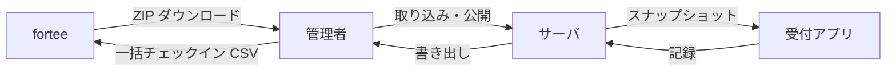

# PRD: fortee 連携チェックインシステム

## 1. 背景と目的

fortee のチェックイン機能は、イベントごとの読み取り画面で、そのイベントのチケット QR を読み取って済みにするだけの仕組みである。前夜祭の受付で本編の受付を兼ねつつ前夜祭チケットを持たない人は断る、本編チケットの種別や購入時の回答に応じて配布物を案内する、といった複数イベントにまたがる運用は fortee 上では表現できない（調査結果は [research/fortee/](research/fortee/README.md) を参照）。

本システムは、fortee が発行するチケット QR をそのまま読み取り、カンファレンスごとに設定した受付ルールでチェックインを判定・記録し、その結果を fortee に手動で一括反映する。受付は会場のネットワークに依存せず端末だけで完結し、慣れていないスタッフでも迷わず操作できることを目標にする。

## 2. 用語

| 用語 | 意味 |
| --- | --- |
| カンファレンス | fortee 上の 1 カンファレンス（スラッグで識別） |
| イベント | fortee 上でチケットを販売・配布する単位（本編、前夜祭など） |
| チケット種別 | イベント内のチケットの種類。チケット番号のプレフィックスを持つ |
| 参加者（チケット） | fortee 上のチケット 1 枚。fortee 側では参加者 ID、チケット番号、チケットトークン、profile_url_token を持つ（本システムの識別子はチケットトークン。7.1 参照） |
| ユーザ | fortee のアカウント。同一人物の判定単位 |
| チケット QR | `fortee:` + チケットトークンを内容とする、fortee が参加者に表示する QR |
| 受付 | 本システムで設定する、期間とルールを持つチェックインの場面 |
| スナップショット | fortee から取り込んだ参加者データの、ある時点の写し |
| 記録 | 本システムで行ったチェックイン・取り消しの追記型イベント |
| 反映 | 記録から一括チェックイン CSV を作り、fortee にアップロードすること |

## 3. スコープ

### 3.1 対象

- 任意のカンファレンスに、設定ファイルの差し替えだけで対応すること。1 つのデプロイ（受付アプリとサーバ）は 1 つの設定、すなわち 1 つのカンファレンスを扱う。デプロイ（環境）は、カンファレンスごとに新しく作ってそのカンファレンスの受付に使い、保持期間（7.4）の後に削除して、次のカンファレンスに使い回さない。運用を始める前の確認に使ってもよいが、本番以外のデータを載せた環境は、運用の開始（9 章 2）の前に作り直す（[Design Doc](design-doc.md) 3.6）
- fortee のチケット QR の読み取りと、設定したルールによるチェックイン判定・記録
- QR を持たない来場者のための、検索によるチェックイン
- 記録の端末間同期と、fortee への反映用データの書き出し
- fortee からのデータ取り込みと公開、設定の検証、参考情報テンプレートのプレビューを行う管理操作

### 3.2 対象外

- fortee への自動反映（反映は管理者の手作業。自動化するとしても管理操作を CI で実行する範囲にとどめる）
- ネームカードや配布物の生成・印刷
- チケットの販売、キャンセル、発券といった fortee 側の操作
- 未発券の参加者（fortee 上でチケット番号だけが採番され、ユーザが紐づいていない行）の受付
- 複数カンファレンスを 1 つのデプロイで同時に扱うこと
- Discord アカウントを持たないスタッフによる受付

## 4. 利用者と役割

| 役割 | 人 | できること |
| --- | --- | --- |
| 受付スタッフ | Discord の指定ロールを持つスタッフ | 受付アプリにログインし、読み取り・検索・チェックイン・取り消し・履歴閲覧・受付切り替え・同期・ログアウトを行う |
| 管理者 | 設定ファイルとデプロイを管理する少数のスタッフ | 管理操作（取り込み、公開、書き出し、設定検証、テンプレートプレビュー）を実行し、fortee に反映する |
| 来場者 | fortee でチケットを持つ参加者 | 本システムを直接操作しない。チケット QR（画面またはウォレット）を提示する |

受付アプリの権限は受付スタッフの 1 段階だけである。管理者は受付アプリではなく管理操作（CLI またはクラウドの管理画面）を使う。記録に残す操作者（FR-39）は、誰が操作したかを後から追うためのもので、スタッフ同士のなりすましを防ぐものではない。受付スタッフは互いに信頼できる前提に立つ。

## 5. 全体像

本システムは次の要素から成る。

- 受付アプリ: スタッフのスマートフォンにインストールする PWA。スナップショットと記録を端末内に持ち、オフラインで受付を行う
- サーバ: Discord 認証を行い、スナップショットの配布と記録の収集・合流を担う
- 管理操作: fortee からダウンロードした ZIP をスナップショットに変換して公開し、記録から反映用データを書き出す。CLI として提供し、状態の確認はクラウドの管理画面で代替してよい
- 設定ファイル: カンファレンス、受付、表示、テンプレートを宣言的に記述する。管理操作で検証する
- fortee: データの取り込み元であり、反映先。本システムからは直接通信しない。fortee の認証情報を本システムに置かず（NFR-7）、非公開の管理画面 API に依存しないためである

## 6. 機能要件

要件には FR-番号を付ける。「注意を要する操作」は 6.7 でまとめて定義し、該当する要件から参照する。

### 6.1 設定

- FR-1 設定ファイルはカンファレンス 1 つにつき 1 つで、次を含む: fortee のカンファレンススラッグとイベント（ID と表示名。テンプレートから参照するための短い名前を任意で付けられる）、受付の一覧、結果画面に出すアンケート回答の項目、参考情報テンプレート、検索対象の列（既定はチケット番号、fortee ユーザ名、Name）、受付期間の判定に使うタイムゾーン。アンケートの項目は、結果画面に出すものも検索対象に加えるものも、イベント ID と項目名の組で指定する。fortee のフォーム項目はイベントごとに定義され、回答の列もイベントの CSV ごとに違うためである（[data-model.md](research/fortee/data-model.md)）。既定の検索対象の列はどのイベントの CSV にもあるので、イベントを指定しない。設定で参照した列はスナップショットに含める（FR-43）
- FR-2 1 つの受付は、識別子、表示名、1 つ以上の期間（開始・終了の組の配列）、読み取りを受け付けるイベントの集合、所持が必須のイベントの集合、チェックインするイベントの集合、拒否時のメッセージ、で定義する。識別子は表示名とは別に持ち、記録（FR-39）と端末内の手動の上書き（FR-8）は受付を識別子で参照する。表示名を変えても過去の記録の受付を引けるようにするためで、イベントの短い名前（FR-1）と同じ扱いである。チェックインするイベントは、読み取りを受け付けるイベントに含まれなければならない。検索からのチェックイン（FR-26）は選べるチケットをチェックインするイベントのものに限ることで、受け付けるイベントかどうかの判定（FR-9, 10）を省いており、この包含関係が崩れると、同じチケットの扱いが QR と検索の経路で分かれるためである。所持が必須のイベントには制約を置かない
- FR-3 すべての受付のすべての期間は互いに重複してはならない。期間は開始の時刻を含み、終了の時刻を含まない（`[start, end)`）。したがって、ある期間の終了と別の期間の開始が同じ時刻であることは重複ではなく、その時刻は後の期間に属する。重複は設定検証で誤りとする
- FR-4 設定検証は、期間の重複のほか、受付の識別子の重複、存在しないイベント ID（アンケートの項目に指定したものを含む）、チェックインするイベントが受け付けるイベントに含まれない受付（FR-2）、テンプレートの構文誤りを検出する。設定で参照した列（アンケート項目名など）の存在は、CSV のヘッダが必要なので取り込み時に検証する（FR-43）
- FR-5 Discord のギルド ID、ロール ID、その他の秘密は設定ファイルとは別に管理し、リポジトリに含めない

### 6.2 受付の決定と切り替え

- FR-6 受付アプリは、設定のタイムゾーンで解釈した現在時刻が期間に含まれる受付を自動的に選ぶ。端末のタイムゾーン設定には依存しない。受付操作の途中（範囲は画面設計書で定める）に期間の境界を跨いだときは、FR-42 のスナップショットと設定の差し替えと同じく、その操作を終えるまで切り替えを保留する。判定の途中でルールが変わらないようにするためである
- FR-7 どの受付の期間にも当たらない時刻は「受付なし」とし、QR の読み取りと検索からのチェックインを行わない。手動切り替え、検索の閲覧、履歴の閲覧と取り消しは行える。取り消しを止めないのは、誤ったチェックインに受付の期間の後で気づくこともあるためである
- FR-8 スタッフは受付を手動で切り替えられる。手動切り替えはその端末だけの上書きとして、明示的に解除するか、次の期間境界を跨ぐか、設定の差し替え（FR-42）で上書きの指す受付が設定から消えるまで持続する（他端末の受付は変えない）。受付が消えたときは自動の選択に戻す。手動の上書きを解除して自動の選択に戻す操作も、受付の切り替えとして扱う。FR-6 で自動の切り替えを保留している間に、手動切り替え、その解除、提案からの切り替え（FR-9）のいずれかを確定した場合は、保留していた切り替えを捨てる。このとき手動切り替えと提案からの切り替えは、次の期間境界まで持続する。境界を跨いだ後の操作なので、保留を反映して上書きを直後に終わらせないためである。手動切り替えとその解除は注意を要する操作である
- FR-9 現在の受付で受け付けないイベントのチケットを読んだとき、そのチケットを受け付ける受付が設定にあれば、その受付への切り替えを提案する。現在時刻がその受付のどの期間にも含まれない（期間外の）受付も提案に含め、その場合は期間外であることを追加で警告する。提案からの切り替えも FR-8 の上書きであり、切り替え後はその読み取り結果を再読み取りなしで再評価する。提案する受付は 1 つとし、候補が複数あるときは次の順で選ぶ。まだ終了していない（期間中か、これから始まる期間を持つ）候補があれば、そのうち現在時刻との隔たり（その受付の期間のうち現在時刻に最も近いものまでの時間。期間中なら 0 で、終わった期間は終了からの時間、これからの期間は開始までの時間）が最も小さい受付を選び、隔たりが同じならこれから始まるほうを選ぶ。終了していない候補がなければ、最も最近に終了した受付を選ぶ。終了した受付が、これから使う受付より優先されないようにするためである
- FR-10 どの受付も受け付けないチケットは「対象外のチケット」として案内する

### 6.3 QR の読み取りとルール評価

- FR-11 受付アプリは端末の背面カメラでチケット QR を読み取る。読み取った文字列は `fortee:` で始まる 39 文字の形式であることを検証し、形式外（URL 形式の QR など）はチケット QR でない旨を表示する
- FR-12 評価はユーザ単位で行う。読み取ったチケットから参加者とユーザを特定し、そのユーザが所持する有効な（現在のスナップショットに存在する）チケットの集合に対して、現在の受付の「所持が必須のイベント」を満たすかを判定する。ユーザの同一性は fortee ユーザ名の一致で判定する（ダウンロード CSV にアカウント ID はない）
- FR-13 条件を満たす場合、「チェックインするイベント」に含まれるイベントのチケットのうち、そのユーザの有効なものをチェックイン済みとして記録する。既に済み（本システムの記録で済み。fortee 側の状態は見ない）のチケットは変更しない
- FR-14 条件を満たさない場合、受付の拒否メッセージを表示し、記録は残さない
- FR-15 同じユーザが読み取ったチケットと同じイベントのチケットを複数枚持つ場合、そのイベントについては読み取ったチケットだけをチェックインし、同一イベントの他のチケットは状態を変えない。読み取っていないイベントにそのユーザの有効なチケットが複数あり、そのどれも済みでない場合、そのイベントは済みにせず、そのイベントのチケットを QR の読み取りまたは検索（FR-26）で 1 枚指定してチェックインするよう結果画面で案内する。複数あってもいずれか 1 枚が既に済みなら、そのイベントは済みとして扱い案内しない（有効なチケットが 1 枚のイベントは FR-13 のとおり済みにする）。結果画面に同一ユーザの他のチケットを表示する
- FR-16 評価の結果、FR-13 と FR-15 の規則で新たに済みにするチケットがなく、FR-15 の案内もないときは、そのユーザがチェックインするイベントのチケットを 1 枚以上持つなら、エラーではなく「済み」とし、済みの根拠となった記録（7.2 の規則で済みとした記録）の日時と受付を表示する。根拠の記録がチケットごとに異なるときの出し方は画面設計書で定める。読み取ったチケット自体が済みかどうかではなく、チェックインするイベントのチケットで判定する。受け付けるイベントの QR からチェックインするイベントのチケットを済みにする受付（FR-2）では、読み取ったチケットがその受付の記録を持たないためである。fortee 側でだけ済みになっているチケットは未チェックインとして扱い、結果画面に fortee 側の状態を参考表示する。所持が必須の条件は満たすが、チェックインするイベントのチケットをそのユーザが 1 枚も持たないときは、済みではなく、この受付では通さない結果（チェックインするチケットがない）とし、記録は残さない。所持が必須の条件を満たしているので FR-14 の拒否ではなく、拒否メッセージも当てはまらないが、この受付でチェックインするイベントの参加者ではないので、済みとして通すのも誤りだからである。例: 受け付けるイベントが本編と懇親会、所持が必須が本編、チェックインするイベントが懇親会の受付で、本編チケットだけを持つ人の QR を読んだ場合。この結果の名前、区分（FR-23 の音の種類を含む）、出し方は画面設計書で定める
- FR-17 現在のスナップショットに存在しないチケット（キャンセル済みを含む）は受け付けない
- FR-18 QR から取り出して使うのはチケットトークンだけとする。読み取った映像と画像は保存せず、QR の文字列そのものも記録と端末に保存せず、サーバに送らない

### 6.4 結果画面と参考情報

- FR-19 結果画面には、判定結果、ユーザ名、読み取ったチケットの番号と種別、そのユーザの全チケットについてチケットに紐づく情報（イベント、種別、番号、本システムでのチェックイン状態と日時、fortee 側のチェックイン有無の参考表示）、チケットごとの、設定で選んだアンケート回答の項目を表示する
- FR-20 結果画面の「参考情報」操作で、設定のテンプレートをその参加者の情報で描画して表示する。テンプレートからは、参加者（ユーザ名、Name。Name は 7.1 の規則でまとめた値）、所持チケット（イベント、種別、番号、そのチケットの Name、状態と、そのチケットのアンケート回答。回答は項目名で参照）、現在の受付（識別子と表示名。受付なしのときはない）を参照できる。現在の受付がどの受付か、どのイベントをチェックインする受付かも参照でき、案内を受付ごとに出し分けられる。所持チケットは一覧としてのほか、イベントごとにも参照できる。イベントは表示名ではなく、イベント ID か設定で付けた短い名前（FR-1）で参照する。表示名を変えてもテンプレートが壊れないようにするためである。チケットの状態は、済みかどうか、済みの日時、済みにした受付を別々の値として参照できる。表示用に整形した 1 つの文字列だけでは、済みのときだけ出すといった分岐が書けないためである。アンケート回答はチケットごとにあるので、所持チケットの属性として参照させる。回答が空のときと、チケットのイベントにその項目がないとき（7.1）は、どちらも空文字として参照でき、描画は失敗しない。項目のないイベントのチケットを持つ参加者にも、参考情報を出せるようにするためである。テンプレート形式は実装で決める。描画結果は HTML として表示する。空白と改行の扱いも HTML のとおりで、テンプレートの改行は表示に出ない。テンプレートに書いた HTML はそのまま解釈し、強調や箇条書きで案内を読みやすくできる。テンプレートに埋め込む値は、HTML として解釈されないようにエスケープして出す。参加者が入力した値（Name やアンケート回答）で、表示が崩れたり変えられたりしないようにするためである。テンプレートを書くのは管理者なので、テンプレートに書ける HTML は制限しない
- FR-21 配布物の受け渡しは記録しない。配布物の判断は表示された情報をもとに受付スタッフが行う
- FR-22 チェックイン成功後は結果画面にとどまり、スタッフが「次へ」を選ぶまで読み取りに戻らない
- FR-23 判定結果に応じて、成功・注意・拒否の 3 種類を区別できる音で知らせ、振動に対応する端末では振動でも知らせる（iOS の Safari は振動に対応していない）。どの判定結果をどの種類で知らせるかは画面設計書で定める。音と振動は端末ごとに無効化できる

### 6.5 検索によるチェックイン

- FR-24 設定の検索対象の列（FR-1。既定はチケット番号、fortee ユーザ名、Name）をまとめて、あいまい一致（部分一致と文字の揺れを許す）で検索できる。検索は端末内のデータだけで動く。文字の正規化と一致の規則は実装で決める（12 章）。規則は候補の取りこぼしより余分な候補を許す側に倒し、候補から本人を選ぶのはスタッフとする（FR-25）。検索は本人確認ではなく候補を絞る手段だからである。候補は一致の強さの順に並べ、検索対象の列のどれかが入力と完全に一致する候補（正規化を経た比較でよい）を最初に出す。余分な候補を許す規則のもとでも、チケット番号やユーザ名を正確に打ったときには、本人が一覧の先頭に来るようにするためである。完全一致より後の並び順は画面設計書で定める
- FR-25 検索結果には候補ごとにユーザ名、所持チケットの一覧、チェックイン状態を表示する
- FR-26 候補を選ぶと、現在の受付の「チェックインするイベント」ごとに、その候補の有効なチケットから 1 枚を選ぶ（そのイベントのチケットが 1 枚だけなら自動で選ぶ）。選んだチケットをすべて読み取ったチケットとみなして、QR 読み取りと同じ評価（6.3）を通す。選べるチケットを「チェックインするイベント」のものに限り、チェックインするイベントは受け付けるイベントに含まれる（FR-2）ので、受け付けるイベントかどうかの判定（FR-9, 10）は行わない。イベントごとに選ぶのは、QR を持たない来場者に FR-15 の追加の読み取りを求めずに済ませるためである。検索からのチェックインは注意を要する操作である
- FR-27 カメラ権限が得られない端末でも検索によるチェックインだけで受付を続けられる。カメラ権限を再度要求する操作を提供する。QR 文字列の手入力は提供しない

### 6.6 履歴と取り消し

- FR-28 履歴画面には、チェックインと取り消しの記録を、同期済みの全端末の分とこの端末の未同期の分を合わせて新しい順に一覧し、一覧と記録の詳細とを合わせて、各記録の操作、受付、操作者、端末、時刻、ユーザ名、チケットを表示する。ユーザ名とチケット番号は記録が持つ値（FR-39）を使い、現在のスナップショットにない参加者の記録も表示できる。チェックイン状態は 7.2 の集約で求める。チェックインの記録には経路を、取り消しの記録には取り消し理由を加える。どの項目を一覧に出すかは画面設計書で定める。この端末の未同期の記録を含めるのは、オフラインでも取り消せるようにするためである（FR-29, 36）
- FR-29 取り消しは履歴のチェックインの記録から行い、他端末の記録からも取り消せる。取り消しの記録は、その端末にあるそのチケットの打ち消されていないチェックインの記録すべてを指す（7.2）。1 回の操作で済みにした複数のチケットはまとめて取り消せ、取り消すチケットを選べる。取り消せるのは、その記録が現在の済みの根拠（7.2）になっているチケットに限る。取り消しの効果はどの記録から行っても同じ（7.2）だが、取り消し後に別の記録で再チェックインしたチケットや、他端末の記録が先に採用された（FR-41）チケットを、履歴の古い記録から誤って操作させないためである。取り消しには理由の入力が必須で、注意を要する操作である。理由は区分の選択と、区分が「その他」のときの自由記述から成る。区分の選択肢は画面設計書で定める。取り消しは記録を消すのではなく、取り消しの記録を追加する
- FR-30 取り消した参加者は通常の経路で再度チェックインできる。両方の記録が残る
- FR-31 受付アプリにはチェックインの件数や未同期の記録の件数など、件数の集計を表示しない。同期の状態（どの状態を区別するかは画面設計書で定める。オフライン、同期の失敗など）はアイコンだけで示す

### 6.7 注意を要する操作

次の操作は、誤操作が受付の結果を直接変えるため、共通の扱いとする。

- 対象: 受付の手動切り替えとその解除（FR-8, FR-9）、検索からのチェックイン（FR-26）、取り消し（FR-29）
- FR-32 通常の操作と視覚的に区別される、危険であることを示すシグニファイア（色、配置、ラベル）を持つ。通常操作と同じ見た目のボタンにしない
- FR-33 操作内容（何を、どの参加者に、どの受付で）を明示した確認ステップを挟む。受付なし（FR-7）のときは受付を示さない
- FR-34 記録に、操作の経路（QR か検索か）または理由を残す（FR-39）。受付の切り替えとその解除は記録を作らない（FR-39）ので、この項目は適用しない

### 6.8 認証と端末のデータ

- FR-35 受付スタッフは Discord でログインし、設定された Discord サーバの指定ロールを持つ場合だけ受付アプリを使える。ロールの確認はログイン時に行い、セッションの期限は同期のたびに延びる（Design Doc 7.2）ので、ロールを外された後も同期を続けている限り使える。即時に止める必要はなく、止めるときはサーバの秘密を差し替えて全端末を再ログインにする
- FR-36 Discord のセッションが切れても、端末内の読み取り・検索・記録・取り消し・履歴は続行できる。同期のときだけ再ログインを求める
- FR-37 ログアウトすると端末内のスナップショットと記録を消去する。ログアウトの前には常に確認を挟み、未同期の記録があるときはそれが消えること、オフラインのときと同期に失敗しているときは、再ログインとスナップショットの取得ができないおそれがあることを警告する。会場で誤ってログアウトすると、ネットワークが戻るまでその端末で受付ができなくなるためである
- FR-38 各記録の操作者として Discord のユーザ ID と表示名を残す

### 6.9 記録と同期

- FR-39 記録は追記型のイベントで、操作（チェックイン・取り消し）、対象チケット（チケットトークン）、対象チケットのユーザ名とチケット番号（チェックインの記録では記録時点のスナップショットの値。取り消しの記録では、取り消しの操作に使った根拠のチェックイン記録の値を引き継ぐ。取り消す時点では対象のチケットがスナップショットにないことがあるためである。チケットが後のスナップショットから消えても履歴（FR-28）と警告一覧（FR-45）に表示できるようにするための写しで、識別子は引き続きチケットトークンである）、受付（識別子（FR-2）。受付なしのときに行った取り消しでは「受付なし」）、理由（取り消し時。区分と自由記述を別の項目として持つ）、打ち消すチェックインの記録の識別子の一覧（取り消し時。7.2）、経路（チェックイン時。QR・検索）、端末の時刻、端末、操作者を持つ。サーバは受信時刻を付加する。1 回の操作（1 回の読み取りや検索からのチェックイン、1 回の取り消し）で作られた記録は共通の操作 ID を持ち、履歴の表示とまとめての取り消し（FR-29）に使う。受付の切り替えは記録しない。チェックインと取り消しの記録がそれぞれ受付を持つので、どの受付で操作したかは切り替えの記録がなくても分かるためである
- FR-40 受付アプリはオンラインを検知したら自動で記録を送信し、他端末の記録とスナップショットを受け取る。手動で同期を実行する操作も提供する。同期のたびに端末の現在時刻と受付アプリの版を送り、サーバはサーバ時刻との差と受付アプリの版を端末ごとに記録する（時計のずれの検出と、古い受付アプリのまま残る端末の発見に使う）。即時性は求めないので、記録は一定時間ごとでよく、同期のたびに残さなくてよい
- FR-41 同じチケットが複数端末でチェックインされた場合、打ち消されていない記録のうち時刻の早い記録を採用し（7.2）、記録はすべて残す
- FR-42 新しいスナップショットと新しい設定は、受付操作の途中でなければ自動で差し替える。設定は受付の定義を含み、スナップショットと同じく判定の途中で変わってはならないためで、保留の範囲も同じとする（FR-6）。スナップショットの版（イベントごとの取り込み日時）を受付アプリで確認できる

### 6.10 管理操作

- FR-43 取り込み: fortee のダウンロード ZIP はイベント単位なので、イベント ID を指定して ZIP を取り込み、全イベント分を合わせて 1 つのスナップショットにする。参加者ごとの最小データは、チケットトークン、イベント、チケット番号、種別、ユーザ名、Name、profile_url_token、fortee 側のチェックイン有無、設定で参照する列（アンケート回答、検索対象）とする。profile_url_token は ZIP 内のプロフィール QR 画像をデコードして得る。キャンセル済みの参加者は ZIP に含まれないので、スナップショットにも含まれない。未発券の行（User name と Issued が空）は ZIP に含まれるので取り込まず、警告に出す。取り込むイベントの CSV のヘッダに、そのイベントについて設定で参照する列（既定の検索対象の列と、そのイベントを指定したアンケートの項目）がないときは、取り込みを止める。ほかのイベントを指定した項目は検証しない。その項目を持たないイベントの ZIP も取り込めるようにするためである。取り込みは CSV の値を上書き、切り詰め、補正せずにそのまま持つ。意味が一通りに決まらない入力（読む列の名前の重複、同じイベントの中でのチケットの重複、User name と Issued の片方だけが空の行）と、記録に写す上限（FR-39 のユーザ名とチケット番号）を超える値は、該当する行と列を列挙して取り込みを止める。どちらの値を採るかを取り込みが黙って選ぶと、誤りに気付くのが受付の当日まで遅れるためである。規則の一覧は Design Doc 8.3 にある。再取り込みはイベント単位で行え、そのイベントの部分だけを差し替える
- FR-44 公開: スナップショットと設定をサーバに配置し、受付アプリが取得できるようにする。スナップショットは版として、イベントごとの取り込み日時を持つ。設定で参照する列を足す、変える、外すときは、そのイベントを再取り込みしてから公開する。スナップショットが設定で参照しない列を持つイベントがあれば、公開を止める。設定から外した項目の回答を、端末に残さない（7.1）ためである（Design Doc 9.4）
- FR-45 書き出し: 記録をチケットごとに 7.2 の規則で集約し、次を出力する。一括チェックイン CSV（`profile_url_token,checkined_at`。7.2 で済みのチケットだけを、7.2 で求めた時刻で 1 行ずつ）、取り消し一覧（7.2 で未、かつ取り消しの記録があるチケット。再チェックイン済みのものは含めない。理由の区分と自由記述を別の列で含める）、取り消した後に済みになったチケットの一覧（7.2 で済み、かつ取り消しの記録があるチケット。取り消した後の正しい再チェックインも、取り消した端末が受信していなかった重複のチェックインが打ち消されずに済みに戻したもの（7.2）も入る。後者はどの端末も知らせないので、管理者がこの一覧で見て判断する。一覧の名前と列は Design Doc 8.5 で定める）、現在のスナップショットにない参加者（前回の取り込み後に消えた参加者）の記録の警告一覧（記録が持つユーザ名とチケット番号（FR-39）を含める）、fortee 側でだけ済みの参加者（最新スナップショットの checked_in が真で、本システムにチェックインの記録がないチケット）の一覧、時計のずれが大きい端末の一覧（FR-40 の差が閾値を超えた端末）、全端末の一覧（最終同期の時刻と受付アプリの版。どの端末があるかの洗い出しと、古い受付アプリのまま残る端末の発見のためで、全端末が同期済みであることは 9 章 6・7 のとおり各端末のヘッダで確かめる。最終同期の時刻は FR-40 の一定時間ごとの記録なので、未同期の記録がないことの確認には使えない）。スナップショットにない参加者は CSV に含めない。CSV は指定した行数で分割して出力できる（fortee の一括チェックインの行数上限が未確認のため）。書き出しは、開始した時点の公開の版、DB の世代、記録の連番の上限を固定してその範囲の記録を読み、どの版とどの範囲の記録から作った出力かを出力に添える。書き出しの間も同期で記録が増えるので、範囲を固定しないと、出力の元になった記録を説明できないためである。fortee の API は呼ばない
- FR-46 設定検証（FR-4）とテンプレートプレビュー（スナップショット内の任意の参加者を指定して描画）を提供する
- FR-47 管理操作は管理者だけが実行できる。その認証は実行環境の仕組み（クラウドの IAM など）に委ねてよい
- FR-48 記録や同期の状態の確認は、管理操作またはクラウドの管理画面で行えればよい

## 7. データ要件

### 7.1 スナップショット

| 項目 | 由来 |
| --- | --- |
| 参加者の識別子 | チケットトークンを使う。未発券の行に発券が引き当てられても、キャンセルされても値は変わらない（[data-model.md](research/fortee/data-model.md)）。fortee の参加者 ID（UUID）はダウンロード CSV に含まれないため持たない |
| イベント | 取り込み時に指定したイベント ID（ZIP はイベント単位） |
| チケット番号、種別 | CSV の Ticket no / Ticket type |
| ユーザ名、Name | CSV の User name / Name。ユーザの同一性は User name の完全一致で判定する。Name は参加者（チケット）ごとの値で、fortee ユーザのプロフィールの「お名前」ではない（プロフィールに名前を設定したユーザのチケットでも空だった。2026-11-09 に Sandbox で確認）。本番の本編イベントでは、同日時点の参加者 750 件すべてで未設定だった。何から埋まるかは未確認（12 章） |
| チケットトークン | CSV の Ticket url |
| profile_url_token | `qr-profile/` 画像のデコード |
| fortee 側のチェックイン有無 | CSV の checked_in（参考値） |
| アンケート回答 | CSV の項目名の列のうち設定で選んだもの（FR-1）。CSV の 1 行が 1 枚のチケットなので、回答はチケットごとに持つ |

アンケート回答は、チケットごとに次のいずれかの状態を取る。

- 値あり
- 空: 未回答か、その項目の対象外のチケット種別か、項目を追加する前に発券されたチケットである。CSV ではいずれも空の値になり、区別できない（[data-sources.md](research/fortee/data-sources.md)）
- 項目なし: そのチケットのイベントに、その項目がない（FR-1）

受付アプリは、空と項目なしをどちらも値のないものとして扱う（FR-20、画面設計書 2.9）。

Name はチケットごとの値なので、同じユーザのチケットのあいだで値が違うことがある。ユーザに 1 つの Name を出すところ（結果画面、検索結果、候補の詳細、テンプレートの参加者の Name）では、そのユーザの有効なチケットの Name のうち空でないものを、チケットの並び順で、重複を除いて「、」でつないだ値を出す。重複は文字列の完全一致で判定し、正規化しない。値が違うことを隠さず、本人確認の手がかりを落とさないためである。どのチケットの値も出すので、Name 列の出所が確かめられていなくても成り立つ。テンプレートからは、チケットごとの Name も参照できる（FR-20 の所持チケットの属性）。

スナップショットは CSV の値をそのまま持つ。前後の空白や全角と半角を変えない。検索のための文字の正規化（FR-24）は検索にだけ使い、ユーザの同一性の判定と記録に写す値には使わない。正規化した値で同一性を判定すると、fortee では別のユーザやチケットを 1 つにまとめうるためである。

チケットトークンは本人確認なしでチケット詳細を開ける値とみなして扱い（未ログインで 200 が返ることまで確認）、スナップショットは受付スタッフの認証の内側にだけ置く。端末に置く回答は設定で選んだ項目に限る。

### 7.2 記録

FR-39 のとおり。記録は削除・更新せず追記のみとする。例外は、DB を以前の時点に戻した後の復旧で、サーバが付けた受信時刻を戻す前の値に書き戻すことだけである（Design Doc 8.6）。受信時刻は下の規則で記録の順序に使うので、復旧の間に端末が記録を送り直したときに、順序が戻す前と変わらないようにするためである。

チケットのチェックイン状態は、そのチケットの記録から次の規則で求める。取り消しの記録は、打ち消すチェックインの記録の識別子を持つ（FR-39）。指すのは、取り消しを確定した時点でその端末にある、そのチケットの打ち消されていないチェックインの記録すべてである。チケットの状態は、どの取り消しにも指されていないチェックインの記録があれば済み、なければ未とし、済みの時刻はそのうち最も早い記録の端末時刻とする。複数端末の記録の順序は端末時刻で決め、同時刻はサーバ受信時刻で決める。この順序は、採用するチェックインの記録の選択（FR-41）と済みの時刻に使う。取り消しの端末時刻は、打ち消すかどうかの判断には使わない。打ち消す対象を識別子で指すので、時計の遅れた端末からの取り消しが効かないことはなく、他端末の取り消しと再チェックインを受信していない端末が古いチェックインの記録を取り消しても、その再チェックインまで打ち消すことはない。端末の時計のずれは許容し、ずれが大きい端末があれば書き出しの警告に出す。取り消しを確定した端末が受信していなかった別端末のチェックインの記録（FR-41 の重複）は打ち消されず、同期の後にその記録を根拠として済みに戻る。これは受け入れる。取り消した端末では、同期の後に、受信したそのチェックインの記録が履歴に並び、その記録の詳細でチケットが済みと分かる。必要なら、受信した記録の詳細から取り消し直す（画面設計書 S08）。

### 7.3 反映用 CSV

[bulk-checkin.md](research/fortee/bulk-checkin.md) の形式。日時は設定のタイムゾーンのオフセット付き ISO 8601 で書き、空欄にしない（空欄は fortee 側でアップロード時刻になる）。fortee は同じ参加者を再度アップロードすると CSV の日時で上書きするので、毎回全件を書き出してもよいが、同じ参加者には常に 7.2 で求めた時刻を書き、参加者 1 人につき 1 行にする。

### 7.4 保持期間

スナップショットと記録は、fortee への最終反映の 30 日後にサーバから削除する。管理者の端末に残る取り込みと書き出しの資料も同じときに削除する（9 章 7）。受付スタッフの端末はログアウトで消去する（FR-37）。

## 8. 非機能要件

- NFR-1 読み取りから判定表示まで 1 秒以内。計測の開始点は、チケット QR として受理した文字列をデコードしたコマを、カメラの映像から取り出した時点とし、終了点は、その判定の記録を端末に保存し終えた後に、結果画面の帯を描いた時点とする。QR をかざしてから読み取れるまでの時間（ピントや向き）は含めない。条件は、NFR-3 の端末の実機で、本番規模のスナップショット（1,500 枚）と記録（3,000 件）を持たせた状態とし、各試行が 1 秒以内であることを満たす条件とする。測り方は Design Doc 11 章にある
- NFR-2 受付中は fortee、サーバ、Discord のどれにも接続できなくても、6.2〜6.6 のすべての操作ができる
- NFR-3 対応ブラウザは iOS Safari と Android Chrome の直近 2 メジャーバージョン。縦持ちのスマートフォンを基準に画面を設計する
- NFR-4 同時に 20 台の端末が記録を送受信できる
- NFR-5 UI は日本語のみ
- NFR-6 受付アプリは HTTPS で配信する（カメラ利用の前提）
- NFR-7 fortee の認証情報（Cookie 等）を受付アプリにもサーバにも置かない
- NFR-8 iOS では、受付アプリをホーム画面に追加した Web アプリとして使う。Safari のタブとホーム画面の Web アプリは、追加の時点で Cookie だけが複写され、追加の後は Cookie も端末内のデータも共有しない（iOS 17.2 以降。WebKit の公式ブログ。端末の挙動 10 章）ので、Safari のタブで開かれたときは追加を案内し、先に進めない
- NFR-9 同じ端末で受付アプリを 2 つの画面で同時に動かさない。ログイン済みの画面がすでに動いている端末で、別の画面（ブラウザのタブとインストールしたアプリの組など）がログイン済みで起動したときは、後の画面は先に進めない。Android ではブラウザのタブとインストールしたアプリが端末内のデータを共有するので、一方でログアウトして消したデータを、もう一方が古い状態のまま書き戻すおそれがある（FR-37）ためである。検出の方法は設計で決める

## 9. 運用手順（概要）

1. 準備: 設定ファイルを書き、設定検証とテンプレートプレビューで確認する。fortee からイベントごとの ZIP をダウンロードし、すべて取り込んで公開する。設定に入れるイベントは、受付で扱わないイベント（託児所など）も含めた、そのカンファレンスの fortee のイベントすべてとし、受付で扱わないイベントはどの受付も受け付けないイベントにする（11 章）。設定にないイベントのチケットは本システムから見えず、その QR は「見つからない」と案内されるのに対し、設定にあれば「対象外のチケット」（FR-10）と案内できるためである。設定にないイベントは設定検証では見つけられないので、これは運用の決まりとして守る。準備は、そのカンファレンスの環境で行う。ZIP は、ダウンロード画面のファイル名にイベントが分かる名前を付けて作り、取り込みの後に、取り込みが出すチケット種別とチケット番号の接頭辞が、fortee のそのイベントのものであることを確かめる。CSV にイベントの列がないので、イベントを取り違えた ZIP を取り込んでも、本システムが見つけられない場合がある（Design Doc 8.3、8.4）
2. 運用の開始: 本番の設定と本番の ZIP を公開した環境で、本番のチケットの受付を始める。来場者の受付の前に、スタッフ自身のチケットを受付と同じ手順で受け付けて、端末の準備から、読み取り、検索、チェックイン、取り消し、同期、書き出し、fortee への一括チェックインまでを通しておく。この受付の記録も、来場者の受付の記録と同じく、書き出しと fortee への反映に含める記録である。したがって、運用の開始後は、記録を消さない（DB を以前の時点に戻す復旧を除く）。誤ったチェックインは、取り消しの記録で打ち消す（FR-29）。本番以外のデータ（Sandbox や合成のデータ）を載せて確認に使った環境は、運用の開始の前に作り直し、端末はログアウトする（Design Doc 3.6）
3. 直前: 参加者の追加・キャンセルを反映するため、受付前日に全イベントの ZIP を同じ作業でダウンロードして取り込み（イベントとの対応の確かめ方は 1 と同じ）、まとめて公開する。イベント間で取り込みの時点をそろえるのは、ユーザの同一性を fortee ユーザ名で判定する（FR-12）ため、取り込みの間にユーザ名が変わると同じ人のチケットが別のユーザに分かれ、所持が必須の判定に失敗するおそれがあるからである
4. 端末の準備（会場に入る前、ネットワークのある場所で）: 受付スタッフは受付アプリを iOS ではホーム画面に追加し（NFR-8）、ログインしてスナップショットを取得し、メニューでデータの版（イベントごとの取り込み日時）が最新であることと、オフラインで起動できる状態（メニューの「アプリ」の行が「オフラインで起動できます」）であることを確かめる。データの取得とオフライン起動の準備は別の処理なので、データがそろっただけでは準備完了ではない。確かめ方としては、機内モードにして、受付アプリを完全に閉じてから開き直し、起動できることを見てもよい（AC-2）。他のアプリに切り替えて戻っただけでは読み込み直されないことがあるためである。端末の記憶域の保持（`navigator.storage.persist()`）は、ログイン済みの起動のたびに受付アプリが要求し、スタッフの操作は要らない。認められているかはメニューの「データ」の行で確かめる。認められていなければ「空き容量が減ると、端末のデータが消されることがあります」と出る（画面設計書 S09）。この文が出ていなければ、認められている。認められない端末も止めずに使ってよい。Android で認められないときは、Google アカウントにログインした Chrome からインストールし直す（WebAPK として入り、検証ではこの場合だけ認められた。端末の挙動 9 章・10 章）。ブラウザのタブのままでは使わない。入れ直しても認められない Android と、認められない iOS は、端末の空き容量に余裕があることを確かめて、そのまま使う（Design Doc 6.3）。セッションの期限は同期のたびに延びるので、2 で使った端末も、準備の日にネットワークのある場所で開いて同期すれば期限が延びる。期限が切れていればヘッダの同期の状態で分かり、端末のデータを消さずに再ログインする（FR-36）。Android では、ログインしたブラウザのタブを開いたままインストールしたアプリを開かず、1 つの画面だけで使う（NFR-9）。端末の画面の向きは縦に固定しておく（端末の設定の回転ロック）。iOS とブラウザのタブでは受付アプリから縦に固定できず、横向きでは縦向きのレイアウトのまま表示されて見づらくなる（画面設計書 1.2）ためである。読み取りは横向きでも止めない。2 で使った端末は、そのまま使ってよい。会場では端末内のデータだけで受付が動く
5. 受付中: 受付スタッフは自動で選ばれた受付で読み取りを行う。オンラインになるたびに同期される。受付期間中は fortee 側の読み取り画面・手動チェックイン・一括チェックインを使わず、チェックイン状態の正は本システムの記録とする。取り込みの後に購入、発券されたチケットは、スナップショットにないので「見つからない」と案内される（FR-17）。その来場者を受け付けるには、管理者が全イベントの ZIP を 3 と同じ作業で取り込み直して公開する。端末は次の同期で新しいスナップショットを受け取る（FR-42）
6. 各受付の終了後: 管理者は、まず全端末が同期済み（ヘッダの同期の状態が「同期済み」）であることを確かめる。オフラインだった端末の記録が書き出しの後に同期されると、その分が CSV から漏れるためである。次に、全イベントの ZIP を 3 と同じ作業でダウンロードして取り込み、公開する。書き出しは公開中のスナップショットを読む（Design Doc 8.5）ので、取り込みが受付の前日のままだと、その後に fortee でキャンセルされたチケットが一括チェックイン CSV に入り、警告一覧と fortee 側でだけ済みの参加者の一覧（FR-45）も、前日までの変化しか拾わないためである。キャンセル済みの参加者の行を fortee がどう扱うかは確かめていない（[fortee の仕様調査](research/fortee/README.md)の未確認事項）。続けて書き出しを実行し、取り消した後に済みになったチケットの一覧を確認する。済みに戻ったのが誤りなら、受付アプリで取り消し直し、同期してから書き出し直す。取り消しは受付なしのときも行える（FR-7）ので、受付の終了後でも取り消し直せる。アップロードの前に確かめるのは、一括チェックインは CSV では戻せないためである。CSV から行を除く方法は採らない。書き出しは毎回、済みのチケットをすべて出す（7.3）ので、取り消し直さない限り、次の書き出しで同じ行がまた入るためである。そのうえで一括チェックイン CSV を fortee にアップロードし、取り消し一覧と警告一覧を確認して、必要なら fortee 側で手動対応する
7. 最終日の終了後: 全端末の同期済みを確かめ、6 と同じく全イベントを取り込み直して公開してから、最終の書き出しと控えの保存、fortee の反映結果の確認を済ませてから、全端末のログアウトを行う。未同期の記録を残したままログアウトできる挙動（FR-37 の警告の先）は誤操作からの回復の余地として残すが、通常の終了手順では使わない。保持期間（7.4）の経過後に、サーバのデータ（D1、KV、Worker）と、管理者の端末にあるもの（作業ディレクトリ、書き出しの出力と途中で残った一時ディレクトリ、fortee からダウンロードした ZIP）を削除する。手順は Design Doc 8.9（消す対象の表。コマンドは dev-setup 10 章）による。ログアウトしなかった端末のデータは端末に残り、サーバからは消せない

## 10. 受け入れ基準

- AC-1 運用の開始（9 章 2）で行う、スタッフのチケットの受付で、取り込み、チェックイン、書き出し、fortee への一括チェックインが失敗行ゼロで通る
- AC-2 端末を機内モードにした状態で、読み取り、検索、チェックイン、取り消し、履歴の閲覧ができる
- AC-3 設定した複数の受付が時刻で自動的に切り替わり、手動切り替えと提案からの切り替えが設定どおりに動く
- AC-4 注意を要する操作（6.7）が、通常操作と区別されたシグニファイアと確認ステップを持つ

## 11. ユースケース例: YAPC::Tokyo 2026

この章は要件ではなく、要件を満たす設定と運用の一例である。開催は 2026-11-27（金）〜 29（日）で、イベントは本編（11/28・29 の 2 日間）、前夜祭（11/27）、懇親会、託児所がある。託児所は受付の対象にしないが、設定のイベントには入れて取り込む。どの受付も受け付けないイベントにしておくと、託児所の QR は「見つからない」ではなく「対象外のチケット」（FR-10）と案内される（Design Doc 4.2）。

受付の設定例:

| 受付 | 期間 | 受け付けるイベント | 所持必須 | チェックインするイベント |
| --- | --- | --- | --- | --- |
| 前夜祭受付 | 11/27 の受付時間 | 前夜祭、本編 | 前夜祭 | 前夜祭、本編 |
| 本編受付 | 11/28 と 11/29 の日ごとの受付時間を期間として設定（11/28 は懇親会受付の開始まで）。夜間は開けない | 本編 | 本編 | 本編 |
| 懇親会受付 | 懇親会当日の受付時間帯 | 懇親会 | 懇親会 | 懇親会 |

運用の前提と例:

- 本編のチェックインは 3 日間で 1 回だけ行い、再入場はネックストラップで判断する。来場日ごとの記録は取らない
- 前夜祭受付は本編の受付を兼ねる。前夜祭チケットを持たない人は前夜祭では断る
- 前夜祭チケットはスタッフチケットを除く本編チケットの所持を前提に販売しており、本編をキャンセルした人は前夜祭も合わせてキャンセルする運用で整合を保つ。本システムはこの整合を検査しない
- 懇親会受付の時間帯に遅れて来た本編参加者は、提案（FR-9）から本編受付に切り替えて受け付ける。本編受付はこの時間帯には期間外なので、期間外の警告が出る。前夜祭受付も本編チケットを受け付けるが、終了しているので提案されない（FR-9）。QR を持たない人は検索では提案が出ないので、受付の切り替え画面から手動で本編受付に切り替えてから検索する
- 結果画面に出すアンケート回答は、本編のイベントの「Tシャツのサイズ」（FR-1）。参考情報テンプレートで、本編チケットの種別に応じたネームカードの種類と T シャツの有無を案内する
- 本編の購入時フォームには氏名の項目がない（2026-11-10 に本番の設定画面で確認。項目は「「YAPC::Tokyo 2026のチケットを販売します！」のエントリを確認しましたか？」「参加予定日」「公式サイトに掲載するSNSアカウントのURL（希望者のみ）」「Tシャツのサイズ」「スピーカー名札に記載するお名前」「スピーカー名札に記載するアイコン画像のURL」の 6 つで、対象は本編の全種別。この項目名がそのままダウンロード CSV の列名になり、設定で参照する列（FR-1）もこの名前で指定する）ため、検索はチケット番号と fortee ユーザ名が主になる。Name 列は本番では全員が未設定（7.1）なので当てにしない。本人確認の方法は受付スタッフの判断に委ねる

## 12. 未決事項

ホスティング先と管理操作の認証方式は[バックエンド](research/backend.md)で、受付アプリの実装技術は[フロントエンド](research/frontend.md)で選んだ。本章に挙げていた残りの未決事項（参考情報テンプレートの形式、同期の実装方式、設定ファイルの配り方、あいまい検索の実装方式）は [Design Doc](design-doc.md) 10 章で決めた。本番で確かめるまで決まらない次の 2 件は、設計上の備えとともに Design Doc 12 章に残している。

- ダウンロード CSV の Name 列が fortee のどの値から埋まるか（fortee ユーザのプロフィールでも「名前」タイプのフォーム項目でもないことと、本番の本編では全員が未設定であることは確認済み。7.1）
- 一括チェックイン CSV の行数上限（本番規模で確認するまで分割出力で備える）

fortee の画面で確かめる次の 1 件も、Design Doc 12 章に残している。FR-12 がユーザの同一性をこの値で判定するので、実装の初めに確かめる。

- fortee のユーザ名（CSV の User name）が fortee 全体で一意か、退会や変更の後に別人が同じユーザ名を取れるか、参加者が変更できるか（[fortee の仕様調査](research/fortee/README.md)の未確認事項）。一意でないか、別人が同じユーザ名を取れると分かれば、FR-12 の判定を見直す

## 13. 参考資料

- [Design Doc](design-doc.md)
- [fortee の仕様調査](research/fortee/README.md)と[独自チェックイン機構に効く fortee 側の制約](research/fortee/constraints.md)
- [画面設計書: 受付アプリ](screen-design.md)
- [バックエンド: ホスティングとデータベースの選定](research/backend.md)
- [フロントエンド: 受付アプリの実装技術の選定](research/frontend.md)
- [端末の挙動: 検証結果と実装に引き継ぐ知見](research/device-behavior.md)
