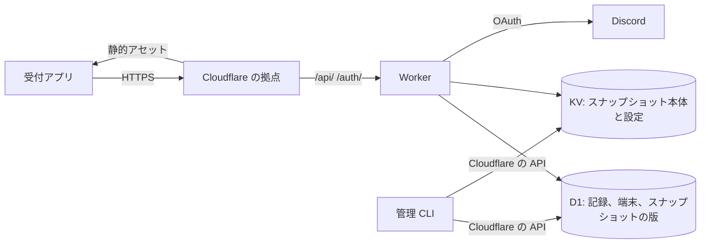

# バックエンド: ホスティングとデータベースの選定

受付アプリの配信、サーバの実行環境、記録とスナップショットの置き場所、管理操作の経路を選んだ記録である。[PRD](../prd.md) 12 章の未決事項のうち「ホスティング先と、管理操作の認証方式」の答えにあたる。選んだ構成とその理由、比べた候補、負荷の見積もり、実行環境の制約と実測の値、運用上の制約、構築で確かめることを書く。この選定の上に何を作るかは [Design Doc](../design-doc.md) が定め、表と SQL、同期の処理、管理 CLI の手順はそちらにある。

記述の確度は次の表記で示す。料金と無料枠は 2026-11 時点の公式文書によるもので、予告なく変わるので、構築の直前に出典（10 章）を見直す。

| 表記 | 根拠 |
| --- | --- |
| 公式 | 事業者の公式文書・料金ページ |
| 実測 | 採用する構成の最小の Web アプリを Workers Free にデプロイし、東京の固定回線から確かめた値。並行させた要求の CPU 時間は標本が間引かれたので、1 件ずつ送った値である |
| 推定 | 上記からの推論 |

## 1. 構成

### 1.1 採用する構成

Cloudflare の Workers Free プランで、受付アプリの静的アセットと API を 1 つの Worker にまとめる。記録、端末の時計の差、スナップショットの版を D1 に、スナップショット本体と設定を Workers KV に置く。オリジンは `workers.dev` のホスト名とする。

| データ・処理 | 置き場所 | 理由 |
| --- | --- | --- |
| 受付アプリ（HTML、JS、CSS、アイコン） | 静的アセット | 要求は無料・無制限で、API と同一オリジンになる |
| Discord ログイン、同期、スナップショットの配布 | Worker | `run_worker_first` で `/api/` と `/auth/` 以下だけを Worker に送り、それ以外は静的アセットとして返す。Worker を実行する拠点は既定のまま（要求を受けた拠点）とする |
| 記録、端末の時計の差、スナップショットの版 | D1 の 1 データベース | 追記と、連番の範囲読み出しを SQL で書ける。D1 はクエリを 1 件ずつ処理するので、書き込みのトランザクションの中で付けた連番は確定する順に増える（5 章） |
| スナップショット本体（イベントごとの JSON）と公開した設定 | Workers KV（イベントと版ごとのキー。設定は版ごとのキー） | 値を Worker で解析せずにストリームで返せる。1 MB を返す CPU 時間は 1〜3 ms で済む（実測）。値は 25 MiB まで入る |
| Discord のクライアント ID とシークレット、ギルド ID、ロール ID、そのほかの鍵 | Worker の secret | FR-5 |

静的アセットの設定と Worker のルートは Design Doc 7.1 にある。`/auth/` 以下を Service Worker が扱わない理由は [端末の挙動](device-behavior.md) 11.1 にある。

### 1.2 この構成を採る理由と、受け入れた弱点

Free プランの上限は、Workers、D1、KV のどれも、超えると課金ではなく失敗になる（公式）。3 章の負荷で最も余裕が少ないのは Worker の要求数で、記録が増えた場合も日次の上限の 3 割に収まる。上限を超えて止まったときは、担当者の判断で Workers Paid（月 5 ドルから）に切り替える（7.1）。

スナップショット本体を D1 の 1 行に置く案は採らない。保存はできたが、Worker が D1 から 1 MB の文字列を受け取って解析せずに返すだけで CPU 時間が中央値 11 ms、p95 22 ms になり、要求 1 件あたりの上限（10 ms）に収まらなかった（実測）。同じ JSON を KV からストリームで返すと、大きさによらず 1〜5 ms だった。R2 も使えるが、無料枠を超えた分が課金されるので、上限で止まる KV を選ぶ。

記録の置き場所に Durable Objects ではなく D1 を選ぶのは、管理 CLI が DB を直接読み書きする方針（2.3）のためである。D1 は Cloudflare の API から SQL で読み書きできるが、Durable Objects の中身を CLI から読むには、Worker に管理用の API とその認証を作ることになる。

この構成は、通信の入口（TLS の終端）も D1 の主インスタンスの位置も保証しない。入口は利用者の回線の経路で決まり、東京の固定回線からは NRT（東京）だった（実測）。D1 は、日本から `apac` のヒントを付けて作っても主インスタンスが ICN（ソウル）に置かれ、NRT の Worker から D1 を 1 回呼ぶ要求に 40 ms 前後が加わった（実測）。この遅れは受け入れる。受付は端末内で完結し（NFR-2）、サーバとの通信はログイン、スナップショットの取得、同期、書き出しに限られ、同期は裏で行われるからである。D1 の位置が問題になれば、DB だけを東京の Turso に替える（9 章）。

受付時の応答時間は、人が集まった会場の回線で決まり、事前に再現できない。別の日にスタッフの回線で測っても受付時の値にはならないので、キャリアの回線での測定は行わない。混雑で通信が失敗したときに記録を失わず、間隔を延ばして再試行すること（Design Doc 6.6、6.10）を、受付アプリの試験で確かめる。

## 2. 選定の条件

### 2.1 求める条件

| 条件 | 内容 |
| --- | --- |
| ゼロスケール | 要求がない間は実行環境が止まり、費用がかからない。最初の要求での起動待ちは許容する |
| 従量課金の DB | 常時起動のインスタンスではなく、操作量と保存量に応じて課金される DB |
| 無料枠に収まる | 3 章の負荷が、記録が増えた場合も含めて、余裕をもって無料枠に収まる。上限を超えたときは、意図せず課金されるより止まる構成を優先する。止まったときに、担当者の判断で有料プランに切り替えることは許す |
| 東京に近い | スタッフの回線から、ログイン、スナップショットの取得、同期の応答が十分に速い。地域の保証は求めない |
| 言語を選べる | サーバの言語を候補を絞る条件にしない。受付アプリは PWA なので JavaScript で書き、管理 CLI は管理者の端末で動くので言語を問わない。採用する構成では、受付アプリ、Worker、管理 CLI のすべてを TypeScript で書く（[フロントエンド](frontend.md) 5.1、Design Doc 3.1） |

### 2.2 PRD と fortee の調査から導かれる条件

| 条件 | 由来 | 理由 |
| --- | --- | --- |
| 受付アプリ、Discord のコールバック、API を同じオリジンで配信できる | [端末の挙動](device-behavior.md) 3.4 | セッションを、Discord のコールバックの応答で HttpOnly Cookie として発行し、その後の受付アプリ自身の fetch で送るため（Design Doc 7.2）。コールバックで付けた Cookie をその後の fetch で送ることは検証していない（端末の挙動 3.4）。配信元が分かれる構成では、1 つのオリジンにまとめる部品が加わる |
| オリジンを構築時に固定できる | NFR-8、[端末の挙動](device-behavior.md) 3 章 | iOS のホーム画面 Web アプリの記憶域はオリジンごとに分かれ、Discord のリダイレクト URI は事前に登録する。オリジンを後から変えると、スタッフ全員の再インストールとリダイレクト URI の再登録が要る。スタッフの端末を準備する前にオリジンを決め、以後は変えない |
| スナップショットを認証の内側から配れる | PRD 7.1 | チケットトークンを含むので、公開の静的ファイルや CDN の共有キャッシュには置けない |
| 管理操作の認証を実行環境の仕組みに委ねられる | FR-47, 48 | 管理操作は管理者だけが実行でき、その認証はクラウドの IAM などに委ねてよい。状態の確認はクラウドの管理画面で行ってもよい |
| 秘密を実行環境の側に置ける | FR-5 | Discord のクライアントシークレット、ギルド ID、ロール ID をリポジトリに含めない |
| サーバ側のデータを消す手順がある | PRD 7.4 | 最終反映の 30 日後に削除する |

可用性への要求は低い。受付は端末内のデータだけで動く（NFR-2）ので、サーバが止まっても受付は続く。サーバが要るのは、受付前日までのログインとスナップショットの取得、受付中の同期、受付後の書き出しである。一方で、受付後に全端末の記録をサーバに集め、書き出し、削除するまでは確実に終える必要がある。DB を以前の時点に戻した場合も記録を回収できるよう、Design Doc 8.6 の手順を用意する（7.2）。

### 2.3 管理 CLI が DB を直接読み書きする

管理 CLI は、クラウドの認証情報で DB を直接読み書きし、受付アプリのサーバには管理用の API を作らない。FR-47 は認証をクラウドの IAM などに委ねることを許しているだけで、この形を求めてはいない。この形を採るのは、公開しているサーバに、管理の入口とその認証を作らずに済むからである。管理 CLI で独自に書くのは、ZIP の展開や集約（PRD 7.2）のような、どの事業者でも変わらない処理と、DB との読み書きのうち既存の CLI で行えない部分に限る（4 章）。

## 3. 負荷の見積もりと無料枠

無料枠に収まるかを判断するため、次の前提で負荷を見積もる。記録の数は、計画どおりの「通常」と、記録が増えた「重い場合」の 2 つで見積もる。この前提は、同期の設計（Design Doc 6.6、7.3）が守るべき条件でもある。

| 前提 | 値 | 根拠 |
| --- | --- | --- |
| 端末 | 20 台 | NFR-4 |
| 受付時間 | 1 日 12 時間 × 3 日 | 開催期間 11/27〜29（PRD 11 章）。上限として見積もる。設定のすべての受付の期間の合計が、無料枠のリセット境界（09:00 JST）で区切った 1 日につき 12 時間を超えないことを、この見積もりの前提とし、設定例（Design Doc 4.2）もこれに合わせる。夜をまたぐ期間を置くと、端末が表示中である限り定期同期が続き、要求数がこの見積もりを超える。受付の手動の上書き（FR-8）が有効な端末は、期間の外でも表示中である限り定期同期を行う（Design Doc 6.6）ので、期間の外で手動で受け付ける時間も、この 12 時間に含めて数える |
| 同期の間隔 | 端末に回線がある間（`navigator.onLine` が真）30 秒ごと。定期的な同期は、受付の期間（FR-6）、受付の手動の上書きが有効な間（FR-8）、端末に未送信の記録が残っている間にだけ行い、期間の外で上書きもなければ、送り終えれば止まる（Design Doc 6.6）。回線が戻ったときの同期と手動の同期（FR-40）は、期間の外でも行う。回線はあるがサーバに届かない失敗は、同期を止める理由にせず、間隔を延ばして再試行する（5 章）。この再試行は、期間の外で未送信の記録がなくても、失敗した同期が成功するまで行う（Design Doc 6.6） | PRD は間隔を定めていない（FR-40）ので、短めに置く。到達の失敗で同期を止めると、回線が変化しない限り回復を知る手段がなくなる |
| 同期 1 回の要求 | 1 件 | 記録の送信と、他端末の記録とスナップショットの版の受け取りを、1 回の要求にまとめる |
| チケット | 1,500 枚 | 本編の 750 行（2026-11-07 時点）に、前夜祭・懇親会・託児所を加えた上限 |
| 記録 | 通常 2,000 件、重い場合 3,000 件。どちらも 1 日に集まるものとする | 通常は、チェックイン 1,500 件と取り消しの計画値である。FR-41 は同じチケットを複数の端末で記録した場合もすべて残し、取り消しと再チェックインの回数も制限しないので、上限ではない。重い場合は、1,500 枚をそれぞれ 2 台で記録した場合に当たる |
| 記録の受け取り直し | 重い場合は、全端末がその日の記録を 2 回受け取る | 再ログインや端末の交換で、端末が記録を最初から受け取り直す |
| 端末の時計の差の記録 | 端末ごとに 10 分に 1 回 | FR-40 は一定時間ごとの記録でよい |
| スナップショット | 1 MB 前後 | ダウンロード CSV の 1 人分（ヘッダを含む）が約 500 バイト（[fortee/constraints.md](fortee/constraints.md)）× 1,500 枚の概算。本番の実データで測る（8.1） |

同期 1 回でサーバが行う処理は、次の 5 つとする。

1. セッションの確認: 署名付き Cookie をサーバで検証し、DB は読まない
2. 版の確認: スナップショットの版を読む
3. 記録の受け取り: 端末の受信位置（どの記録まで受け取ったかを示す値）より後ろの記録を読む
4. 記録の保存: 端末から届いた記録を書く
5. 時計の差の保存: 端末ごとに 10 分に 1 回、端末の行を書き換える

これを Workers Free の上限（公式）と比べる。D1 の行数は、同期ごとの読み取りが 3 行（世代、版、受信位置の文の中で世代を比べるための `meta` の 1 行。版は設定と全イベントの版を 1 行の JSON で持つ。Design Doc 7.3、7.5）、記録 1 件の書き込みが表と索引 2 つの 3 行、端末へ配る記録が 1 件 1 行という値で数えた。記録の行数は実測で、版の読み取りは、イベントごとに 1 行だった実測の形を Design Doc 7.5 が 1 行にまとめた後の値である。

| 指標 | 通常 | 重い場合 | 上限（Free） | 計算 |
| --- | --- | --- | --- | --- |
| Worker への要求 | 約 3 万件/日（30%） | 同左 | 10 万件/日。アカウント単位で、ほかの Worker と共有する | 同期 20 台 × 120 回/時 × 12 時間 = 28,800 件に、ログイン、スナップショットの取得、記録のページング（数百件）を加える。静的アセットは数えない |
| D1 の読み取り | 約 13 万行/日（3%） | 約 21 万行/日（4%） | 500 万行/日 | 世代と版の確認 28,800 回 × 3 行、端末へ配る記録 20 台 × 2,000 件（重い場合は × 3,000 件 × 2 回） |
| D1 の書き込み | 7,440 行/日（7%） | 10,440 行/日（10%） | 10 万行/日 | 記録 × 3 行、時計の差 20 台 × 6 回/時 × 12 時間 × 1 行 |
| KV の読み取り | 100 回/日 | 同左 | 10 万回/日 | スナップショットの配布 20 台 × 取り込みの回数（1 日に数回まで）。100 MB/日 |
| KV の書き込み | 数回/日 | 同左 | 1,000 回/日 | 公開のたびにイベントごとに 1 回 |
| 保存容量 | 数 MB | 数 MB | D1 は 1 DB 500 MB、KV は 1 GB | 記録と、イベントごとのスナップショット |

要求の 3 万件/日は、20 台が受付時間中ずっとオンラインでいる場合の値である。この見積もりは前提に依存する。受付時間の外も端末を起動したまま定期的に同期させると同期は 24 時間で 57,600 回/日になり、同期 1 回に要求を 2 件使えば 115,200 件/日になって上限を超える。認証していない要求（公開している URL への外部からのアクセス）も Worker を起動するので数えられる。時計の差を同期のたびに書くと 28,800 行/日になる。前提が崩れたときの扱いは 7.1 に書く。

## 4. 管理操作の経路

管理 CLI は受付アプリの Worker を通らず、Cloudflare の API（REST API）を呼んで D1 と KV を読み書きする。wrangler の `d1 execute --remote`、`d1 export --remote`、`kv key put --remote` も、この API を呼ぶ。管理 CLI は、ZIP の展開、QR 画像のデコード、集約（PRD 7.2）、CSV の生成を端末の中で行い、クラウドとの読み書きは、できるところを wrangler に任せる。

| 操作 | 経路 |
| --- | --- |
| 取り込みと公開（FR-43, 44） | 管理者の端末で CLI が ZIP を展開し、QR 画像をデコードして、イベントごとのスナップショットを作る。`wrangler kv key put --remote` で版ごとの新しいキーに本体を書いてから、`wrangler d1 execute --remote` で D1 の版を更新する（Design Doc 8.4）。ZIP の処理を Worker で行わないのは、CPU 時間の上限のためである |
| 書き出し（FR-45） | `wrangler d1 execute --remote --json` で記録を SELECT して JSON で受け取り、CLI が PRD 7.2 の規則で集約して CSV を書く。`d1 export --remote` は実行中にほかの要求を止めるので、受付の時間帯には使わない |
| 状態の確認（FR-48） | ダッシュボードの D1 コンソールとメトリクス、Workers Logs |
| 認証（FR-47） | 管理者を Cloudflare アカウントのメンバーに招待し、管理者ごとに作ったユーザの API トークンのうち、操作に必要な権限だけを持つものを使う。API トークンの権限は、書き出しには D1 の Read（記録と `devices`）と Workers KV Storage の Read（現在の設定と全イベントのスナップショット。Design Doc 8.5）、公開には D1 と KV の Edit、削除には両方の Edit に加えて Worker を消す Workers Scripts の Edit を付ける。KV の値の取得には KV の Read 以上が要るので（公式）、書き出しに D1 の読み取りだけを付けると KV の読み出しで失敗する。ユーザの API トークンには、作るメンバーのロールが持つ権限を超える権限を付けられない（公式）。そのため、管理者のメンバーのロールには、トークンに付ける権限を含むものを与え、トークンの側で操作ごとに絞る。組み込みのロールでこれらを含むのは、Super Administrator と Administrator のほか、Workers Platform Admin である。Workers Platform Admin は、新しい権限の体系では Developer Platform のスコープの `Admin` に対応し、このスコープは Workers、D1、KV を含み、`Admin` はリソースの作成と削除を含むすべての操作を許す（公式）ので、D1 と KV の編集と Worker のデプロイを含む。管理者のロールは、Administrator より範囲の狭い Workers Platform Admin で足りる。実際に与えたロールとトークンで必要な操作が通ることは、環境を作るときの手順で確かめる（8.1）。メンバーのロールはダッシュボードで行える操作も決めるので、トークンを絞っても、管理者がダッシュボードから行える操作は狭まらない。`wrangler login` は権限を絞れないので使わない。管理 CLI が API を直接呼ぶときも、同じ API トークンを使う |
| 削除（PRD 7.4） | 7.3 |

この経路では、次の 3 点に従う。

- API トークンの権限は、D1 と KV の製品の単位までしか絞れず、特定の DB や名前空間の単位には絞れない（公式）。同じアカウントにほかの D1 や KV があれば、それらも操作できるものとして、招待するメンバーと API トークンを選ぶ
- 要求数と D1・KV の日次の上限はアカウント単位なので、受付の期間は、同じアカウントで開発用の Worker やほかのプロジェクトの Worker が要求を使わないようにする（7.1）
- KV の書き込みは、Free で 1 日 1,000 回、同じキーへは 1 秒に 1 回までで、ダッシュボードと wrangler からの書き込みも数えられる（公式）。スナップショットはイベントごとに 1 つの値にし、参加者ごとのキーには分けない。参加者ごとに分けると、1 回の公開で 1,500 回の書き込みになる

アカウントの API トークン（特定のユーザに結び付かないトークン）は、wrangler で使える。`CLOUDFLARE_API_TOKEN` にトークンを、`CLOUDFLARE_ACCOUNT_ID` に対象のアカウントを置いて wrangler を認証する手順があり、製品ごとの対応表では Workers、D1、Workers KV のどれも対応している（公式）。

本件では、アカウントのトークンを採らず、管理者ごとのユーザのトークンを使う。アカウントのトークンの利点は、作ったユーザがアカウントを離れても使い続けられることにある（公式）が、本件の管理操作は管理者が手元で実行するもので、人が入れ替わっても動き続ける連携（CI など）を持たない。付けられる権限が作るメンバーの権限の範囲に限られる点はユーザのトークンと同じで（公式）、管理者のロールを決める必要は残る。作れるのも、Super Administrator と、API トークンを発行する権限を持つメンバーに限られる（公式）。管理者ごとのユーザのトークンなら、管理者をメンバーから外せば、その管理者のトークンもアカウントの権限を失う（推定）。アカウントのトークンで本件の操作を実行する試験は行っていない。

Cloudflare の API の要求数の上限は 1 ユーザにつき 5 分で 1,200 件である（公式）。D1 の REST API の `params` は文字列の配列と定められているので、数値も文字列で送り、列の型（INTEGER）で整数に戻す。

## 5. Worker の実行環境の制約と実測

Workers Free の CPU 時間は要求 1 件あたり 10 ms で、超えた要求は Error 1102 で失敗する（公式）。日ごとの上限（7.1）とは違い、要求 1 件ごとに適用される。fetch や D1 の応答を待つ時間は数えないので、Discord の API や D1 を呼ぶこと自体は制約にならないが、Worker の処理は DB と端末のあいだでデータを受け渡すことにとどめる必要がある。実測では 10 ms を超えた要求（最大で 200 ms 前後）も失敗しなかったが、理由は確かめていないので、10 ms を上限として扱う。新しい isolate で処理した要求は、変化のない同期のような軽い処理でも 7〜11 ms になることがあった（実測）ので、処理ごとの CPU 時間には余裕が要る。

D1 の制限は次のとおりである（公式）。SQL 文は 100 KB、文字列・BLOB・行は 2 MB、1 つのクエリのパラメータは 100 個、1 回の Worker の呼び出しで出せるクエリは Free で 50 件。`batch()` は 1 件と数え、1 つのトランザクションとして実行される。読み取りの行数は、主キーか索引の範囲で読めば読んだ行だけが数えられ、表全体を走査すると走査した行がすべて数えられる。

この制約と 3 章の前提から導いた表、同期の文、Worker の処理は Design Doc 7 章にある。その設計の根拠にした実測は次のとおりである。

| 測ったこと | 結果 |
| --- | --- |
| スナップショット 1 MB を返す CPU 時間 | D1 の 1 行から読んで解析せずに返すと中央値 11 ms、p95 22 ms。KV からストリームで返すと大きさによらず 1〜5 ms（1.2） |
| 返す記録の件数と CPU 時間 | 1 回で 500 件なら p95 5 ms、1,000 件で 15 ms、2,000 件で 34 ms。返す JSON を D1 の `json_object` で作っても減らなかった |
| 受信位置の付け方 | 読んだ最後の記録の連番を受信位置にすると、件数とバイト数の上限で応答を切ったときに端末が取りこぼす（21 台の試験で実際に起きた）。実際に返した最後の記録の連番にすれば起きない |
| 記録の書き込みの形 | 記録 10 件までは、配列を 1 つの JSON 文字列で渡す `json_each` の 1 文も、記録ごとの文を並べた `batch()` も 1〜2 ms。1,000 文字の自由記述を含む 20 件では `batch()` が中央値 3 ms、`json_each` が 6 ms で、`json_each` は記録 1 件につき読み取りが 1 行多い |
| 時計の差の書き込み | 1 文の UPSERT の条件で間隔を判定すると、間隔の内側の同期では端末の行の読み書きが 0 行になる |
| 全端末の一斉復帰 | 50 件を送り 200 件（128 KiB まで）を受け取る要求 1 件は 3〜8 ms |
| 同期の整合 | 21 台の端末で、同じ記録の再送、保存の後に応答を捨てる、送信直後に切断するという 3 種の障害を混ぜた試験で、全端末とサーバの記録 ID の集合が一致し、再送で連番と受信時刻が変わった記録はなかった |
| 連番の単調さ | D1 は書き込みを 1 つずつ処理するので、書き込みのトランザクションの中で付けた連番は確定する順に増え、受信位置より前の記録が後から確定することはない（推定）。書き込みが並行する DB では、この付け方は成り立たない |
| KV の書き込みの見え方 | ほかの拠点から見えるまで 60 秒以上かかることがある（公式）。NRT の Worker からは公開の直後に新しい版を取得できたが、ほかの拠点では確かめていない |

3 章の前提のうち、同期を 30 秒ごとに、受付の期間の中と未送信の記録が残る間だけ行うこと、1 回の同期を 1 要求にまとめること、失敗した端末が間隔を延ばして再試行の時刻をずらすことは、見積もりが成り立つ条件でもある。守られないと 7.1 の事態になる。

## 6. フレームワーク

Worker は Hono で書く。Workers と D1 のあいだに入る層が薄く、状態確認とログインの CPU 時間は中央値 1 ms だった（実測）。Hono には AWS Lambda 用のアダプタもあるので、ハンドラを Lambda に移す道も残る。Workers 向けのフレームワーク Void は採らない。サーバ側の描画や型付きの DB といった利点をこのアプリは使わず、公開から日が浅く未解決の問題が多いためである。

## 7. 運用上の制約

### 7.1 上限に達したとき

Workers Free の上限は、要求数も D1 と KV の操作も、超えると課金ではなく失敗になる。上限に達する原因には、3 章の前提が守られない場合（受付時間の外で、手動の上書きも未送信の記録も失敗した同期もないのに定期的に同期する、同期 1 回に要求を複数使う、失敗した同期を間隔を空けずに繰り返す）、外部からのアクセス、同じアカウントのほかの Worker の使用量がある。上限に達した後の要求は、Error 1027 や 429、D1 のエラーで失敗する。受付アプリはこれらを同期の失敗として扱い、未同期の記録を消さない（Design Doc 6.10）。

上限は 00:00 UTC、つまり 09:00 JST にリセットされる。受付の時間帯の中なので、たとえば 10:00 に上限に達すると、翌日の 09:00 まで同期が止まる。その間も受付は端末内で続く（NFR-2）が、ほかの端末の記録が届かなくなり、同じ参加者を複数の端末でチェックインしても気付けない。新しい端末のログインとスナップショットの取得もできない。Worker の要求数だけが上限に達した場合は、D1 の上限は別に残るので、管理 CLI から Cloudflare の API で記録を書き出せる（推定）。

止まったときは、ダッシュボードから Workers Paid（月 5 ドルから）に切り替えれば、要求数の日次上限がなくなり、D1 と KV も月単位の大きな枠に移る。CPU 時間の上限も、要求 1 件あたり 30 秒（既定）に上がる。切り替える担当者と、切り替えを決める条件（たとえば、受付中に要求数が上限の 8 割を超えたとき）は、受付の前に決めておく。担当者がプランを変えられることも、受付の前に確かめる（8.1）。受付アプリは、上限に達したことを同期の失敗としてしか示さない（Design Doc 4.5）ので、受付中に使用量を見る担当者と間隔も決めておく。受付の当日に構成を替えることはしない。

### 7.2 DB を以前の時点に戻すとき

D1 の Time Travel は、7 日前までの任意の時点に DB を戻せるが、戻す操作は DB をその場で上書きする（公式）。戻した時点より後に保存した記録はサーバから消え、連番も戻るので、戻した後に保存する記録が、消えた記録と同じ連番を使う。DB を戻すのは、記録を誤って消したなど、ほかに手段がない場合に限る。

戻した後に記録を回収する手順は Design Doc 8.6 にある。回収には、端末が持つ記録の送り直しと、受付の日ごとの書き出し（Design Doc 8.5）の両方が要る。ログアウトした端末の記録は端末から消える（FR-37）ので、送り直しだけでは足りないためである。手順は、DB を戻し、書き出しから記録を戻し、最後に端末に知らせる順にする。DB を戻してから端末に知らせるまでの間も、端末は同期を続ける。戻した時点が以前の世代の書き換えより前だと、端末は知らせを待たずに世代の変化を知って記録を送り直し、書き出しにある記録が、送り直した時刻の受信時刻で先に入ることがある。そこで、書き出しから戻すときに、同じ記録がすでにあれば受信時刻を書き出しの値に書き戻す（Design Doc 8.6）。こうすると、書き出しにある記録は元の受信時刻を保ち、書き出しの後に保存されて端末の送り直しだけで戻った記録だけが、受信時刻を送り直した時刻に付け直される。受信時刻は、端末の時刻が同じ記録の順序を決めるのに使う（PRD 7.2）ので、その順序だけが戻す前と変わりうる。この手順で、ローカルの D1 と、Time Travel で戻したリモートの D1 の両方で、ログアウトした端末の記録も含めて全件を回収できた（実測）。

Time Travel の時刻の指定は粗い。指定した時刻の 2〜13 秒前に保存した記録も消え、`wrangler d1 time-travel info --timestamp` で調べると、3 分半にわたるどの時刻にも同じ bookmark が返った（実測）。戻す前に bookmark を確かめ、戻す時点より前の記録も消えうるものとして、端末の送り直しと日ごとの書き出しで回収する。戻すコマンドは確認を求めるが、対話できない環境から実行すると確認を待たずに進んだので、対話できる端末で手で実行する。

### 7.3 削除

最終反映の 30 日後（PRD 7.4）に、D1 のデータベース、KV の名前空間、Worker を削除する。管理者の端末に保存した書き出し（7.2 の日ごとの書き出しを含む）も消す。Workers Logs は 3 日で消える。事業者の内部に残る複製の保持期間は確かめていない。

## 8. 構築と運用の開始で確かめること

### 8.1 確認事項

| 確認すること | 方法 | 結果による判断 | 時期 |
| --- | --- | --- | --- |
| D1 の主インスタンスの位置 | 日本から `wrangler d1 create --location apac` で作成し、作成した端末の接続元（プロキシや VPN を通したか）を記録する。クエリ結果の `meta.served_by_region` が APAC であることを確かめ、REST API の結果で `served_by_primary` が true のときの `served_by_colo` を記録する | APAC でなければ、記録を入れる前に作り直す。拠点が東京から遠く、同期の待ち時間が受け入れられなければ、DB を Turso に替える（9 章）。1.2 の実測の D1 は ICN だったが、新しく作る D1 が同じ拠点になる保証はない | D1 を作った直後 |
| スナップショットの大きさ | 本番と同じ項目と形式でスナップショットを作り（長いアンケート回答を含む例も作る）、全体とイベントごとの UTF-8 のバイト数を測る。参加者の情報は測定の記録に残さない | 端末の記憶域と配布の時間の見積もりに使う。KV の値の上限（25 MiB）に近づくことはないと見込む（推定） | 取り込みの管理 CLI を作った後 |
| 要求 1 件あたりの CPU 時間 | 認証と zod の検証（Design Doc 4.1）を含む実際の処理で、通常の同期、最大のページ、長い自由記述を含む記録、長い自由記述で埋まったページ（1 ページの記録すべてが上限いっぱいの自由記述を持つ応答）、全台の一斉復帰を試し、Workers Logs（Free は 1 日 20 万件まで、3 日間保存。2026-12-01 から料金体系が Cloudflare Observability pricing に移るが、保持期間の変更は公式ページ（2026-10-12 更新）にない）の CPU 時間と `outcome` を見る。並行させた要求は `wrangler tail` では標本が間引かれるので、Workers Logs で見る | 10 ms に近い処理があれば、ページの件数とバイト数を減らす。10 ms を超えて失敗しても、端末は再試行し、記録は重複を除いて保存されるので失われない | スタッフのチケットの受付（PRD 9 章の 2） |
| 同期の性質 | 20 台相当の端末で、同じ記録の再送、受信直後の応答の切断、別の端末での同じチケットの記録、ページングの途中の書き込み、全台のオフラインからの一斉復帰を試し、全端末とサーバの記録 ID の集合が一致することを確かめる。再送で保存済みの記録が変わらないことも確かめる | 一致しなければ、Design Doc 7.3 の設計を直す | 実装後 |
| DB を戻したときの回収 | Time Travel で DB を戻し、端末からの送り直しと日ごとの書き出しから、記録をすべて回収できることを確かめる | 回収できない記録があれば、Design Doc 8.6 の手順を直す | 運用の開始の前（ローカルか、運用を始める前の環境か、確認用の環境）。運用を始めた後の環境の記録は消さない（Design Doc 3.6）ので、DB を戻す試験には使わない |
| 使用量 | 同期 1 回あたりの D1 の `rows_read` と `rows_written`、ダッシュボードの要求数を見て、3 章の見積もりと比べる。利用するアカウントの所有者と、同じアカウントのほかの Worker を記録する | 見積もりと大きく違えば、同期の処理を見直す。受付の期間は、ほかの Worker が要求数を使わないようにする | スタッフのチケットの受付（PRD 9 章の 2） |
| 同じアカウントの検証用の資源 | 検証用に同じアカウントへ作った Worker、D1、KV を消す。要求数と D1・KV の日次の上限はアカウント単位なので、残しておくと受付中の要求数を奪う | — | 受付の前 |
| Workers Paid に切り替える担当者と条件 | 7.1 の担当者と条件を決める。担当者のアカウントで、ダッシュボードのプランの変更の画面まで進み（確定はしない）、プランを変えられることと、支払い方法が登録済みであることを確かめる。公式のロールの一覧は、サブスクリプションを編集できるロールに Administrator と Billing を挙げており、4 章の管理者のロール（Workers Platform Admin）の説明は、Developer Platform の製品の読み書きにとどまる（公式）。受付中に要求数の使用量を見る担当者と、見る間隔も決める | プランを変えられなければ、変えられるロールのメンバーを担当者にする | 受付の前 |
| 管理者のロールとトークン | 構築の手順として、管理者に与えたロール（4 章）のメンバーが、4 章の権限を付けた API トークンを作れること、そのトークンで `d1 migrations apply --remote`、`d1 execute --remote`、`kv key put --remote`、`deploy`、`secret put` が通ることを確かめる。ロールが D1 と KV の編集を含むことは公式の文書で確かめてある（4 章）ので、仕様を確かめるためではなく、与えた設定の誤りを見つけるために行う | 通らなければ、与えたロールとトークンの権限を 4 章と見比べて直す | 環境を作るとき |

### 8.2 構築の注意

- `wrangler d1 create` と `wrangler kv namespace create` は、作った資源を設定ファイルに足すかを聞く。足すと、コードが使わない名前のバインディングが増えるので、断って ID を手で書く
- 設定の `database_id` を空にすると、`wrangler deploy` が位置のヒントなしで D1 を自動で作る。D1 を作る前は、仮の値を置いておく
- 設定に `env` があると、`--env` を付けない wrangler のコマンドは警告を出してから最上位の設定で動く。最上位を使うときは `--env=''` を付ける
- ローカルの D1 は `database_id` ごとに分かれるので、ID を書き換えたらローカルのマイグレーションをやり直す。ローカルの D1 は値の大きさの上限を再現せず、クエリ結果の `meta` の値もリモートと一致しない
- D1 の文字列の上限は文書上 2 MB だが、REST API からは 5 MB まで保存でき、10 MB は `SQLITE_TOOBIG` で拒否された（実測）。文書と違う振る舞いなので当てにしない
- `wrangler tail` の `cpuTime` で CPU 時間を見られるが、要求が多いと標本を間引く。wrangler のログイン（OAuth）のトークンには Workers Logs を読む権限がないので、API で読むには権限を付けた API トークンが要る
- 同期の試験を、記録が入った D1 で動かすときは、1 回に受け取る記録の件数を大きくする。小さいままだと受け取り直しに要求を大量に使う
- プロキシ経由で外に出る端末では、Node.js の fetch がプロキシを使うよう、環境変数 `NODE_USE_ENV_PROXY=1` を付ける

## 9. 採らなかった候補

東京に置ける実行環境と DB を 2026-11 時点の公式文書で調べ、次の構成を比べたうえで 1 章の構成を採った。

| 構成 | 採らなかった理由 |
| --- | --- |
| Workers と Turso（東京） | DB だけを Turso（`aws-ap-northeast-1`）に替え、Placement Hints で Worker を東京の近くで実行する変形。D1 と同じ SQLite の SQL を使え、書き込みを 1 つずつ処理するので Design Doc 7.5 の表と受信位置の付け方をそのまま使える。D1 の位置による 40 ms の遅れを受け入れたので採らないが、D1 の位置が問題になったときの替え先として残す。事業者が 2 つになり、Turso の Free には組織にメンバーを加える機能がないので、ほかの管理者には期限付きの DB のトークンを渡すことになる |
| AWS Lambda の関数 URL と Turso（東京） | 通信の入口も東京にできる。同じ SQL と Hono のハンドラを引き継げるが、オリジンが変わるのでスタッフの端末を準備する前に決める必要があり、その判断の材料になる会場の回線の応答は事前に測れない（1.2） |
| Lambda と Aurora DSQL（東京） | 事業者を AWS だけにでき、IAM で管理者ごとに権限を分けられる。しかし書き込みが並行するので、受信位置の付け方を作り直す必要がある（5 章）。接続は 60 分で切れ、認証トークンにも期限がある |
| Prisma Compute と Prisma Postgres（東京） | 実行環境も DB も Free プランで請求が起きないが、DB の枠が月単位で小さく、通常の負荷でも開催 3 日間に半分近くを使う。使い切ると翌月まで止まり、接続情報を読み取り専用にできず、Free にはバックアップもない |
| Cloud Run か App Engine と、Firestore（Datastore モード、東京） | 日本向けの下りの転送が無料枠の対象外で、通常の負荷でも少額の課金がある。重い場合は読み取りが日次の無料枠を超える。請求先アカウントが要る |
| Durable Objects（記録の置き場所） | 中身を CLI から読むには Worker に管理用の API が要る（2.3） |
| R2（スナップショット本体） | 無料枠を超えた分が課金される |
| Azure、Vercel、Netlify、Deno Deploy、Fly.io、Render、Railway、Koyeb、TiDB Cloud、Supabase、Upstash、Neon、CockroachDB、MongoDB Atlas、さくらのクラウド | 無料枠の余裕、APAC の有無、規約（非商用に限る）、休止や停止の扱いのいずれかが条件に合わない |

## 10. 出典

括弧内はページに表示された更新日である。

- [Workers: Limits](https://developers.cloudflare.com/workers/platform/limits/)（2026-10-29）、[Pricing](https://developers.cloudflare.com/workers/platform/pricing/)（2026-10-02）、[Static Assets の Billing and Limitations](https://developers.cloudflare.com/workers/static-assets/billing-and-limitations/)（2026-11-03）、[How Workers works](https://developers.cloudflare.com/workers/reference/how-workers-works/)（2026-09-18）
- [Workers: Placement](https://developers.cloudflare.com/workers/configuration/placement/)（2026-10-12）、[Roles and permissions](https://developers.cloudflare.com/workers/authorization/)（2026-09-15）、[Workers Logs](https://developers.cloudflare.com/workers/observability/logs/workers-logs/)（2026-10-12）、[workers.dev](https://developers.cloudflare.com/workers/configuration/routing/workers-dev/)（2026-11-06）、[Custom Domains](https://developers.cloudflare.com/workers/configuration/routing/custom-domains/)（2026-09-29）
- [Wrangler: Commands](https://developers.cloudflare.com/workers/wrangler/commands/)（2026-04-23）、[General commands（login、auth token）](https://developers.cloudflare.com/workers/wrangler/commands/general/)（2026-09-02）、[run_worker_first の変更の告知](https://developers.cloudflare.com/changelog/2025-06-17-advanced-routing/)（2025-06-17）
- [API のレート制限](https://developers.cloudflare.com/fundamentals/api/reference/limits/)（2026-08-25）、[API トークンの権限](https://developers.cloudflare.com/fundamentals/api/reference/permissions/)（2026-10-30）、[メンバーのロール](https://developers.cloudflare.com/fundamentals/manage-members/roles/)（2026-10-12）、[トークンの権限とユーザの権限（Incorrect user permissions）](https://developers.cloudflare.com/fundamentals/api/troubleshooting/#you-have-the-incorrect-user-permissions)（2026-04-20）、[アカウントの API トークン（製品ごとの対応表）](https://developers.cloudflare.com/fundamentals/api/get-started/account-owned-tokens/#compatibility-matrix)（2026-10-23）、[Developer Platform のスコープと権限、wrangler での認証](https://developers.cloudflare.com/workers/authorization/)（2026-09-15）、[旧ロールとの対応](https://developers.cloudflare.com/workers/authorization/workers/#legacy-workers-permissions)（2026-09-15）
- [D1: Pricing](https://developers.cloudflare.com/d1/platform/pricing/)（2026-10-30）、[Limits](https://developers.cloudflare.com/d1/platform/limits/)（2026-10-30）、[Data location](https://developers.cloudflare.com/d1/configuration/data-location/)（2026-10-02）、[Database（batch）](https://developers.cloudflare.com/d1/worker-api/d1-database/)（2026-06-22）、[Return objects](https://developers.cloudflare.com/d1/worker-api/return-object/)（2026-04-21）、[Wrangler commands](https://developers.cloudflare.com/d1/wrangler-commands/)（2026-04-21）、[Query a database](https://developers.cloudflare.com/d1/best-practices/query-d1/)（2026-04-21）、[Import and export data](https://developers.cloudflare.com/d1/best-practices/import-export-data/)（2026-04-21）、[REST API: Query D1 Database](https://developers.cloudflare.com/api/resources/d1/subresources/database/methods/query/)、[Time Travel](https://developers.cloudflare.com/d1/reference/time-travel/)（2026-11-06）
- [Workers KV: Pricing](https://developers.cloudflare.com/kv/platform/pricing/)、[Limits](https://developers.cloudflare.com/kv/platform/limits/)（いずれも 2026-10-30）、[How KV works](https://developers.cloudflare.com/kv/concepts/how-kv-works/)（2026-04-21）、[Write key-value pairs](https://developers.cloudflare.com/kv/api/write-key-value-pairs/)（2026-06-22）、[KV の Wrangler コマンド](https://developers.cloudflare.com/kv/reference/kv-commands/)（2026-04-21）
- [Durable Objects: Pricing](https://developers.cloudflare.com/durable-objects/platform/pricing/)（2026-10-18）、[R2: Pricing](https://developers.cloudflare.com/r2/pricing/)（2026-10-30）
- [Cloudflare traffic not being sent to the geographically closest data center](https://developers.cloudflare.com/support/troubleshooting/general-troubleshooting/geographic-traffic-routing/)（2026-10-14）
- [Workers と Turso の接続](https://developers.cloudflare.com/workers/tutorials/connect-to-turso-using-workers/)（2026-08-25）、[Turso の料金](https://turso.tech/pricing)、[Turso Cloud の制約](https://docs.turso.tech/cloud/limitations)
- [Hono](https://hono.dev/)
