# 画面設計書: 受付アプリ

## 1. はじめに

本書は、[PRD](prd.md) が定める受付アプリ（PWA）について、画面、画面上の要素、状態、遷移、文言を定める。受付アプリの画面については本書を実装の正とし、各画面には対応する PRD の要件番号（FR・NFR）を書く。本書と PRD が食い違う場合は、画面の側で辻褄を合わせず PRD を直す。管理操作（CLI）とクラウドの管理画面は対象外である。同期の実装方式や参考情報テンプレートの形式のような実装の方式（[Design Doc](design-doc.md) 10 章）には依存せず、どの方式を採っても成り立つ表示要件だけを書く。

### 1.1 利用場面

受付アプリは、受付スタッフが各自の私物のスマートフォンで使う。1 台を 1 人が使い、来場者が差し出したスマートフォンの画面やウォレットの QR に端末をかざして読み取る。スタッフは片手で端末を持ち、もう片方の手で配布物を渡すので、主要なボタンは親指の届く画面の下半分に置く。結果の画面はスタッフだけが見るもので、来場者に向けることは想定しない。QR を持たない来場者も同じ列に並び、同じ端末の検索で受け付ける。

### 1.2 対象端末と表示の前提

| 項目 | 内容 |
| --- | --- |
| ブラウザ | iOS Safari と Android Chrome の直近 2 メジャーバージョン（NFR-3） |
| 利用形態 | iOS ではホーム画面に追加した Web アプリとして使う（NFR-8）。Android ではブラウザのままでも動くが、端末のデータを守るため、インストールして使う（S01、Design Doc 6.3） |
| デザイン基準幅 | 390px（カンプはこの幅で作ってある） |
| 最小対応幅 | 360px（この幅まで表示が崩れないようにする） |
| 向き | 縦向きを基準に作る。横向き用のレイアウトは作らず、表示領域の高さが足りないときの崩し方だけを決める（下記）。横向きにしても、画面は隠さず、読み取りも止めない |
| 配色 | ライトモードに固定する。結果の色の見え方を一通りに保ち、カンプも 1 通りで済ませるため |
| 文字サイズ | OS の文字サイズの設定には追従しない。360px の幅でレイアウトを崩さないため |
| 言語 | 日本語のみ（NFR-5） |

レイアウトを縦向きの 1 通りにするのは、レイアウトとカンプを 1 通りで済ませるためである。インストールした Android のアプリでは縦向きに固定するが、iOS の Safari と Android のブラウザのタブでは固定できない（Design Doc 6.8）。横向きになっても、画面を隠したり読み取りを止めたりはしない。端末を水平にして使うと横向きと判定されることがあり、そのときに QR を読み取れなくなるためである。スタッフには、端末の向きのロックを使うよう運用で勧める（PRD 9 章 4）。ロックしていれば、横向きにはならない。

横向きでは、縦向きのレイアウトをそのまま使い、見づらくなるのは受け入れる。求めるのは、要素が重なって押せなくなったり、はみ出して見えなくなったりしないことだけで、本文が収まらなければスクロールで見られるようにする。表示領域の高さが 560px に満たないときは、この求めを画面ごとの配置の決めより優先して、ホームの配置を崩す（S02〜S04）。条件を向きではなく高さにするのは、崩す理由が高さの不足だからで、向きは検出しない（Design Doc 6.8）。560px は、縦向きで使う端末の表示領域の高さより低く、横向きにしたスマートフォンの高さ（430px ほどまで）より高い値として選んだ。幅 360px、高さ 640px の端末をブラウザのタブで開いたときの、ステータスバーとアドレスバーを除いた高さが、560px ほどである。崩した配置の組み方は Design Doc 6.12 による。

### 1.3 本書の書き方

各画面は上部固定・本文・下部固定の領域に分け、領域ごとに要素を上から順に表で並べる。図は描かない。各画面の節の末尾には、390px の幅のカンプを参考として載せる。カンプは画像（[images/ui-comp/](images/ui-comp/)）だけを残し、作り直す手段はリポジトリに残さない。画面の要素、状態、文言は本書を正とし、カンプと本書が食い違う場合は本書に従う。

色は、役割と、その役割をどの要素に使うかを 2.2 で決め、値を 2.10 で定める。フォント、文字サイズ、角丸、影、余白の値も 2.10 で定める。シートの出入りなどの動き（速さと、端末で動きを減らす設定をしたときの扱い）と、外付けのキーボードで操作したときのフォーカスの見せ方は、2.11 で定める。これらを CSS に書く方法（トークンの名前と置き方など）は、[Design Doc](design-doc.md) 6.12 による。タップできる要素は最小 48px 四方とする。

コントラスト比は、文字と背景の間で 4.5:1 以上、ボタンの輪郭や意味を表すアイコン・マークと背景の間で 3:1 以上にする。押せない状態のボタンは除く。明るい会場でも文字を読めるようにし、枠線のボタン（2.2）を、枠のない文字と見分けられるようにするためである。

画面に出す文言はすべて本書に書く。文言は最小限にとどめ、ラベルとボタンは短い名詞か動詞にする。説明文は原則として置かず、置く場合も 1 行にする。文脈やレイアウトから意味が分かる要素には、ラベル自体を置かない。文言の中の `{受付名}` のような波括弧の部分には、表示するときに値を埋める。

## 2. 共通仕様

### 2.1 画面の種別とつなぎ方

画面上に出るものは、次の 3 種別に分ける。

| 種別 | 内容 |
| --- | --- |
| 画面 | 表示領域の全体を占める |
| シート | 画面の下からせり上がり、親の画面に重なる。下に引くか「閉じる」で閉じる。確認のシート（2.5）は下に引いても閉じず、「やめる」と Android の端末の戻る操作（後述）でだけ閉じる。つまみも出さない |
| ダイアログ | 画面の中央に出て、選ぶまでほかの操作を受け付けない |

確認のシートを下に引いて閉じられないようにするのは、S08-M1 で理由を書いている途中に指が滑ってシートが閉じ、入力が消えるのを防ぐためである。S02-M1 の確認では「やめる」で一覧に戻るので、下に引いたときに一覧に戻るのかシートごと閉じるのかが紛らわしくなるのも避けられる。

1 つの画面が状態によって中身を大きく変える場合は、状態ごとに ID を付ける。ホームの停止中（S02）、読み取り中（S03）、結果（S04）がこれに当たる。シートとダイアログは、開く画面か状態の子として扱う。ID は、親の ID に、シートなら `M`、ダイアログなら `D` と連番を付けたものにする（例: S04-M1）。

ホームの停止中（S02）をハブにし、下部タブは置かない。各画面へはホームから入り、ホームへ戻る。iOS のホーム画面アプリにはブラウザの戻る操作がないので、S05〜S09 には左上に「戻る」を置く。読み取り中（S03）には「戻る」の代わりに「終了」を置き、停止中に戻す。結果（S04）には戻る操作を置かず、下部のボタンでだけ抜けられるようにする（FR-22）。

Android の端末の戻る操作（戻るボタンと戻るジェスチャ）は、その場で押せる「戻る」「終了」「閉じる」「やめる」と同じに扱う。戻る操作で何が起きるかを、画面に出ている操作から予測できるようにするためである。シートかダイアログが開いている間は、その「閉じる」か「やめる」と同じにし、下の画面は変えない。S02-M1 の確認では、「やめる」と同じく一覧に戻る。シートもダイアログも開いていないときは、次のとおりにする。

| 画面 | 戻る操作 |
| --- | --- |
| 読み取り中（S03） | 「終了」と同じ |
| 結果（S04） | 何もしない |
| S05〜S09、S01（「戻る」を出している状態） | 左上の「戻る」と同じ |
| 停止中（S02）、S00、S99、S01（ほかの状態） | Android の通常の挙動のとおり、アプリを閉じる |

結果で何もしないのは、結果から抜けるのを下部のボタンだけにする上の決まり（FR-22）を守るためである。停止中でアプリを閉じてよいのは、データはすべて端末に残り、開き直せば停止中から続けられるためである。

確認のシートは、下に引いても閉じないが、戻る操作では閉じる。戻る操作は、タップを挟まずに 2 回続けて押されると、2 回目をページの側で止められない（HTML の仕様。Design Doc 6.9）。止める作りにしても、同じシートの上で 1 回目は何も起きず、2 回目で閉じる動きになり、入力も守りきれない。S08-M1 で選んだ理由と書きかけの記述は消えるが、区分を選び直し、「その他」のときだけ記述を書き直せば済む。

### 2.2 色の役割

塗りつぶした面の色は判定結果を表し、ボタンの色は操作の種類を表す。結果の赤は S04 の帯（面）にだけ使い、通常の操作のボタンには使わない。

| 役割 | 色 | 使う要素 |
| --- | --- | --- |
| 成功 | 緑 | S04 の帯、チケットの一覧の「今回」のマークと行の背景（2.9） |
| 注意 | 黄 | S04 の帯、ヘッダの「手動」 |
| 拒否 | 赤 | S04 の帯 |
| 済み | 通常色の塗り | チケットの一覧の「済」のマーク（2.9） |
| 未 | 灰の枠線 | チケットの一覧の「未」のマーク（2.9） |
| 無効 | 灰 | 「受付なし」の表示、押せない状態のボタン |
| 通常の操作 | 通常色 | 主ボタン（「次へ」「QR コード読み取り」など）は塗り、それ以外は枠線 |
| 注意を要する操作 | 赤の枠線（塗らない）と ⚠ | 2.5 の対象のボタン |
| 確定 | 赤の塗り | 2.5 の確認シートの確定ボタン、S09-D1 の「ログアウト」 |

色だけで区別しない。判定結果には必ずアイコンと結果名を併記し、注意を要する操作には必ず ⚠ を付ける。色の値は 2.10 で定める。

### 2.3 ヘッダ

S02〜S09 の上部固定の領域に、ヘッダを置く。S00、S01、S99 には置かない。

| 位置 | 要素 | 内容 |
| --- | --- | --- |
| 左 | 戻る操作 | 画面ごとに定める（「戻る」または「終了」）。S02 と S04 には置かない |
| 中央 | 受付 | 現在の受付（下の表）。表示だけで、タップしても何も起きない。S02 には置かず、S02 の受付のカードで表示する |
| 右 | 同期の状態 | 下の表 |
| 右 | メニュー | S02 にだけ置くアイコン（名前: メニュー）。S09 を開く |

受付の表示は次のとおりである（FR-6〜8）。

| 状態 | 表示 |
| --- | --- |
| 自動で選ばれている | `{受付名}` |
| 手動で上書きしている | `{受付名}` と、注意色の「手動」 |
| どの受付の期間にも当たらない | 灰色の「受付なし」 |

同期の状態はアイコンだけで表し、未同期の記録の件数は出さない（FR-31, 36, 40）。

| 状態 | 表示 | タップしたとき |
| --- | --- | --- |
| 同期済み | 完了のアイコン（名前: 同期済み） | 手動で同期する |
| 未同期あり | 未同期のアイコン（名前: 未同期あり） | 手動で同期する |
| 同期中 | 回転するアイコン（名前: 同期中） | 何もしない |
| オフライン | オフラインのアイコン（名前: オフライン）。未同期の記録があれば、アイコンに印を付ける（名前: オフライン（未同期あり）） | 何もしない |
| 再ログインが必要 | 警告のアイコン（名前: 再ログインが必要） | S01 で再ログインする（2.8）。受付操作の途中（2.7）は何もしない |
| 同期の失敗 | 警告のアイコン（名前: 同期の失敗） | 同期を再試行する |

オフラインは、端末がネットワークにつながっていない状態をいう。つながっているのに同期の要求が成功しなかったときは、同期の失敗とする。2 つを分けるのは、取れる対処が違うためである。オフラインの間は、つながりが戻るのを待つしかないので、タップしても何もしない。同期の失敗は、サーバの一時的な不調のように再試行で直ることがあるので、タップで再試行できるようにする。

複数の状態に当てはまるときは、同期中、オフライン、再ログインが必要、同期の失敗、未同期あり、同期済みの順に見て、最初に当てはまったものを出す。オフラインの間は再ログインもできないので、オフラインを先に出す。再ログインが必要なときは同期も失敗するので、対処の分かる「再ログインが必要」を「同期の失敗」より先に出す。

受付操作の途中に「再ログインが必要」をタップしても S01 に移らないのは、S04 から抜けるのを下部のボタンだけにする 2.1 の決まりを守り、判定や確認の途中で画面を離れさせないためである。

### 2.4 判定結果と音・振動

QR の読み取りでは、判定を次の順に行い、最初に当てはまった結果を出す。まず QR の形式を検証し（FR-11）、次にチケットがスナップショットにあるかを見る（FR-17）。続いて、現在の受付がそのチケットのイベントを受け付けるかを見て、受け付けない場合は、ほかに受け付ける受付があれば切替提案、なければ対象外とする（FR-9, 10）。その後、所持が必須のイベントを満たすかを判定する（FR-12, 14）。満たしていても、現在の受付の「チェックインするイベント」のチケットを 1 枚も持たなければ、チケットなしとする（FR-16）。持っていればチェックインに進み、有効なチケットが複数あってどれも済みでないために済みにできなかったイベントが残れば続けて読み取り、新たに済みにしたチケットがあれば成功、どちらでもなければ済みとする（FR-13, 15, 16）。

検索からのチェックインでは、所持が必須のイベントの判定から始める。S06 で選べるチケットを、現在の受付の「チェックインするイベント」のチケットに限っているので、QR の形式、スナップショット、受け付けるイベントの判定は要らないためである（FR-2, 26）。したがって、検索からは切替提案、対象外、見つからない、QR 形式外の結果は出ない。また、S06 ではイベントごとにチケットを選び、チェックインするイベントのチケットを持たない人にはチェックインの操作を出さないので、続けて読み取りとチケットなしの結果も出ない。

| 結果 | 条件 | 帯の色とアイコン | 結果名 | 帯の 1 行 | 音・振動 | 下部の主ボタン |
| --- | --- | --- | --- | --- | --- | --- |
| 成功 | 新たに 1 枚以上を済みにした | 緑・チェック | チェックインしました | なし | 成功 | 次へ |
| 続けて読み取り | 有効なチケットが複数あり、どれも済みでないため済みにできなかったイベントが残る（FR-15。いずれか 1 枚が済みのイベントは済みとして扱う） | 黄・QR コード | 続けて読み取り | `{イベント名}のチケットを 1 枚読み取ってください`（複数のイベントは「、」で並べる） | 注意 | 続けて読み取る |
| 済み | チェックインするイベントのチケットを持ち、新たに済みにしたチケットがなく、残るイベントもない（FR-16） | 黄・感嘆符 | チェックイン済み | `{済みの根拠の記録の時刻} {その記録の受付名}` | 注意 | 次へ |
| 切替提案 | 現在の受付は受け付けないが、別の受付なら受け付ける（FR-9） | 黄・入れ替えの矢印 | 別の受付のチケット | `{提案する受付名}で受け付けます`。期間外の受付なら 2 行目に `{提案する受付名}は期間外です` | 注意 | 切り替えずに次へ |
| 拒否 | 所持が必須のイベントを満たさない（FR-14） | 赤・バツ | 受け付けられません | 設定の拒否メッセージ（長ければ折り返す） | 拒否 | 次へ |
| チケットなし | 所持が必須のイベントを満たすが、チェックインするイベントのチケットを 1 枚も持たない（FR-16） | 赤・バツ | 受け付けられません | `{チェックインするイベント名}のチケットがありません`（複数のイベントは「、」で並べる） | 拒否 | 次へ |
| 対象外 | どの受付も受け付けない（FR-10） | 赤・バツ | 対象外のチケット | なし | 拒否 | 次へ |
| 見つからない | スナップショットにない（FR-17） | 赤・バツ | データにないチケット | キャンセル済みか、データ取得後の購入です | 拒否 | 次へ |
| QR 形式外 | チケット QR ではない（FR-11） | 結果（S04）にせず、読み取り中（S03）のままバナーを出す | — | — | なし | — |

黄の 3 つの結果でアイコンを分けるのは、スタッフが次にすることが違うためである。続けて読み取りでは残りのチケットの QR を求め、切替提案では受付を切り替えるかを決める。済みは、同じチケットが 2 度使われた可能性を示す。腕を伸ばした距離では、結果名より先に色とアイコンが目に入る。iOS の消音モードでは、画面の表示だけで結果を伝えることにもなる。済みにチェックの形を使わないのは、成功の緑のチェックと形で見分けられるようにするためである。

チケットの済みの根拠の記録とは、PRD 7.2 の規則でそのチケットを済みとした記録をいう。取り消しの記録は、打ち消すチェックインの記録を指す。根拠の記録は、そのチケットのチェックインの記録のうち、どの取り消しの記録にも指されていない（打ち消されていない）、最も早いものである。

済みの結果の帯の 1 行と、S04 の「済みの詳細」には、現在の受付の「チェックインするイベント」にある、そのユーザの済みのチケットの根拠の記録のうち、最も新しいものを使う（FR-16）。最後にこの人を受け付けたのが、いつ、どこで、誰かを示すためである。根拠の記録はチケットごとに違うことがある。検索で選んだ 2 枚が別々の操作で済みになっていた場合などである。そのため、チケットごとの時刻はチケットの一覧の「済 `{時刻}`」で示す（2.9）。

見つからないの 1 行が 2 つの可能性を挙げるのは、キャンセル済みのチケットがダウンロード ZIP に含まれず、スナップショットの上では取り込み後に購入されたチケットと区別できないためである（FR-43）。この 1 行は、受付で扱わないイベント（託児所など）も含め、カンファレンスのイベントがすべて設定にあることを前提にする（PRD 9 章 1）。設定にないイベントのチケットもスナップショットにないので見つからないになり、この 1 行が誤った案内になるためである。設定にあれば、受付で扱わないイベントのチケットは対象外になる。

QR 形式外だけ扱いを変えるのは、背景のポスターや名札の QR にカメラが反応するたびに、結果の表示に切り替わったり音が鳴ったりするのを防ぐためである。

チケットなしは、受け付けるイベントがチェックインするイベントより広い受付（FR-2）でだけ起きる（例は FR-16）。色とアイコンを赤とバツにするのは、拒否、対象外、見つからないと同じく、この受付ではその人を通さない結果だからである。黄にしないのは、黄の 3 つの結果が、どれも、操作か確認を 1 つ足せば通しうる結果だからである。結果名を拒否と同じにするのは、どちらも、その人が持つチケットが足りない結果だからである。対象外と見つからないは、読み取ったチケットについての結果なので、結果名も「〜のチケット」にしている。帯の 1 行に受付の拒否メッセージを使わないのは、拒否メッセージが所持が必須のイベントについての文で、この人はその条件を満たしているためである。代わりに、足りないチケットのイベント名を出す。

音は、成功・注意・拒否の 3 種類とし、判定結果を表示したときに 1 回鳴らす（FR-23）。

- 音そのものは実装で選ぶ。0.5 秒以内に鳴り終わり、騒がしい会場でも 3 種類を聞き分けられることを条件とする
- iOS の消音モードでは鳴らなくてよい（iOS 27 の実機では、消音モードのときに鳴らなかったと検証者が申告している。6 章）。音が要る会場では、スタッフに消音モードを切ってもらうよう運用で案内する。運用で足りるので、アプリでは消音モードを無視して鳴らす工夫をしない。iOS では振動も使えないので、消音モードのときは画面の表示だけで判定結果を伝えることになる
- iOS では、音を鳴らす前にユーザのタップが必要である。そこで、音を鳴らしうる画面や状態へ進むタップのたびに、音を鳴らせる状態にし直す。対象は、S02 の「QR コード読み取り」、S04 の下部の主ボタン、S04-M2 と S06-M1 の確定、S09 の「音を試す」である。起動後の一度だけにしないのは、iOS 26.0 に、バックグラウンドから戻った後に音が出なくなるという報告があるためである

振動は、振動に対応した端末（Android）でだけ使う。iOS の Safari は振動に対応していない。

- 成功は短く 1 回、注意は短く 2 回、拒否は長く 1 回とする。長さは実装で決める
- 音と振動は、それぞれ S09 で端末ごとに無効にできる

### 2.5 注意を要する操作

PRD 6.7 の注意を要する操作は、次の画面で行う。

| 操作 | ボタンを置く画面 | 確認 |
| --- | --- | --- |
| 受付の手動切り替えと、その解除（FR-8） | S02-M1 | S02-M1（シートの中身を確認に切り替える） |
| 提案からの切り替え（FR-9） | S04 | S04-M2 |
| 検索からのチェックイン（FR-26） | S06 | S06-M1 |
| 取り消し（FR-29） | S08 | S08-M1 |

これらの操作のボタンは、赤の枠線（中は塗らない）に ⚠ を付け、ラベルには具体的な動詞を書く（FR-32）。また、直前の画面（ホームでは直前の状態）で主ボタンがあった位置には置かない。直前と同じ位置を続けて叩いたときに、押されてしまうのを防ぐためである。

確認は、下からせり上がるシートで行う（FR-33）。長押しやスライドで確定する方式は、操作方法に気づきにくいので使わない。

- 操作の内容（何を、どの参加者に、どの受付で）を一文で書く
- 確定ボタンは赤で塗り、シートが開いてから 0.5 秒間は押せないようにする。シートが開いた瞬間に同じ場所を叩いて確定してしまうのを防ぐためである
- 「やめる」を押すと、何もせずに閉じる

### 2.6 カメラと画面のスリープ

- カメラは読み取り中（S03）の間だけ動かし、結果（S04）では止める。読み取り中へは必ずタップを経由して入る（停止中の「QR コード読み取り」、結果の下部の主ボタン）
- 結果でもカメラを止めるのは、結果を出したまま来場者と話している間に、カメラによる電池の消耗と発熱が続くのを避けるためである。再開のときに getUserMedia が返るまでの時間は、仮想のカメラでは 0.1 秒程度だった。実機で映像が出るまでの時間は確かめていない（6 章）
- 読み取り中にアプリがバックグラウンドに回った場合は、戻ってきたときに停止中（S02）にする。次に「QR コード読み取り」を押したときに、カメラの起動と、音を鳴らせる状態にする処理がやり直される
- チケット QR を読み取って判定を始めた後は、結果（S04）を出すまで次の QR を読み取らず、「終了」、2 分の経過、バックグラウンドへの移行でも停止中に戻さない。バックグラウンドから戻ったときは結果を出す。判定がチェックインの記録を作った後に停止中へ戻ると、スタッフの知らないチェックインが残るためである。判定を始めてから結果を出すまでは一瞬なので、この間を示す表示は置かない
- 結果から読み取り中に戻った直後の 3 秒間は、直前に判定したチケットを読み取っても無視する。来場者のスマートフォンがカメラの前に残っていると、すぐに読み直して「済み」になってしまうためである
- 来場者の対応中に使う状態と画面（読み取り中、結果、S06 と、それらのシート）では、画面のスリープを止める（Screen Wake Lock）。来場者が QR を探している間や、スタッフが配布物を渡している間は画面に触らない時間が続き、OS の自動ロックが働いてしまうためである。停止中とほかの画面では OS の設定に従う
- 読み取り中にチケット QR を 2 分間読み取らなければ、カメラの許可待ちや拒否された状態も含めて停止中に戻す。読み取り中はスリープを止めているので、そのままにすると画面が点いたままになり、電池が減り続けるためである。カメラが動いていれば、その消耗と発熱も続く。QR 形式外の読み取りでは 2 分を数え直さない。背景のポスターの QR が写り続けていても、停止中に戻すためである
- 結果は、ロックされてから戻った場合も表示し続ける

### 2.7 受付操作の途中と、裏で起きる変化

受付操作の途中とは、ホームの結果（S04）、S06、S08 を表示している間と、シートかダイアログを表示している間をいう。読み取り中（S03）にチケット QR を読み取って判定を始めてから結果を出すまで（2.6）も含める。この間は次の 2 つの変化を保留し、その画面を離れた時点で反映する（FR-6, 42）。判定や確認の途中で、ルールやデータが変わらないようにするためである。

| 変化 | 知らせ方 |
| --- | --- |
| 新しい設定かスナップショットへの差し替え（FR-42） | 画面の下に 1 行「データを更新しました」 |
| スタッフの操作によらない受付の変化（FR-6, 8） | 画面の下に 1 行「{受付名}になりました」（受付なしになったときは「受付なしになりました」）。ヘッダの受付（停止中では受付のカード）をしばらく強調する。音は鳴らさない |

スタッフの操作によらない受付の変化には、まず、期間の境界での自動の切り替えと、それに伴う手動の上書きの終了がある。設定の差し替えでも、受付は変わりうる。期間が変わって現在時刻に当たる受付が変わる場合と、手動で切り替えた先の受付が設定から消える場合である。後者では、上書きを終えて自動の選択に戻す。どの原因でも、受付が変わったことはスタッフが知っておく必要があるので、同じ知らせを出す。一方、スタッフが自分で受付を切り替えたとき（S02-M1 の手動の切り替えとその解除、S04-M2 の提案からの切り替え）は、この知らせを出さない。切り替えた本人には、受付が変わったことが分かっているためである。

保留している間に、スタッフが自分で受付を切り替えた場合は、保留していた自動の切り替えを捨てる。手動の切り替えは、次の期間の境界まで持続する（FR-8）。境界を越えた後に行った操作なので、画面を離れた時点で保留を反映すると、確定した直後に上書きが消えてしまうためである。

ほかの端末の記録は、受付操作の途中でも、同期で届いたときにすぐ反映し、保留しない。保留すると、ほかの端末ですでに済みにしたチケットを S06 が未と出し、検索からのチェックインの結果も、済みではなく成功になってしまうためである。その代わり、確認のシートを開いている間に、届いた記録で状態が変わることがあるので、確認のシートは確定の時点の記録で判定し直す。S06-M1 は確定のときに判定を通るので、もとからそうなっている。S08-M1 も、確定の時点で根拠を求め直す（S08-M1）。

届いた記録で、S06 と S08 の表示はすぐに描き直す。一方、結果（S04）の帯とチケットの一覧は、判定した時点の記録のまま変えず、届いた記録は次の判定から使う。一覧の状態だけを描き直すと、ほかの端末の先の記録（FR-41）が届いたときに、帯は成功なのに一覧は済みになり、帯と一覧が食い違う。帯まで判定し直すと、すでに通した来場者の結果が、後から変わってしまう。スタッフが帯と一覧を見て判断するのは判定したその場なので、その後に届いた記録で書き換えても、判断の役には立たない。

2 つの知らせが同時に出るとき（保留していた変化をまとめて反映したときや、設定の差し替えで受付が変わったとき）は、2 行に並べて同時に出し、受付の知らせを上にする。受付が変わったことを先に読めるようにするためである。1 つずつ続けて出すと、2 つ目はスタッフが次の操作を始めた後に出るので、見落としやすい。

画面の下の知らせは数秒で消え、2 行になっても操作を妨げない。読み取り中（S03）に受付なしになった場合は、停止中（S02）に戻す（FR-7）。設定とスナップショットの初回の取得は S01 で行い、ここでは 2 回目以降の差し替えだけを扱う。

### 2.8 再ログイン

Discord のセッションが切れても受付は続けられ、ヘッダの同期の状態が「再ログインが必要」になる（FR-36）。これをタップすると S01 で再ログインし、端末内のデータは消さずにホームの停止中（S02）へ戻る。受付操作の途中（2.7）はタップしても S01 に移らない。S01 からは、ログインせずに「戻る」で S02 に戻ることもできる（S01）。端末にまだデータがなく、S01 での初回の取得でログインの期限切れが分かったときは、S01 の「再ログインが必要」の状態から同じく再ログインする（S01）。

### 2.9 表示の規則

時刻は、設定のタイムゾーンで表示し、端末のタイムゾーン設定は使わない。受付の判定（FR-6）とタイムゾーンを揃えるためである。時は 2 桁にそろえ、当日の時刻は「08:30」、前日以前は「11/28 08:30」と書き、秒は出さない。

名前とチケット番号は次のように表示する。

- ユーザ名と Name は、本人確認に使う画面（S04、S06、S08）では省略せず、折り返して全文を出す
- Name はチケットごとの値なので、同じユーザのチケットで違うことがある。ユーザの Name（S04、S05、S06）には、PRD 7.1 の規則でまとめた値（異なる値を、チケットの並び順に「、」でつないだもの）を出す。S08 では、その記録の対象のチケットのうち、データにあるものの Name を同じ規則でまとめる。どの Name も空なら、Name は出さない
- 一覧（S02 と S03 の直近の記録、S05、S07）では 1 行に収め、末尾を「…」で省略する。ただし記録の行（S02 と S03 の直近の記録、S07）では、ユーザ名に 5 文字分の幅を残せないとき（取り消しの行や、チケットの多い行など）に限り、チケット番号（S07 では操作者と未同期のアイコンも）を 2 行目の右端に送る。ユーザ名がほとんど見えなくなるのを防ぐためである
- ヘッダの受付名と、S07 の操作者も、1 行に収めて末尾を「…」で省略する
- 記録の受付（S08 の詳細、2.4 の済みの帯の 1 行）は、記録が持つ受付の識別子（FR-39）から、いまの設定の表示名を引いて出す。設定から消えた受付は、識別子をそのまま出す。識別子は管理者が付けた英数字なので、表示名でなくても、どの受付の記録かを追える
- 記録のユーザ名とチケット番号（S02 と S03 の直近の記録、S07 の一覧と検索、S08、S08-M1）は、記録が持つ値（FR-39）を出す。チェックインした後の取り込みでデータから消えたチケットや、ほかの端末が新しいデータで読み取った、この端末のデータにまだないチケットの記録も、名前と番号を欠かさずに出せるようにするためである。Name と、チケットのイベントと種別は記録にないので、いまのデータ（スナップショット）から引く。データにないチケットの出し方は S08 で定める
- チケット番号は、どこでも省略しない

チケットの一覧（S04、S06、S08 で共通）は、イベントごとにまとめ、イベント名の下にチケットを 1 枚ずつ並べる。各行の左端に状態のマークと文字を置き、その右に「`{チケット番号} {種別}`」を書く。状態は本システムの記録（PRD 7.2）で決め、次の 3 つを形・色・文字で見分けられるようにする。

| 状態 | マーク | 文字 |
| --- | --- | --- |
| 今回済み | 緑で塗った丸にチェック。行の背景も淡い緑にする | 「今回」 |
| 済み | 通常色で塗った丸にチェック | 「済 `{時刻}`」 |
| 未 | 灰の枠線だけの丸 | 「未」 |

今回済みは、S04 で、表示している判定結果の操作で済みにしたチケットにだけ使う。S06 と S08 では、済みと未だけを使う。マークを左端に縦にそろえるのは、連続して読み取ったときや複数日にまたがるときも、縦に目を走らせるだけで済みのチケットを拾えるようにするためである。太字は S04 で読み取ったチケットを示すのに使うので、状態を表すのには使わない。

fortee 側でだけ済みになっているチケットには、行の右端に小さく「fortee 済」を添える（FR-16, 19）。fortee 側の状態は参考であり、判定には使わない。

S04 と S06 の一覧では、各チケットの行の下に、そのチケットのイベントについて設定で選んだアンケートの項目を「`{項目名}` `{回答}`」の形で並べる（FR-1, 19）。fortee の CSV では回答がチケット 1 枚（1 行）ごとにあり、同じ人のチケットでも回答が違うことがあるためである。回答が空の項目は出さない。空は未回答なのか対象外のチケット種別なのかを区別できず（PRD 7.1）、「未回答」とも出せないためである。S05 と S08 には回答を出さない。

回答を最初から出すのは、いまの操作に関わるチケットの行（S04 では今回済みの行、S06 では選べるチケットの行）だけにする。ほかの行の回答は閉じておき、その行の右端に、下向きの開閉の印（名前: 回答）だけを出す。閉じた行は、チケットの 1 行だけになる。この行は行全体を押せるようにし、押すと、今回済みの行と同じ形で行の下に回答を出し、印を上向きにする。もう一度押すと閉じる。開閉は行ごとに行い、まとめて開く操作は置かない。読み上げでは、開閉のボタンとして扱う。S04 では、次の判定や判定し直しで結果が変わったら、すべて閉じた状態に戻す。

最初から出す回答を絞るのは、回答を見て渡すものを決めるときに、ほかのチケットの回答と取り違えないためである。たとえば前夜祭の受付で、まだ使っていない本編のチケットの T シャツのサイズが見えると、前夜祭で T シャツを渡してしまうおそれがある。同じイベントのチケットを 2 枚持つ人では、未のチケットのサイズを渡すおそれがある。閉じた回答も開けば見られるので、済み（再入場）のときにも確かめられる。まとめて開く操作を置かないのは、すべて開くと取り違えやすい状態に戻るうえ、行ごとに開けば、回答がどのチケットのものかが離れずに済むためである。行全体を押せるようにするのは、小さなボタンより押しやすいためである。閉じた行に印だけを出し、「回答」のような文字を置かないのは、一覧を短く保ち、いま要らない情報を目に入れないためである。何が開くかは、成功のたびに今回済みの行で同じ形の回答を見ているので、スタッフには分かる。印を下向きにするのは、押すと別の画面に移るのではなく、その場で下に開くことを示すためである。印は開いても同じ位置に残るので、閉じるときも同じ位置を押せば済む。開け閉めするだけで画面を移らないので、S04 で押せるものが増えても、誤って押したときの害はない。

枠で囲むのは、押せる要素（ボタン、受付のカード、S06 で選べるチケットの行など）だけにする。押せない情報のまとまり（S04 のチケットの一覧、S08 の詳細など）は、区切り線で分ける。枠を見れば押せることが分かるようにし、押せない表を押せるものと取り違えないようにするためである。

読み上げ機能への特別な対応はしない。ただし、ラベルを置かないアイコンのボタンと、文字を添えずに意味を表すアイコンには、すべてアクセシブルな名前を付ける。本書では、その名前を要素の表に「名前: 〜」と書く。たとえば記録の行のチェックインは、アイコンだけで示すので、名前がないと読み上げで操作が分からない。

### 2.10 見た目の値

色、文字、角丸、影、余白の値を定める。値をトークンとして CSS に書く方法は、[Design Doc](design-doc.md) 6.12 による。

色の値は次のとおりである。カンプに使った値で、どれも仮の値である。値を変えるときも、1.3 のコントラスト比を満たす組にする。

| 色 | 値 | 使う要素 | 上に載せる文字とマーク |
| --- | --- | --- | --- |
| 緑 | `#18803e` | 成功の帯、「今回」のマークの塗り | 白 |
| 淡い緑 | `#e2f2e6` | 「今回」の行の背景 | 文字の色 |
| 黄 | `#f2c12e` | 注意の帯、「手動」の塗り | `#1d1a10` |
| 赤 | `#c62828` | 拒否の帯、確定の塗り、注意を要する操作の枠線と文字と ⚠ | 白（帯と確定） |
| 青 | `#1f4fa0` | 主ボタンの塗り、選んでいることを示す枠と印（S06 で選んだ行、オンの切り替え） | 白 |
| 文字の色 | `#15181c` | 文字、アイコン、枠線のボタンの文字、「済」のマークの塗り | 白（「済」のマーク） |
| 薄い文字の色 | `#5e6670` | 補助の情報（時刻、項目名、見出しなど）、「自動」、「受付なし」 | — |
| 灰 | `#858b93` | 「未」のマークの枠線、押せない状態のボタンの文字 | — |
| 淡い灰 | `#e3e6ea` | 押せない状態のボタンの地、受付なしのときの受付のカードの地 | 灰（ボタン）、薄い文字の色（カード） |
| 枠線の色 | `#7d848d` | 押せる要素の枠線（枠線のボタン、受付のカード、入力欄、選べる行） | — |
| 区切り線の色 | `#d3d8de` | 押せない情報のまとまりを分ける線（2.9） | — |
| 面の色 | `#ffffff` | ヘッダ、下部固定、一覧、シート、ダイアログ、枠線のボタンの地 | 文字の色 |
| 地の色 | `#f3f4f6` | 画面の地 | 文字の色 |

2.2 と 2.9 の「通常色」は、主ボタンの塗りでは青を、「済」のマークの塗りでは文字の色を指す。「灰」は、「受付なし」の文字では薄い文字の色を、「未」のマークの枠線と押せない状態のボタンの文字では灰を指す。「受付なし」に灰より濃い色を使うのは、押せない状態のボタンと違って、読ませる文字だからである（1.3 のコントラスト比は、押せない状態のボタンを除いている）。

文字は次のとおりである。

- フォントは OS の標準の日本語のフォントを使い、Web フォントは読み込まない。指定は `"Hiragino Sans", "Hiragino Kaku Gothic ProN", "Noto Sans JP", sans-serif` の順にし、日本語のフォント名を先頭に置く。iOS のシミュレータで、先頭が `system-ui` か `-apple-system` だと日本語が表示されなかったためである（[フロントエンド](research/frontend.md) 2.1）
- 文字サイズは次の 6 段だけを使う。段を限るのは、画面ごとに文字サイズが散らないようにするためである

| 文字サイズ | 使う要素 |
| --- | --- |
| 28px | 結果名、S04 のユーザ名 |
| 22px | 画面の見出しに当たる文字（受付のカードの受付名、S00 の見出し、S01 のカンファレンス名、S08 の操作など） |
| 17px | 本文、ボタン、アンケートの回答 |
| 16px | 入力欄の文字だけ |
| 15px | 補助の情報 |
| 13px | タグ（「手動」「自動」「fortee 済」など） |

入力欄の文字を 16px 以上にするのは、iOS の Safari が、それより小さい文字の入力欄にフォーカスすると画面を拡大するためである。

角丸、影、余白は次のとおりである。

- 角丸は、押せる要素の 12px の 1 種類だけにする。シートとダイアログの角も同じ値にする。状態のマーク（2.9）のような丸は、角丸ではなく形として扱う
- 影を付けるのは、画面に重なるシート、ダイアログ、画面の下の知らせだけにする。下の画面と見分けるためである。画面の中のまとまりを区切るのには使わず、押せない情報のまとまりは区切り線で分ける（2.9）
- 余白は 4px の倍数にする。タップできる要素は最小 48px 四方である（1.3）

この節にない値（個々の要素の余白、文字の太さ、行の高さ、ここに挙げていない色など）は、カンプを参考に実装で決める。

### 2.11 動きとフォーカス

動きを付けるのは、次の 3 つに限る。

| 動き | 内容 | 端末で動きを減らす設定をしているとき |
| --- | --- | --- |
| シートとダイアログの出入り | シートは下からせり上がり、ダイアログは中央に現れる（2.1） | 動かさずに、出し入れだけをする |
| 受付の強調（2.7） | ヘッダの受付（停止中では受付のカード）を、しばらく強調する | 移動を伴う強調はしない |
| 回転するアイコン | 同期中（2.3）と、S01 のログイン中とデータ取得中のアイコンを、1 秒に 1 回転させる | 回転させず、同じ形のまま静止させる |

出入りの時間は 0.2 秒で、終わりに向けて遅くなる動きにする。この時間と緩急は仮の値である。回転を止めても状態を見分けられるのは、回転するアイコンの形が、同期済みや再ログインが必要のアイコンと違うためである。

外付けのキーボードで操作したときは、フォーカスのある要素を輪郭で示し、位置を見失わないようにする。輪郭は、青で太さ 3px とし、要素から 2px 離して出す。タップで操作したときには出さない。ただし、入力欄には、タップで入力を始めたときにも出す。どこに入力しているかを示すためである。輪郭の色、太さ、離す幅は、仮の値である。

この節にない値（受付の強調の見せ方と長さ、画面の下の知らせを出しておく時間など）は、実装で決める。

## 3. 画面一覧

| ID | 名前 | 種別 | 主な要件 |
| --- | --- | --- | --- |
| S00 | 開き方の案内 | 画面 | NFR-8, 9, FR-37 |
| S01 | ログインとデータ準備 | 画面 | FR-35, 36, 42 |
| S02 | ホーム（停止中） | 画面の状態 | FR-6〜8, 31 |
| S02-M1 | 受付の切り替え | シート | FR-8, 32〜34 |
| S03 | ホーム（読み取り中） | 画面の状態 | FR-7, 11, 27, 31 |
| S04 | ホーム（結果） | 画面の状態 | FR-9, 10, 12〜17, 19, 21〜23 |
| S04-M1 | 参考情報 | シート | FR-20 |
| S04-M2 | 切り替えの確認 | シート | FR-9, 32〜34 |
| S05 | 検索 | 画面 | FR-24, 25 |
| S06 | 候補の詳細 | 画面 | FR-25, 26 |
| S06-M1 | 検索からのチェックインの確認 | シート | FR-26, 32〜34 |
| S07 | 履歴 | 画面 | FR-28, 31 |
| S08 | 記録の詳細 | 画面 | FR-28〜30, 41 |
| S08-M1 | 取り消しの確認 | シート | FR-29, 32〜34 |
| S09 | メニュー | 画面 | FR-23, 37, 38, 40, 42 |
| S09-D1 | ログアウトの確認 | ダイアログ | FR-37 |
| S99 | エラー | 画面 | — |

## 4. 画面遷移図

四角は画面とホームの状態、角の丸い枠はシートとダイアログを表し、点線はシートとダイアログを開く操作を表す。ホームの 3 つの状態は「ホーム」の枠で囲む。「戻る」「閉じる」「やめる」による遷移、どの画面からも起こりうる S99 への遷移、ヘッダからの再ログイン（2.8）は省いている。

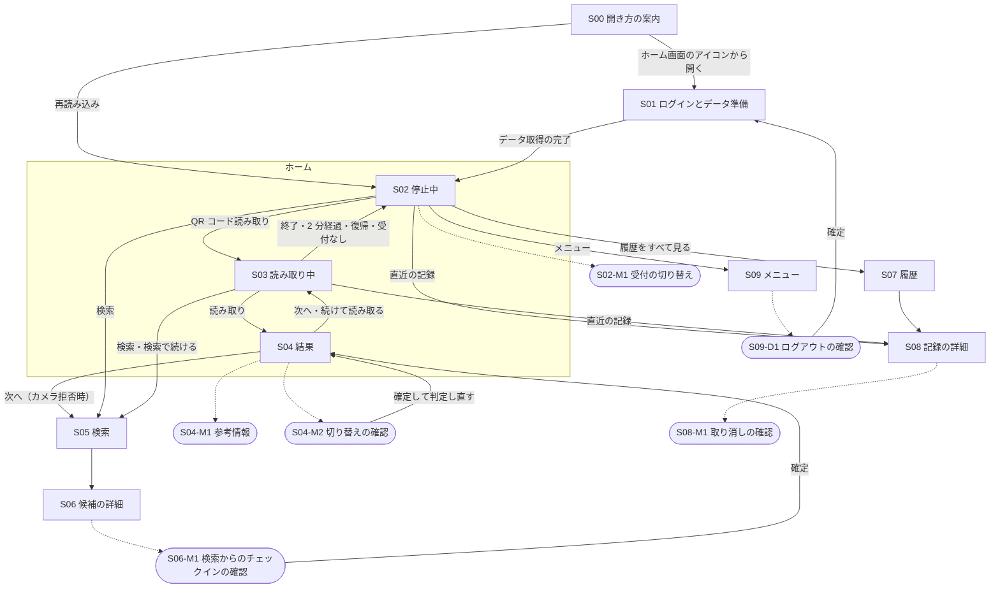

## 5. 画面ごとの詳細

### S00 開き方の案内

受付アプリを、その開き方では使えないときに表示し、ほかの画面には進ませない。どこで開けば使えるかを案内する。状態は次の 2 つである。

| 状態 | 入る条件 | 本文 | 下部固定 |
| --- | --- | --- | --- |
| Safari のタブ | iOS で、ホーム画面の Web アプリとしてではなく Safari のタブで開いたとき（NFR-8） | 見出し「ホーム画面に追加して開いてください」と、アイコン付きの 3 段階の手順（①「共有」ボタン（共有のアイコン）②「ホーム画面に追加」③ ホーム画面のアイコンから開く） | なし |
| 別の画面で開いている | ログイン済みで起動したとき（ログインから戻ったときを含む）に、同じ端末の別の画面で、受付アプリがすでにログイン済みで動いているとき（NFR-9）。または、受付アプリの更新で端末内のデータの形を移すときに、別の画面で開いている受付アプリに待たされたとき（Design Doc 6.3） | 見出し「別の画面で開いています」と文。文は、この画面がホーム画面のアプリなら「ブラウザのタブで開いている受付アプリを閉じてから、「再読み込み」を押してください」、ブラウザのタブなら「ホーム画面のアプリかほかのタブで開いているので、このタブは閉じてください」 | 「再読み込み」（主ボタン）。起動をやり直す |

Safari のタブで止めるのは、Safari のタブとホーム画面の Web アプリがデータを共有しないためである。Safari のタブでログインやデータの取得をすると、追加した後にやり直しになり、未同期の記録が Safari の側に取り残される。Android のブラウザでは止めず、S01 で追加を勧める。

別の画面で開いているときに止めるのは、反対に、Android ではブラウザのタブとインストールしたアプリが端末内のデータを共有するためである（端末の挙動 9 章）。2 つの画面が同時に動くと、一方でログアウトしてデータを消した後も、もう一方が、読み込んであった古い状態のまま記録を書き戻しうる（FR-37）。ログインしていない画面は記録もデータも書かないので、ほかの画面が動いていることを理由には止めない。Android の準備では、Chrome のタブで開いてホーム画面に追加し、タブを開いたままアプリを開くことがあるが、そのタブはまだログインしていないので、アプリは止まらない。

受付アプリの更新で端末内のデータの形を移すときに、別の画面で開いている受付アプリがあると、移すのを待たされる。このときも、後から開いたこの画面を同じ状態で止め、先に開いていた画面は止めない（Design Doc 6.3）。先に開いていた画面は受付に使われていることがあり、後から開いた画面の都合で止めないためである。この画面は、端末内のデータを開けないので、ログインしているかが分かる前に止まる。ほかの画面がログイン済みで動いているときも、この画面は端末内のデータを開く前に止まる（Design Doc 6.4）。開いてから止めると、データの形を移す要求が、受付に使っている画面の後ろに残ることがあるためである。スタッフがすること（ほかの画面を閉じて、読み込み直す）は、ほかの画面がログイン済みで動いているときと同じなので、状態も文言も分けない。1 つの画面だけで使う端末（NFR-9）では、起きない見込みである（Design Doc 12.3）。

文を 2 通りにするのは、閉じてもらう画面が、この画面の種類で決まるためである。Android では、インストールしたアプリを 2 つ同時には開けないので、アプリで止まったときに先に動いているのはブラウザのタブである。タブで止まったときは、受付アプリはホーム画面のアプリで使う（S01）ので、そのタブを閉じてもらう。

ほかの画面を閉じても、この画面は自動では進まず、「再読み込み」で起動をやり直す。自動で進む作りにすると、開いたまま忘れられたタブが、アプリを閉じた隙に先に進み、次にアプリを開いたときにアプリを止めてしまうためである。

カンプ:

| Safari のタブ | 別の画面で開いている（ホーム画面のアプリ） | 別の画面で開いている（ブラウザのタブ） |
| --- | --- | --- |
| 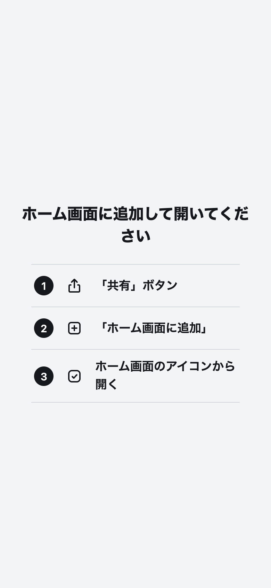 | 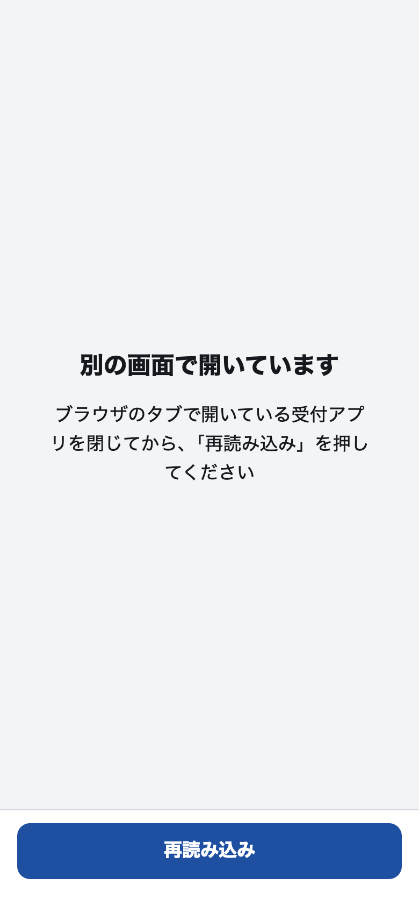 | 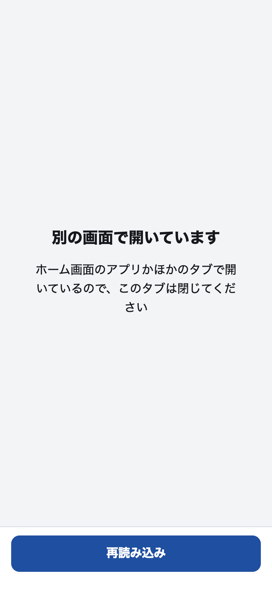 |

### S01 ログインとデータ準備

Discord でのログイン（FR-35）を行い、設定とスナップショットを初めて取得する。あわせて、アプリのファイル（受付アプリそのものを動かすファイル。Design Doc 6.11）を端末に取り込み、オフラインで起動できるようにする。状態ごとに表示を変える。

| 状態 | 入る条件 | 本文 | 下部固定 |
| --- | --- | --- | --- |
| 未ログイン | 未ログインで起動したとき、ログアウトの後、ログイン中に失敗したとき | カンファレンス名。ログインに失敗したとき（Discord から失敗で戻ったとき、戻った後に操作者の情報を取得できなかったとき）だけ「ログインできませんでした」。Android のブラウザで開いたときだけ、1 行のバナー「ホーム画面に追加して使ってください」 | 「Discord でログイン」（主ボタン） |
| ログイン中 | Discord から戻ってきたとき | 回転するアイコンと「ログイン中」 | なし |
| ロールなし | 指定のロールを持たないとき（FR-35） | 「このアカウントでは使えません」 | 「別のアカウントでログイン」 |
| データ取得中 | ログインに成功したとき、ログイン済みで、スナップショットがないか、アプリのファイルの取り込みが済んでいない端末で起動したとき | 回転するアイコンと「データを取得中」 | なし |
| 取得失敗 | データか、アプリのファイルを取得できなかったとき | データを取得できなかったときは「データを取得できませんでした」、アプリのファイルだけを取得できなかったときは「アプリのファイルを取得できませんでした」 | 「再試行」（主ボタン） |
| 再ログインが必要 | データの取得で、ログインの期限が切れていると分かったとき | 「ログインの期限が切れました。もう一度ログインしてください」 | 「Discord でログイン」（主ボタン） |

- 「Discord でログイン」を押すと Discord の認可画面に移り、認可の後に本アプリの URL に戻ってくる。iOS では、スタッフがログイン画面で Discord アプリを使ったログインを選ぶと、戻り先がホーム画面アプリではなく既定のブラウザになる可能性がある（[端末の挙動](research/device-behavior.md) 3 章。6 章）
- データの取得が終わり、アプリのファイルもそろったら S02 へ進む。データだけがそろった端末は、会場でオフラインのまま受付アプリを開き直すと、起動できないためである。アプリのファイルを待つ時間には上限を置き、超えたら取得失敗にする（待ち方と上限は Design Doc 6.4）。アイコンが回ったまま先へ進まない状態を作らないためである。待っている間の「データを取得中」の文言は、アプリのファイルを待つときも変えない。待っている間、スタッフがすることはないためである
- データがある端末でも、アプリのファイルの取り込みが済んでいなければ、起動のときに「データ取得中」で、アプリのファイルがそろうのを待つ。準備の途中で読み込み直しても、オフラインで起動できない端末が受付に進まないようにするためである。データは取得した時点で端末に残るので、この待ちがないと、アプリのファイルだけを取得できなかった後に、「再試行」を押さずに読み込み直した端末が S02 に進んでしまう。取り込みが済んでいるかの判定は Design Doc 6.4 による。取り込んだ後にアプリのファイルだけが消えた端末は止めず、受付アプリが起動時に行う取り直しと、S09 の表示に任せる（Design Doc 6.11）
- 取得失敗の文言は、何を取得できなかったかで分ける。アプリのファイルの文言は、データを取得できたことも伝えるので、データも取得できなかったときには使わない。「再試行」は、データとアプリのファイルのうち、そろっていないほうを取り直す
- 取得失敗を 1 つの状態にまとめるのは、どちらを取得できなかったときも、スタッフはネットワークのある場所で「再試行」を押すだけで、取れる行動が変わらないためである。それでも文言を分けるのは、管理者が原因を探すときに差が出るためである。データの文言を見た管理者は、まず公開を疑う。しかし、リリースの不具合でアプリのファイルを配れないときは、全端末が同じ所で失敗し、調べるべきなのはデプロイである。データを取得できているのに「データを取得できませんでした」と出すと、事実とも違う
- 再ログイン（2.8）では端末内のデータを消さず、ログインが済んだら S02 へ戻る。データはその後の同期で受け取る
- 再ログインのとき（端末内にデータがあるとき）は、「未ログイン」と「ロールなし」の状態の左上に「戻る」を置き、S02 に戻れるようにする。ログインに失敗したときは「未ログイン」に戻り、「ログインできませんでした」と「戻る」を出す。誤ってタップしたときやログインに失敗したときも、受付を続けられるようにするためである（FR-36）
- 再ログインが必要の状態を取得失敗と分けるのは、ログインの期限が切れたままでは「再試行」を繰り返してもデータを取得できないためである。S01 にはヘッダがなく、ヘッダの「再ログインが必要」（2.3）からは再ログインできない。この状態からのログインも、再ログイン（2.8）と同じく端末内のデータを消さない。ログインが済んだら、データ取得中に戻って取得をやり直す。S02 に戻るためのデータがまだないので、「戻る」は置かない
- 取得失敗と再ログインが必要の状態で新しい版の受付アプリが届いたときは、自動で読み込み直し、新しい版で取得をやり直す（Design Doc 6.11）。古い版の受付アプリが新しいデータを読めず、取得に失敗し続けるときに、S01 から進めるようにするためである

カンプ:

| 未ログイン | 未ログイン（Android のブラウザ） | 未ログイン（ログインの失敗後） |
| --- | --- | --- |
| 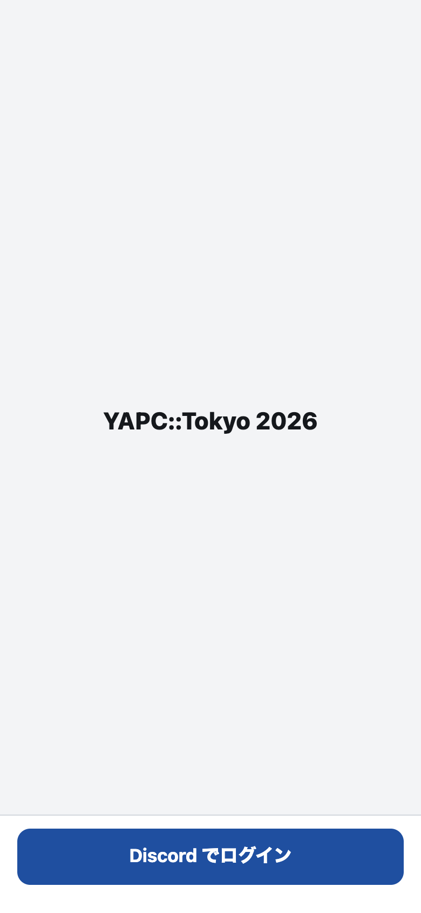 | 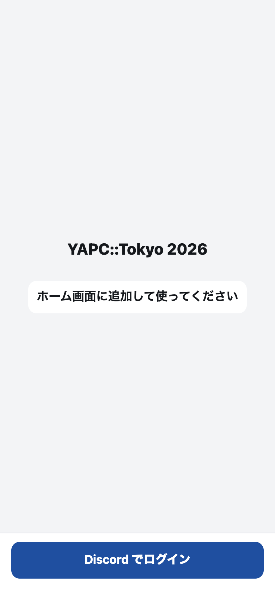 | 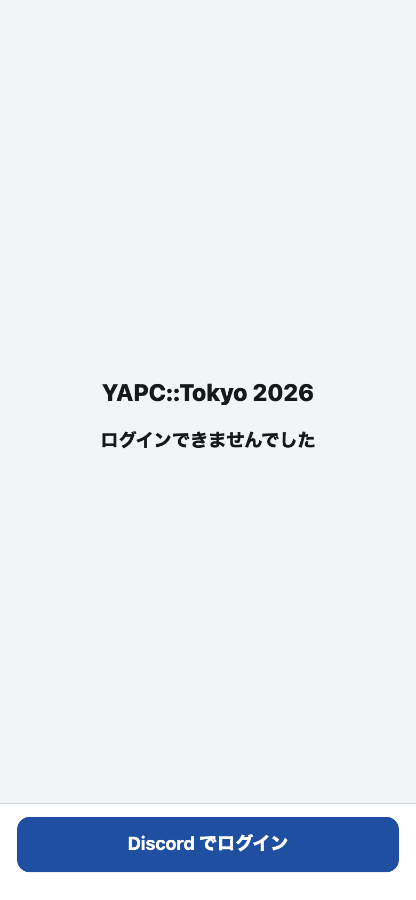 |

| ログイン中 | ロールなし | データ取得中 |
| --- | --- | --- |
| 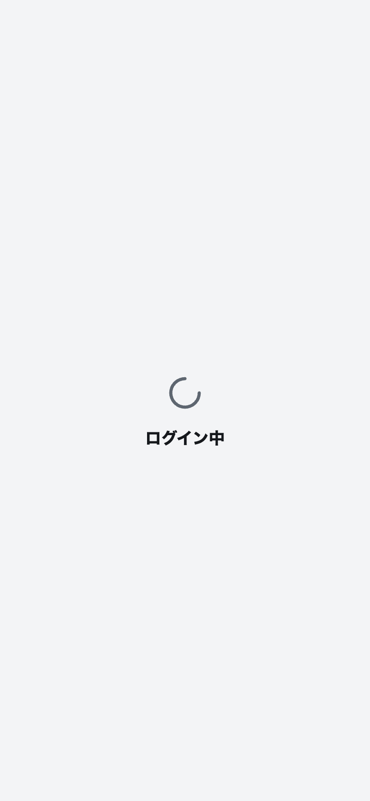 | 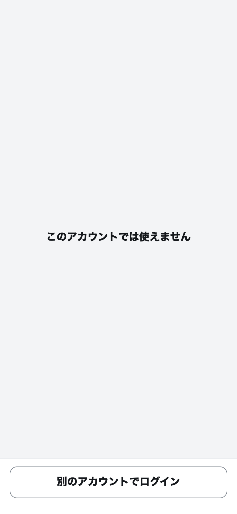 | 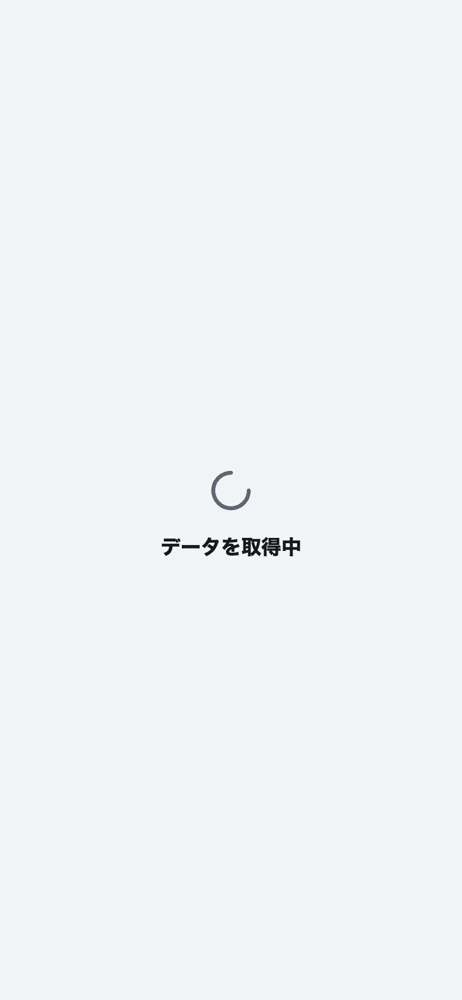 |

| 取得失敗 | 取得失敗（アプリのファイル） |
| --- | --- |
| 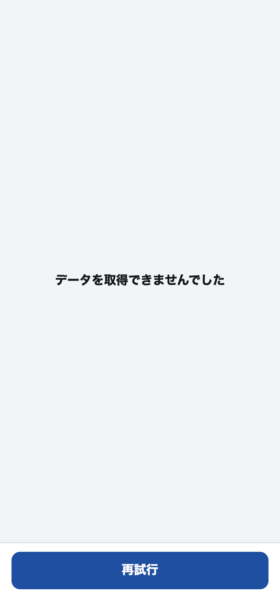 | 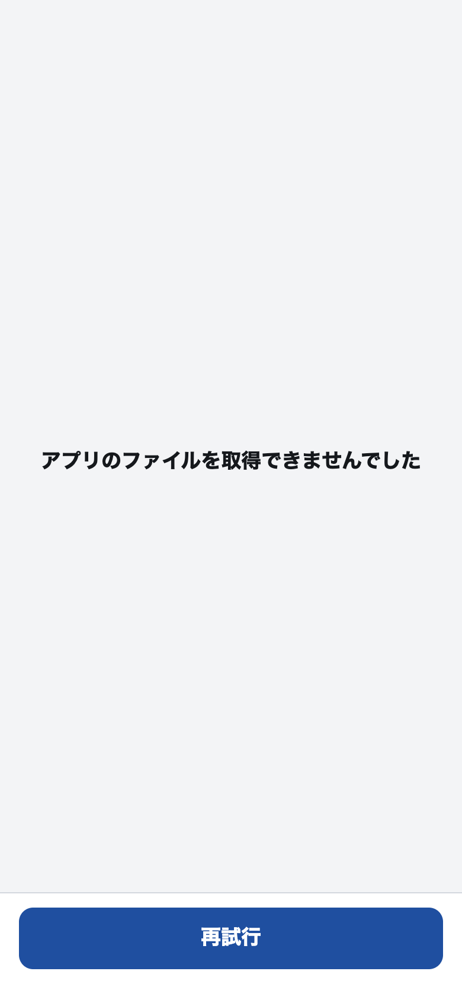 |

### S02〜S04 ホーム

ホームは、受付の起点であり、チケット QR の読み取りと判定結果の表示も行う 1 つの画面である。停止中（S02）、読み取り中（S03）、結果（S04）の 3 つの状態を持つ。状態ごとの要素は、この後の各節で定める。

| 状態 | 上の領域 | その下の本文 | 下部固定 |
| --- | --- | --- | --- |
| 停止中（S02） | 受付のカード | 直近の記録、履歴へのリンク | 「検索」「QR コード読み取り」 |
| 読み取り中（S03） | カメラの映像 | 直近の記録 | 「検索」 |
| 結果（S04） | 結果の色の帯 | 参加者の情報 | 「参考情報」、主ボタン |

本文の先頭には、どの状態でも同じ位置と高さで、画面の上 3 分の 1 程度を占める領域を置く。本書では、これを上の領域と呼ぶ。中身が上の領域に収まらないとき（長い拒否メッセージ、カメラを使えないときの手順など）だけ、上の領域を下に伸ばす。上の領域はスクロールさせない。結果の状態でその下の本文が収まらないときは、上の領域の下だけをスクロールさせ、結果の色とアイコンが常に見えるようにする。状態が変わるときは、画面を移る動きを付けず、上の領域とその下の中身を入れ替える。表示領域の高さが足りないときは、この段落の決めを後述のとおりに崩す。

1 つの画面にまとめるのは、カメラを向けた場所がそのまま判定結果の色に変わり、スタッフが視線を動かさずに結果を確かめられるようにするためである。読み取りを終えたときも、別の画面に移るのではなく停止中に戻るだけなので、スタッフから見て自分がどこにいるかが変わらない。

上の領域を上 3 分の 1 程度にとどめるのは、結果の状態で、その下に出す参加者の情報とチケットの一覧の高さを残すためである。読み取りの細かさはカメラの映像で決まり、画面に出す大きさには左右されないので、この大きさでも読み取りの精度は落ちない。ただし、縦長の映像を横長の上の領域に収めると映像の上下が画面から切れるので、読み取る範囲は画面に出ている範囲に限る（S03）。

表示領域の高さが足りないとき（1.2）は、上の領域を固定せず、その下の本文と一緒に、ひと続きの本文としてスクロールさせる。上の領域の高さの決め（画面の上 3 分の 1 程度で、中身が収まらなければ伸ばす）は変えない。状態ごとの見え方は次のとおりである。

| 状態 | 高さが足りないときの見え方 |
| --- | --- |
| 停止中（S02） | 直近の記録を新しい順に 3 件まで出し、その下に「履歴をすべて見る」を置く |
| 読み取り中（S03） | 直近の記録を出さず、本文をカメラの映像だけにする。本文はスクロールしない。ただし、カメラを使えないとき（映像の代わりに手順を出すとき）は、収まらなければスクロールする |
| 結果（S04） | 結果の帯も、その下と一緒にスクロールする。結果を出したときは先頭から表示し、帯が見える状態から始める |

S02 で件数を決めるのは、本文がスクロールすると、収まる件数が決まらないためである。すべて出すと、この端末の記録が数百件になったときに、「履歴をすべて見る」が遠くに押し出される。S03 で直近の記録を出さないのは、本文がスクロールしてカメラの映像が画面の外に出ると、スタッフに見えていない映像で QR を読み取ることになり、読み取る範囲を画面に出ている範囲に限る決め（S03）に反するためである。その代わり、このときの読み取り中には直近の記録から S08 を開けないので、取り消すときは停止中に戻ってから開く。カメラを使えないときにスクロールさせるのは、映像がなく読み取りもしないのでこの理由が当たらず、手順とボタンが見えなくならないことを優先するためである。S04 で帯も一緒にスクロールさせるのは、帯を止めると、その下に参加者の情報とチケットの一覧を出す高さがほとんど残らないためである。帯が見える状態から始めるので、判定の結果は、出した時点では目に入る。

### S02 ホーム（停止中）

受付の状態を確かめ、読み取り、検索、履歴、メニューへ進む起点である。S01 でデータの準備が済んだとき、読み取りを終えたとき、ほかの画面から「戻る」で戻ったときに、この状態になる。

| 領域 | 要素 | 内容 |
| --- | --- | --- |
| 上部固定 | ヘッダ | 同期の状態、メニュー（名前: メニュー）。受付は出さない |
| 本文（上の領域） | 受付のカード | `{受付名}`（大きく）、「自動」または「手動」（手動は注意色）、期間（期間中なら `{開始}〜{終了}`、期間外なら「期間外」）。タップすると S02-M1 を開く（名前: 受付を切り替える） |
| 本文 | 直近の記録 | 見出し「直近の記録」と、この端末で行ったチェックインと取り消しの記録を新しい順に、上の領域と「履歴をすべて見る」の間に収まる件数だけ出す（高さが足りないときは 3 件まで。S02〜S04）。1 行に時刻、操作のアイコン（名前: チェックイン）、ユーザ名、チケット番号（1 回の操作で複数のチケットを扱ったら「、」で並べる）。取り消しの行には、アイコンの右に「取り消し」と書き、アイコンには名前を付けない（S07）。タップすると S08 を開く。0 件なら見出しも出さない |
| 本文 | 履歴へのリンク | 「履歴をすべて見る」。S07 へ |
| 下部固定 | 検索 | 「検索」（全幅）。S05 へ |
| 下部固定 | QR コード読み取り | 「QR コード読み取り」（主ボタン、全幅、最下段）。読み取り中（S03）にする |

直近の記録をこの端末の操作に限るのは、スタッフがここで確かめたいのが、自分がいま行った操作が通ったかどうかだからである。出す件数は画面の高さで変わり、本文はスクロールさせない（高さが足りないときを除く。S02〜S04）。それより前の記録は「履歴をすべて見る」から S07 で見る。件数などの集計は出さない（FR-31）。

読み取りを、上の領域のタップではなく「QR コード読み取り」で始めるのは、主要なボタンを親指の届く画面の下半分に置くためである（1.1）。上の領域は親指の届きにくい画面の上側にあるので、たまにしか使わない受付の切り替えの入口にする。

受付なしのときは、受付のカードを灰色にして「受付なし」とだけ出し、「QR コード読み取り」を押せないようにする（FR-7）。「検索」は押せるが、S06 からチェックインはできない。

カンプ:

| 自動 | 手動 | 受付なし |
| --- | --- | --- |
| 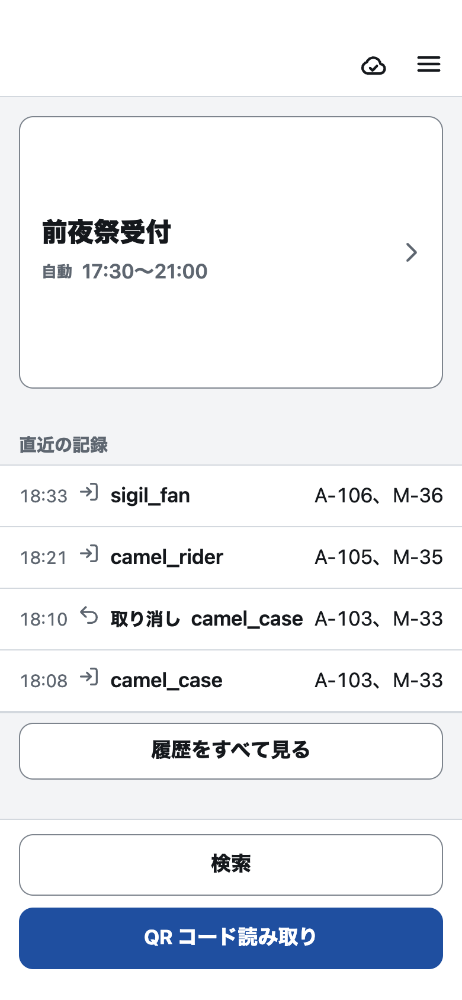 | 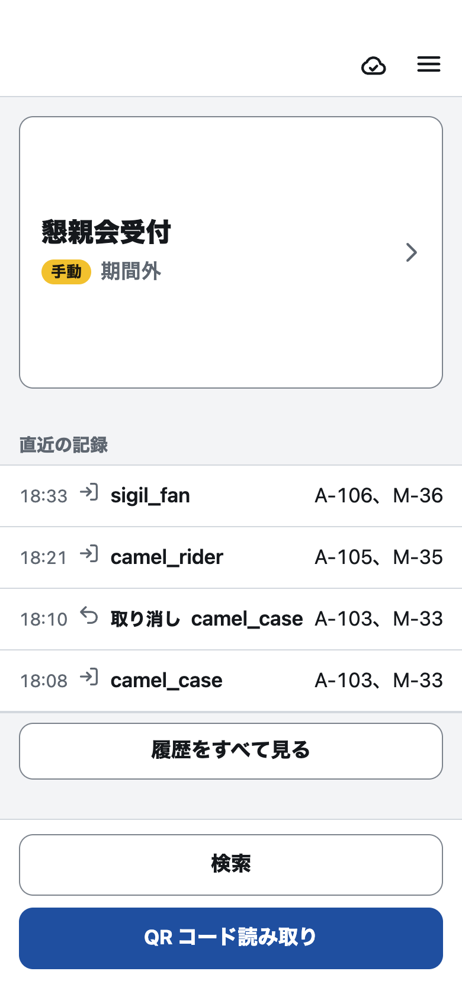 | 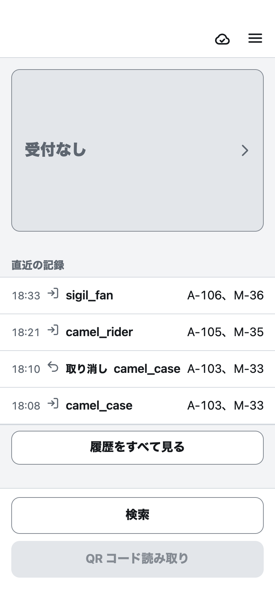 |

### S02-M1 受付の切り替え（シート）

受付を手動で切り替える、または手動の上書きを解除する（FR-8）。停止中（S02）の受付のカードからだけ開く。シートの中身は、一覧と確認の 2 段階で切り替わる。

一覧:

| 要素 | 内容 |
| --- | --- |
| 閉じる | 右上のアイコン（名前: 閉じる） |
| 自動に戻す | 手動で上書きしているときだけ、一覧の上に置く。注意を要する操作「自動に戻す」 |
| 受付の一覧 | 設定のすべての受付を設定の順に並べる。各行に `{受付名}` と状態（「期間中」「これから」「終了」）。状態は、現在時刻がどれかの期間に含まれれば「期間中」、これから始まる期間があれば「これから」、どちらでもなければ「終了」とする。現在の受付の行には「現在」と書き、選べないようにする。選べる行の右端には ⚠ を置く。行を選ぶと確認に切り替わる。一覧の下には余白を空け、最下行が S02 の主ボタンの上端より上に収まるようにする |

「自動に戻す」を一覧の下ではなく上に置き、一覧の下に余白を空けるのは、S02 の主ボタン（「QR コード読み取り」）が画面の最下段にあり、同じ位置を避けるためである（2.5）。受付の行も、押すと確認に進む注意を要する操作である。余白がないと、受付が 2、3 件あるだけで、最下行がこの位置に来る。

現在の受付を印ではなく文字で示すのは、丸い印がラジオボタンに見え、選べる行と紛らわしいためである。

期間と期間の間にある受付を「終了」ではなく「これから」とするのは、日ごとの期間を持つ受付（PRD 11 章の本編受付など）が、夜の間に、もう使わない受付のように見えないようにするためである。

確認:

| 要素 | 内容 |
| --- | --- |
| 文 | 切り替えるとき:「この端末の受付を {受付名} に固定します。解除するか、次の期間の境目までこのままです」。期間外の受付なら 2 行目に「{受付名}は期間外です」。自動に戻すとき:「自動の選択に戻します。受付は {受付名} になります」（受付なしになる場合は「受付なしになります」）。この {受付名} は、受付のカードの表示ではなく現在時刻で選んだ受付である（2.7 の保留中にも正しく出すため） |
| 確定 | 「切り替える」または「戻す」（2.5 の確定ボタン） |
| やめる | 「やめる」。一覧に戻る |

確定すると、シートを閉じて受付のカードを更新する。

カンプ:

| 一覧 | 一覧（手動のとき） | 確認 |
| --- | --- | --- |
| 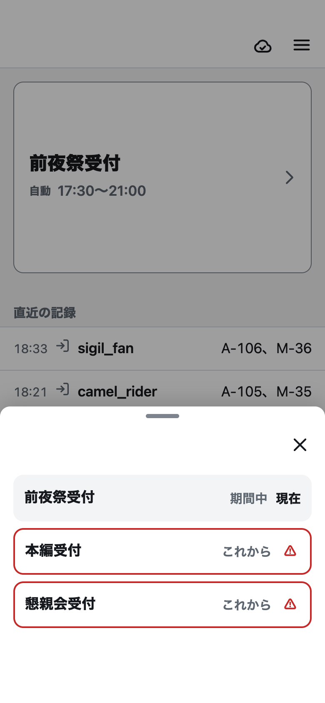 | 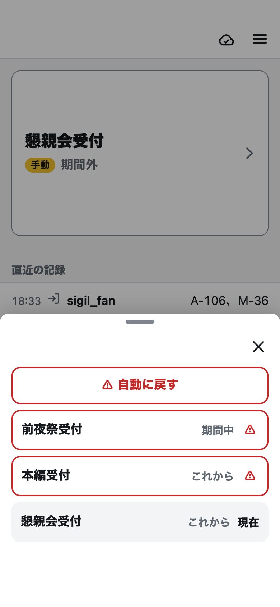 | 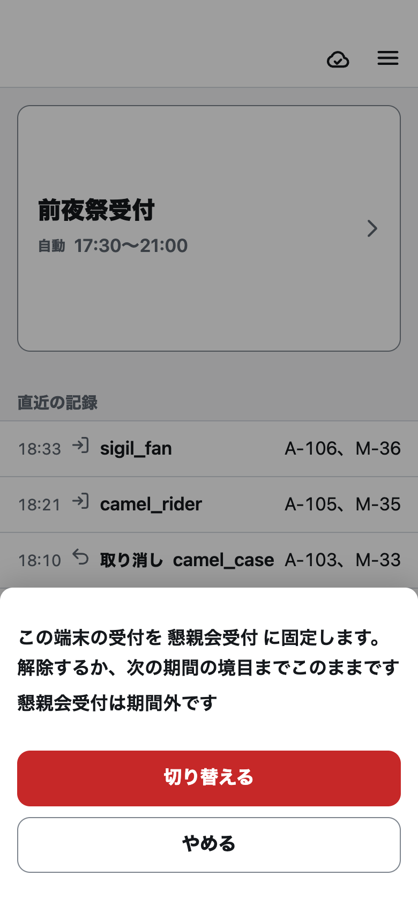 |

### S03 ホーム（読み取り中）

背面カメラでチケット QR を読み取る（FR-11）。

| 領域 | 要素 | 内容 |
| --- | --- | --- |
| 上部固定 | ヘッダ | 左に「終了」（停止中へ）、受付、同期の状態 |
| 本文（上の領域） | カメラの映像 | 背面カメラの映像を、縦横比を保ったまま、上の領域に隙間なく収める（はみ出す部分は切る）。読み取るのは、上の領域に出ている範囲の QR だけにする |
| 本文（上の領域） | 読み取り枠 | 映像に重ねる枠 |
| 本文（上の領域） | バナー | QR 形式外のときだけ、映像に重ねて「チケットの QR ではありません」。2 秒で消え、同じ内容の QR を写し続けている間は出し直さない。音は鳴らさない |
| 本文 | 直近の記録 | 停止中（S02）と同じ見出し「直近の記録」と記録を、上の領域と下部固定の間に収まる件数だけ出す。高さが足りないときは出さない（S02〜S04）。タップすると S08 を開く |
| 下部固定 | 検索 | 「検索」（左に寄せ、全幅にしない）。S05 へ。カメラの使用が拒否されたときは置かない |

読み取る範囲を上の領域に出ている範囲に限るのは、画面に出ていない QR を読み取らないためである。縦持ちのカメラの映像は縦長なので、横長の上の領域に隙間なく収めると、画面に出るのは映像の高さの半分ほど（3:4 の映像で 54%、9:16 で 40%）になる。残りまで読み取ると、列の次の人が構えたチケットの QR を、スタッフが狙わないまま読み、判定まで進めるおそれがある。映像を縮めて全体を上の領域に収める方法は採らない。映像の幅が 210px ほどになり、狙いにくいためである。読み取り枠の中だけに限る方法も採らない。画面に見えている QR が読まれないと、スタッフが戸惑うためである。

カメラのライトは使わない。来場者はチケット QR をスマートフォンの画面かウォレットのパスで提示するので（PRD 4 章）、照らす必要がなく、照らすと画面に光が映り込んで読み取りを妨げうるためである。

「検索」を置くのは、QR を出せない来場者が来たときに、停止中を経由せずに検索へ移れるようにするためである。停止中に戻る「終了」は左上にあり、片手では指が届きにくい。全幅にしないのは、結果（S04）の下部の主ボタンを続けて叩いたときに押されにくくするためである。押されても検索の画面に移るだけで、注意を要する操作ではない。カメラの使用が拒否されたときは、上の領域の「検索で続ける」を使う。

読み取り中にも直近の記録を出すのは、いま行った操作が通ったかを、読み取りを止めずに確かめられるようにするためである。タップで S08 を開けるので、誤りに気づいたときに「終了」を経ずに取り消しへ進める。表示領域の高さが足りないときは、直近の記録を出さない（S02〜S04）ので、「終了」で停止中に戻ってから開く。S08 の「戻る」では、読み取り中ではなく停止中に戻る（S08）。

上の領域の表示は、カメラの使用の許可によって変える。

| カメラの状態 | 入る条件 | 上の領域の表示 |
| --- | --- | --- |
| 許可待ち | カメラの使用の許可を求めている間 | カメラのアイコン（名前: カメラの許可待ち）だけを出す |
| 許可済み | 許可されたとき | 上の表のとおり |
| 拒否された | 許可が得られなかったとき（FR-27） | 映像の代わりに「カメラを使えません」と、OS ごとの許可の手順（iOS は「設定 > アプリ > Safari > カメラ」、Android は「Chrome > 設定 > サイトの設定 > カメラ」）。ボタン「もう一度試す」と「検索で続ける」（S05 へ） |

iOS 27 の実機では、ホーム画面アプリがカメラの使用の許可を求めるのは初回だけだった（検証者の申告。6 章）。一方、iOS 26.3 のシミュレータでは起動するたびに求められ、iOS 26 の実機でも起動のたびに求められたという報告がある（6.1）。起動のたびに求められても、画面は変えない。許可待ちの状態から許可すれば、読み取りに進めるためである。Safari のカメラの設定を「許可」に変えればこの確認は出なくなるが、その設定は全サイトに効くので、スタッフには求めない。

- チケット QR を読み取ったら判定し、結果（S04）にする（NFR-1）
- 「終了」を押したとき、チケット QR を 2 分間読み取らなかったとき、バックグラウンドから戻ったとき、受付なしになったときは、停止中（S02）に戻す（2.6, 2.7）

カンプ:

| 許可待ち | 許可済み | QR 形式外のバナー |
| --- | --- | --- |
| 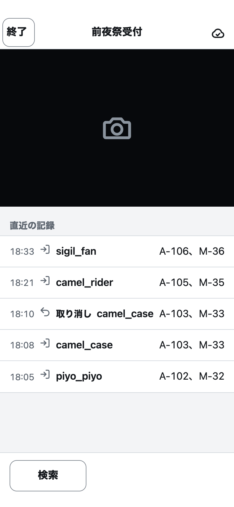 | 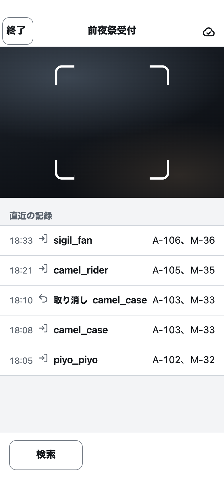 | 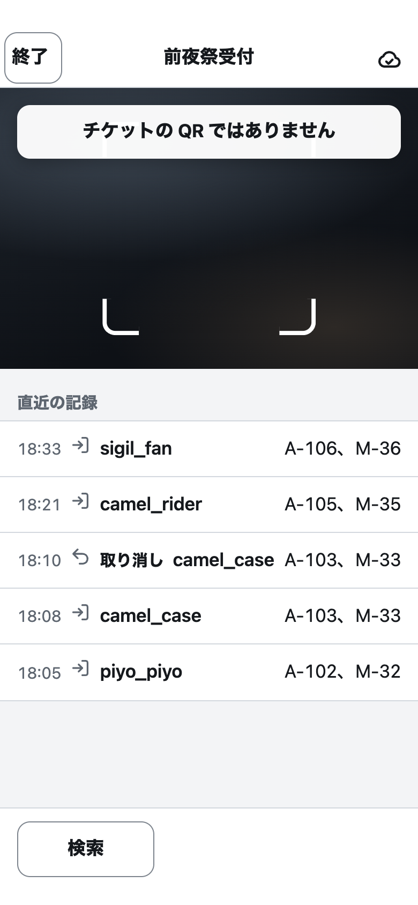 |

| 拒否された |
| --- |
| 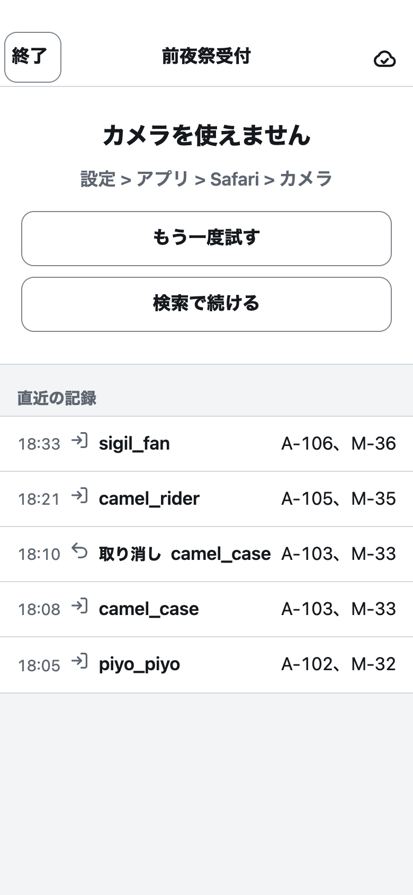 |

### S04 ホーム（結果）

判定結果と、その参加者の情報を出す（FR-19）。結果の種類と、帯・主ボタンの文言は 2.4 の表に従う。判定結果を表示したときに、音と振動で 1 回知らせる。

| 領域 | 要素 | 内容 |
| --- | --- | --- |
| 上部固定 | ヘッダ | 受付、同期の状態。戻る操作は置かない |
| 本文（上の領域） | 帯 | 上の領域を結果の色で塗り、アイコン、結果名、帯の 1 行を出す。腕を伸ばした距離からでも結果が分かるようにするため |
| 本文 | ユーザ名 | 大きく出し、その下に Name。結果が「見つからない」のときは出さない |
| 本文 | 済みの詳細 | 済みのときだけ、帯の 1 行と同じ記録（2.4）の `{操作者}`・`{端末名}` |
| 本文 | 切り替え | 切替提案のときだけ。注意を要する操作「{提案する受付名}に切り替えて判定」。S04-M2 を開く |
| 本文 | チケットの一覧 | そのユーザの有効なチケットをすべて、2.9 の形式で並べる。アンケート回答は、今回済みの行にだけ最初から出し、ほかの行では閉じておく（2.9）。読み取ったチケット（検索から来たときは選んだチケット）の行は太字にする。続けて読み取りのときは、済みにできなかったイベントのイベント名の行に印（名前: 済みにできなかったイベント）を付ける。結果が「見つからない」のときは出さない |
| 本文 | データの版 | 結果が「見つからない」のときだけ、見出し「データの取得日時」と、イベントごとの「`{イベント名}` `{取り込み日時}`」 |
| 下部固定 | 参考情報 | 「参考情報」（主ボタンの上）。S04-M1 を開く。結果が「見つからない」のときは出さない |
| 下部固定 | 主ボタン | 2.4 の表の「下部の主ボタン」（主ボタン、全幅） |

- 下部の主ボタンを押すと、読み取り中（S03）に戻る。検索から来たときも同じである。QR を持たない来場者はまれで、次の来場者は QR を持っている見込みが高いためである
- カメラの使用が拒否されている端末では、S05 に移り、入力欄を空にする。その端末ではどの来場者も検索で受け付けるためである
- 切り替えを S04-M2 で確定すると、同じチケットを新しい受付で判定し直し、結果の内容を差し替えて、音と振動で知らせ直す（FR-9）
- 続けて読み取りで、来場者が残りのチケットの QR を出せない場合は、読み取り中（S03）の「検索」から指定する（FR-15, 26）
- 取り消しの操作は置かない。誤ってチェックインした場合は、直近の記録（S02、S03）から S08 を開いて取り消す。表示領域の高さが足りないときは、読み取り中に直近の記録を出さない（S02〜S04）ので、停止中に戻ってから開く。結果の状態で押せるものを少なくして、誤操作を減らすためである

ユーザ名を帯の中ではなく帯の下に出すのは、ユーザ名を省略せず、折り返して全文を出すためである（2.9）。高さの決まった帯の中では、長いユーザ名が帯の 1 行と一緒に収まるとは限らない。

参考情報を本文に出さず、ボタンの先のシート（S04-M1）に置くのは、結果の画面を、判定、本人の確認、チケットの一覧に絞って見やすく保つためである。本文に出すと、帯、ユーザ名、参考情報、チケットの一覧が並んで見づらくなる。いま渡すチケットの T シャツのサイズのような回答は、一覧の今回済みの行に出ている。

読み取ったチケットの番号と種別（FR-19）は、チケットの一覧の太字の行で示し、別の要素としては出さない。同じ情報を 2 か所に出さないためである。

データの版に見出しを付けるのは、「本編 11/26 22:10」のような行だけでは、イベントの開催日時とも読めるためである。見出しの「取得」は、帯の 1 行の「データ取得後の購入です」と言葉をそろえている。

カンプ:

| 成功 | 続けて読み取り | 済み |
| --- | --- | --- |
| 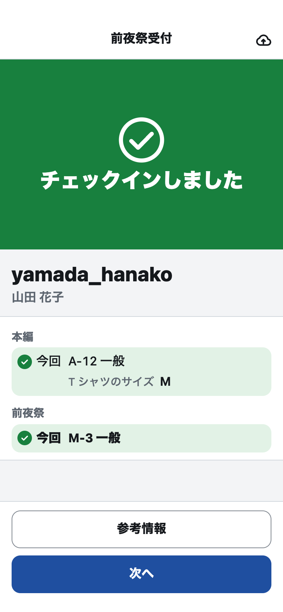 | 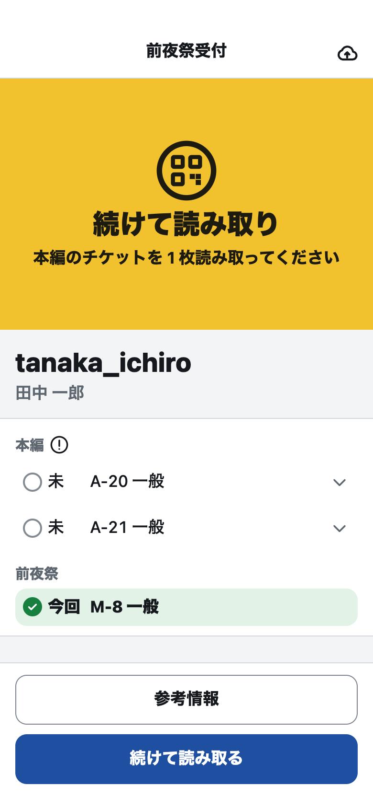 | 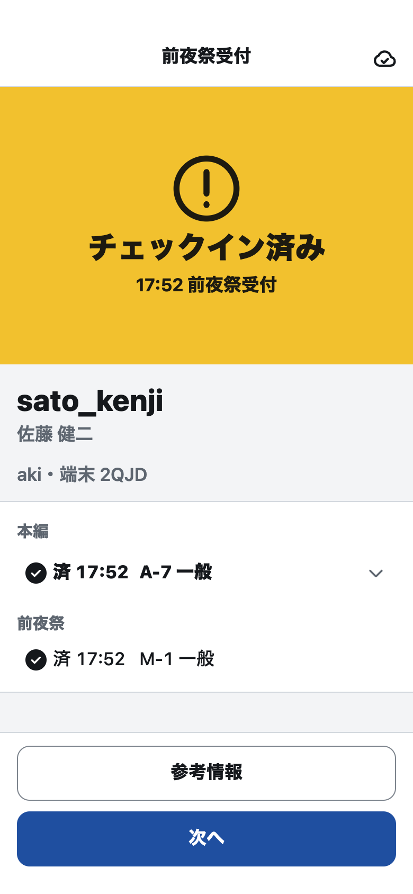 |

| 切替提案 | 拒否 | 対象外 |
| --- | --- | --- |
| 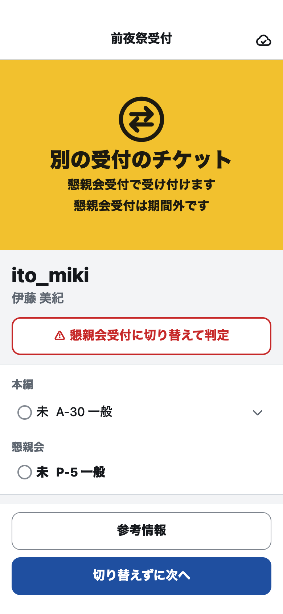 | 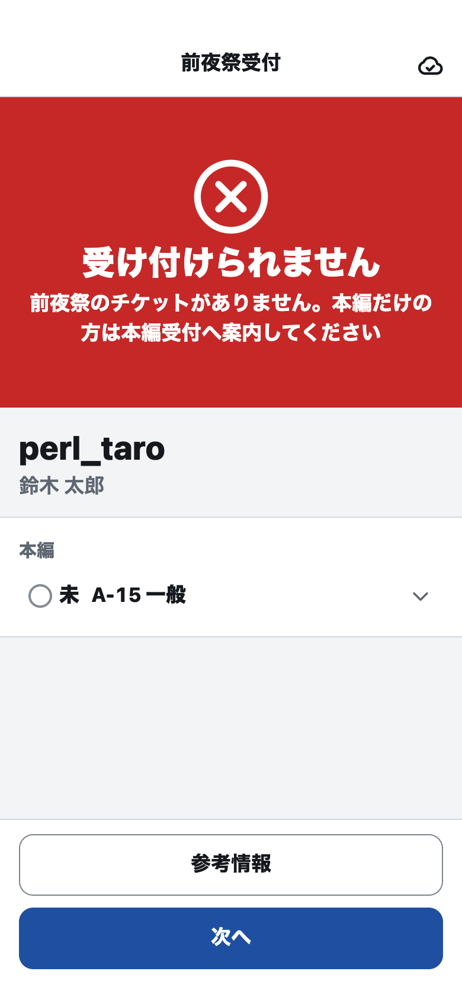 | 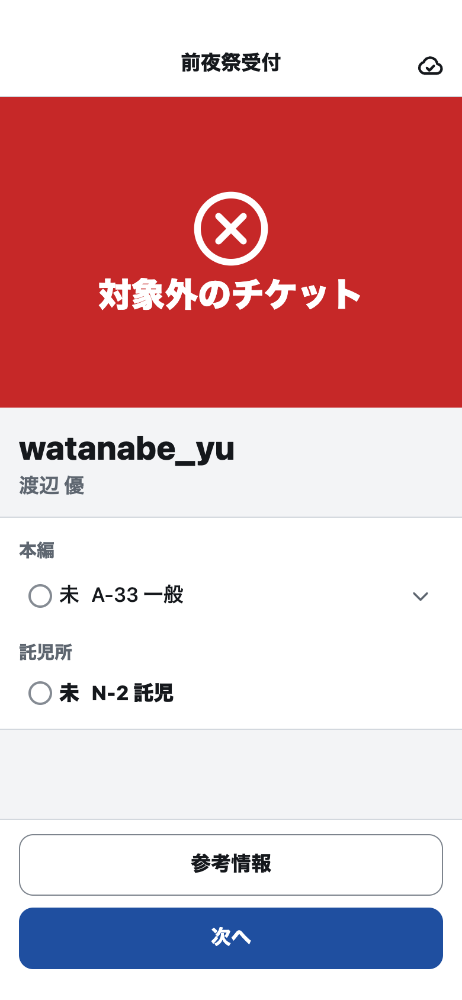 |

| 見つからない |
| --- |
| 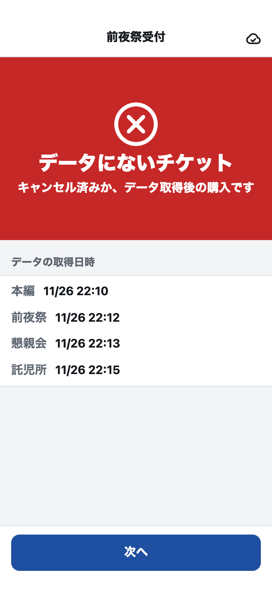 |

### S04-M1 参考情報（シート）

設定のテンプレートを、その参加者の情報で描画して出す（FR-20）。結果（S04）の「参考情報」から開き、画面の下半分程度の高さで開く。

| 要素 | 内容 |
| --- | --- |
| 閉じる | 右上のアイコン（名前: 閉じる） |
| 描画結果 | テンプレートの描画結果を、ただの文字列として出す。改行だけを保ち、HTML や Markdown などの記法としては解釈しない。長い行は折り返し、全体が長い場合はシートの中でスクロールする。描画に失敗したら「表示できません」 |

記法として解釈しないのは、描画結果に Name やアンケート回答のような参加者が入力した値が入るためである。解釈すると、参加者の入力しだいで表示が崩れたり、内容を書き換えられたりする。テンプレートの形式（Design Doc 4.6）を変えても、この表示は変わらない。

テンプレートに渡すチケットの状態（済みか、済みの時刻、済みにした受付）は、S04 の一覧と同じく、判定した時点のものを使う（2.7）。判定した後、開くまでの間にほかの端末の記録が届いても、一覧と参考情報が食い違わないようにするためである。判定した時点の状態には、この判定の結果も含む。今回済みにしたチケットは済みとして渡し、済みの時刻はこの判定で作った記録の時刻、済みにした受付は現在の受付とする。

カンプ:

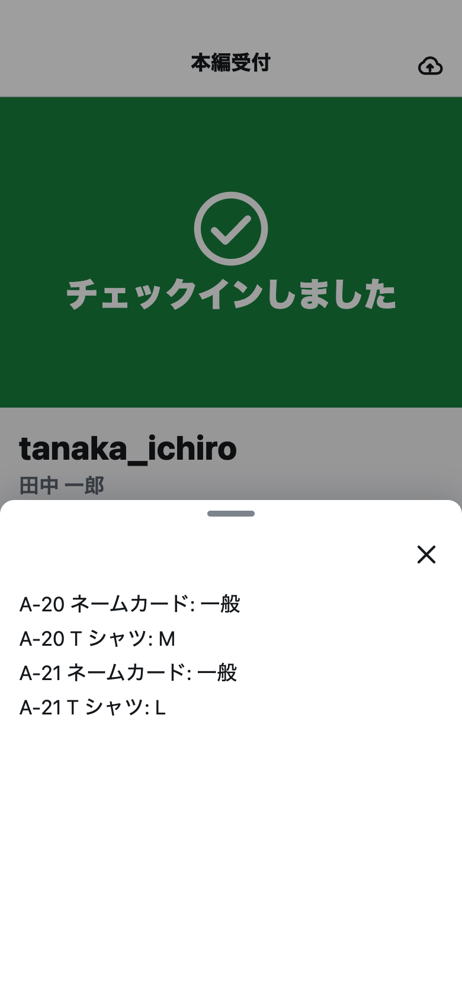

### S04-M2 切り替えの確認（シート）

切替提案から受付を切り替える前の確認である（FR-9, 33）。

| 要素 | 内容 |
| --- | --- |
| 文 | 「この端末の受付を {受付名} に固定して、このチケットを判定し直します」。期間外の受付なら 2 行目に「{受付名}は期間外です」 |
| 確定 | 「切り替える」（2.5 の確定ボタン） |
| やめる | 「やめる」 |

確定すると、受付を切り替え、S04 を判定し直した結果に差し替える。

カンプ:

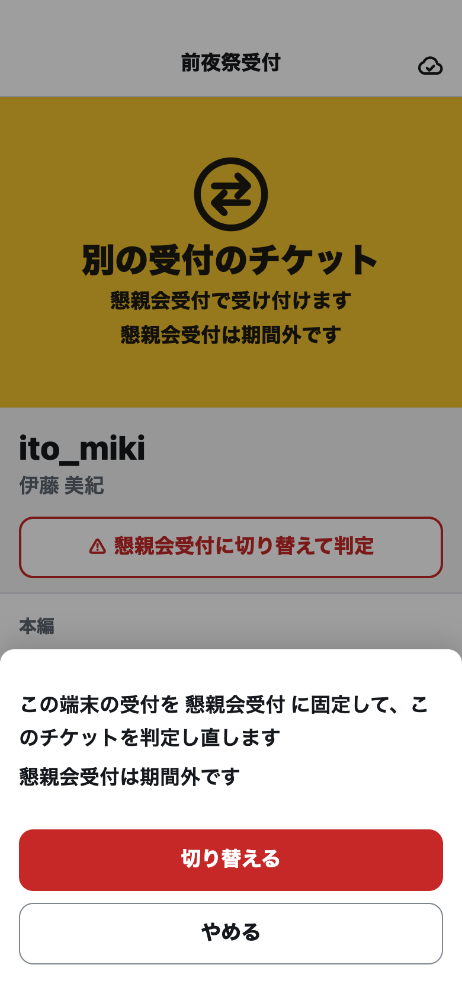

### S05 検索

QR を持たない来場者を、端末内のデータから探す（FR-24, 25）。

| 領域 | 要素 | 内容 |
| --- | --- | --- |
| 上部固定 | ヘッダ | 左に「戻る」（S02 へ）、受付、同期の状態 |
| 上部固定 | 入力欄 | 画面を開いたらすぐに入力できる状態にする。S02、S03、S04 から開いたときは空にし、S06 から「戻る」で戻ったときは入力を残す（S06）。プレースホルダには、設定の検索対象の列の表示名を「・」で並べて出す（既定は「チケット番号・ユーザ名・Name」） |
| 本文 | 候補の一覧 | 入力のたびに絞り込む。候補はユーザ単位で、最大 20 件。各行にユーザ名、Name、所持チケットの「`{チケット番号}` `{状態}`」。検索対象の列のどれかが入力と完全に一致した候補を最初に、前方一致した候補を次に、それ以外の候補（部分一致や、文字の揺れを許した一致）を最後に並べ、同じ順位の中はユーザ名の昇順にする（FR-24）。完全一致かどうかは、正規化した後の文字列で比べてよい。タップすると S06 を開く |
| 本文 | 該当なし | 入力があり、候補が 0 件のときだけ「該当なし」 |

入力の前は、本文に何も出さない。

ほかの画面から開いたときに入力欄を空にするのは、次に探すのが別の来場者だからである。前の検索語が残っていると、消す手間が増えるうえ、前の来場者の候補を、次の来場者のものと取り違えるおそれがある。S06 から戻ったときに入力を残すのは、同じ来場者を、候補の一覧から選び直すためである。

完全一致した候補を最初に出すのは、チケット番号やユーザ名を正確に打ったときに、本人が一覧の先頭に来るようにするためである（FR-24）。検索は、候補の取りこぼしより余分な候補を許す側に倒しているので、正確に打っても似た候補が並ぶ。前方一致した候補をその次に並べるのは、名前やチケット番号は先頭から打つことが多いためである。候補は 20 件までしか出さないので、並べ方によって、目当ての人が一覧に入るかどうかが変わる。文字の揺れをどこまで許すかは、この並び順とは別に Design Doc 5.5 で決めている。

カンプ:

| 入力の前 | 候補の一覧 | 該当なし |
| --- | --- | --- |
| 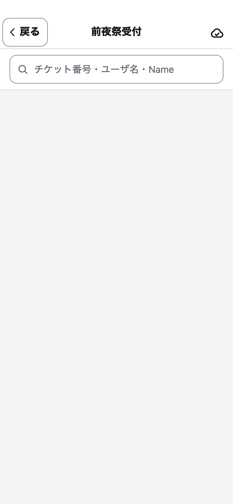 | 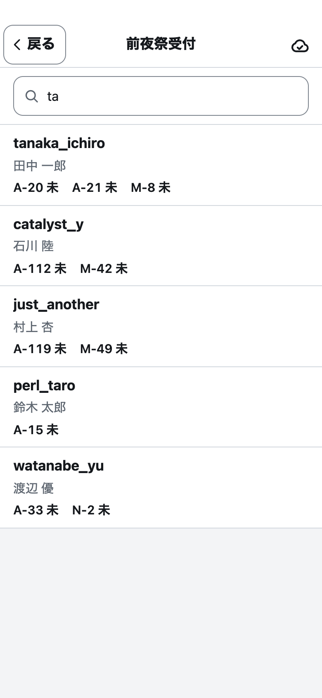 | 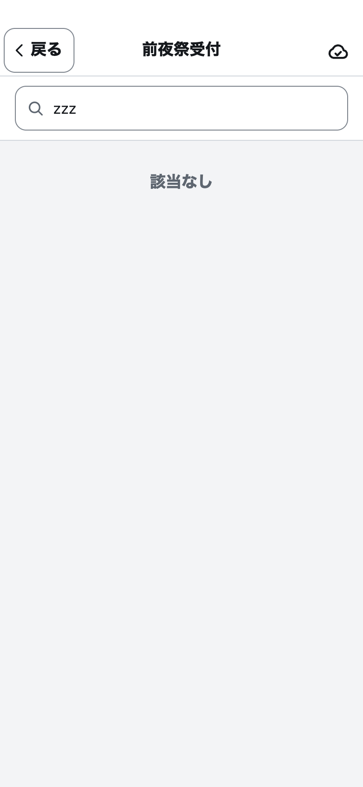 |

### S06 候補の詳細

本人確認と、チェックインするチケットの指定を行う（FR-25, 26）。

| 領域 | 要素 | 内容 |
| --- | --- | --- |
| 上部固定 | ヘッダ | 左に「戻る」（S05 へ。入力は残す）、受付、同期の状態 |
| 本文 | ユーザ名 | 大きく出し、その下に Name |
| 本文 | チケットの選択 | 現在の受付の「チェックインするイベント」のうち、このユーザが有効なチケットを持つイベントごとに、イベント名の下にチケットを 2.9 の形式で、アンケート回答とともに並べ、1 枚を選ばせる。回答を出すのは、本人の申告と突き合わせるためである。そのイベントのチケットが 1 枚だけなら、最初から選んでおく。済みのチケットがあれば、それを最初から選んでおく。選んだ行は主色の枠で囲み、右端に、丸で囲まないチェックを出す。ラジオボタンの丸は使わない（読み上げではラジオボタンとして扱う） |
| 本文 | ほかのチケット | 選択の対象にならないチケットを、2.9 の形式で並べる。選べない。アンケート回答は閉じておき、行を押すと開く（2.9） |
| 本文 | チェックインできない理由 | 選べるチケットがないときは「`{チェックインするイベント名}`のチケットがありません」（複数のイベントは「、」で並べる）、受付なしのときは「受付なし」 |
| 下部固定 | 検索からチェックイン | 注意を要する操作「検索からチェックイン」。すべてのイベントで 1 枚ずつ選ぶまで押せない。選べるチケットがないときと受付なしのときは置かない。S06-M1 を開く |

イベントごとに選ばせるのは、QR を持たない来場者に、FR-15 の追加の読み取りを求めずに済ませるためである。1 回の操作ですべてのイベントが済みになり、記録も 1 つの操作 ID にまとまる（FR-39）。選べるチケットがないときに切替提案を出さないのは、受付の切り替えを S02 に集めるためである。そのときの文言を 2.4 のチケットなしの帯の 1 行とそろえるのは、どちらもチェックインするイベントのチケットを持たない人に出すもので、同じ状況を 2 通りの言い方で出さないためである。

選んだ行をラジオボタンで示さないのは、左端の「未」のマーク（灰の枠線だけの丸、2.9）と同じ白い丸が 1 行に並ぶためである。チェックを丸で囲まないのは、左端の「済」「今回」のマーク（塗った丸にチェック）と形を分けるためである。

カンプ:

| チケットの選択 | 選べるチケットがないとき |
| --- | --- |
| 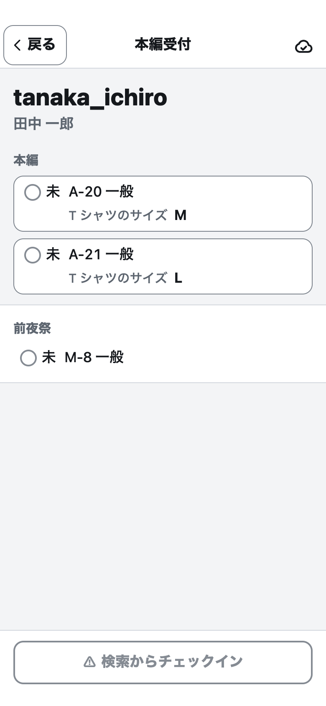 | 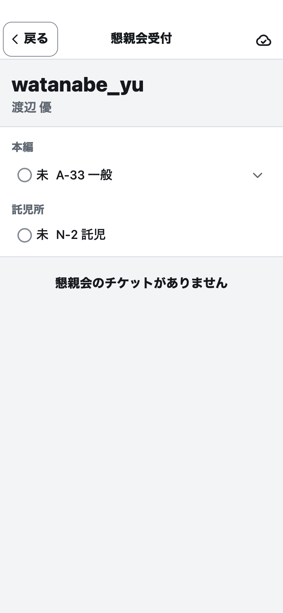 |

### S06-M1 検索からのチェックインの確認（シート）

| 要素 | 内容 |
| --- | --- |
| 文 | 「{ユーザ名} の {チケット番号} を、{受付名} で、検索からチェックインします」（チケット番号が複数なら「、」で並べる） |
| 確定 | 「チェックイン」（2.5 の確定ボタン） |
| やめる | 「やめる」 |

確定すると、選んだチケットを読み取ったチケットとみなして判定し（経路は検索）、ホームの結果（S04）に進む。

カンプ:

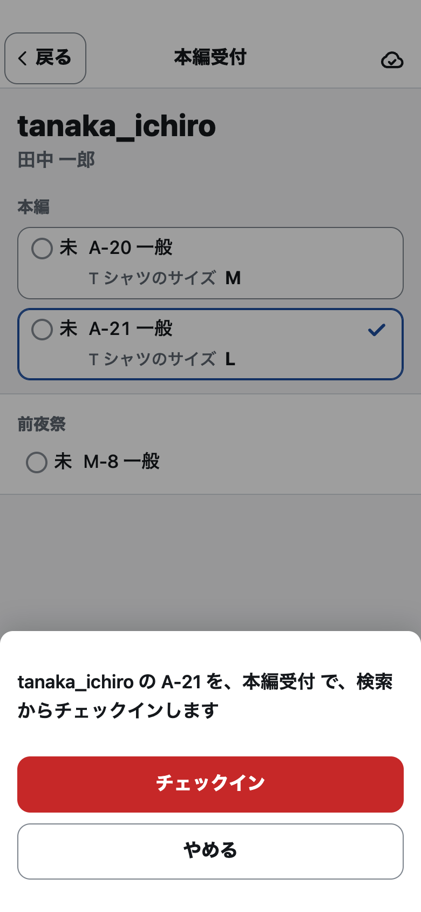

### S07 履歴

チェックインと取り消しの記録を、同期済みのすべての端末の分と、この端末の未同期の分を合わせて、新しい順に並べる（FR-28）。

| 領域 | 要素 | 内容 |
| --- | --- | --- |
| 上部固定 | ヘッダ | 左に「戻る」（S02 へ）、受付、同期の状態 |
| 上部固定 | 検索欄 | ユーザ名とチケット番号（記録が持つ値。2.9）の部分一致で一覧を絞り込む（名前: 履歴を検索）。S02 から開いたときは空にし、S08 から「戻る」で戻ったときは入力を残す（S08） |
| 本文 | 記録の一覧 | 1 回の操作の記録を 1 行にまとめる（FR-39 の操作 ID）。1 行に時刻、操作のアイコン（名前: チェックイン）、ユーザ名、チケット番号（複数なら「、」で並べる）、操作者。取り消しの行には、アイコンの右に「取り消し」と書き、アイコンには名前を付けない。未同期の記録には未同期のアイコン（名前: 未同期）を付ける。タップすると S08 を開く |
| 本文 | 記録なし | 記録が 1 件もないとき、または絞り込みで 0 件になったとき「記録なし」 |

受付、端末、経路、理由は一覧に出さず、S08 で見せる。検索欄を置くのは、数百件の記録の中から取り消したい記録を探すためである。件数などの集計は出さない（FR-31）。

取り消しの行にだけ「取り消し」と書くのは（S02 の直近の記録も同じ）、小さなアイコンだけでは、チェックインと取り消しを一目で見分けにくいためである。取り消しは数が少ないので、文字のある行が目に留まる。チケット番号に取り消し線は引かない。チケットそのものが無効になった（fortee のキャンセル済み）とも読め、番号も読みにくくなるためである。取り消しのアイコンに名前を付けないのは、添えた文字が読み上げられるので、名前も付けると「取り消し」が 2 回読まれるためである（2.9）。

カンプ:

| 記録の一覧 | 記録なし（絞り込みで 0 件） |
| --- | --- |
| 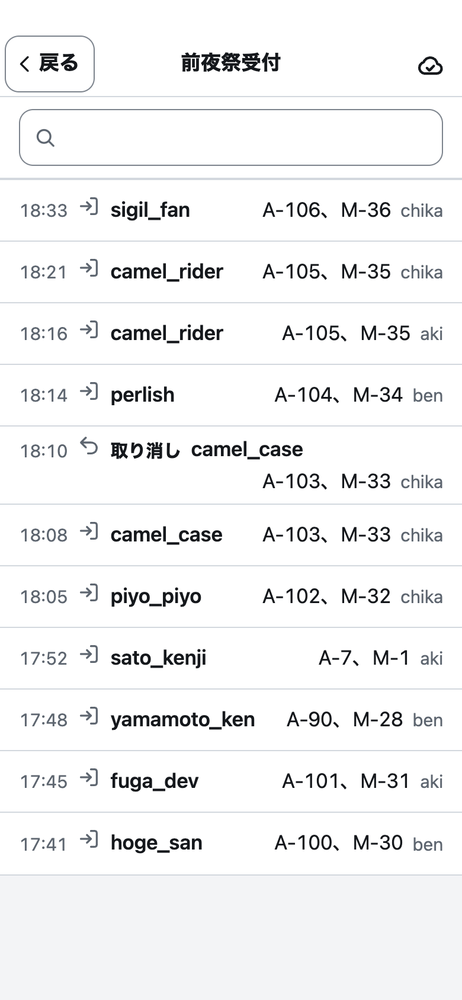 |  |

### S08 記録の詳細

チェックインか取り消しの、1 回の操作の記録の詳細を出し、チェックインを取り消す入口になる（FR-28〜30）。

| 領域 | 要素 | 内容 |
| --- | --- | --- |
| 上部固定 | ヘッダ | 左に「戻る」（S07 から開いたときは S07 へ戻り、S07 の検索欄の入力を残す。ホームから開いたときは停止中（S02）へ）、受付、同期の状態 |
| 本文 | 操作 | 操作のアイコンと「チェックイン」「取り消し」のいずれか |
| 本文 | 時刻 | 端末の時刻 |
| 本文 | 対象 | ユーザ名、Name（対象のチケットの Name。2.9）、対象のチケット（2.9 の形式で、現在の状態を出す）。データにないチケットは、チケットの一覧の末尾に見出し「データにないチケット」を置き、その下に状態とチケット番号だけを出す。種別と「fortee 済」は出さない。対象のチケットがどれもデータになければ、Name も出さない |
| 本文 | 詳細 | チェックインでは「受付」「経路」「操作者」「端末」、取り消しでは「受付」「理由」「操作者」「端末」とその値。取り消しの記録には経路がない（FR-39）ので、その位置に理由を出す。経路の値は「QR」「検索」のいずれか。受付の値は受付の表示名（2.9）で、受付なしのときに行った取り消しでは「受付なし」。理由の値は区分（「誤操作」「別人だった」）で、区分が「その他」のときは区分の代わりに自由記述を出す（FR-39）。未同期なら「未同期」 |
| 本文 | 注記 | チェックインの記録で、この記録が済みの根拠の記録（2.4）になっていないチケットごとに 1 行出す。この記録が取り消しの記録に打ち消されているチケットは「`{チケット番号}` 取り消し済み」、打ち消されていないチケットは「`{チケット番号}` 他の端末の記録が先」（FR-41）。対象のチケットがすべて取り消し済みなら、1 行の「取り消し済み」にまとめる |
| 本文 | 取り消す | チェックインの記録で、この記録が済みの根拠の記録になっているチケットが 1 枚以上あるときだけ、本文の末尾に置く。注意を要する操作「取り消す」。S08-M1 を開く。取り消しの記録には置かない |

データにないチケットを別の見出しの下に置くのは、記録がチケットのイベントと種別を持たない（FR-39）ので、2.9 の一覧のようにイベントの見出しの下に置けないためである。見出しの文言は、見つからないの結果名（2.4）とそろえる。「データから消えた」としないのは、取り込み後にキャンセルされたチケットのほかに、この端末のデータにまだないだけのチケットもあるためである（2.9）。データにないことは S08 でだけ示し、記録の行（S02 と S03 の直近の記録、S07）には印を付けない。取り消す記録を探すのには要らず、S08 を開けば分かるためである。

「その他」のときに自由記述を出すのは、「その他」とだけ出しても何があったのか分からないためである。自由記述は、ほかの文字と同じく、記法として解釈せずに文字列のまま出す。

「取り消す」と S08-M1 の対象を、この記録が根拠になっているチケットに限るのは、取り消しの記録が、開いている記録だけでなく、そのチケットの打ち消されていないチェックインの記録をすべて指して打ち消すためである（S08-M1）。根拠でない記録から取り消せると、取り消した後の再チェックインや、他の端末の先の記録のように、開いている記録とは別の記録を打ち消すことになる（FR-29）。

「取り消す」を下部固定ではなく本文の末尾に置くのは、S08 を開く直前の停止中（S02）で、主ボタンが画面の最下段にあるためである（2.5）。

読み取り中（S03）から開いたときも、「戻る」では停止中に戻す。読み取りに入る入口を、停止中の「QR コード読み取り」と結果の主ボタンの 2 つに保つためである。読み取り中に戻すと、カメラを起動し、音を鳴らせる状態にする（2.4）入口が増える。

S07 に戻るときに検索欄の入力を残すのは、S07 の検索が、数百件の記録の中から取り消す記録を探すためのものだからである（S07）。取り消した後や、違う記録を開いたときに、同じ絞り込みの一覧に戻れれば、打ち直さずに済む。取り消しの記録は、取り消したチェックインのユーザ名とチケット番号を持つ（FR-39）ので、戻った一覧には取り消しの行も並ぶ。

取り消しを確定したら S08 にとどまり、対象のチケットの状態と注記をその時点の記録で更新して、画面の下に 1 行の知らせを出す。選んだチケットをすべて取り消したときは「取り消しました」とする。確定の時点で根拠でなくなっていて、取り消さなかったチケット（S08-M1）があるときは、「`{チケット番号}` は他の端末で操作されたため、取り消しませんでした」とする（複数のチケットは「、」で並べる）。一部だけを取り消したときも、この文だけを出す。取り消したチケットは状態が変わるので、知らせに書かなくても分かるためである。「状態が変わったため」としないのは、ほかの端末の先のチェックインが遅れて届いた場合（FR-41）は、状態は済みのままで、根拠の記録だけが変わるためである。どちらの場合かは、更新した注記（「取り消し済み」か「他の端末の記録が先」）で分かる。

取り消したチケットは、この端末にあるチェックインの記録がすべて打ち消される（S08-M1）ので、状態が「未」に変わり、注記に「`{チケット番号}` 取り消し済み」が加わる（すべて取り消し済みになれば 1 行の「取り消し済み」）。この記録が根拠になっているチケットが残っている間は「取り消す」を出し続ける。

取り消した後に、ほかの端末が同じチケットをチェックインした記録（FR-41）のうち、確定した時点でこの端末になかったものが、同期で届くことがある。取り消しの記録は届いた記録を指さないので、チケットは、届いた記録を根拠に済みに戻る（PRD 7.2）。このときの S08 は、取り消した後に再チェックインされたときと同じで、対象のチケットの状態が「済 `{届いた記録の時刻}`」になり、注記の「`{チケット番号}` 取り消し済み」はそのまま残る。開いている S08 も、知らせを出さずに描き直す（2.7）。取り消し直すとき（PRD 7.2）は、S07 から届いた記録の S08 を開いて取り消す。この記録はもう根拠ではないので、この記録の S08 には「取り消す」が出ない。

受付なしのときも取り消せる（FR-7）。誤ったチェックインに、受付の期間の後で気づくこともあるためである。

カンプ:

| チェックイン | 取り消し | 取り消しの確定後 |
| --- | --- | --- |
| 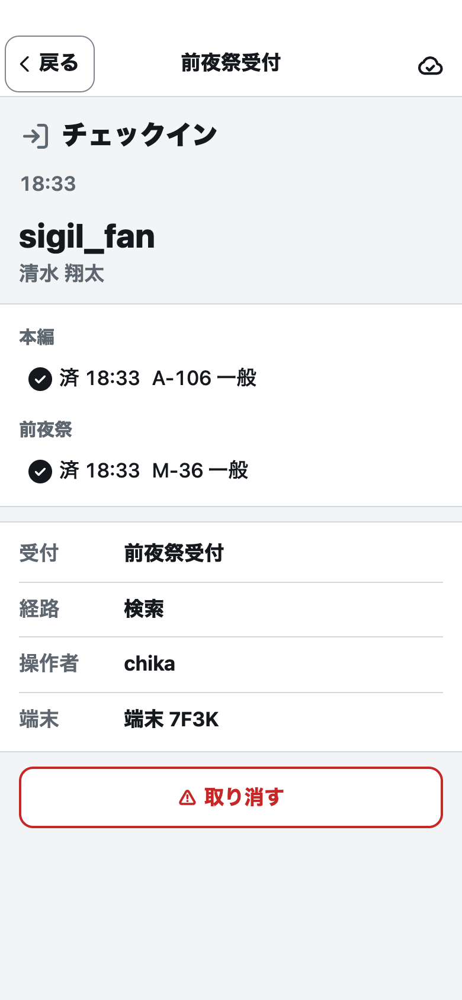 | 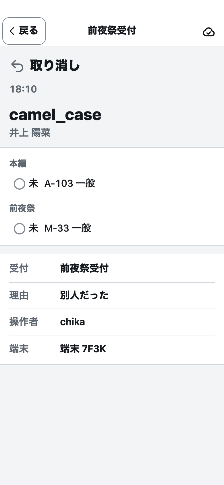 | 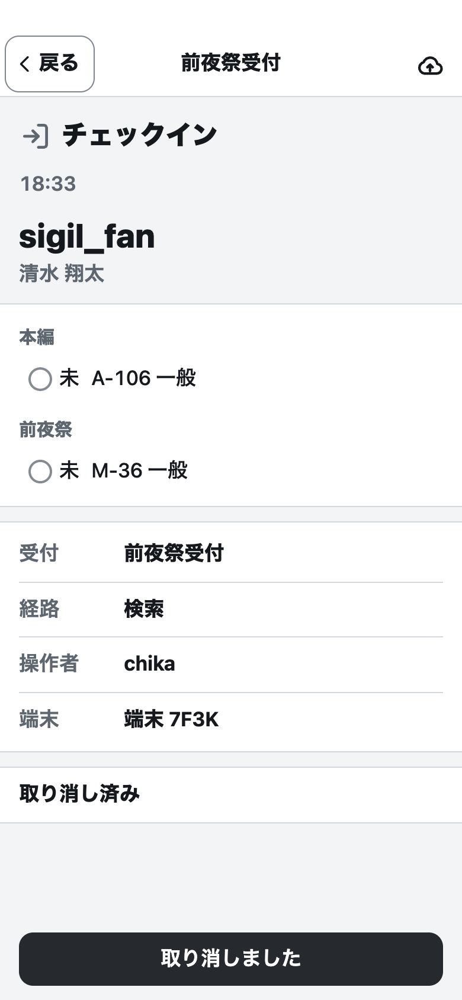 |

### S08-M1 取り消しの確認（シート）

1 回の操作で済みにしたチケットを、まとめて取り消す（FR-29）。

| 要素 | 内容 |
| --- | --- |
| 文 | 「{ユーザ名} の、下で選んだチケットのチェックインを、{受付名} で取り消します」。チケットの選択によって文は変えない。受付名は現在の受付（取り消しの記録に残る受付。FR-39）。受付なしのときは「、{受付名} で」を省き、「{ユーザ名} の、下で選んだチケットのチェックインを取り消します」とする |
| 対象のチケット | この記録が済みの根拠の記録になっているチケット（S08）を、チェックボックス付きで並べる。各行には「`{チケット番号} {種別}`」を書き、データにないチケット（S08）は番号だけを書く。最初はすべてに印を付けておく |
| 理由 | 「誤操作」「別人だった」「その他」から 1 つ選ぶ。これが FR-29 の区分の選択肢である。「その他」を選んだときだけ自由記述の欄を出し、入力を必須にする。自由記述は 2,000 文字までとし、それを超えては入力できないようにする（数え方は Design Doc 7.3） |
| 確定 | 「取り消す」（2.5 の確定ボタン）。理由が決まり、チケットが 1 枚以上選ばれるまで押せない |
| やめる | 「やめる」 |

文をチケットの選択に合わせて変えないのは、何枚選んでいても、1 枚も選んでいなくても、同じ文で伝わるようにするためである。どのチケットを取り消すかは、文のすぐ下の「対象のチケット」の印で分かる。

自由記述を 2,000 文字までにするのは、サーバがそれを超える記録を受け付けない（Design Doc 7.3）ためである。超えた記録が端末に残ると、その記録を含む同期が拒まれ続け、後に作った記録も送れなくなる。

確定すると、その時点の記録で根拠を求め直し、選んだチケットのうち、この記録がまだ根拠になっているものごとに取り消しの記録を作り、それらに共通の操作 ID を持たせる（FR-39）。それぞれの取り消しの記録は、そのチケットのチェックインの記録のうち、確定した時点でこの端末にあり、打ち消されていないものをすべて指す（PRD 7.2）。この記録のほかに、ほかの端末が同じチケットをチェックインした記録（FR-41）が届いていれば、それも指す。根拠でなくなったチケットは取り消さず（FR-29）、選んだチケットがすべてそうなら、取り消しの記録を作らない。知らせ方は S08 で定める。

確定の時点で求め直すのは、シートを開いている間に、ほかの端末の記録が同期で届くことがあるためである（2.7）。たとえば、ほかの端末が同じチケットを取り消して再チェックインした記録が届いた後に、そのまま取り消しの記録を作ると、取り消しの記録は、確定した時点で打ち消されていない再チェックインの記録を指すので、それを打ち消してしまう。

カンプ:

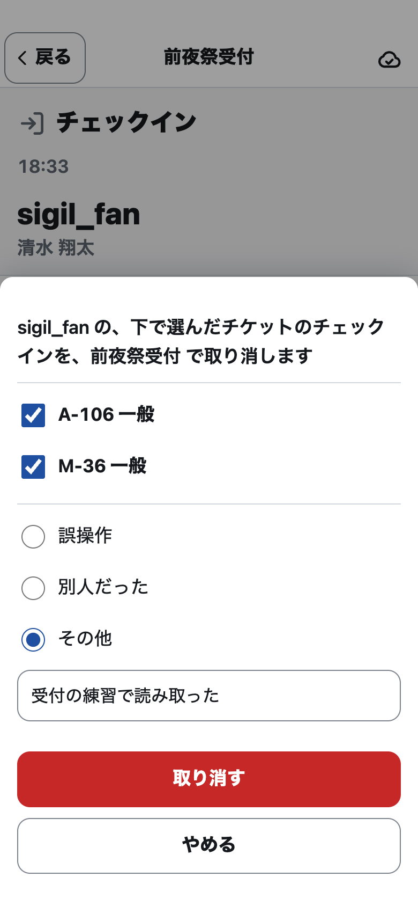

### S09 メニュー

端末の設定と状態の確認、ログアウトを行う。S02 のヘッダのメニューから開く。

| 領域 | 要素 | 内容 |
| --- | --- | --- |
| 上部固定 | ヘッダ | 左に「戻る」（S02 へ）、受付、同期の状態 |
| 本文 | ユーザ | 「ユーザ」と Discord の表示名（FR-38） |
| 本文 | 端末 | 「端末」と端末名 |
| 本文 | データ | 「データ」と、イベントごとの「`{イベント名}` `{取り込み日時}`」（FR-42）。端末のデータの永続化が認められていないときだけ、その下に「空き容量が減ると、端末のデータが消されることがあります」。認められているかは S09 を開いたときに判定する（判定の方法は Design Doc 6.3） |
| 本文 | アプリ | 「アプリ」とリリース名、その下に「オフラインで起動できます」か「オフラインでは起動できません。ネットワークのある場所で、アプリを完全に閉じてから開き直してください」。リリース名は、同期で送る受付アプリの版（FR-40）と同じ文字列にする。起動できるかは S09 を開いたときに判定し、開いている間に取り直しが終われば表示を更新する（判定の方法は Design Doc 6.11） |
| 本文 | 同期 | 「同期」と、最終同期の時刻、ヘッダと同じ同期の状態のアイコン、「今すぐ同期」（FR-31, 40）。「今すぐ同期」は、同期中とオフラインのときは押せない。再ログインが必要なときは、押すと S01 で再ログインする（2.8） |
| 本文 | 音 | 「音」とオン・オフの切り替え、「音を試す」（成功・注意・拒否の順に鳴らす。音がオフでも鳴らす） |
| 本文 | 振動 | 振動に対応した端末だけに置く。「振動」とオン・オフの切り替え |
| 本文 | ログアウト | 「ログアウト」（本文の末尾）。S09-D1 を開く |

端末名は、初回の起動時にアプリが自動で付ける短い名前（例「端末 7F3K」）であり、スタッフには入力させない。記録の端末（FR-39）として S08 に表示する。

「データ」の行に、端末のデータが消されうることを出すのは、PRD 9 章 4 の端末の準備で、データの版と一緒に確かめるためである。ブラウザは、記憶域の永続化を認めていないサイトのデータを、端末の空き容量が減ると消すことがあり、消えるデータには未同期の記録も含まれる（Design Doc 6.3）。認められているときは何も出さない。スタッフが知っておくことがないうえ、「消されません」と書くと、空き容量のほかの理由でも消えないと読まれかねないためである。文に「空き容量が減ると」と添えるのは、消える条件を示し、空き容量に余裕を持たせれば防げることが分かるようにするためである。認められていない端末の扱いは、端末の種類で違う（Android ではインストールし直し、iOS では空き容量を確かめる）ので、文には書かず、端末の準備の手順に任せる（Design Doc 6.3、PRD 9 章 4）。

「アプリ」の行は、どの版の受付アプリで動いているかと、オフラインで起動できるかを確かめるために置く。PRD 9 章 4 の端末の準備では、データの版と並べてここで確かめるので、「データ」の直後に置く。「準備完了」のような書き方にせず「オフラインで起動できます」と書くのは、何の準備なのかがスタッフに分からないためである。会場でスタッフが知りたいのは、ネットワークがなくても受付アプリを開けるかどうかである。

アプリのファイルの取り込みが済むまで S01 で待つ（S01）ので、S02 に進んだ端末は、ふつうオフラインで起動できる。それでもこの行で知らせるのは、取り込んだ後にアプリのファイルだけが消えた端末は、S01 で止めずに S02 へ進ませるためである（S01）。アプリのファイルだけが消えるのは、長く開かなかった端末で、ブラウザがアプリのファイルを消した場合である（Design Doc 6.11）。リハーサルから端末の準備まで数週間あくと、これに当たりうる。

起動できないときに開き直しを案内するのは、受付アプリが起動するたびに、足りないアプリのファイルを取り直すためである（Design Doc 6.11）。「完全に閉じてから」とするのは、ほかのアプリに切り替えて戻っただけでは、受付アプリが読み込み直されないことがあり、そのときは取り直しが始まらないためである。

リリース名を同期で送る版と同じ文字列にするのは、書き出しの全端末の一覧（FR-45）にもこの文字列で出るためである。管理者は、一覧で見つけた古い版の端末を、会場でその端末の画面と突き合わせて確かめられる。

カンプ:

| iOS | Android（振動あり） | データが消されうる、オフラインで起動できない（iOS） |
| --- | --- | --- |
| 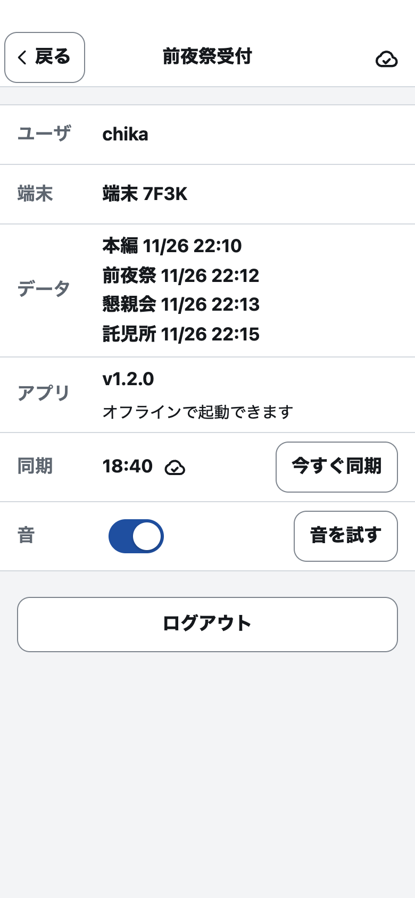 | 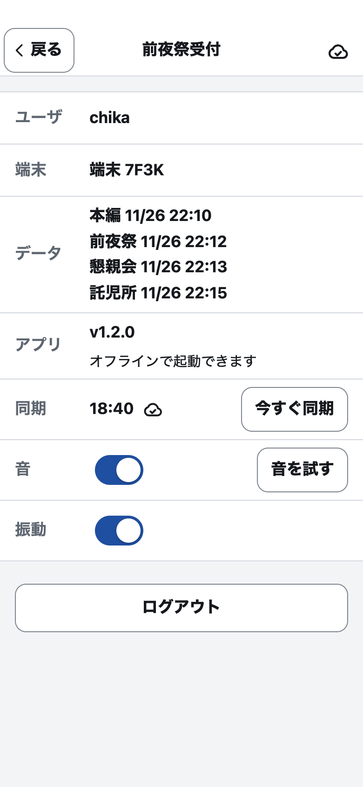 | 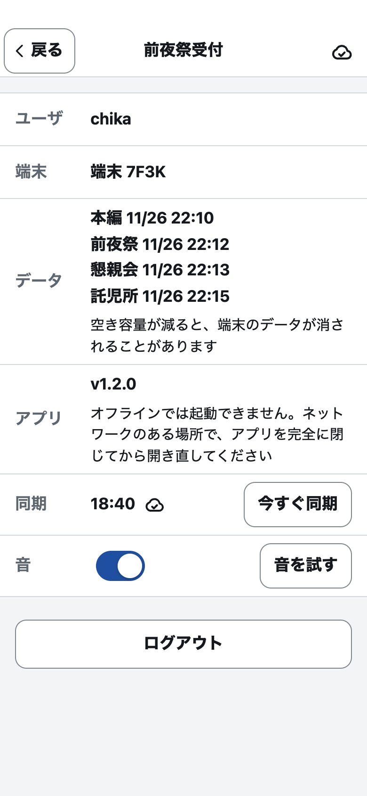 |

### S09-D1 ログアウトの確認（ダイアログ）

ログアウトすると端末内のスナップショットと記録を消すので、常に確認する（FR-37）。

| 要素 | 内容 |
| --- | --- |
| 文 | 「この端末のデータを消してログアウトします」 |
| 警告 | 未同期の記録があるときは「未同期の記録も消えます」（件数は出さない。FR-31）。同期の状態（2.3）がオフラインのときは「オフラインです。再ログインとデータの取得にはネットワークが必要です」、同期の失敗のときは「同期に失敗しています。同期できるようになるまで、再ログインとデータの取得ができないおそれがあります」 |
| 確定 | 「ログアウト」（赤の塗り）。開いてから 0.5 秒間は押せない |
| やめる | 「やめる」 |

同期の失敗のときにも警告するのは、ネットワークにつながっていてもサーバに届かない状態では、ログアウトすると、オフラインのときと同じく再ログインとデータの取得ができないおそれがあるためである。同期の失敗が続くと、ログインし直して直そうとするスタッフもいると考えられる。失敗は一時的なこともあるので、「おそれがあります」とする。

確定すると端末内のデータを消し、S01（未ログイン）に進む。

カンプ:

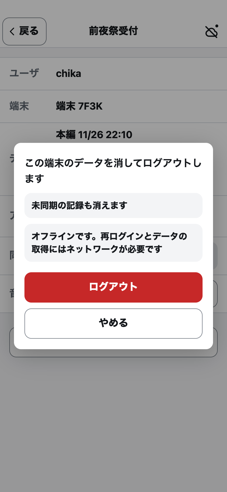

### S99 エラー

端末の記憶域の読み書きに失敗した場合など、想定外のエラーが起きたときに、どの画面からでも移る。

| 領域 | 要素 | 内容 |
| --- | --- | --- |
| 本文 | 文 | 「エラーが発生しました」 |
| 下部固定 | 再読み込み | 「再読み込み」（主ボタン）。アプリを読み込み直す。新しい版の受付アプリが届いていれば、新しい版に切り替えてから読み込み直す（Design Doc 6.11） |

記録は追記型で端末に保存済みなので、再読み込みで消えることはない。新しい版に切り替えるのは、受付アプリの誤りで S99 に移ったときに、直した版で起動し直せるようにするためである。ふつうの読み込み直しでは、届いている新しい版に切り替わらないことがある。

カンプ:

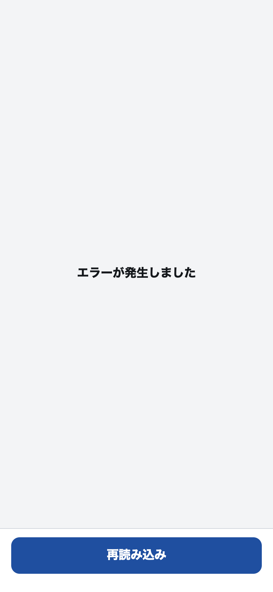

## 6. 端末の挙動の前提と予備案

本書の端末の挙動に関する記述は、検証用の PWA を使って iOS 27 の実機、iOS 26.3 のシミュレータ、Android のエミュレータで確かめた結果に基づく。iOS 27 の実機の結果には、検証用の PWA の記録で確かめたものと、検証者の申告だけによるものがあり、後者には「申告」と添える（端末の挙動 1 章）。結果の詳細と、実装に引き継ぐ知見は[端末の挙動](research/device-behavior.md)にまとめている。iOS 26 と Android の実機では確かめていないので、確かめた結果によっては本書を直す。

### 6.1 前提とした挙動と、残る確認

| 項目 | 本書の前提 | 確かめたこと | 残る確認 | 関係する箇所 |
| --- | --- | --- | --- | --- |
| Discord のログイン | 同じ画面のまま認可画面へ移動すれば、コールバックはホーム画面アプリに着き、画面は読み込み直される | どの環境でも、同じ画面のまま移れば、ホーム画面アプリ（Android ではインストールした Web アプリ）に戻り、画面は読み込み直された。既定のブラウザに着く経路はなく、Discord アプリが入った端末でも Discord アプリは開かなかった。認可画面を新しい画面（`target=_blank`）で開くと、ログインを始めた画面とは別の画面に戻る | iOS で、Discord アプリがない端末、未ログイン時に Discord アプリを使ったログインを選んだ場合、既定のブラウザが Safari 以外の場合。受付アプリ内の Discord のログイン状態が次の起動まで残るか | S01 |
| カメラの許可 | 1 回の起動の中でカメラを止めて再開しても、許可を求められない。起動のたびに求められるのはよい（S03） | iOS 27 の実機（申告）と Android のエミュレータでは、初回だけだった。iOS 26.3 のシミュレータでは起動のたびに求められたが、起動の中の再開では求められなかった。実機では起動の中の再開を確かめておらず、シミュレータとエミュレータでは、止めてから再開するまでの間隔を記録していない。Android では、拒否するとページから再び求めることはできず、Chrome のサイト情報で権限をリセットする必要がある | iOS 26 の実機で、起動のたびに求められるか（求められれば、起動のたびの許可を運用で案内する）。iOS の実機で、起動の中で止めてから 1 分以上おいて再開したときに求められるか、拒否した後にどうなるか。実機で、カメラを再開してから映像が画面に出るまでの時間 | S03、2.6 |
| 音 | iOS の消音モードでは鳴らなくてよい。音を鳴らしうる画面へ進むタップのたびに鳴らせる状態にし直せば、バックグラウンドから戻った後も鳴る | iOS 27 の実機では、消音モードのときに鳴らなかった（申告）。このときの鳴らし方と音声セッションの種類は記録していない。シミュレータとエミュレータでは、バックグラウンドから戻った後も音声の出力は動作中のままだった | 実機で、受付アプリが使う音声セッションの種類（Design Doc 6.8）で、タップの後と、バックグラウンドから戻った後に鳴るか | 2.4 |
| 振動・触覚 | 振動は Android でだけ使う | iOS 27 のホーム画面アプリでは、スクリプトから触覚を出す手段がなかった。Android のエミュレータでは振動した | Android の実機 | 2.4 |
| 画面のスリープ | Screen Wake Lock で OS の自動ロックを止められる | iOS 27 の実機で効いた（申告） | iOS 26 と Android の実機 | 2.6 |
| ライト | 使わない。来場者は QR を光る画面で提示する | — | — | S03 |
| オフラインでの起動 | 機内モードで起動し、読み取りと音が動く | Android のエミュレータでは、機内モードで起動し、QR の判定と音まで動いた。iOS のシミュレータでは、サーバに届かない状態で起動できた | 実機の機内モードでの起動 | PRD の AC-2 |
| データの保持 | 端末内のデータは、数日おいても残る | Android では、Chrome のタブとインストールした Web アプリが端末内のデータを共有していた。永続化の要求（`navigator.storage.persist()`）は、iOS のシミュレータのホーム画面アプリと Android の WebAPK で認められ、Android のショートカットでは認められなかった | 数日おいても残っているか | S01、S09 |
| Android の戻る操作 | 戻る操作を 2.1 の表のとおりに扱える。シートかダイアログが開いている間の戻る操作は、それだけを閉じ、画面を変えない。停止中ではアプリが閉じる | — | Android の端末で、停止中の戻る操作でアプリが閉じるか。ログインの後は、履歴に Discord の認可画面が残り、それが出るおそれがある。シートかダイアログが開いている間の戻る操作が、それだけを閉じるか。S02-M1 の確認で、1 回目の戻る操作を一覧への切り替えにできるか | 2.1 |
| 別の画面で開いているかの検出 | 同じ端末の別の画面で、受付アプリがログイン済みで動いていることを、起動時に検出できる | Android のエミュレータで、Chrome のタブとインストールした Web アプリが端末内のデータを共有していることは確かめた。検出の方法（Design Doc 6.4 のロック）は確かめていない | Android の端末で、ホーム画面に追加したアプリと Chrome のタブが同じロックを見るか | S00 |
| 画面の向き | インストールした Android のアプリは縦向きに固定できる。横向きでも、カメラの映像と読み取りが動く | — | Android の実機で、縦向きに固定されるか。iOS の実機で、横向きにしても読み取れるか。横向きの読み取り中（S03）の映像は、高さが上 3 分の 1 程度のままで細くなるので、QR を狙えるかも見る | 1.2、S02〜S04 |
| データの形を移すときの待ち | 1 つの画面だけで使う端末では、受付アプリの更新で端末内のデータの形を移すときに、S00 で止まらない | — | 実機で、更新の後に待たされずに起動するか（Design Doc 12.3） | S00 |

カメラの許可については、WebKit の bug 報告に、利用者からの次の 2 つの報告がある。iOS 27 の実機（申告）の結果とは食い違うが、どちらが正しいかは確かめていない。

- iOS 26.6.2 の実機のホーム画面アプリで、起動のたびに求められた（[bug 327237](https://bugs.webkit.org/show_bug.cgi?id=327237)。2026 年 10 月の報告で、WebKit の回答はまだない）。起動の中で再開したときと、読み込み直したときの結果は書かれていない
- iOS 16.3.1 のホーム画面アプリで、1 分以上あけて読み取ると、再び求められた（[bug 215884](https://bugs.webkit.org/show_bug.cgi?id=215884)）。WebKit の担当者は同じ bug で、WKWebView では、取り込みをしない状態が 1 分続くと次は再び求め、これは Safari と同じ挙動だと説明している。ホーム画面アプリで確かめた説明ではない

起動のたびに求められても、画面は変えない（S03）。一方、止めてから 1 分たつと求められるなら、読み取りに戻るたびに確認が出うる。結果（S04）は次の来場者を読み取るまで出し続けることがあり、その間に 1 分を超えうるためである。残る確認に、止めてから 1 分以上おいて再開する条件を入れたのはこのためで、そうなった場合は 6.2 の予備案に切り替える。結果によってカメラの持ち方が変わるので、この条件は実装の初めに確かめる（Design Doc 12.3）。

### 6.2 予備案

残る確認の結果によっては、次の予備案に切り替える。

- ログイン: 既定のブラウザに着く経路が見つかった場合に限り、そのブラウザに表示したワンタイムコードを受付アプリに入力してもらう手順を加え、S01 にコード入力の状態と、既定のブラウザ側でコードを表示する画面を加える。手順と安全上の条件は端末の挙動 3.4 に従う
- カメラ: iOS の実機で、1 回の起動の中でもカメラを再開するときに許可を求められる場合は、止めてから一定の時間がたったときだけ求められる場合（6.1）も含めて、読み取り中（S03）と結果（S04）の間ではカメラを止めず、結果では映像を隠して読み取りを止めるだけにする。停止中（S02）や検索（S05、S06）の間はカメラを止めたままにし、そこから読み取りに入るときに求められるのは受け入れる。読み取りに使わない間までカメラを動かし続けると、電池の消耗と発熱が続くためである。確かめるまでは、2.6 の「カメラは読み取り中（S03）の間だけ動かし、結果（S04）では止める」を正とする
- 画面のスリープ: Screen Wake Lock が効かない端末でも、S04 はロックから戻った後に表示し続ける（2.6）ので、判定結果は失われない。S03 でロックされた場合は、2.6 のとおり S02 に戻る
- Android の戻る操作: 停止中（S02）の戻る操作で、ログインの後に履歴に残った Discord の認可画面が出てしまい、Design Doc 12 章の対策でも避けられない場合は、停止中でも戻る操作で何もしない（2.1 の表の停止中の行を変える）。Discord の画面が出ると、受付アプリを出たのか、ログインをやり直しているのか、スタッフには分からないためである。アプリを離れるには、OS のホームに戻る操作を使えばよい
- 画面の向き: 実機の横向きで、読み取り中（S03）の映像が細くて QR を狙いにくい場合は、表示領域の高さが足りないときの読み取り中に限り、上の領域を、直近の記録を出さずに空いた高さまで広げる。読み取る範囲は、広げた後も、画面に出ている範囲に限る（S03）。確かめるまでは、S02〜S04 の「上の領域の高さの決めは変えない」を正とする。広げると、読み取り中と結果で上の領域の高さが変わり、カメラを向けた場所がそのまま結果の色に変わる作り（S02〜S04）が、このときだけ崩れるためである
- 別の画面で開いているかの検出: アプリとタブが同じロックを見ない場合は、Design Doc 12 章のとおり検出の方法を替える。S00 の「別の画面で開いている」の表示は変えない
