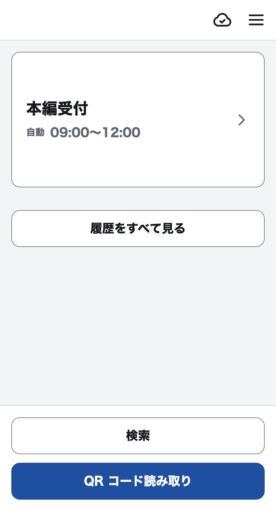
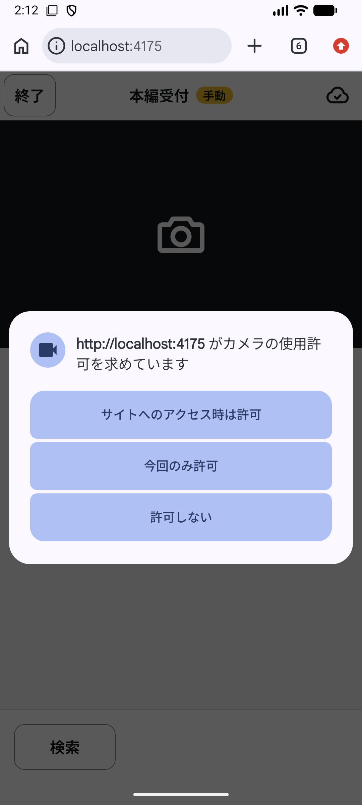
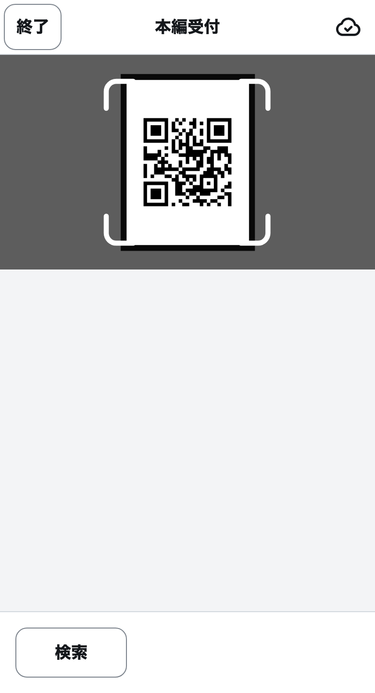
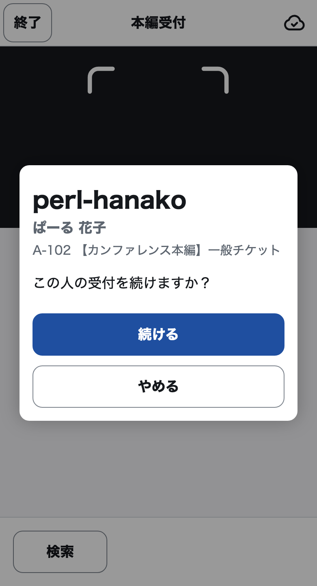
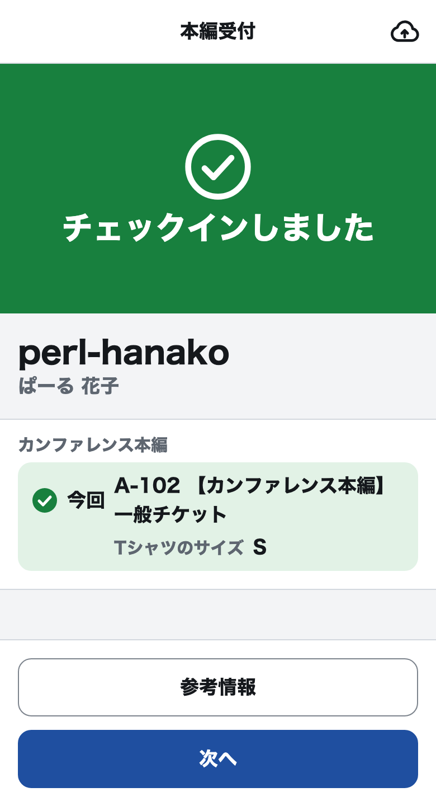
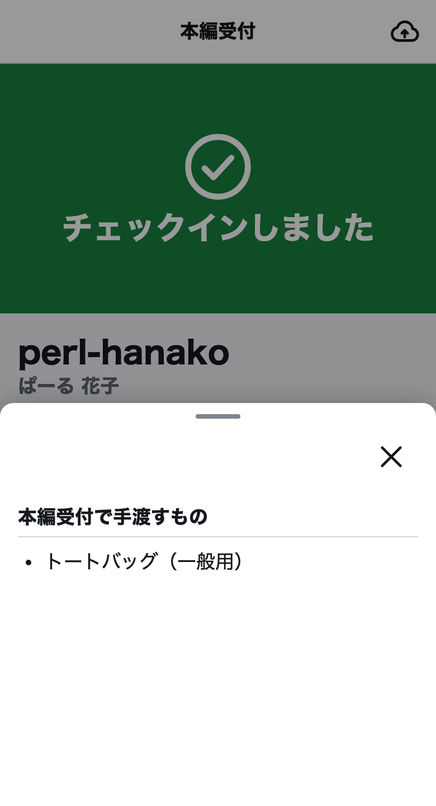

# 2. 受付をする

来場者 1 人の受付は、4 つの手順で終わります。画面の画像は YAPC::Tokyo 2026 の例です。

## 受付を始める前に

ホーム画面のアイコンからアプリを開くと、最初の画面の上の枠に、いまの受付の名前と時間が出ます。受付は、設定された時間になると自動で選ばれます。

「受付なし」と出ているときは、どの受付の時間にも当たっていません。このときは「QR コード読み取り」が押せません。

## 手順

### 1. 「QR コード読み取り」を押す

カメラの映像が画面の上に出ます。カメラを使ってよいかを聞かれたときは、許可してください。

上の画像は Android の Chrome の例で、「サイトへのアクセス時は許可」を選ぶと、次からは聞かれません。iPhone では、見た目の違う確認が出ます。

### 2. 来場者の QR コードにカメラを向ける

来場者に、チケットの QR コードをスマートフォンの画面に出してもらいます。チケットの QR コードは、fortee の「チケット」の画面か、スマートフォンのウォレットに出ます。その QR コードが、映像の枠の中に入るようにします。シャッターを押す必要はありません。読み取れると、自動で次の画面に進みます。

### 3. 名前を確かめて「続ける」を押す

読み取ったチケットの持ち主の名前が出ます。目の前の来場者のチケットであることを確かめて、「続ける」を押します。

別の人の QR コードを読み取ってしまったときは、「やめる」を押します。受付は記録されず、読み取りに戻ります。

### 4. 緑の画面を確かめて、「次へ」を押す

緑の画面に「チェックインしました」と出れば、受付は完了です。音も鳴ります。

名前の下には、その人のチケットが並びます。いま受け付けたチケットには「今回」の印が付き、カンファレンスによっては、T シャツのサイズのような申し込みのときの回答が一緒に出ます。

「次へ」を押すと、カメラの映像に戻り、次の QR コードを読み取れます。手順 2 から 4 の繰り返しです。

## 参考情報を見る

緑の画面で「参考情報」を押すと、その来場者についての参考情報が出ます。出る内容は、カンファレンスごとの設定で決まります。右上の「×」で閉じます。

## 画面の色の意味

読み取りの結果は、色で分かります。

| 色 | 意味 | 続き |
| --- | --- | --- |
| 緑 | 受け付けました | 「次へ」で次の読み取りに進みます |
| 黄 | 確かめることがあります | 画面ごとの意味は[黄色や赤の画面が出たとき](results.md) |
| 赤 | 受け付けていません | 画面ごとの意味は[黄色や赤の画面が出たとき](results.md) |

## 読み取りを終える

左上の「終了」を押すと、カメラが止まり、最初の画面に戻ります。しばらく読み取らなかったときも、自動で最初の画面に戻ります。続けるときは、もう一度「QR コード読み取り」を押します。

右上の雲のマークにチェックが付いていれば、受付の記録はすべてサーバに送られています。マークの見方は[困ったとき](troubleshooting.md#右上のマークの見方)にあります。

## 知っておくとよいこと

- 回線がつながらなくても、受付は続けられます。記録はスマートフォンの中に残り、回線がつながったときに自動で送られます
- 手順 3 の確認を出さずに、読み取ってすぐ受け付ける設定（高速受付）があります。メニューの「高速受付」のスイッチで切り替えます
- 来場者が QR コードを出せないときは、名前やチケット番号で探して受け付けます。[QR コードを出せない人を受け付ける](search.md)

---

前のページ: [1. 準備する](setup.md)　／　[目次に戻る](README.md)
