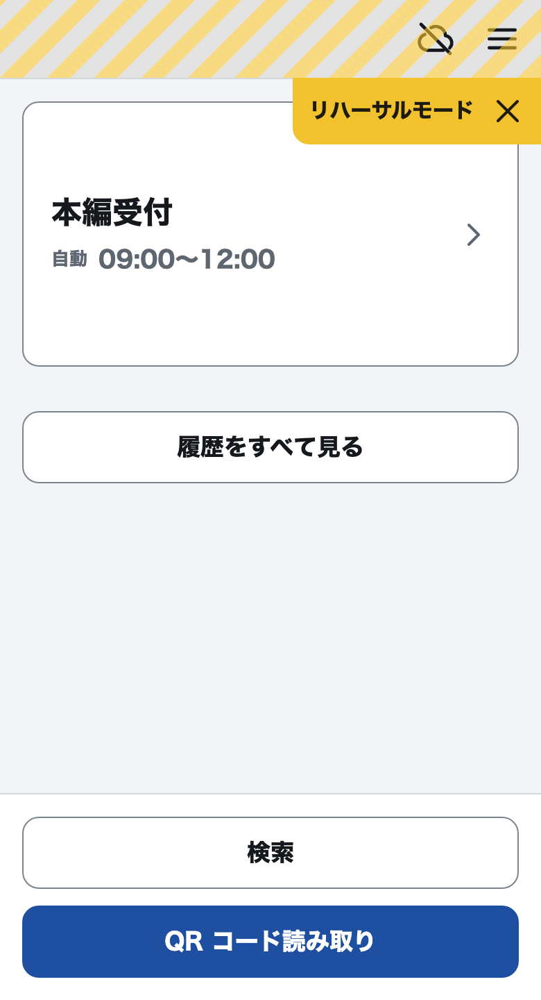

# 練習する

リハーサルモードにすると、受付の操作を、記録を残さずに試せます。リハーサルモードの間の受付と取り消しは、どこにも保存されません。

画面の画像は YAPC::Tokyo 2026 の例です。

## リハーサルモードにする

1. 最初の画面の右上の「≡」を押して、メニューを開きます
2. 「リハーサルモード」のスイッチを押し、確認の「切り替える」を押します
3. 左上の「戻る」で、最初の画面に戻ります

リハーサルモードの間は、画面の上に黄色の縞と「リハーサルモード」の札が出ます。

## 練習する

操作は本番と同じです（[2. 受付をする](checkin.md)）。自分のチケットの QR コードを読み取るか、「検索」で自分の名前を探して、受け付けてみてください。結果の画面には、毎回「リハーサルモードです　この受付は記録に残りません」と出るので、「OK」を押します。

受付の時間の外では、最初の画面に「受付なし」と出て、「QR コード読み取り」が押せません。このときは、リハーサルモードにした後で、次の手順で受付を選びます。

1. 最初の画面の上の枠（「受付なし」と出ている枠）を押します
2. 練習したい受付を押し、確認の「切り替える」を押します

受付を選ぶのは、必ずリハーサルモードにした後にしてください。リハーサルモードの間に選んだ受付は、リハーサルモードをやめると元に戻ります。通常のモードで選ぶと、本番でもその受付に固定されたままになります。

## リハーサルモードをやめる

「リハーサルモード」の札の「×」を押し、確認の「戻す」を押します。黄色の縞が消えれば、通常のモードです。

**本番の受付の前に、黄色の縞が出ていないことを確かめてください。** リハーサルモードのまま受け付けると、その受付は記録に残りません。

---

[目次に戻る](README.md)
