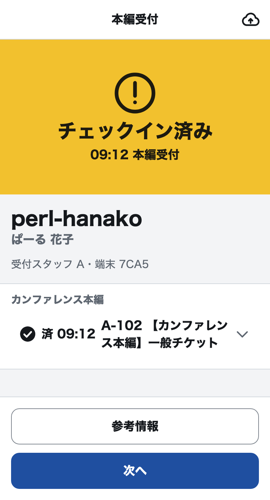
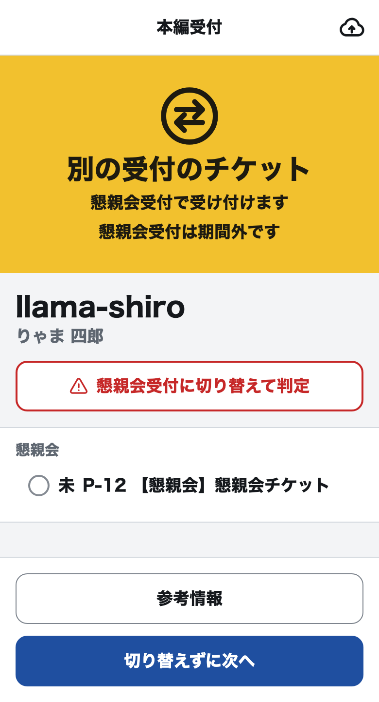
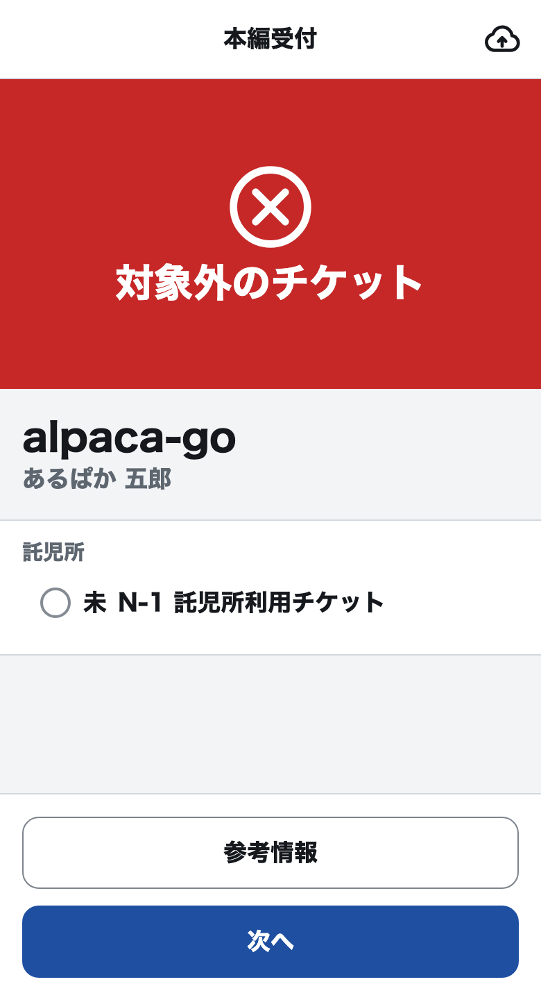
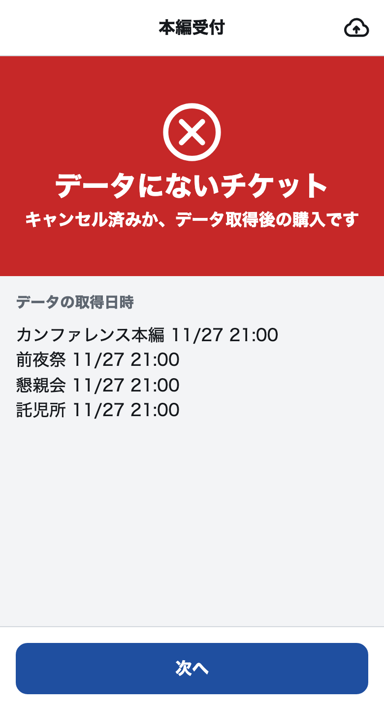

# 黄色や赤の画面が出たとき

読み取りの結果が緑でないときは、画面の大きな文字を見て、当てはまる項目を読んでください。どの画面も、下のボタンを押せば、次の来場者の読み取りに戻れます。

画面の画像は YAPC::Tokyo 2026 の例です。

| 色 | 画面の大きな文字 | 意味 |
| --- | --- | --- |
| 黄 | [チェックイン済み](#チェックイン済み) | このチケットは、もう受け付けてあります |
| 黄 | [別の受付のチケット](#別の受付のチケット) | 別の受付で受け付けるチケットです |
| 黄 | [続けて読み取り](#続けて読み取り) | 別のチケットも読み取る必要があります |
| 赤 | [受け付けられません](#受け付けられません) | この受付に要るチケットを持っていません |
| 赤 | [対象外のチケット](#対象外のチケット) | 受付で扱わないチケットです |
| 赤 | [データにないチケット](#データにないチケット) | アプリのデータにないチケットです |

カメラの映像の上に「チケットの QR ではありません」と出たときは、[困ったとき](troubleshooting.md#qr-コードを読み取っても進まない)を見てください。

## 黄色の画面

### チェックイン済み

このチケットは、前に受け付けてあります。大きな文字の下に、前に受け付けた時刻と受付の名前が出ます。名前の下には、そのとき操作したスタッフが出ます。

「次へ」を押すと、読み取りに戻ります。

### 別の受付のチケット

読み取ったチケットは、いまの受付ではなく、大きな文字の下に出ている受付で受け付けるチケットです。

チケットを何枚か持っている人では、別のイベントのチケットの QR コードを読み取ったときにも出ます。「切り替えずに次へ」を押すと、受付を変えずに読み取りに戻ります。

赤い枠の「〇〇に切り替えて判定」は、このスマートフォンの受付を、画面に出ている受付に切り替えて、同じチケットを判定し直す操作です。切り替えた受付は、その後の読み取りにも使われます。

### 続けて読み取り

来場者が同じイベントのチケットを 2 枚以上持っていて、どのチケットを受け付けるかをアプリが決められないときに出ます。大きな文字の下に「〇〇のチケットを 1 枚読み取ってください」と出ます。

「続けて読み取る」を押して、来場者に、そのイベントのチケットの QR コードを出してもらい、読み取ります。出せないときは、カメラの映像の下の「検索」から受け付けます（[QR コードを出せない人を受け付ける](search.md)）。

## 赤い画面

赤い画面が出たときは、受付は記録されていません。

### 受け付けられません

来場者が、この受付に要るチケットを持っていません。大きな文字の下に、理由が出ます。

「次へ」を押すと、読み取りに戻ります。

### 対象外のチケット

受付アプリで受け付けないイベントのチケットです。

### データにないチケット

アプリが持っているデータに、このチケットがありません。キャンセルされたチケットか、画面の「データの取得日時」より後に買われたチケットです。

「データの取得日時」より後に買われたチケットは、アプリのデータが新しくなると受け付けられるようになります。

---

[2. 受付をする](checkin.md)　／　[目次に戻る](README.md)
