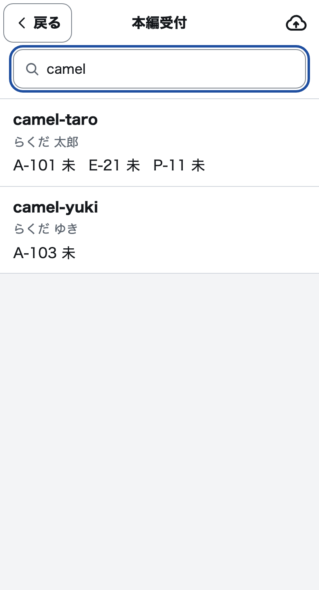
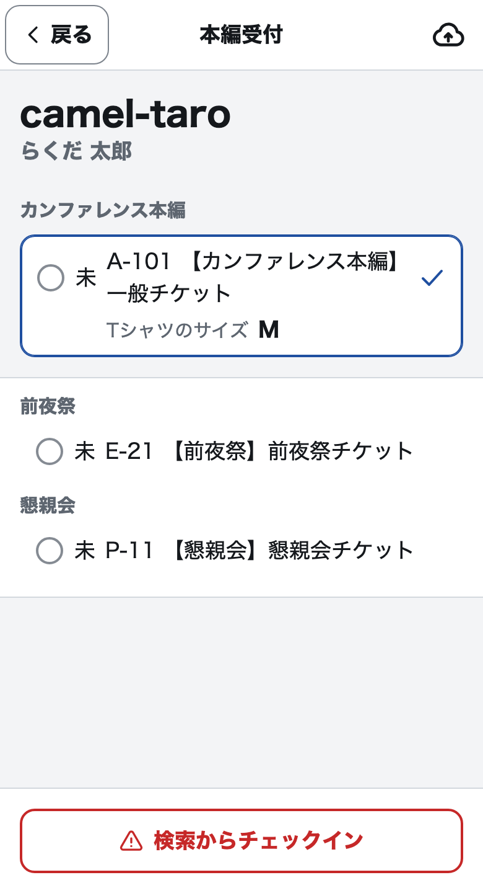
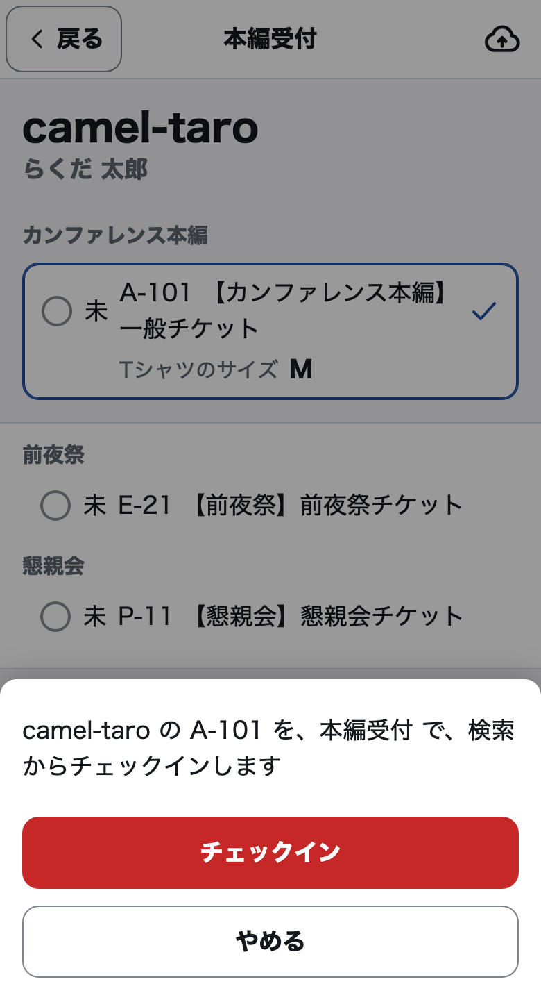
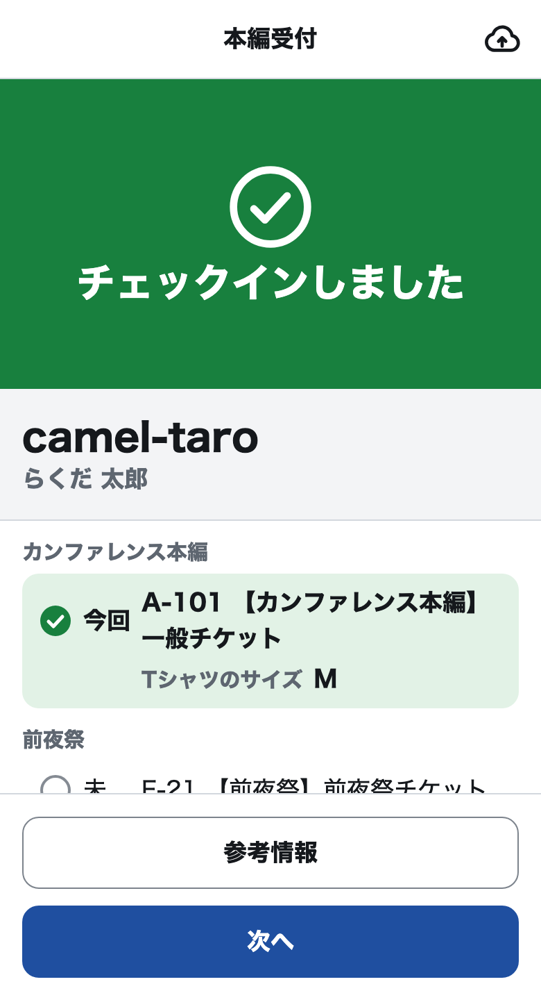

# QR コードを出せない人を受け付ける

来場者が QR コードを見せられないときは、名前やチケット番号で探して受け付けられます。

画面の画像は YAPC::Tokyo 2026 の例です。

## 手順

### 1. 「検索」を押して、名前かチケット番号を入れる

「検索」は、最初の画面と、カメラの映像が出ている画面の下にあります。文字を入れるたびに、当てはまる人が並びます。

名前の下には、その人のチケットの番号と、受付が済んでいるか（「済」か「未」）が出ます。

### 2. 来場者を選ぶ

一覧から来場者を押すと、その人のチケットが出ます。

青い枠で囲まれたチケットが、これから受け付けるチケットです。同じイベントのチケットを 2 枚以上持つ人では、受け付けるチケットを押して選びます。

### 3. 「検索からチェックイン」を押す

確認が出るので、名前とチケット番号を確かめて、赤い「チェックイン」を押します。

赤い「チェックイン」は、まちがって押すのを防ぐため、確認が出た直後の一瞬だけ押せません。

### 4. 緑の画面を確かめて、「次へ」を押す

QR コードを読み取ったときと同じ画面が出ます。「次へ」を押すと、カメラの映像に戻ります。

## うまくいかないとき

| 画面 | 意味 |
| --- | --- |
| 「該当なし」と出る | 入れた文字に当てはまる人が、アプリのデータにいません。チケット番号やユーザ名など、別の文字でも探せます |
| 「検索からチェックイン」のボタンがなく、「〇〇のチケットがありません」と出る | その人は、いまの受付で受け付けるイベントのチケットを持っていません。この画面からは受け付けられません |

---

[2. 受付をする](checkin.md)　／　[目次に戻る](README.md)
