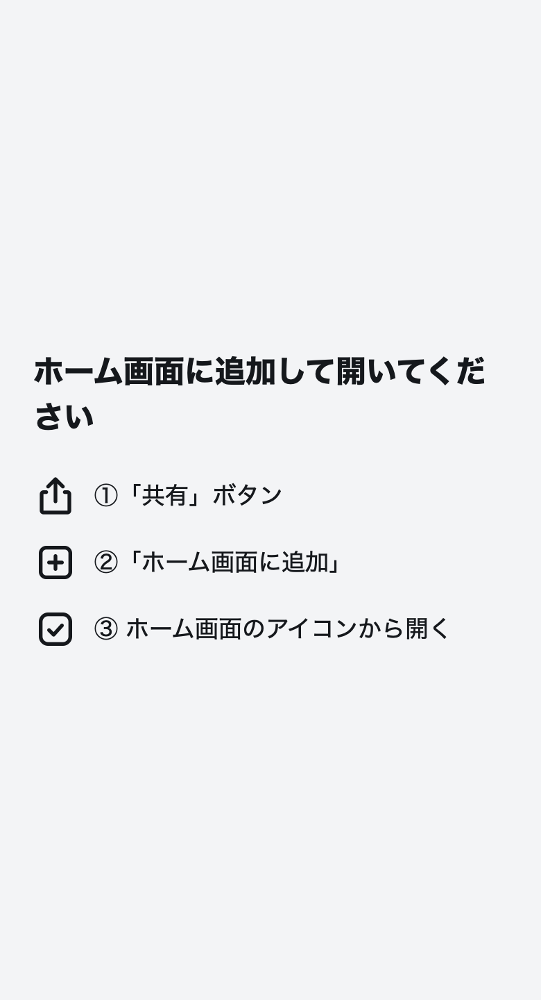
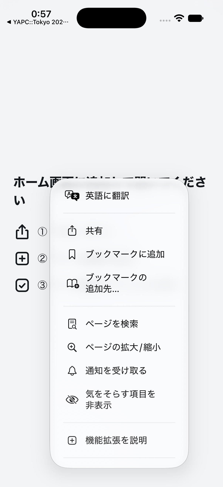
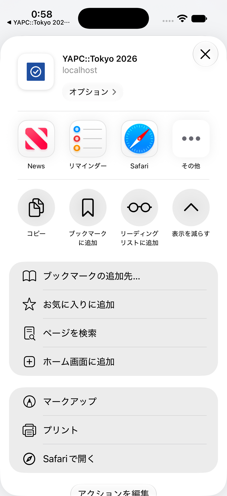
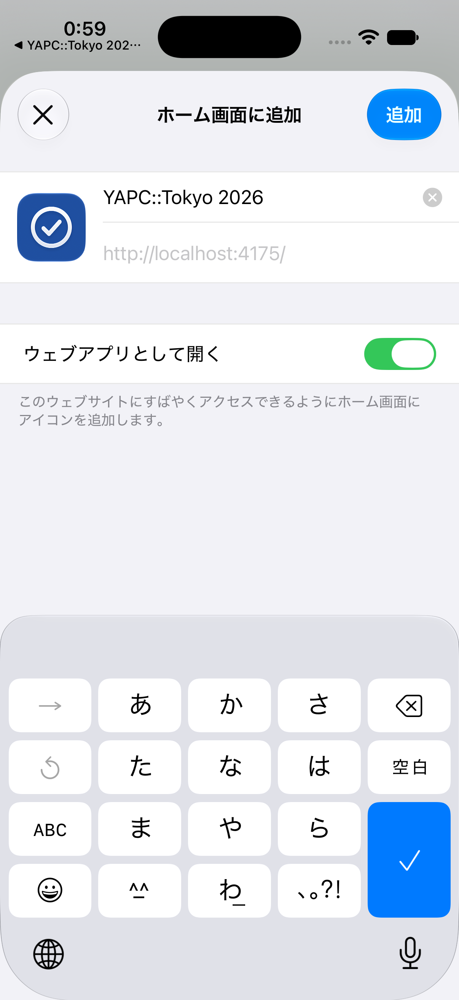
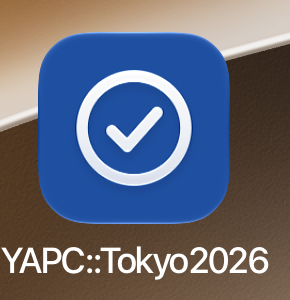
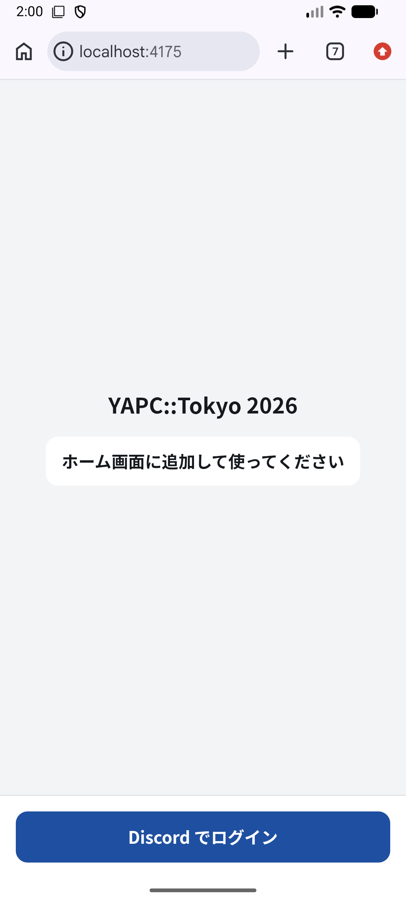
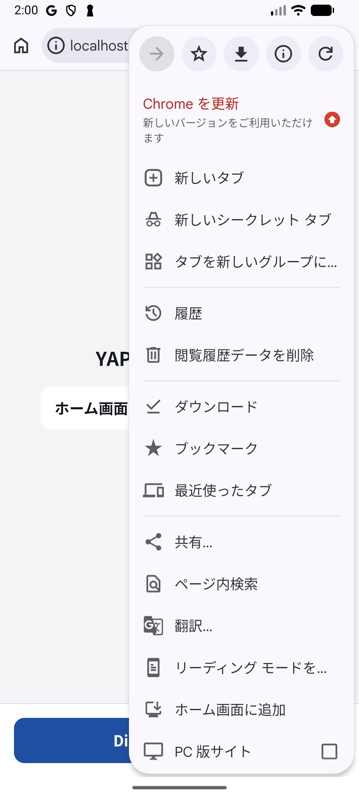
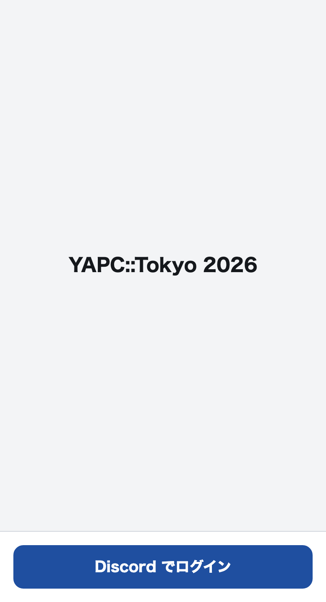
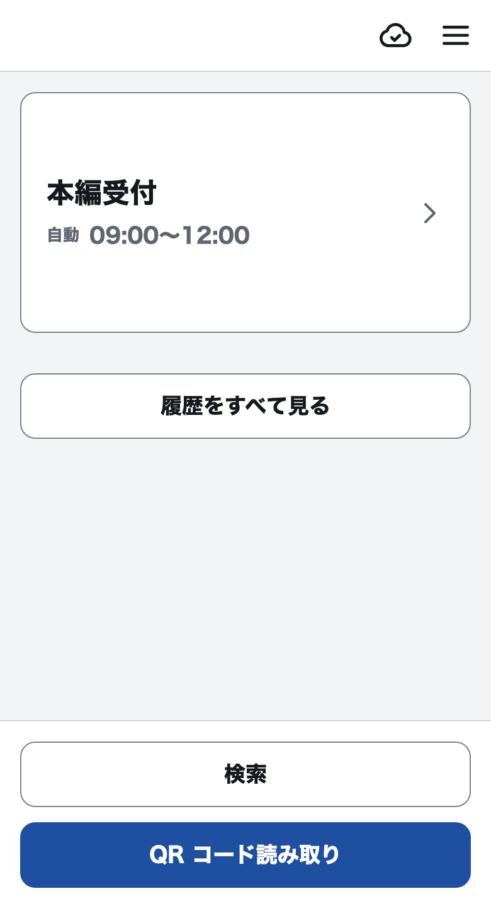
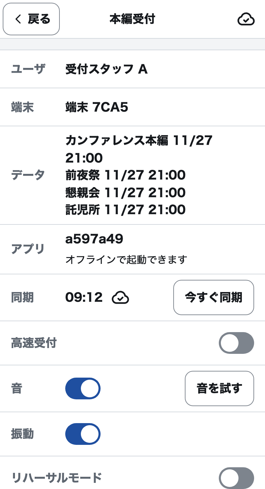

# 1. 準備する

アプリを使えるようにする手順です。Wi-Fi やモバイル回線がつながる場所で行います。準備が済んだスマートフォンでは、回線がつながらなくてもアプリが動きます。

画面の画像は YAPC::Tokyo 2026 の例です。

## 用意するもの

- 自分のスマートフォン（iPhone か Android）
- スタッフ用の Discord アカウント。受付スタッフのロールが付いている必要があります
- 受付アプリの URL（カンファレンスごとに違います）

## 手順

### 1. アプリをホーム画面に追加する

**iPhone の場合**

1. Safari で受付アプリの URL を開きます。次の画面が出ます

   

2. 画面の下のアドレス欄の左にあるボタンを押し、出てきたメニューの「共有」を押します

   

3. 「表示を増やす」を押して一覧を広げ、「ホーム画面に追加」を押します

   

4. 「ウェブアプリとして開く」がオンになっていることを確かめて、右上の「追加」を押します

   

5. Safari を閉じ、ホーム画面にできたアイコンからアプリを開きます

   

Safari の画面の画像は iOS 27 の例です。iOS の版によって、「共有」のボタンの場所や一覧の並びが違います。

iPhone では、ホーム画面のアイコンから開いたときだけ、アプリが使えます。

**Android の場合**

1. Chrome で受付アプリの URL を開きます。「ホーム画面に追加して使ってください」と出ます

   

2. 右上のボタン（「︙」。Chrome の更新があるときは赤い矢印）を押してメニューを開き、「ホーム画面に追加」を押します

   

3. 続けて出る画面で、インストールを選びます
4. Chrome のタブを閉じ、ホーム画面にできたアイコンからアプリを開きます

Chrome の画面の画像は Android 17 の例です。Android と Chrome の版によって、メニューの並びが違います。

### 2. ログインする

1. 「Discord でログイン」を押します

   

2. Discord の画面が出たら、スタッフ用のアカウントでログインして、連携を認めます
3. 「データを取得中」の表示が消えて、次の画面になれば、ログインは完了です

   

この画面が、受付アプリの最初の画面です。以後のページでは「最初の画面」と呼びます。

### 3. 準備ができたことを確かめる

1. 最初の画面の右上の「≡」を押して、メニューを開きます

   

2. 「アプリ」の行に「オフラインで起動できます」と出ていることを確かめます
3. 「データ」の行で、参加者のデータがいつの時点のものかを確かめられます
4. 「音を試す」を押して、音が 3 種類鳴ることを確かめます。鳴らないときは、スマートフォンの消音モードを切ってください
5. 左上の「戻る」で、最初の画面に戻ります

「アプリ」や「データ」の行に上と違う文が出ているときは、[困ったとき](troubleshooting.md#メニューに注意の文が出ている)を見てください。

## 知っておくとよいこと

- アプリの画面は縦向き用です。スマートフォンの画面の向きを縦に固定しておくと、使いやすくなります
- メニューの「ログアウト」を押すと、スマートフォンの中の受付の記録が消えます。まだサーバに送っていない記録も消えます
- Android では、Chrome のタブとホーム画面のアプリの両方で同時には開けません。後から開いた側に「別の画面で開いています」と出ます

---

次のページ: [2. 受付をする](checkin.md)　／　[目次に戻る](README.md)
