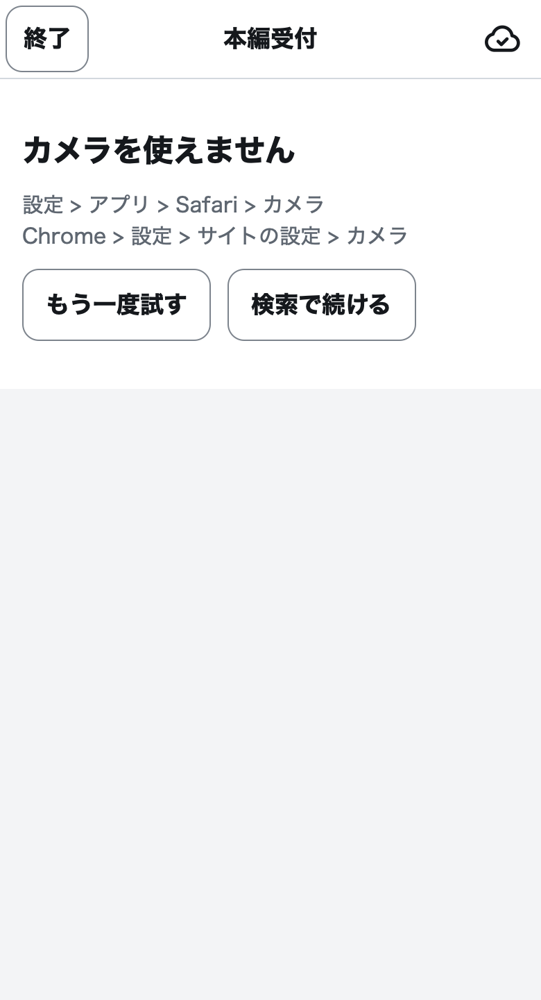
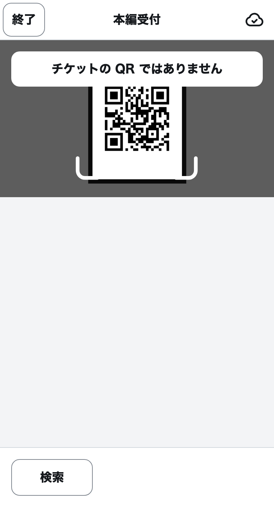

# 困ったとき

当てはまる項目を探して読んでください。

画面の画像は YAPC::Tokyo 2026 の例です。

- 受付の画面
  - [「QR コード読み取り」が押せない](#qr-コード読み取りが押せない)
  - [カメラの映像が出ない](#カメラの映像が出ない)
  - [QR コードを読み取っても進まない](#qr-コードを読み取っても進まない)
  - [音が鳴らない](#音が鳴らない)
  - [画面の上に黄色の縞が出ている](#画面の上に黄色の縞が出ている)
  - [受付の名前が違う、「手動」と出ている](#受付の名前が違う手動と出ている)
- 右上のマーク
  - [右上のマークの見方](#右上のマークの見方)
  - [もう一度ログインする](#もう一度ログインする)
- アプリを開いたとき
  - [ログインできない](#ログインできない)
  - [「別の画面で開いています」と出る](#別の画面で開いていますと出る)
  - [「エラーが発生しました」と出る](#エラーが発生しましたと出る)
  - [メニューに注意の文が出ている](#メニューに注意の文が出ている)

## 受付の画面

### QR コード読み取りが押せない

最初の画面の上の枠が灰色で、「受付なし」と出ているときは、受付の時間の外です。受付の時間になると、自動で受付の名前に変わり、押せるようになります。

### カメラの映像が出ない

「カメラを使えません」と出ているときは、アプリがカメラを使うことを許可されていません。

1. スマートフォンの設定で、カメラを許可します。設定の場所は、画面に出ています（iPhone は 1 行目、Android は 2 行目）
2. アプリに戻って、「もう一度試す」を押します

すぐに直せないときは、「検索で続ける」を押せば、名前やチケット番号で探して受付を続けられます（[QR コードを出せない人を受け付ける](search.md)）。

### QR コードを読み取っても進まない

映像の上に「チケットの QR ではありません」と出たときは、チケットではない QR コードを読み取っています。来場者に、チケットの QR コードを出してもらってください。プロフィールの QR コードや、名札の QR コードは、受付には使えません。

何も出ないまま進まないときは、次を試します。

- QR コードが、映像の枠の中に全部入るように、スマートフォンを少し離す
- 来場者に、画面を明るくしてもらう
- 来場者の画面に照明が映り込まない向きにしてもらう

それでも読み取れないときは、「検索」から受け付けます（[QR コードを出せない人を受け付ける](search.md)）。

### 音が鳴らない

- iPhone は、消音モードになっていると鳴りません。消音モードを切ります
- スマートフォンの音量を上げます
- メニューの「音」のスイッチがオンになっていることを確かめます。「音を試す」で、鳴るかを試せます

音が鳴らなくても、受付は画面の色と文字で確かめられます。

### 画面の上に黄色の縞が出ている

リハーサルモードになっています。このままでは、受付が記録に残りません。

「リハーサルモード」の札の「×」を押し、確認の「戻す」を押すと、通常のモードに戻ります。リハーサルモードの間の受付は記録されていないので、記録するには、通常のモードで受け付け直す必要があります。

リハーサルモードの使い方は、[練習する](practice.md)にあります。

### 受付の名前が違う、「手動」と出ている

受付は、時間に合わせて自動で選ばれます。受付の名前の横に「手動」と出ているときは、このスマートフォンの受付が、手で切り替えたものに固定されています。

自動に戻すには、次の手順で操作します。

1. 最初の画面の上の枠を押します
2. 「自動に戻す」を押し、確認の「戻す」を押します

画面の上に「〇〇受付になりました」と出たときは、時間になって、受付が自動で切り替わっています。操作は要りません。

## 右上のマーク

### 右上のマークの見方

画面の右上のマークは、受付の記録をサーバに送る「同期」の状態を表します。同期は自動で行われるので、ふだんは操作が要りません。

| マーク | 状態 | すること |
| --- | --- | --- |
| 雲にチェック | 記録はすべて送ってあります | なし |
| 雲に上向きの矢印 | まだ送っていない記録があります | 待っていれば、自動で送られます。押すと、すぐに送ります |
| 回っているマーク | 送っている途中です | なし |
| 雲に斜めの線 | 回線がつながっていません | 受付は続けられます。回線がつながると、自動で送られます |
| 警告のマーク | もう一度ログインが要るか、送るのに失敗しています | 受付は続けられます。マークを押すと、送り直すか、ログインの画面が出ます。ログインの画面が出たら、[もう一度ログインする](#もう一度ログインする)の手順に進みます |

マークが「雲にチェック」にならないときは、回線がつながる場所で、メニューの「今すぐ同期」を押します。

### もう一度ログインする

ログインには期限があります。期限が切れても、受付は続けられますが、記録を送れなくなります。

1. 回線がつながる場所で、右上の警告のマークを押します
2. 「Discord でログイン」を押して、ログインします

この手順では、スマートフォンの中の記録は消えません。メニューの「ログアウト」は使わないでください。

## アプリを開いたとき

### ログインできない

| 画面の文 | すること |
| --- | --- |
| ログインできませんでした | Discord でのログインが完了していません。もう一度「Discord でログイン」を押します |
| このアカウントでは使えません | ログインした Discord アカウントに、受付スタッフのロールがありません。「別のアカウントでログイン」を押すと、ロールのあるアカウントでログインし直せます |
| データを取得できませんでした、アプリのファイルを取得できませんでした | 回線がつながる場所で「再試行」を押します |
| ログインの期限が切れました。もう一度ログインしてください | 「Discord でログイン」を押して、ログインします |

iPhone で「ホーム画面に追加して開いてください」と出るときは、Safari で開いています。ホーム画面のアイコンから開いてください。アイコンがまだなければ、[1. 準備する](setup.md)の手順で追加します。

### 別の画面で開いていますと出る

同じスマートフォンで、受付アプリが 2 か所で開いています。受付アプリは、ホーム画面のアイコンから開いた 1 つだけを使います。

- ホーム画面のアイコンから開いた側に出たとき: ブラウザ（Chrome など）のタブで開いている受付アプリを閉じてから、「再読み込み」を押します
- ブラウザのタブに出たとき: そのタブを閉じて、ホーム画面のアイコンから開きます

### エラーが発生しましたと出る

「再読み込み」を押します。受け付けた記録はスマートフォンの中に残っているので、再読み込みしても消えません。

### メニューに注意の文が出ている

| 行 | 文 | すること |
| --- | --- | --- |
| アプリ | オフラインでは起動できません。ネットワークのある場所で、アプリを完全に閉じてから開き直してください | 回線がつながる場所で、アプリを完全に閉じてから、開き直します。ほかのアプリに切り替えて戻るだけでは直りません。開き直したら、メニューで「オフラインで起動できます」に変わったことを確かめます |
| データ | 空き容量が減ると、端末のデータが消されることがあります | スマートフォンが、アプリのデータの保持を保証していない状態です。そのままでも使えますが、空き容量が少なくなると、記録が消されることがあります。Android で Chrome のタブのまま使っているときは、[1. 準備する](setup.md)の手順でホーム画面に追加すると、解消することがあります |

「データ」の行の日時は、参加者のデータがいつの時点のものかを表します。新しいデータがあれば、同期のときに自動で受け取ります。メニューの「今すぐ同期」を押すと、すぐに受け取れます。

---

[目次に戻る](README.md)
