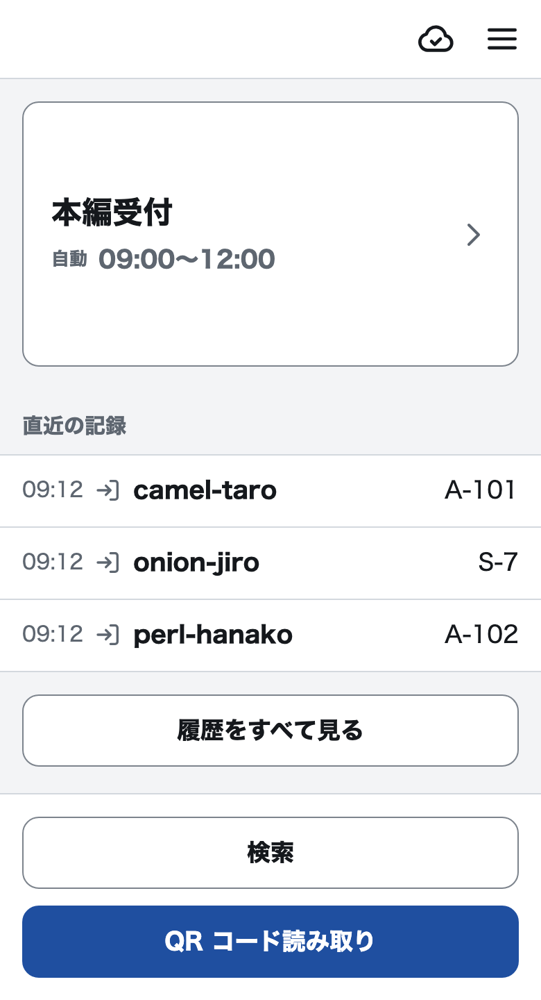
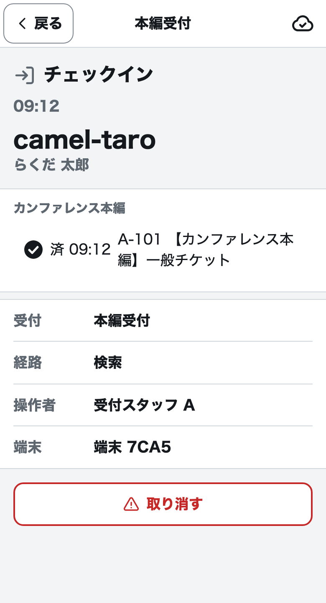
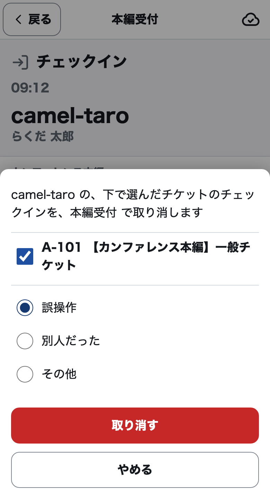
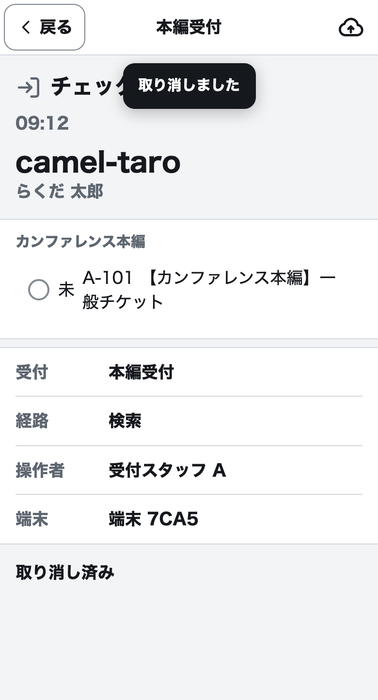

# 受付を取り消す

別の人のチケットで受け付けてしまったときなど、まちがえた受付は、取り消して、受け付ける前の状態に戻せます。

画面の画像は YAPC::Tokyo 2026 の例です。

## 手順

### 1. 最初の画面で、取り消したい受付を押す

カメラの映像が出ているときは、左上の「終了」で最初の画面に戻ります。「直近の記録」に、このスマートフォンで行った受付が、新しい順に並んでいます。

見当たらないときは、「履歴をすべて見る」を押します。ほかのスタッフの受付も含めた一覧が出て、名前やチケット番号で絞り込めます。

### 2. 内容を確かめて「取り消す」を押す

### 3. 理由を選んで、赤い「取り消す」を押す

理由は「誤操作」「別人だった」「その他」から選びます。「その他」を選んだときは、何があったかを文で書きます。

### 4. 「取り消しました」と出たことを確かめる

チケットの印が「未」に変わります。左上の「戻る」で戻ります。

取り消したチケットは、もう一度読み取れば受け付けられます。

---

[2. 受付をする](checkin.md)　／　[目次に戻る](README.md)
